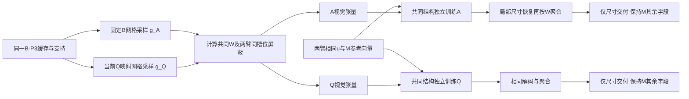

# 抓斗检测长短边精度优化专用记录

**S039最新完成（2026-10-19）：** S038固定B二维读取／Q对齐读取均完成24轮及全部48次完整VAL，独立回传复算通过，单卡GPU3自身显存监控峰值300MiB。两臂均无eligible，原规则描述性代表A20／Q20；Q20未超过共同控制且未通过尺寸／near／联动保护，结束本次对齐假设，不替换M。A20有Sim局部正结果；Q02仅Sim DFR未过的近合格事实单独保留，不倒改规则或重选。详S039.2—6；未运行TEST／深度。

**S038最新状态（2026-10-19）：** 已完成“固定B网格 vs 当前Q对齐二维区域读取”的具体设计；共同使用旧B-P3缓存、V式2800参数读出及仅最终尺寸监督，唯一受控因素为视觉读取坐标。共用支持掩码与固定输出位置表达，避免额外引入支持通道／几何输入差异。设计可形成有限对照，值得进入后续实现；实际缓存支持、坐标等价、梯度及效率仍待工程验证，尚未实现、运行或训练。正式M保持，详第8节S038；本条不覆盖旧实验的合同与结论。

**S033当前状态（2026-10-18）：** 已完成S011空间位置监督适配审查、论文/旧实现查重及完整TRAIN标签几何核查。原虚拟范围不等于实际GT位置，直接原GT投影又混入角度；二维解耦存在数学可能，但尚无完整中性/截断/离散解码及公平控制合同，未形成可实施候选，继续暂停尺寸头训练。仅新增审查代码并CPU运行，正式M保持，详第8节S033。

**S032当前状态（2026-10-18）：** A21/N18与M的保存TRAIN/VAL方向—幅度分解已完成。错误方向贡献VAL约87%—95%、TRAIN约75%—83%的正损伤量，且共同失败较多；尚无推理时可用的新纠错依据，不提出新候选，暂停当前后接尺寸头研究。正式M及既有局部正结果保持，本轮仅本机CPU分析，详第8节S032。

**S031当前状态（2026-10-18）：** 两臂各24轮及全部48次完整VAL已结束并回传核验；单卡GPU3训练进程峰值236MiB。两臂无eligible，缓存ep21/原生ep18仅为预定排序的描述性代表；原生有Sim局部收益，但Real、near保护和相对控制机制条件未通过，正式M保持，不自动接多尺度或追加训练。详第8节S031.5。

**S030当前活动已完成（2026-10-18）：** 原生P3适配审查及12个预定TRAIN视图无训练核查完成，7/11有输出视图检出新增空间自由度，1个原缺输出保持；第三张卡GPU2观测峰值618MiB。两臂合同已记录但训练器／全量新缓存未接入，未训练／TEST／深度，效果未验证；S028停止和S029目标保持，见第8节S030。

**S027现行目标与本阶段状态：** 改善最终框长短边及联合比例精度，保护准确观测；争取定位收益并保持检测能力，固定Raw-opt下游收益需独立验证。尺寸稳定改善且检测保持可作为尺寸回归结果，不称全面检测提升。已完成保存TRAIN／VAL的CPU联合核查：自然同帧取舍成立，人工条件证据不足以冻结下一训练候选；不加模块／loss、不训练／推理／重跑TEST，Unknown不用于选择。S025／S026身份保持；详见S027。此前S009／S025的阶段目标文字保留其时点，不覆盖本次明确更新。

**文件分工（2026-10-16合并后）：** 本文件保存改进过程、运行命令和未采用实验；[核心结果文档](尺寸精度主要结果与对比分析_20261006.md)保存固定基线与经验证、值得引用的结果。新活动追加在第8节，旧运行说明完整并入第9节，不再维护第三份同类文件。第9节旧命令、旧“当前／下一步”均保留原日期身份，不自动执行。

建立日期：2026-10-16。当前固定目标以S009为准（补充明确S008），状态证据见S006／S007，旧C有限核对与停止结论见S010，文献支持的新草案见S011（待比较），近年补查与适配合同见S012／S013，原流程完成与判断见S014、运行后评价协议修订见S015、三分量报告与现行流程见S016：直接优化预测框长短边精度；用已有检测指标共同评价收益与代价，不以mean_RIoU或AP75单项包办判断。已完成服务器只读状态核查及针对性TRAIN保存框分析；S007复现方向平衡合同的浮点精确比较问题；S011范围监督草案保留待比较；S013分布监督两臂已完成本地／GPU检查及各24轮，S014保留旧TRAIN门槛下的原判断；S015取消TRAIN准入条件，两臂全部48个epoch完整VAL已补评：R05有Real局部收益但Sim退化，D23两域尺寸／定位更差，仍保留M；训练更新0。S004尺寸J／预算及S005将尺寸仅列解释、mean_RIoU列唯一主目标的安排均不再作为当前合同；其历史正文保留。

**2026-10-17最新接续：** S019的I07身份保留；S020完成Sim定向分析；S021单边加权已完成本地／服务器检查及唯一24轮候选、逐轮完整VAL，控制原I24轮核验复用。两臂无严格可采用版本，描述性代表为uniform I21／加权ep15；记录局部取舍，正式M未替换。两次正式更新前工程停止及GPU数值等价协议修订全部保留，不改尺寸／检测门槛。S021训练阶段未访问TEST／深度；随后S023已按新增授权完成固定版本的TEST及三套历史深度描述性评价，身份及未采用结论保持。

**后续执行约束（2026-10-17用户更新）：** 直接在服务器`/media/omnisky/personal_files/ljj/symEOOD`、`mmrotljj`环境执行；不新建同级代码副本，也不在work_dirs放代码checkout。work_dirs仅保存结果和必要日志。后续新增深度推理／误差评价只用Unknown-02，Raw-opt不重拟合；已完成的Train-03／Fixed-dev历史结果保留。S024单次有限核查按本次明确授权复用三套历史保存结果解释分层差异，不重新推理或重复计算全局深度成绩。

**S025最新完成：** 七槽单边提案与repeat7控制均已fresh完成24轮和全部48次完整缓存VAL，合同事先冻结于main `8c21026`。同规则描述性代表C20／P07，两臂均无严格采用版本，保留M／原I07。P07对自然VAL两域均有相对M的连续尺寸与RIoU收益，但near长边保护及相对控制的Real代价未解决；详见第8节S025，不执行S004旧五槽／六轮／TRAIN门槛。

**S026冻结下游补评完成：** 按新增授权完成完整原图VAL一致性、检测TEST和仅Unknown-02固定Raw-opt评价。P07有总体检测局部收益，但准确边／逐视频代价仍在，Unknown米制MAE比M退化；未倒改S025采用结论或替换M。完整数值及复核见第8节S026。

## 1. 当前任务与记录职责

**本轮固定目标（2026-10-16，S009明确）：**

> 面向抓斗旋转框精定位，直接降低最终输出框的长短边估计误差，兼顾共同尺度与比例，并保护原本准确的观测；使用现有检测指标验证定位收益及附带代价。中心错位、漏检和连续失配作为保护项与已知局限，不要求本轮同时解决。

直接优化对象是规范长短边连续误差、共同尺度和比例误差，重点避免整体缩小、单向纠错及改坏原本准确的框。任务价值是提高抓斗旋转框的范围估计与精定位质量，服务小论文检测研究。**深度不作为本轮动机、选权依据或必要验收。**

当前工作服务于小论文中的抓斗旋转检测改进。具体改长短边误差，同时检查整体尺度、投影比例与原本准确框的保护；原因是边长偏差会使框过大、过小或比例失真。RIoU、DFR、ACI、MCML及现有覆盖／中心／方向指标共同说明检测收益和代价，AP50／AP75补充。中心严重错位、漏检暂作为保护项与局限，不要求本次尺寸优化同时解决；研究范围没有扩展成优化所有检测问题。深度留待大论文，不是本轮成功条件。可靠性继续封存，入口见[可靠性封存第15节](../obb/可靠性实验主要结果与对比分析_20261006.md#reliability-archive-20261016)。

本文件沿用2026-10-16建立的尺寸优化入口，现集中记录面向旋转框精定位的长短边回归优化目标、依据、验证、失败和决定；不新建重复记录，不改写历史实验职责。固定B／M及经验证值得引用的结果继续维护在[现有核心结果文件](尺寸精度主要结果与对比分析_20261006.md)；候选设计与未采用实验留在本记录。

S006／S007阶段仅授权服务器只读核查和保存TRAIN输出分析，该阶段边界保留在对应活动。S013收到新增明确授权：按适配审查固定有限对照，本地实现／验证、Git main提交同步、在用户确认的`/media/omnisky/personal_files/ljj/symEOOD`及`mmrotljj`运行，必要证据压缩回传、本地分析记录后清理本轮无用传输文件。只用一张卡，保留全部已有改动；不修改B／M检测器或可靠性、不读取TEST或深度、不改论文。方法假设、历史区别、尺寸及检测保护、预算、停止条件以S013冻结合同为准。

## 2. 固定起点与公平参照

| 对象 | 身份／职责 |
|---|---|
| B | SymEOOD＋等比例尺度增强，原VAL选择epoch24；检测前端参照 |
| M | B＋midpoint σ1.5／head_epoch03；当前工程版本与主要改进起点 |
| 新候选 | S013／S015的R／D未采用；S019的I07有VAL收益但未正式替代M；S020完成Sim定向分析；S021单边加权24轮无采用版本，保留M／原I07；S011范围占用未实施 |
| simple | 已封存可靠性基线；不承担本轮主优化目标或强制输出筛选 |
| Raw-opt | 保留现有深度公式及全部记录，留待大论文阶段；不作为本轮成功条件或必跑评价 |

B权重SHA：`8f8008c4944807a65ed0f2ee0cc348ea78690d54a4176944b2c9b0ebc83cec23`。
M头SHA：`16c2fb448ac4e1c53530b8086d547f6f6ccb8d6b0763a42391c34f9b337982d7`。
S006本轮在服务器对以上两个实际文件流式计算SHA，与固定身份一致；B配置及σ协议也与本地一致。只读取字节，不反序列化权重或构建模型；Git整体HEAD和dirty并不相同，详见S006。

固定检测划分：TRAIN2558（Real1810／Sim748）、VAL887（Real375／Sim512）、TEST1440（Real868／Sim572）。TEST已多次暴露；不以其选择新结构、损失权重、epoch或补偿规则。完整TRAIN拟合、完整VAL评价及选权，冻结后报告预定TEST版本；旧fit／probe／legacy／purged身份保留，不将历史结果改写为完整TRAIN实验，也不默认新增复杂数据角色。

新候选须同时与B和M比较定位、覆盖、连续性及几何分量，保持正式协议一致；只改善尺寸不能称整体检测改进，只恢复M相对B的某项代价也须如实标明。M已有中心、方向和重叠收益与尺寸代价分别保留，不根据已暴露TEST换基线。

## 3. 已确认的尺寸问题（直接优化对象）

### 3.1 完整VAL的固定参照

下表来自原尺寸结果及A045复核，本轮未重算。MAE是输出帧的绝对相对误差均值，正确覆盖以全部帧为分母。

| 域／方法 | 输出／全帧 | 双边≤10%正确／全帧 | 长边MAE % | 短边MAE % |
|---|---:|---:|---:|---:|
| Real B | 374/375 | 193/375 | 8.4208 | 8.7580 |
| Real M | 374/375 | 199/375 | 8.2202 | 8.4058 |
| Sim B | 512/512 | 489/512 | 3.8712 | 4.1388 |
| Sim M | 512/512 | 464/512 | 4.3216 | 4.3450 |

M相对B在Real净增6正确、Sim净少25，不能称两域尺寸一致改善。完整VAL的M尺寸正确共663帧，错误223帧，缺输出1帧。

### 3.2 误差方向、支持及监督限制

- VAL seq07长／短边平均有符号误差为−8.2657%／−8.3422%；seq14为+3.8969%／+0.7636%。方向不同，不支持统一放大所有框。
- TRAIN有71个尺寸错误，VAL有223个；但不能只统计超10%错误：综合诊断中，标准TRAIN fit已有137帧双边偏小≥3%、204帧双边偏大≥3%。这些是历史fit角色内计数，不冒充完整TRAIN相应总数。
- 旧连续尺寸候选C把上述两组都继续缩小，标准TRAIN2558帧中2554帧双边缩小。已有偏小样本也没有学出所需放大响应；这是具体行为证据，不能仅归因于新视频差异，亦未唯一隔离特征、监督、优化或权重原因。
- 所查真实TRAIN原标注快照均为两点轴线，短边按各视频固定比例生成，没有逐帧独立短边测量。生成一致性已经核验，独立物理范围对应仍未确认。不能直接断言标签错误、按预测误差改标签或要求全部比例等于Webots物理比例。
- 没有确认可直接使用的其他独立训练数据。pilot203已经做过可靠性数据增量，不当作未用新数据；四角点材料不因存在文件就成为已批准训练GT。不默认追加标注任务。

## 4. 历史路线与本次不得混淆的状态

| 路线 | 已完成事实 | 本次含义 |
|---|---|---|
| 训练尺度增强B | EOOD／SymEOOD×有无等比例增强四组已训练评价；改善Real覆盖／连续性，但有几何代价，已纳入正式B | 已做且采用；不能再将普通多尺度／等比例缩小当成尚未尝试的新方法 |
| 检测器中心—尺寸补偿D | 显式中心归一化＋双边log监督已接主检测头并正式训练；VAL修复严重错位，TEST未形成联合优势 | “给检测器增加尺寸loss”已做，不能仅换名称重跑 |
| 同中心形状监督E-H | 正式24轮、VAL选ep22及冻结TEST；尺寸／重叠代价、Sim退化，不替换B | 原E0设计与后来实际E-H分开；旧总记录中“E未实施”不是E-H最新状态 |
| 独立尺寸监督F-S | 正式24轮、VAL选ep18及冻结TEST；短边等局部改善，但TEST Real少21输出、正确中心少26，最长失败4→9帧 | 独立尺寸学习不只有200步支路；已经做过完整训练，不能以“以前没训够”概括全部历史 |
| midpoint解码尺寸辅助／GT相对motion／系数对照 | 已有静态尺寸、相对运动及七配置有限配对；部分短边或动态收益伴随Sim半尺度／RIoU／方向代价，未采用 | 不宣称midpoint历史只有四点监督；不自动再加相同比例或时序项 |
| midpoint σ参数 | 0.5／1／1.5按相同完整24轮、完整VAL规则各选权；当前σ1.5／ep03，收益与尺寸代价均已报告 | σ是读出先验宽度，不等于图像尺度增强；不据已暴露TEST重复扫参数 |
| A014独立双边log残差头 | 旧64图／128视图、200步；Real VAL正确199→190，Sim464→471，未通过联合门槛 | 不是未运行，也不是完整TRAIN正式实验；不原样重跑 |
| A048支持扩展＋双边／比例监督 | fit1942、200步；双边与双边＋0.25比例两组均未通过；Real正确197／199、Sim451／456 | 显式尺寸及比例监督已经试过，不宣称历史只有点监督 |
| 对边粗桶＋细偏移 | 已测，存在GT桶训练／预测桶推理差距，最终表现不佳 | 不只换名称重开同方案 |
| 连续概率读出C | 已实际训练，梯度连接成立；fit局部改善，probe／尺度偏差等失败 | 可微连接通过不等于纠错有效；全局缩小是双向纠错反例，不要求先彻底解释C才设计其他方案 |
| C实际下游诊断 | 港口TEST尺寸正确1089→1064；Fixed-dev深度MAE1.237245→1.317887m，Unknown-02 1.193163→1.268924m | 已完成负结果，不再次要求补这项测试；不能从TEST调补偿 |
| 纠错方向平衡单因素对照 | 已实现；S006现场发现旧GPU入口尝试：15测试、check／prepare通过，smoke在尺寸头优化前因曝光合同不一致退出1 | 工程入口失败，非尺寸效果失败；没有真实2步／200步／VAL成绩，不自动修复或续跑。旧“仅实现”是未收件状态，当前按S006更新 |
| 直接用B尺寸、保留M中心方向 | 已做离线固定来源替换；Real RIoU下降、Sim提高 | 不是已采用方案，也不是GT选择上限 |
| 均匀／高斯先验同容量对照 | 已完整24轮训练、VAL及冻结TEST；高斯有重叠／方向收益和部分尺寸代价 | 已有机制证据，不重复列为待补，不据TEST挑先验 |
| S013连续尺寸分布监督两臂（S014回传核验） | 完整TRAIN、每臂24轮／15,336更新、GPU工程通过；原流程两臂无TRAIN合格epoch、拟合VAL0；S015运行后修订取消准入，补评48轮完整VAL，TEST0、未采用 | R05有Real局部VAL改善但Sim长边／RIoU代价；D23两域尺寸／精定位更差，不自动延长或叠加模块 |
| S019几何条件交互I | 原I结构2712参数、完整24轮及逐轮VAL，I07有局部自然VAL收益；S023已完成固定版本下游描述 | I07保留研究参照身份，未正式替代M；不把几何条件交互再当未试方向 |
| S021单边权重平衡 | 同I结构／读出、候选24轮，旧控制核验复用；无严格采用版本，ep15仅描述；S023已做冻结下游报告 | 单边权重／near系数保持1已经试过，不等于准确边保护成立 |
| S004旧草案修订为S025七槽单边提案 | I结构、未加权loss，两臂fresh各24轮、全部48次完整缓存VAL；C20／P07均无严格采用版本 | 相对M有自然两域连续尺寸／RIoU收益，但near保护和Real相对控制代价未解决；不得包装为未实施或自动扩h／加轮数 |

旧原图边界及固定36帧审读也已完成；尚未隔离边缘提取、读出或可见轮廓与标注范围的因果。不能据此直接启动TEED或重标注。辅助OOF检测器和DINO停止状态保持。

历史入口：[活动A014／A048](../geometry_precision_activity_20261005.md)、[尺寸统一运行说明及7856帧综合分析](尺寸优化专用记录_20261016.md#legacy-size-run-doc)、[全链路交接第8节](../symEOOD_全链路统一交接_20261014.md)。7856帧包含不同职责的数据；不将其全部当作训练材料或独立样本。

## 5. 直接优化对象与论文检测评价（S009目标；S016明确报告流程）

### 5.1 改什么、为什么改、怎样证明价值

| 职责 | 本阶段要求 | 判断限制 |
|---|---|---|
| 直接优化长短边 | 减小两边相对误差MAE／P95，报告signed bias；检查共同尺度a、投影比例r，保护近正确框和双向纠错 | 不用bias正负抵消代表准确，不把比例变好、整体缩小作为成功；不新造尺寸J综合分 |
| 正确观测保护 | 报双边≤10%的错→对／对→错、近正确组误差及全帧正确覆盖；输出身份变化另列 | 不用净增数掩盖改坏原本准确框，不把新增／丢失输出硬拼为尺寸纠错 |
| 检测定位收益（采用依据） | 报既有全帧mean_RIoU、RIoU命中／尾部；AP50／AP75补充 | RIoU上升也可能来自中心／方向，不能代替尺寸直接目标；尺寸下降也不自动证明值得采用 |
| 稳定性与连续可用性 | 共同检查DFR、ACI、MCML_max／mean、TDR_w10、MRF及失败区间 | 保留各自正式分母；DFR／ACI含真实运动，MRF须注明未恢复事件，TDR100%仍可能连续失配 |
| 覆盖、中心与方向保护 | 输出覆盖、输出帧中心命中、全帧中心正确／RIoU命中覆盖；规范角与Sim协议／纯角RMSE分开 | 不靠丢弃困难帧改善均值；不要求本次尺寸优化补出漏检或修复严重中心错位 |
| 论文使用 | 用上述检测证据说明尺寸优化的实际收益与代价，B／M／新候选共同对照 | 不要求每视频每项都提升，不以单项优点追认整体成功；深度不纳入本轮验收 |

保护项不等于同步改善要求：若尺寸优化带来可用定位收益，中心、方向、覆盖及连续性保持原水平，可以构成有效改进。是否允许小幅代价、允许哪些代价，须在实施前明确；既不默认每项零下降，也不事后放宽。

本轮精度指**相对现有GT的二维标注框长短边回归精度／框范围一致性**。真实短边按视频固定比例生成，缺少逐帧独立测量；不能将回归改善直接表述为物理尺寸、真实可见轮廓或深度精度改善，也不因此自动转为重标注任务。

正式定义继续使用S005.1—S005.2已核对的`metric_protocol_v2`／`full_video_protocol_v2`；本次澄清改变评价职责，不改公式、阈值、分母、B／M历史权重或选权。原S005将mean_RIoU单列主目标、尺寸只作解释的安排不再生效。

### 5.2 方案实施前必须确定的合同

S013已固定一个监督单因素两臂对照，结果状态见后续活动；不从核查结果臆定成功幅度。候选实施前固定两边直接目标、共同尺度／比例及近正确框要求；再明确哪些既有检测指标承担预期收益、哪些作为保护、各项可接受代价及VAL选权。不得只规定mean_RIoU或AP75一个标准，也不另造加权综合分数。

同一版本同时比较B、M及必要的同预算控制，报告总体、Real／Sim和逐视频；输出身份变化须单列新增／丢失输出，不能硬拼成同框尺寸纠错。若只有局部尺寸改善而没有可用的检测收益，保留为局部几何结果，不优先作小论文新增检测贡献。

TRAIN按偏小、偏大、近正确与混合组记录实际交付变化，用于诊断，不作为进入VAL或参与选权的门槛（S015）；不只看loss、梯度连通或更新符号。完整TRAIN拟合、完整VAL评价及确定方案；旧fit／probe等仅保留历史职责，不改写旧实验已用数据。已暴露TEST只报告冻结版本，不选择结构、权重、epoch或规则。

**每次提出候选，先用三句话说明：**

1. **针对的误差：** 它针对哪项已经观察到的长短边连续误差、共同尺度或比例问题，以及需要保护哪类原本准确框。
2. **实质区别：** 它与最接近的旧方案在输入、监督、梯度范围、读出、数据或预算上有何可检验变化；若涉及共享特征或检测器训练，说明如何服务长短边目标及控制附带影响。
3. **有效性判定：** 用哪些尺寸指标验证直接目标，用哪些既有检测指标判断收益与代价，并在实施前固定保护项及停止条件。

实现范围不预先收窄为只改两个数的后处理头：可研究回归监督、特征读取或尺寸读出，但必须说明其如何服务长短边目标，并与旧路线形成可检验的实质区别；涉及共享参数时检查中心、方向等附带变化，不扩成全面检测器搜索。

检测指标参与评价不扩大方案范围：本轮不转为中心纠错、漏检恢复或时序研究。没有可验证的新假设时明确证据不足；不得通过更换目标、追加模块或降低保护要求延续实验。

### 5.3 深度与可靠性边界

深度留待大论文，不作为本轮动机、选权依据、必要成功条件或自动下游步骤。原Raw-opt参数、米制结果及Train-03标定／反复诊断、Fixed-dev开发、Unknown-02已暴露TEST职责保留；未来恢复时另定合同。没有港口米制GT，不声称真实测距改善。可靠性继续封存，FA、simple及size_accept不作为本轮成功条件或强制筛选。

### 5.4 现行评价流程与三分量报告（S016）

**后续统一适用（用户确认，2026-10-16）：** 后续本项目检测优化实验均执行本节完整流程与三分量报告合同。各预定epoch同时评价检测、中心／尺寸／方向及覆盖，保留总体、Real／Sim和逐视频结果；TRAIN诊断不作VAL准入条件。各候选仍须事先记录统一选权规则和采用条件，新增报告字段不自动增加淘汰门槛。历史协议保留原身份，不能覆盖本节现行要求；本次确认不启动训练、推理或TEST评价。

1. **TRAIN拟合与诊断：** 完整TRAIN训练，尺寸分组变化仅用于解释。工程身份、坐标映射和数值有效性仍须通过；TRAIN尺寸未改善不阻止完整VAL评价。
2. **完整VAL评价与选权：** 每个预定epoch评价完整VAL，候选与同预算控制采用一致的候选范围、排序和评价机会。每轮同时保存正式自定义检测指标、中心／尺寸／方向达标率及覆盖，不能等检测指标改善才查看几何。B24与M原权重固定；独立头与完整检测器的候选窗口差异如实披露。当前S015对每臂全部24轮的描述性排序及独立VAL采用检查保持其记录身份，本次不改变排序或数值门槛，也不以新增达标率重选已完成权重。
3. **冻结与复现：** 在VAL阶段确定结构、参数、checkpoint、输出规则及评价协议。真正执行检测链路的冻结评价须核对其VAL输出与选权时缓存的一致性；仅复算同一保存框不冒称在线推理验证。
4. **固定TEST完整描述性报告：** 后续另行执行时，对预定冻结版本与B／M及必要控制同时报告检测指标和三分量结果，无论改善或退化都保留。TEST已暴露，不据其重选epoch、阈值、规则或模块。本条是流程说明，不新增TEST执行授权。
5. **解释与论文呈现：** 检测结果说明定位、覆盖与连续性收益和代价；三分量达标率检查收益来源及其他分量退化。尺寸达标率／全帧尺寸正确覆盖为简明尺寸展示，长／短边MAE补充连续精度；P95、bias、a／r及配对错对变化保留作诊断，必要时正文／附录引用。不得隐藏反面分量结果，不将所有诊断指标逐一变成淘汰门槛。是否构成创新仍需历史区别和公平机制消融。

**三分量统一报告合同。** 规范长短边、长轴角及π周期处理沿用`port_simple_component_reliability_v1.py`的`canonical`／`geometry_errors`。中心误差严格`<15px`；尺寸最大双边绝对相对误差`≤10%`；方向周期误差`≤3°`且GT长短边比`≥1.2`。阈值固定，不是本轮新调参数；三项分别报告，不合成为一个分数，不引入可靠性筛选。

设N为全部有GT帧，O为有输出帧，G为GT方向可评帧，Oθ为其中有输出帧；Hc／Hs／Hθ为各分量达标数。报告Hc/O、Hs/O、Hθ/Oθ，均列整数分子／分母；另报O/N、缺输出N−O、Hc/N、Hs/N，以及方向资格G/N、方向可评覆盖Oθ/G和方向可评全帧正确覆盖Hθ/G。仅当G=N时，Hθ/G才等于全体帧方向正确覆盖；非可评帧不算方向错误，也不计为正确。分母为0记不可评价。几何分量集合可重叠，三项达标数不得相加。

总体、Real／Sim、逐视频均报告同一组字段；方向资格由GT固定，不随候选预测比例变化。缺输出单列，输出身份变化另报新增／丢失输出，配对错→对／对→错在共同可评输出上统计。Real方向仅表示现有二维标注长轴的一致性，不是独立物理方向真值；不与Sim正式A-RMSE罚角口径混写。完整定义与已核验B／M表见[核心结果第2.6节](尺寸精度主要结果与对比分析_20261006.md#geometry-component-reporting)。中心／方向作为保护与局限，不要求本轮同时改善；可接受代价在对应实验合同中确定。

## 6. 下一步与有限核对停止边界（S015选权修订；S016报告流程）

**当前以S025为准：** 七槽有限对照已完整结束，C20／P07未通过拟合前采用合同，正式M及旧I07身份保持。自然VAL局部收益、near代价、共同提案机制及全48轮证据见S025.2—6；本次不追加训练或自动进入TEST／深度。下方S015／S004阶段安排保留历史身份，不覆盖S025完成状态与停止结论。

**最新结论：** S013两臂各24轮训练已完成。用户于运行结束后修订协议，TRAIN双向纠错和near保护仅作解释，不再决定VAL准入；S015已对全部48个已保存epoch统一补评完整887帧VAL，训练更新0。全epoch同规则描述性选权R05／D23；R05有Real局部尺寸／RIoU改善但Sim长边／RIoU退化，D23两域直接尺寸及精定位更差，均无原VAL-only合格epoch，继续保留M。原S013／S014合同与记录作为历史保留，本次不倒写修订时点；不追加训练／模块、不读取TEST／深度。

**现行范围：复用有记录／结果路径的服务器状态和TRAIN证据，对旧方案中与长短边目标直接相关的失败行为做一次有限核对；重点检查双向纠错与准确框保护，判断是否有可验证的新假设。** 核对缺项先明确，所需证据不足才补；不将建议视为已执行。严重错位、漏检及连续失配用于保护检查和局限分析，不重新作为待选研究方向。

服务器只读核查与针对性TRAIN分析对应[S006.1—S006.4](#activity-s006)，方向平衡入口异常的复现对应[S007](#activity-s007)。这些是原核查时点的证据；S013／S015后续实际执行另有运行来源，不用S006快照替代当前远程进程、HEAD或模型身份核验。当前自然标准TRAIN的普通框低重叠样本集中seq05，方向敏感性强，与VAL尺寸敏感样本并不同分布；但连续尺寸偏差和需要放大的已见fit样本确实存在，不能称完全没有训练支持。旧C对这类fit样本仍改坏，而旧硬桶有局部修正响应，说明既有输入并非已被证明毫无可用信息，也不能把C失败全归于跨视频。

S010已复用原C的监督、分解、200×8调度和保存TRAIN文本完成有限核对：目标符号／轴映射及连续读出未见新增错接；总体loss下降仍伴随偏小组、near组代价，最终快照的共同尺度loss导数也不支持“始终偏好缩小”的简单解释。fine仅定位输出变化的主要分量，不能作为结构根因。**这项核对到此结束，彻底解释或修复旧C不是提出其他尺寸方案的前提。**

截至S010，仅凭旧实验核对尚无足以确定新训练候选的新增机制证据；S011的新文献草案属于待验证假设，不改变旧C的停止结论。方向平衡本来已经提出组贡献加权假设，不作为本次新方案；S007工程修复保留为可选维护，不再列作研究必须先做的步骤。不因代码现成、末位浮点问题可修复而自动续跑。S004同图扰动提案也不是新空白，真实误差代表性仍未验证，不原样继承旧200步、六轮预算或旧gate。若后续独立形成可验证的新尺寸假设，可直接按第5.2节设计有限对照；S010不追加模型加载、逐步梯度追踪或训练以追求旧C唯一根因；S013新增授权的加载／训练只服务新监督对照。

S004提案及其J／六轮预算继续后置；S005严重错位与漏检分析保留为保护与局限，本次不转向以修复它们为首要任务。当前证据足够结束本轮状态／支持核查，不再重跑整套VAL／TEST或重复7856帧综合分析。提出候选前，仍按第4节逐项与B、D、E-H、F-S、midpoint尺寸／motion及后接尺寸头比较输入、监督、梯度、读出、数据和预算；没有实质差异不启动。

## 7. 来源与后续记录格式

优先读取顺序：

1. 本文件第1—6节及最新S记录。
2. [尺寸主要结果](尺寸精度主要结果与对比分析_20261006.md)。
3. 本文件[历史运行存档](#legacy-size-run-doc)中的综合证据、连续头和未运行方向平衡合同。
4. [旧几何活动](../geometry_precision_activity_20261005.md)对应条目，不重复完整读取。
5. [midpoint方法](旋转ROI四边中点几何修正_midpoint_v1_方法与结果_20261003.md)、[同容量机制对照](midpoint_readout_v1_机制对照结果_20261012.md)、[AP口径](AP评价口径与运行说明_20261010.md)、[检测总记录](港口新数据集与EOOD_SymEOOD尺度增强实验总记录.md)。
6. [深度结果及传播分析](../webots/深度估计主要结果与误差分析_20261006.md)；小论文实际方法见`/Users/mac/Desktop/lunwenxiezuo/EAAI_Paper/main.tex`。

新增活动依次编号S001、S002……，每条记录：问题与假设、相对历史区别、授权范围、代码／数据／模型来源、实际运行与未运行内容、指标及得失、结论和下一步。失败实验留在本记录或原始活动，不自动进入论文成果表。正式结果和研究进度分开；不复制权重、缓存或大段旧日志。

### S001. 2026-10-16：从可靠性封存转回检测尺寸误差，创建专用记录

已读取截图中的尺寸结果、统一运行说明、检测总记录与midpoint方法相关条目，并按需核对A014／A048、综合证据、同容量读出及深度关系。确认尺寸优化历史并非只有单一头或缺少显式尺寸监督；方向平衡仅本地实现、无真实训练成绩，不能误记。

本轮交付为当前目标、历史状态索引及本专用记录；在旧尺寸结果和运行说明顶部补接续链接，原实验数值与历史正文保留。用户已有可靠性文档修改及专用交接删除状态保持。未修改模型、policy、公式或LaTeX，未连接服务器、训练、推理、提交Git或导出新结果。


## 8. 后续活动记录

### S002. 2026-10-16：三个尺寸文档合并为过程与核心结果两个入口

按用户要求，将旧尺寸运行说明收入本文件第9节；保留其独有的实验合同、来源、指标、失败分析、标注状态及命令，仅下移标题层级，不修改原数值或命令。原文件移除，项目内实际Markdown引用改指本文件存档；历史源码清单中的旧路径及旧SHA保留原义。后续新方案／运行／失败及解释集中追加本节，不再创建重复运行说明。

核心结果沿用现有尺寸结果文件，不再新建第三份结果文件；只有明确的基线或已验证增量进入其中，局部收益须同时交代代价，未采用候选不写成正式成果。没有新的尺寸性能或模型采用结论。

### S003. 2026-10-16：补齐更早尺度／检测器尺寸优化历史，防止重复

用户提醒此前已做尺度优化。本轮补查检测总记录第4／7节、旧几何交接及全链路第8.1节，确认此前不仅做过后接尺寸头，还完成尺度增强B、检测器补偿D、E-H形状监督、F-S独立尺寸的正式训练，以及midpoint尺寸／motion／先验宽度对照。第4节补齐这些路线；旧总记录的E0“仅设计”与后来E-H实测不能混用。前次只突出A014／A048的简表不足以覆盖完整历史，现已补全。

查阅入口：[检测增强及D原记录](港口新数据集与EOOD_SymEOOD尺度增强实验总记录.md)、[旧几何交接](../geometry_precision_handoff_20261001.md)第26节E-H TEST、第44节F-S TEST、第79／81／83节尺寸与motion对照；[全链路第8.1节](../symEOOD_全链路统一交接_20261014.md)提供跨路线摘要。旧交接已有较新条目覆盖其早期状态，阅读时以对应最终完成记录为准。

后续提出候选前必须列出与最近历史方案在输入、监督、梯度范围、读出、数据与预算上的实质差别，并说明该差别针对哪项已观察问题。仅换名称、增大网络、延长步数、再加双边／比例loss、重复扫σ或原样跑未采用尺寸头，都不自动构成新方案。旧方向平衡对照仅实现未实测；是否值得运行须另行论证，不作为默认下一步。当前没有启动任何重复实验，也未选定新训练候选。

### S004. 2026-10-16：固定参照补齐、C读出分解与同图成对尺寸提案草案

**授权与完成范围。** 本轮只读现行入口及所需历史、源码和保存结果，必要的文献检索后提出有限方案，并维护现有两个尺寸文档。没有修改模型／训练／评价代码、protocol、权重、标注、policy、Raw-opt或论文；没有连接服务器、调用模型推理、启动训练、执行历史命令或提交Git。已有文档修改、删除及未跟踪状态保留。以下方案是本轮新建议，**不是用户已经确定的实施合同，也没有新训练成绩**。

#### S004.1 恢复结果与历史查重

已读本文件第1—6节、S003、历史C及方向平衡合同，尺寸主要结果全文；按需核对检测总记录§4／7、旧几何交接§26／44／79／81／83、活动A014／A048、midpoint方法与完整同容量机制对照、AP统一报告、全链路§8及深度主要结果。没有展开可靠性全历史，没有将旧服务器状态冒充本轮现场状态。

确认B＝等比例增强B24，M＝B＋σ1.5／ep03。权重SHA沿用前述报告身份；本轮实际核对的是本地报告／逐帧文本字节，**没有核验实际模型文件SHA、配置可加载性或服务器目录**。完整VAL尺寸正确Real193→199、Sim489→464，总682→663；其中错→对29、对→错48。现行起点仍为M，同时要求新方案与B比较。

在[尺寸主要结果§2.1／2.2](尺寸精度主要结果与对比分析_20261006.md#fixed-val-size-results)补齐固定VAL两边P95／bias、共同尺度和比例、逐视频尺寸及配对转移、AP50／75、中心三个分母／均距离、规范方向、RIoU、DFR／ACI／MCML／MRF。全部是固定B／M的既有证据补齐，不是新方法收益。Real方向独立真值不足、Sim MRF无恢复事件未定义、AP服务器PR与源码清单未完整回传的限制保持；不填推测值。

**发现并纠正一项历史口径解释：** 第9节旧综合记录及`analyze_port_size_all_evidence_v1.py`的note称RIoU差异来自“帧加权／按视频平均”。本轮读源码确认综合分析只对`active`输出帧取均值，而正式评价器逐帧累积、缺输出记0；实际差异是输出条件分母374与全帧375。Real B／M的旧0.7976324533／0.7986960054各乘374/375，与原正式未舍入0.7955054450／0.7965661663分别差1.15e−8／1.70e−8，在既有1e−5几何核验容差内。核心结果补明这一点；第9节、旧报告及分析源码保持历史字节，不能继续把其note当成已核实的聚合机制。固定来源替换的旧RIoU数值仍是输出条件均值，其比较方向不受同分母换算影响。

历史路线状态核对结论不变：尺度增强已采用；D、E-H、F-S正式训练及相应冻结TEST已完成；midpoint尺寸／motion及七配置、三σ全24轮、A014／A048、粗桶与连续C均已实际运行；C港口TEST与固定公式深度负结果、B尺寸＋M中心方向替换、均匀／高斯同容量对照均已完成。方向平衡只有实现／本地检查，没有真实GPU训练成绩。边界审读尚未形成因果归类，不据此启动边缘网络、重标注、DINO或辅助OOF检测器。早期E0设计未实施不覆盖后来E-H的完成事实。

#### S004.2 新增只读诊断：单向缩小具体落在哪个读出分量

复用C的实际最终输出，不加载其权重。来源为`work_dirs/port_geometry_size_boundary_v1/port_geometry_size_boundary_continuous_v1_20261007_154944_1078779/finite/boundary_continuous/final_rows.jsonl`，SHA256＝`34c0df37f49a36027377a1a950886d8628e0aca0c34d1082882fcef3bb10a8fc`，与同目录`artifacts.json`相符；5116行含标准／半尺度各2558，标准2558均有输出且均实际接受C尺寸。此文件对应旧200步最终C，而非方向平衡候选。

源码`port_geometry_size_boundary_continuous_v1.py`及runner保存了两个连续分量：`coarse=E_p[grid]−E_prior[grid]`，`fine=E_p[fine_log]`，总残差为两者之和。对ROI两轴取平均即共同尺度log更新；轴交换不改变这个均值。逐轴相加与保存`delta_roi`在标准TRAIN上的最大差1.21e−8。下表均为**100×log更新**，不是边长普通相对百分比、MAE贡献或损失梯度归因。

| 标准TRAIN组 | 输出数 | coarse共同尺度均值 | fine共同尺度均值 | 合计约值 |
|---|---:|---:|---:|---:|
| 完整TRAIN | 2558 | −0.017313 | −0.698468 | −0.715781 |
| 历史fit全部 | 1942 | −0.017038 | −0.703552 | −0.720590 |
| 历史fit两边均偏小≥3% | 137 | −0.014799 | −0.674110 | −0.688910 |
| 历史fit两边均偏大≥3% | 204 | −0.017570 | −0.718416 | −0.735987 |

标准2558帧两轴概率众数全部为零桶（索引4），但softmax连续期望并不为零；不能称粗支路完全未学习。fine的共同尺度分量2558/2558为负，均值幅度明显大于coarse，说明**本固定快照的缩小主要表现于fine读出**。这不能区分终端bias、输入特征、样本贡献或优化的因果，不能据此直接去bias、删fine、换先验或扩网络。此分解只在TRAIN完成，未新增C的VAL／Train-03或再诊断其TEST。

另按已有方向平衡的描述定义，在**完整TRAIN原始身份**上核对实际交付误差：两边绝对相对误差均≤3%先归near，其余两边均负归偏小、均正归偏大，其余mixed。阈值复用历史诊断以便对照，不用于新方案采样权重。下表不是旧200步曝光槽数，也不是1942 fit组；半尺度缺输出4帧另列，未计入组均值。

| 视图／M误差组 | 输出数 | 长边MAE % M→C | 短边MAE % M→C | mean(abs(a))×100 M→C | mean(abs(r))×100 M→C | 错→对／对→错 |
|---|---:|---:|---:|---:|---:|---:|
| 标准／偏小 | 415 | 4.2515→5.0643 | 4.5516→5.0662 | 4.5464→5.2412 | 3.0112→2.8253 | 0 / 6 |
| 标准／偏大 | 663 | 4.6377→3.7270 | 3.8168→3.2783 | 4.0692→3.3356 | 2.6601→2.4509 | 10 / 0 |
| 标准／near | 1080 | 1.3872→1.3514 | 1.3249→1.3517 | 1.0163→1.0951 | 1.6709→1.5453 | 0 / 0 |
| 标准／mixed | 400 | 3.6288→3.2614 | 3.1797→3.1265 | 1.6267→1.6116 | 6.8110→6.3230 | 3 / 2 |
| 半尺度／偏小 | 696 | 4.6597→5.0078 | 5.2845→5.6374 | 5.1582→5.5219 | 3.7407→3.4537 | 3 / 7 |
| 半尺度／偏大 | 611 | 5.3808→4.9880 | 5.3442→4.9308 | 5.1607→4.7661 | 3.4232→3.1873 | 21 / 5 |
| 半尺度／near | 728 | 1.3893→1.3885 | 1.4021→1.4942 | 1.0241→1.1240 | 1.7148→1.6761 | 0 / 0 |
| 半尺度／mixed | 519 | 4.0397→3.6815 | 3.8069→3.6791 | 1.9621→1.9765 | 7.8611→7.3052 | 10 / 1 |

标准转移合计13错→对、8对→错，与2487→2492一致；半尺度为34／13。可以同时看到比例改善、偏小组恶化及near连续尺度恶化，因此不能以缩小符号、loss下降或10%正确净增加代替有效双向纠错。完整TRAIN分组包含旧probe／legacy等，旨在描述已保存C响应；不改写它们当时未进入梯度的事实。

#### S004.3 唯一优先候选：同图成对尺寸提案训练（待评审，未实现）

**有限假设。** 在固定图像证据下，让同一目标的输入尺寸提案向两个方向变化、标签相应变化，可能比仅对每图一个自然M框学习残差更容易建立条件纠错。现有证据只支持检验该假设，不证明C因缺少此训练而失败，也不证明固定9×9 ROI有足够独立尺寸信息。自然M框的TRAIN／VAL效果是必要验收，人工提案恢复不能单独晋级。

这里的“提案”是同一已输出目标的虚拟尺寸输入；不引入其他检测候选、NMS、得分重排、在线多框选择或GT在线输入。首轮保留现有B定向ROI，不新采集图像、不扩大ROI、不增加分辨率。若需要新增图像信息，应另立假设，不在本项失败后自动叠加。

| 查重维度 | 最近旧路线 | 本草案的实质变化／保持项 |
|---|---|---|
| 输入 | A014／A048／C为每个视图一个自然M几何；C已对多个桶位置采样 | 同一ROI内增加相对自然M的成对虚拟尺寸输入Q；逐Q重算对边采样与几何量，不将九个读出桶误称为已经做过这种训练输入扰动 |
| 监督 | 已有双边log、比例及C连续读出监督 | 保持双边SmoothL1，不新增loss；目标改为相对每个Q的`log(GT/Q)`，而非所有虚拟输入继续使用`log(GT/M)` |
| 梯度范围 | A014／A048／C只训尺寸头；D／E-H／F-S允许检测器更新 | 仍只训与C同容量的2760参数头；B、M、P3／ROI全部detach，不恢复检测器训练 |
| 读出 | C已做9桶连续概率均值＋fine，中性初始化 | 保持同一数学读出、先验、stem与终端；仅分离自然M身份校验、内部虚拟Q及最终交付，不能直接关闭旧保护来迁就虚拟Q |
| 数据 | 旧C fit1942，probe／legacy／purged不进新头更新 | 新合同完整TRAIN2558身份拟合，标准＋既有半尺度视图；两臂同样使用完整TRAIN，旧角色仅保留追溯，不当独立泛化集 |
| 预算 | 旧C固定200步；方向平衡旧合同两臂各200步 | 两臂同初始化／顺序／更新／提案槽数，固定最多6轮完整TRAIN；不与旧200步绝对差异作因果比较，不宣称加训本身解决问题 |

与**方向平衡**的可检验区别：后者仅改变既有自然框各组loss贡献，不产生同图不同尺寸输入。本草案若只改善虚拟Q，或不能超过同预算自然输入控制，假设不成立；不把方向平衡列为必须先跑的步骤。本轮不另提第二个训练候选。

**输入、标签与输出草案。** 在原图M的固定raw轴身份上定义log尺寸扰动集合`P={(0,0),(h,h),(−h,−h),(h,−h),(−h,h)}`，固定`h=0.0625`（原C桶间隔0.125的一半，约6.45%放大／6.06%缩小），不搜索幅度。令`Q_edges=M_edges*exp(p)`，中心／raw角／分数和B旋转坐标系不变；GT长短边先按自然M身份分配一次，随后目标`t_Q=log(GT_edges/M_edges)−p`。虚拟Q近方形或交叉时不重新排序标签；不把真实物理L/S当目标。

head只接收同一ROI／support、当前Q相对B的几何量及对边空间读取；不额外提供p、扰动分组标签、原始M尺寸副本、GT、域／视频／时间。这样避免通过显式扰动码直接反推自然M。输出为相对Q的两条连续log残差，训练恢复尺寸`Q*exp(delta(Q))`，GT只进离线损失；推理**只调用p=0的自然M一次**，输出仍为M的中心、规范方向、score及缺输出身份，尺寸整对保护失败回退M。

虚拟Q不是真实冻结M，现有`checked_midpoint`与`size_targets`不能直接拿Q替代M：前者有B边界，后者会按输入尺寸排序分配GT。后续若实施，须保持自然M校验及最终B边界／ROI／方向／次序保护，另做内部Q几何合同，两臂共用该包装。不得把内部Q先回退成M、按GT裁掉难目标，或把训练前保护的candidate收益当最终交付收益。越出ROI的采样按既有support处理并完整计数，不能由GT选择是否扰动；正负proposal有效支持及原始未扰动框可达性须先通过静态核对，若几何映射不成立则不进入训练。

**数据与公平控制草案。** 比较B、M、控制C0及扰动C1。C0每个自然视图重复5个p=0槽，C1用上述5个槽；各原视图先对5项loss平均，再对逻辑batch平均，每次只更新一次。两臂使用同样全部TRAIN、相同初始化seed1703、相同顺序／Adam lr0.001／beta0.1／clip10、无比例／质量／深度／motion项。C0是新数据／预算下的必要归因控制，不冒充重现旧200步C；若两臂都改善，只能把C1相对C0的增量归于提案组织。

保存行显示标准2558／半尺度2554有M输出，4个半尺度缺输出只评价覆盖、不制造框；共5112可监督视图。旧`eligible_train`只有5103个true，且精确GT尺寸越原B边界的标准／半尺度分别1／7帧；新完整TRAIN合同不能无说明沿用旧eligible过滤。草案对所有有输出且数值有效视图计算未裁剪GT尺寸loss，另外报告不可达目标及最终回退。它不等于新增独立GT或修正真实短边合同；实际缓存张量存在性及身份本轮未核验。

**预算、TRAIN检查与VAL选权草案。** 每轮完整遍历5112个有输出视图、逻辑batch8（每批最多40提案槽），639次更新，单臂最多6轮＝3834更新，两臂总7668；若实际核验发现数量不符则停并先修正合同，不偷偷补样本。单卡顺序执行两臂；2步工程smoke各自丢弃，不计正式效果；不重载旧C失败权重。6轮是有限上限，不是收敛或充分训练的证明，不因未通过延长预算。

每轮先在未经扰动的完整TRAIN及原四组上统计实际交付：偏小／偏大各组mean(abs(a))都须低于M；near不得新增双边10%错误，mean(abs(a))不得增加；mixed两边平均相对MAE和mean(abs(r))不得增加；标准／半尺度、Real／Sim分别检查并保留支持数。另报每组两边MAE／P95／bias、a／r及转移、回退和不可达数。缺必要组支持不能当作通过。该检查基于实际误差，不要求逐帧delta同号，不使用loss下降替代。虚拟Q仅作机制表，不参与正式尺寸成绩。

六轮完成后，若C1最终轮仍未通过自然TRAIN双向纠错检查，保存结果并结束，不加载VAL张量、不进入TEST或深度。通过后才对两臂六份固定epoch各评价同一完整VAL887；只有已通过TRAIN检查且满足下述VAL保护的epoch可选。按`J=(Real长MAE+Real短MAE+Sim长MAE+Sim短MAE)/4`最小选权（误差为相对量，域等权）；数值tie依次取双边正确总数更多、epoch更早，不加事后综合权重。C0同规则独立选权；无合格epoch保留M。此为拟议规则，尚未运行或预先锁定到实现产物。

**主指标、保护及可接受代价草案。** 所有条件须在实施前一并确认，不能运行后放宽：

- 主连续指标为上述J；C1还须在Real／Sim各自的两边平均MAE严格低于M及B，且相对同预算C0的J严格更低。仅修复M的Sim代价、仍不超过B不能称解决原检测尺寸问题。
- 每域双边正确数不低于M与B较高者，即Real至少199/375、Sim至少489/512，至少一域严格增加；报告每个对照的错→对、对→错、共同正确、缺输出，以及新增／丢失输出身份。这里是建议的验收底线，不是预测能达到的收益。
- 硬保护：自然推理逐帧中心、raw及规范方向、score、输出身份精确继承M，新增／丢失输出均0；分别核对中心三个分母。两域正式RIoU、AP50／AP75不低于M；MCML_max／mean不增，TDR不降。角度和ACI应按身份保持；Real无独立物理角度精度结论。所有失败仍进入全帧统计。
- 连续尺度／比例保护：两域mean(abs(a))及mean(abs(r))不高于M；两边P95允许相对M最多增加0.5个百分点，DFR允许相对M最多增加5%，均同时展示相对B的得失。此0.5／5%是本草案明确的工程取舍上限，**没有实证证明其应用可接受性**；不是噪声容差或从TEST调得。若不接受这项代价，须在实施前改成更严合同。逐视频完整报告，不要求每个视频每一项都胜出；不能用域平均隐藏某视频新增连续失配。数值比较容差另按既有几何核验固定，不能把数值容差算作收益。

**停止与下游顺序。** 来源／轴映射／中性p=0回放／冻结梯度／序列化／支持检查失败先停；最终自然TRAIN机制不通过、VAL无合格epoch、C1不优于C0，均结束此项并保留M，不自动去fine／改先验／平衡权重／解冻／扩大网络或换种子。若只得到人工扰动恢复，结论只限训练辅助任务可学。通过几何条件后再提出冻结候选的完整描述性TEST及Raw-opt评价，TEST不重选结构／epoch／规则。

Raw-opt首轮继续固定`c9c14fc1b09ba8223996121425e302888ac7d44213192225acd5365fb2f1ffe2`所绑定的公式／参数；报米制MAE、RMSE、bias、P95、有效数值覆盖和逐帧增减，q越支持仍进入主统计。Train-03标定／反复诊断、Fixed-dev开发、Unknown-02已暴露TEST职责不变，三者不选择上游方案。没有港口米制GT时不声称真实测距改善；不强制用可靠性或size_accept筛输入。效率另报告新增头及完整链路延迟，不能将缓存训练耗时当推理FPS。

#### S004.4 文献依据、证据核验及当前决定

定向读取[DN-DETR作者论文扩展版§IV-C](https://arxiv.org/html/2203.01305)及[官方实现说明](https://github.com/IDEA-Research/DN-DETR)：可借鉴的是训练时扰动框再恢复标签、推理去除辅助输入的组织。其原任务着重DETR匹配与收敛，使用带噪GT查询；本草案使用冻结M周围的尺寸输入及已固定单目标对应，不移植其Transformer、类别去噪或性能结论。官方README已读，链接的具体`dn_components.py`网页本轮404，未声称逐行核验官方实现。另核对[Cascade R-CNN作者摘要](https://arxiv.org/abs/1712.00726)的回归阶段输入分布／重采样观点，仅作训练与输入质量需要匹配的提醒，不据其结论宣布当前根因或引入在线级联。论文有效不替代本项目的自然TRAIN／完整VAL证据。

本机只读核验包括：C最终行SHA与artifact一致；源码读出和保存字段一致；coarse＋fine与实际delta数值相符；完整TRAIN标准／半尺度四组实际误差与转移复算；固定VAL六组（总体、两域、三视频）两边MAE／P95／bias及a／r绝对均值与既有综合证据最大差2.78e−17、整数正确数／转移一致。VAL／TEST两份AP原生报告SHA分别`6e682f64824fe0b68bbe6b49276ebf7d147fe9891a70b0fe3d7f7757b4bc7d34`／`faac1587e26f17e562130f8b3bc0bf37ba261d6a2113dbb42fd69f6ee980c140`，与原记录一致；未重算AP。机制对照VAL／TEST的`compare.json`、`gaussian_summary.json`和`gaussian_rows.jsonl`逐份匹配原artifact清单。本次读取TEST仅补核固定报告来源，没有对C新增TEST统计或用其选择新参数。

新增诊断结果只写本过程记录；核心结果只补固定B／M参照。未新建第三份记录、结果目录或持久分析脚本；未改模型代码，不重复未变化版本的训练测试。文献、有限协议、允许结论及失败出口集中在本条，按用户要求不另建skill建议的plan／table／figure文件。本轮没有撰写论文Results／Discussion或生成mock数值。

**当前决定：保留B／M及全部历史；仅推荐评审这一项同图成对尺寸提案草案，不启动它，也不自动恢复方向平衡。** 优先方案的新增信息是同一图像下可控的条件纠错监督，不是新独立场景／真实短边测量；是否值得进入实现仍取决于对其输入可达性、预算和代价合同的确认。没有唯一确定根因，没有新的已采用尺寸模型。

<a id="activity-s005"></a>

### S005. 2026-10-16：转为小论文旋转检测定位目标，核对正式指标与VAL失败分层

**当前决定。** 按用户新目标修订第1／2／5／6节，以现有自定义定位、有效观测覆盖与连续性评价为主；尺寸作为几何解释，AP50／AP75补充，深度留待大论文。S004全部诊断及候选正文保留为历史，尺寸J分数、尺寸正确数门槛、六轮预算和深度继续条件不再生效；不据本轮目标变化恢复任何旧实验。本轮未选定训练候选。

**范围。** 读取正式方法／论文指标段、评价器及历史版、正式B／M的VAL原始行和摘要；仅CPU回放保存框的评价与离线GT分量替换，没有图像模型推理、权重读取、训练／梯度更新、服务器连接、TEST新统计或论文修改。沿用两份现有记录，不新建结果目录、分析脚本或重复过程文件。

#### S005.1 正式口径、全称与公式

核对来源：[检测总记录§5](港口新数据集与EOOD_SymEOOD尺度增强实验总记录.md)、midpoint方法及同容量对照、论文`main.tex`的`sec:metrics`／`tab:metrics-def`；实际采用[评价器](../../crane_project/tools/eval_crane_offline.py)的`METRIC_PROTOCOL_VERSION=2`。所查正式资料给出RIoU英文展开，但没有为DFR、ACI、MCML、TDR、MRF提供统一英文全称；下表列项目公式对应的中文功能全称，保留既有缩写，不凭缩写补造英文名或换口径。

设有GT帧集合为G、N=数量；输出帧为O；`u_t=RIoU(pred_t,GT_t)`，缺输出取0；`h_t=1[有输出且u_t≥0.5]`；原图中心距离为`c_t`；`δπ`为180°周期最小角差，范围0—90°。规范轴与原始raw宽高／角关联分开，正式离线视图先转为规范长轴表示。

| 既有缩写／中文功能全称 | 实际公式／优劣方向 | 单位、分母与缺输出处理 | 主要代码入口 |
|---|---|---|---|
| RIoU：rotated intersection over union，旋转交并比；mean_RIoU为全帧平均 | `area(P∩GT)/area(P∪GT)`；`Σ_G u_t/N`，越高越好 | 无量纲；全部有GT帧，缺输出记0；不按0.5删除低重叠帧。输出条件均值另为`Σu_t/数量(O)` | `compute_riou`，`_compute_sequence_metrics`，`_aggregate_test` |
| R_center：中心正确率／覆盖，须标明三个口径 | `H=Σ1[输出且c_t<15px]`；输出命中`H/数量(O)`、输出覆盖`数量(O)/N`、全帧正确覆盖`H/N`，均越高越好 | 比例／%；缺输出不计H、保留在N。终端R_center实际是H/N，不能直接标作H/O | `_compute_sequence_metrics`／`_aggregate_test`；正式封装`summary`另存三个分母 |
| A-RMSE：协议角度均方根误差（Sim） | 有输出且中心`<10px`时用δπ(pred,GT)，否则赋90°；`sqrt(Σ_Gsim err²/Nsim)`，越低越好 | 度；全部Sim GT帧，包含缺输出及中心门控惩罚。与中心15px阈值不同；纯角RMSE另按全部输出、不加罚 | `angle_diff`，`_compute_sequence_metrics`，`_aggregate_test`；`decompose`记录纯角和罚角 |
| DFR：帧间对角线相对变化率 | `d_t=sqrt(w_t²+h_t²)`；`100×mean(abs(d_t−d_prev)/d_prev)`，既有协议取越低越好 | %/采样帧；同视频、编号差1且两帧均有输出的有效帧对。缺输出打断配对；不是漏检率，也不是GT校正抖动 | `obb_diag`，`_compute_sequence_metrics` |
| ACI：方向一致性指标 | `mean(clip(1−δπ(theta_t,theta_prev)/(35°+数值epsilon),0,1))`，越高越好 | 无量纲；与DFR相同有效相邻帧对，缺输出打断配对；35°是原归一化尺度，不是新方向准确门槛 | `angle_diff`，`_compute_sequence_metrics` |
| TDR_w10：10帧窗口至少一次检测命中率 | 每个长度10滑动窗口取`any(h)`，再按窗口平均，越高越好 | 比例，终端以%显示；分母为各连续输入片段`max(0,L−9)`之和。缺输出记未命中；无窗口时未定义，不记100% | `_compute_sequence_metrics`的`tdr_hits`；`_aggregate_test` |
| MCML：片段最大连续失配长度 | 片段j的`L_j=max连续(h=0)长度`；MCML_max=`max L_j`，MCML_mean=`ΣL_j/片段数`，越低越好 | 采样帧；无失败片段以0参与mean；无输出或RIoU<0.5均失配。`pass(limit=5)`只是max≤5的指示，不等于无失败 | `_split_contiguous_frames`，`_compute_sequence_metrics`，`_aggregate_test` |
| MRF：已恢复失配事件长度均值 | 从第一次失配位置i到首次恢复命中位置j，事件长`j−i`；对已恢复事件平均，越低越好 | 采样帧／已恢复事件数；片段尾部未恢复事件不计，须另报；无事件未定义，不填0 | `_compute_sequence_metrics`的`miss_start`／`mrf_vals`；`_aggregate_test` |

代码定位：`angle_diff`第44行、`compute_riou`第57行、`compute_metrics`第220行、`_aggregate_test`第283行、`_compute_sequence_metrics`第308行、`_split_contiguous_frames`第400行；[正式summary封装](../../crane_project/tools/eval_port_geometry_midpoint_v1_test.py)第350行；[分量诊断](../../crane_project/tools/audit_port_train_val_geometry_v1.py)的`canonical`／`decompose`第40／55行。名称中带旧test的封装在此仅被复用计算，不能由文件名判断数据划分。

**边界与统计对象。** 先按domain／video及frame_id排序；视频改变、frame_id不是前一帧＋1、无GT帧均形成连续输入片段边界，不能跨越计算窗口或失败段。**有GT但预测无输出不切断MCML失败段**，仍以h=0进入同片段；它只打断DFR／ACI的相邻输出配对。失败事件是同片段内极大的连续h=0区间；片段末仍失败者为未恢复事件，不进MRF。帧号邻接只证明编号连续，重命名／采样台账中的真实时间缺口不能据此抹去，也不将帧数换算为控制容忍秒数。

域内／总体的静态指标按GT帧、DFR／ACI按有效帧对、TDR按窗口、MCML_mean按片段、MRF按已恢复事件汇总；均不是先对视频均值再等权平均。只在MCML_mean定义中每片段最大值等权。不能把所有字段塞进一个相同分母或新综合分。

#### S005.2 历史差异与正式基线绑定

对照[历史评价器](../../crane_project/tools/eval_crane_offline_legacy_v1.py)，发现以下会改变结果的差异，保留旧结果原身份，不拼接或重算来覆盖历史：

- legacy `compute_riou`使用不考虑方向的轴对齐近似，且包含框处理不等价于严格交集；当前版使用OpenCV旋转矩形交集。由IoU导出的TDR／MCML／MRF也会受影响，不能混用。
- legacy缺输出不进入RIoU／中心／角度数组，易形成输出条件均值；当前正GT帧缺输出计RIoU0、中心未命中、角度90°。legacy无GT曾记作命中，当前排除并切断时序。本批887帧全部有GT。
- legacy允许跨编号间隔作时序配对并按gap处理，连续窗口／失败段没有当前的片段边界；当前只配对gap=1，并在输入编号缺口切段。
- legacy恢复计算从最后一个失配索引计时，不能代表完整失败长度；当前从首次失配索引计完整已恢复事件，尾部不纳入MRF。
- 当前`mode='val'`仅输出部分中心／Sim角度／Sim ACI字段；正式midpoint封装在VAL数据上调用`mode='test'`获得完整视频协议。这不是读取TEST。本轮回放同样只读VAL887。
- 原终端R_center为全帧正确覆盖，论文正文与当前报告另列输出帧命中及输出覆盖；原A-RMSE有10px中心门控，不能普遍用纯角RMSE替代。本次Sim B／M无90°罚角，因此两者数值相同是本批结果，不是指标恒等。

本轮核对当前评价器、正式summary封装、分量诊断及规范化来源4份源码SHA，均匹配`midpoint_readout_fixed_test_evidence_20261012/val/sources.json`；当前评价器SHA＝`52d22caa5383a0c35c3b4f1b1f6b1453ba5da9d2618da0eb686eff8570bfc9b9`。固定来源为同目录`gaussian_rows.jsonl`／`gaussian_summary.json`／`compare.json`，三者SHA均匹配原artifact。本机OpenCV4.12.0／NumPy2.1.3，仅回放封存框，不重建GT或权重；总体／Real／Sim×B／M的全部原完整协议字段逐值一致，不放宽阈值或原数值容差。

B仍为SymEOOD＋尺度增强B24，M仍为B＋σ1.5／ep03；不重选σ、epoch或score门限。旧σ1／ep23、旧有限头和多次暴露TEST的身份不变。原B／M权重SHA沿用封存报告，本轮未重载实际权重。现行指标分工不会追溯改变其既有选权；原`ckpt_sweep.SELECTION_CONFIG`评分没有直接纳入DFR、mean_RIoU及Real ACI，是历史选择方式的限制，不据此重新挑已有权重。

#### S005.3 固定VAL任务表现与失败分层

完整B／M基线表沿用[核心结果§2.2](尺寸精度主要结果与对比分析_20261006.md)的Real／Sim，新增§2.3总体／逐视频、§2.4分层命中。总体mean_RIoU0.847566→0.851315、DFR3.308964→3.272111、ACI0.944419→0.953656；输出均886/887，中心命中872/886→874/886，RIoU≥0.5命中均876/887。MCML_max均4、mean均4/3帧，MRF均11/7帧，TDR均860/860。总体不是域等权新评分；总体、两域及视频均保留，不能用总体改善掩盖seq14平均RIoU下降或seq07 DFR上升。

**第一层：严重错位、无输出与连续失配。** B／M的11个RIoU<0.5全帧失败身份完全相同，均在seq07：13、17—20、26—27、134、188、219、221，共7段、总长11，最长17—20为4帧。134无输出，其余10个有输出但RIoU均0；没有尾部未恢复事件。seq14和Sim没有该层失败。TDR_w10虽100%，仍存在4帧失败，因此已饱和TDR不能单独区分后续改进。

M这10帧中心误差121.820—319.592px。由原midpoint中心移动上限`0.30×B短边`，任意保留该上限候选的中心距离下界为`distance(Bcenter,GTcenter)−0.30×B短边`；逐帧下界96.195—286.694px，均远大于15px。该结果只证明**原局部中心移动合同不能修成中心命中**，不擅自证明所有定位机制无效或IoU改善绝无可能。固定M中心的尺寸头也不能补出134帧或修复这些中心。是否为错误对象、原生Top-1选择还是回归失败，仅凭最终框不能区分；本轮不构造NMS丢弃候选。

**第二层：普通输出的严格重叠不足。** M有53个输出处于0.5≤RIoU<0.75，Real50／Sim3；B为73个，Real69／Sim4。0.75仅沿用AP75阈值作尾部诊断，正式MCML／TDR仍用0.5。本轮不把这53帧改称漏检，也不把尺寸超10%的223帧全部等同定位失败。

用原报告已保存的`riou_gain_if_gt_center/size/angle`核对分量敏感性，并以当前评价器重算：规范化后仅替换一类GT分量、其余取原预测，不选择在线方案。

| 原输出组 | 帧数 | 仅GT中心后越原组阈值 | 仅GT长短边后越阈值 | 仅GT方向后越阈值 |
|---|---:|---:|---:|---:|
| B有输出且RIoU<0.5 | 10 | 6 | 0 | 0 |
| M有输出且RIoU<0.5 | 10 | 6 | 0 | 0 |
| B的0.5≤RIoU<0.75 | 73 | 12 | 69 | 5 |
| M的0.5≤RIoU<0.75 | 53 | 6 | 52 | 1 |

前两行以0.5、后两行以0.75为越阈值标准；各列可能重叠，不相加、不当独立因果贡献。Real M的50帧对应5／49／1，Sim3帧对应1／3／0。GT尺寸敏感性支持尺寸参与普通框严格重叠问题，却不能证明原尺寸头能实现GT替换收益，也不是选阈值／补偿的在线oracle。当前重算与保存分量替换RIoU的最大差5.21e−6，越阈值计数差0，符合原1e−5几何核验容差。

例如seq07_00013：M中心误差128.004px、RIoU0，仅GT中心后RIoU约0.6945；seq07_00018：中心319.592px、长／短边绝对相对误差49.493%／63.449%、规范角残差32.257°，即使仅换GT中心RIoU仍约0.3831。前者对中心敏感，后者多分量同时有误；不能强定唯一根因。

**第三层：分布取舍。** seq14中心覆盖全满、MCML0，RIoU≥0.75命中148→149，平均RIoU却0.884194→0.870356；阈值命中与重叠均值不能互相代替。Sim尺寸正确489→464，但平均RIoU0.885695→0.891414、角RMSE2.1072°→1.5635°，也说明独立边长误差不足以决定整体定位。seq07 DFR5.954951→5.991343上升，而Real域DFR略降；必须保留逐视频结果。

#### S005.4 后续方法选择与成功标准的当前状态

当前已完成“按正式指标辨认短板”的首轮核对，没有证据迫使选择唯一方法：严重错位／连续失配与普通框精定位具有不同可达范围。下一次方案应先核对完整TRAIN里与拟处理失败相对应的支持及旧路线证据，再固定新增假设；不因尺寸敏感就自动续S004、重跑D／E-H／F-S、加尺寸／motion loss或后接头。

当前评价职责明确为：**全帧mean_RIoU主目标；输出及全帧有效覆盖、MCML／TDR为主要保护；DFR、ACI、MRF完整报告并在候选实施前明确保护或代价；AP补充；几何分量解释。** 尚无候选，因此不臆定新的加权分数、成功幅度、可接受代价或epoch预算。若未来候选主攻连续失配，须在运行前明确其主目标为哪项既有失配指标及定位保护，不能结果出来后临时更换。只改善尺寸而无可用任务收益，归为局部几何结果。

本轮只更新本文件及现有核心结果；原第9节历史运行存档、S004正文、模型与评价源码、论文及其他已有文档改动保持。验证包括封存行／摘要／来源SHA、完整协议回放、失败身份与区间、分母及分量替换数值；S004与第9节字节SHA不变，9份其他文档／源码／论文文件SHA不变，链接／表格列数／围栏及diff检查通过。没有新训练、TEST评价、权重现场核验或米制深度收益声明。

<a id="activity-s006"></a>

### S006. 2026-10-16：长短边直接目标澄清、服务器状态清单与定向TRAIN支持核对

**目标与本轮范围。** 直接优化长短边，检查共同尺度、相对GT投影比例及近正确框；用已有自定义检测指标共同评价收益与代价，不以mean_RIoU或AP75单项替代判断。中心严重错位／漏检保留为保护和局限，深度留待大论文。更新第1—6节及核心结果的现行目标；S001—S005和第9节正文按原字节保留，旧结论以本条更新。

用户本轮明确授权服务器只读核查。实际只通过SSH读取Git／文件／索引／日志／进程，以mmrotljj解释器查看已安装包元数据；流式计算固定权重SHA但不反序列化，不构建模型、不运行推理、梯度或训练，不修改服务器文件、Git、环境或任务。CPU尺寸／IoU分析复用本地保存框；没有重跑整套VAL／TEST、深度或可靠性评价。没有修复、续跑旧方向平衡，也没有自动执行任何历史命令。

#### S006.1 服务器现场身份与边界

实际`pwd -P`＝`/media/omnisky/personal_files/ljj/symEOOD`，用户omnisky，连接别名`omnisky-codex`。解释器为`/media/omnisky/4435947f-033c-4e45-904d-f2c4d0bfbf70/Anaconda3/envs/mmrotljj/bin/python`，Python3.8.20，安装元数据Torch1.13.1+cu117／MMCV1.7.0／MMDetection2.25.1／MMRotate0.3.4／NumPy1.24.4；不是本轮重建环境或实际CUDA运行成绩。

本地分支main，HEAD=`0b64cdc9874a7ddc841ebbbaa52c6d8ecf2cee1c`；服务器main，HEAD=`3274c2142b929e9f3206a098b3173ad737904274`。服务器拥有本地HEAD对象，`git rev-list --left-right --count 本地HEAD...服务器HEAD`为88／22：两侧已有分叉，**不是仅服务器领先或两边同步**。本地有原文档修改／迁移／删除；服务器有旧可靠性交接及third_party/dinov2改动和未跟踪材料。未fetch／pull／push／commit／reset／清理或同步源码。

现场文件核验：B配置SHA=`9da972b7010540e12b2501d1c400db13c159381f495f539d6315e7adb498e345`；σ协议SHA=`48e7f1144ea442ae45218a754013521b0de50ba27b399204c23b77f74776c65d`；方向平衡协议SHA=`ad49394d99ffb2aa8a0d2d7cf0aedd2df2de828881949b554304e125c047bc62`，均与本地文件一致。实际B24权重251,970,151字节、SHA=`8f8008c4944807a65ed0f2ee0cc348ea78690d54a4176944b2c9b0ebc83cec23`；实际M头258,083字节、SHA=`16c2fb448ac4e1c53530b8086d547f6f6ccb8d6b0763a42391c34f9b337982d7`，与固定身份一致。整体Git不一致不能因此被抹去，也不意味着这些指定模型文件不一致。

检查当前项目目录为cwd的Python／torchrun进程及尺寸相关入口，未发现相关运行；nvidia-smi存在其他gcnet环境进程，未操作或推断其任务内容。此为核查时点，不作为后续启动时的资源保证。

#### S006.2 既有实验与结果完整性清单

核查范围为指定项目`work_dirs`中的相关路线、`_geometry_archive`压缩成员及本地约定路径；不声称遍历服务器所有磁盘或审计全部可靠性历史。完成状态与采用状态分开，归档不是未运行。

| 路线／材料 | 当前核对状态 | 服务器证据／本地情况 | 本次决定 |
|---|---|---|---|
| B24、M σ1.5／ep03 | 已有固定版本，现场身份一致 | 原路径权重、配置及σ协议实际SHA通过；ROI缓存目录及正式VAL报告存在 | 保留，不重载或重跑 |
| D、E-H、F-S | 历史正式训练评价已完成；原件已归档 | `closed_outputs_20261005_103946_70187e2eb29c.tar.gz`中分别见5901／5899／5899个文本成员及日志／预测文本；本地既有复核摘要保留。历史manifest明确部分权重未纳入该包 | 非新实验；本轮核对归档成员，不宣称逐份重验所有内容或恢复全部权重 |
| midpoint尺寸／motion／七配置 | 已完成历史有限对照，归档原件可见 | `closed_midpoint_geometry_20261005_0196d1cab005.tar.gz`内各train／static／completion和轨迹原件存在 | 不重复已有对照 |
| A014独立log残差 | 已完成200步及完整VAL，效果未采用 | 服务器finite完成记录、日志、final_rows与索引存在；索引内10个文本文件SHA均正确，checkpoint存在 | 本地既有复核仍有效；当前约定原包／展开行路径未找到，属于本地原件缺件，不是从未运行 |
| A048双边／双边＋比例 | 两臂各200步及完整VAL已完成，均未采用 | 两臂各6个索引文本SHA通过，checkpoint存在；根完成状态与旧记录一致 | 本地保留既有分析，但当前约定原包／展开行路径未找到；如需可补取旧原件，无需补跑 |
| 对边粗桶H、连续C | 各200步完成，未采用；C TRAIN gate失败 | H／C索引各7／9个文本SHA通过，checkpoint存在；final_rows SHA与本地逐字节一致 | 本轮直接复用同一TRAIN输出；未计算其全部二进制权重SHA或重载 |
| 方向平衡 | 已实现，**曾尝试GPU入口但优化前工程失败**；效果结果缺失 | 新发现`port_geometry_size_direction_balance_v1_20261007_212046_2322017`及同名根目录tar；check／prepare通过，smoke失败，退出1；无finite、final_rows或实验头 | 旧“仅实现”须补充工程尝试；不是方法效果失败，也不是已完成400步；不自动修复／续跑 |
| 原生AP的PR／artifact | 已完成评价，服务器原件存在 | 既有VAL／TEST原生目录均有`pr_details.json`和`artifacts.json`，本地此前只收主报告 | 已知本地归档缺件，非AP待补跑；本轮不追加AP评价 |
| 旧独立尺寸参考／halfpeak／residual_v4 | 既有封存的参考／可靠性路线 | 服务器完成标志可见，已能在本地旧可靠性交接对应到历史记录 | 不把带size名称的旧参考头误当新M尺寸修正结果，不展开完整可靠性审计 |

服务器A014、A048两臂、H、C的共38个索引文本文件均无缺失／SHA不符；这只指上述索引范围，不等于所有源码／模型二进制重放。C原`final_rows.jsonl` SHA=`34c0df37f49a36027377a1a950886d8628e0aca0c34d1082882fcef3bb10a8fc`，H为`4196c368ff2619b1757d703eddaa7c000950932f72767e96b56d39d5efb0db3b`，均匹配本地。没有为了填清单重复解压、复制权重、下载整套结果或创建新运行目录。

**未同步的新状态具体是什么。** 方向平衡旧运行的15项服务器测试通过，check／prepare成功；真实smoke已加载旧冻结头与TRAIN缓存、执行中性回放，随后在`prepare_weights`的`contract != 固定曝光合同`校验处异常，早于尺寸头optimizer创建与update循环。根日志报`ValueError: Actual cached TRAIN groups/exposure differ from fixed contract`，退出1。没有两臂实际2步更新、200步、VAL或性能结果；根因尚未细分，不能只凭错误文案断言训练样本或标签错误。

原目录为`work_dirs/port_geometry_size_boundary_v1/port_geometry_size_direction_balance_v1_20261007_212046_2322017/`；`run.log` SHA=`63a40a04c6695358ecbd306f7d35f83579d5728cd082750e88228171d23202e7`，`smoke/completion.json` SHA=`393f87ff8e33024acf4ce25f28727fae74075f904dc04dc44784a9f437af555b`，状态`SIZE_DIRECTION_FAILED`，VAL／TEST访问均false。此运行原包及展开目录当前不在本地约定路径；本轮只读记录摘要与SHA，未搬动原件。第9节和S003—S005当时“无真实训练成绩”的效果边界仍成立，但“从未尝试GPU入口”不再是当前完整状态。

#### S006.3 只补一个问题：TRAIN是否有与VAL普通框尺寸问题对应的支持

复用C已保存5116行：标准／半尺度各2558身份，标准2558输出、半尺度2554输出；半尺度不算新增独立图像。先按冻结M筛选原图中心距离`<15px`且RIoU`<0.75`，单列`<0.5`；该筛选只组织诊断，不改训练采样／标签／正式MCML阈值，也不以这些个案选参数。两尺度所选帧均在0.5≤RIoU<0.75。其余连续偏差与近正确框仍保留在完整TRAIN分析中，不用这个子集替代所有训练支持。

| 保存视图 | 中心合格输出 | 低RIoU子集 | 视频分布 | 旧角色分布 | 偏小／偏大／mixed／near |
|---|---:|---:|---|---|---|
| TRAIN标准 | 2557/2558 | 42 | 全部real_seq05；Sim0 | fit31、probe11 | 10 / 2 / 30 / 0 |
| TRAIN半尺度 | 2549/2554 | 126 | seq01:26、seq05:71、seq06:2、seq12:1、seq13:16、sim08:10 | fit93、probe29、legacy2、purged2 | 34 / 32 / 47 / 13 |

分组沿用S004描述：先将两边绝对相对误差均≤3%归near，其余两边同负归偏小、同正归偏大、异号等归mixed；不是“两边都超3%”的137／204定义。完整标准TRAIN中心合格集合四组为415／662／400／1080，覆盖Real和Sim、多条视频；完整误差组及连续变化已由S004.2分析，本轮不复制整套汇总。旧fit内两边均偏小≥3%的137帧和均偏大≥3%的204帧证据继续原身份使用，不把它们改成42个低RIoU样本。

**关键的对应性限制。** 中心<15px是项目既有中心命中定义，不等于中心误差对小目标的重叠影响已经消失。按同一筛选，对保存VAL仅作对照索引，原53个普通低重叠输出去掉2个中心不合格后为51帧（Real seq07:48、Sim seq10:3）；其中49帧两边均偏小≥3%。不重新评价整套VAL，更不读取TEST选方法。

| 同口径M子集 | 数量 | 仅GT中心后RIoU≥0.75 | 仅GT长短边后达标 | 仅GT方向后达标 |
|---|---:|---:|---:|---:|
| TRAIN标准 | 42 | 2 | 3 | 36 |
| TRAIN半尺度 | 126 | 75 | 22 | 49 |
| 保存VAL的对应子集 | 51 | 4 | 51 | 1 |

这只是单分量GT替换敏感性，各列可重叠，不能相加或当因果／在线纠错方案。自然标准TRAIN的低重叠42帧主要表现为标注方向敏感、集中seq05，而VAL对应子集是尺寸敏感；半尺度又带来较强的中心相对影响。**不能只凭TRAIN存在42／126帧就认定已充分覆盖VAL普通框的尺寸问题。** 这也不说明TRAIN没有连续尺寸信息。

标准TRAIN仅GT尺寸后跨0.75的三帧是`real_seq05_00406`（fit）、`00417`（fit）、`00453`（probe）；半尺度带来的样本不是新独立事件。例00417的替换后RIoU约0.750019，仅用来记账，不作为拟合边界、改阈值或成功门槛。

#### S006.4 已见样本上的实际纠错及输入／监督边界

固定M的上述标准42帧中，31帧属于旧C实际fit；其中4帧属于需要放大的偏小组。对同一4帧，B、M、旧硬桶H和连续C如下；H与C的同帧B／M输出身份逐标量相等。数值仅说明这个固定子集，不重新选择权重，也不是新候选效果。

| 同一4个标准fit偏小帧 | 长边MAE % | 短边MAE % | mean(abs(a))×100 | mean_RIoU |
|---|---:|---:|---:|---:|
| B | 8.6680 | 3.7179 | 5.5938 | 0.711655 |
| M | 11.2716 | 5.4683 | 8.8659 | 0.701417 |
| 旧硬桶H | 10.8138 | 4.0724 | 7.8636 | 0.705636 |
| 连续C | 12.1035 | 5.8652 | 9.5427 | 0.698509 |

C在4/4帧共同尺度绝对误差变大；不是只在probe／VAL失败。半尺度对应的24个fit偏小帧，C有22帧共同尺度误差变大，组均值9.2187→9.4947（×100 log单位）。原137帧偏小fit全部继续缩小的旧结论直接复用。不能把这些训练内错误归因于没有见过VAL。

同时，H在相同4帧上有局部纠偏，不能据C断言同一ROI绝对没有可读尺寸信息；但H仍未超过B，该局部改善也未使其通过原完整联合门槛。C对标准42帧长边MAE9.1477%→9.7655%、短边6.1918%→5.7957%，共同尺度绝对误差4.9240→5.1440（×100），RIoU0.701849→0.700760：短边改善不抵消其他代价。旧A014／A048已有fit局部改善、probe或VAL退化的记录另原样保留；不能用本C结论概括所有旧路线。

**支持到哪一步。** 标准42帧的原GT尺寸均未越B尺寸交付范围、无M轴次序冲突，H／C对该组均实际接受42/42尺寸更新；半尺度126帧中5帧GT尺寸越原B范围，需单列不可达目标。两组GT最近候选桶的两侧support最小值均1.0；该字段取最近桶，**不等于精确GT边界有独立可见证据**，9×9插值也不增加图像信息。没有证据表明该组C失败只是被保护回退抹掉，但也未证明冻结特征足以跨视频估准尺寸。

标签方面，旧监督已经是GT相对M的双边log残差，完整TRAIN有偏小／偏大／mixed及近正确材料；真实短边来自视频固定比例的合同继续成立。生成一致性不等于逐帧独立短边测量或物理准确性，本轮没有修改／新增GT。可支持“存在代数上明确、部分范围可达且已见的纠错监督”，不能升级为“训练信息充分／可泛化已证实”。

#### S006.5 结论、是否提出新候选及收束

1. **状态核查有新增价值，但没有新增有效尺寸训练成绩。** 新确认的是方向平衡GPU入口的工程失败记录；A014／A048等效果已完成，部分本地原件缺件与服务器未运行必须分开。无需因此重跑实验。
2. **TRAIN对应支持存在，但不充分且类型不完全匹配。** 连续偏小／偏大与近正确材料存在，标准低重叠样本却集中seq05且方向敏感；半尺度不等于新增场景。不能只按超10%数量或只用VAL53帧判断。
3. **优先检验训练内监督／读出／优化行为，同时保留迁移限制。** C在已见偏小fit仍改坏，H有局部修正；其他旧头也存在fit能改善、VAL退化。因此两种问题并存，不强求唯一根因，不简单追加尺寸loss、训练步数或大模型。
4. **暂不提出新结构训练候选。** 下一项若推进，应是一项有限单因素机制对照，而非重复C；先明确方向平衡曝光合同异常属于何种工程差异，再决定是否值得重审这条已有未有效实测路线。其代码现成不构成优先理由，人工扰动也尚未证明可代表真实误差。当前不修代码或续跑，不把中心错位／漏检改成新主线。

本轮状态和定向支持证据已足够收束；无需重复全套VAL／TEST、7856帧诊断或完整可靠性审计。正式候选确定前仍须固定长短边直接目标、近正确框保护、检测指标职责与可接受代价；完整TRAIN／完整VAL和已暴露TEST的数据原则不变。

**只读与保留验证。** 服务器核查前后HEAD、status指纹、暂存／未暂存diff指纹一致；status SHA=`e629d09a0cb46592c341750bc0688f8fd3c5998a6814d8d9ebeea6482c8e8c40`，暂存diff为空，未暂存diff SHA=`12a0141a12f81d109938b71d6bde9ef0ee70f59e2b49de6797597c6027142255`。未复制权重、解压服务器原件、提交／同步或改动其他任务。新状态与局部失败分析只写本条；核心结果仅更新目标分工，不收入未采用候选的新增局部表。

<a id="activity-s007"></a>

### S007. 2026-10-16：只读定位方向平衡曝光校验的可复现浮点触发点

**范围与问题。** 接续用户“继续”，完成S006保留检查，并只读追查工程入口错误。没有修改模型／运行／测试／协议源码，没有加载权重或ROI张量，没有运行CUDA、推理、训练或旧smoke；服务器执行仅是mmrotljj中读取既有JSON、导入不依赖Torch的分组／权重函数进行CPU计算。本条不提供恢复命令，不把修复入口当成新尺寸方法或效果成绩。

**已排除的静态差异。** 失败运行的`prepare/exposure_contract.json`与固定EXPOSURE内容一致，`smoke/schedule.json`与旧C的`schedule.json`逐字节相同，SHA均为`50de269e32e1d5c7280fcbe7523bde8c5c5fe8a48837d72a6f56fccfbd347615`。旧`baseline_rows.jsonl`实际SHA=`8f225449749466923527449b4af34035dce5c4a031b9c3a1bbc1eedb8329f288`，匹配合同。服务器当前方向分组模块、runner及EXPOSURE三份源码／合同SHA，均匹配失败运行的`smoke/source_identity.json`。未发现所查静态批次或源码漂移。

**不需要模型也能复现的失败。** 把同一份原始baseline行和schedule交给同一个`exposure_contract`纯函数：本地Python3.13.5重建结果与固定JSON精确相等；服务器Python3.8.20不相等。服务器逐字段比较结果：

| 核对项 | 结果 |
|---|---|
| 所有TRAIN逐帧分组／角色／资格身份指纹 | 完全相同 |
| 原批次指纹、1600槽与独特视图数 | 完全相同 |
| 协议、设置、原始baseline／schedule SHA | 完全相同 |
| 差异字段 | 390个，全在Sim标准尺度的weights、weighted_slots及scheduled_views对应weight |
| 最大绝对差 | 1.4210854715202004e−14（派生贡献111.99999999999999与112.0） |
| 组权重例 | mixed为2.8717948717948714与2.871794871794872，差4.44e−16 |

本地额外在内存中将该纯模块使用的sum替换为朴素逐项浮点累加，仅用于诊断，结束后立即恢复；不编辑源码、不持久化新模块。相同输入得到与服务器相同的390个差异位置及最大差；默认本地累加仍精确匹配固定JSON。这将可复现差异收窄到**求权重过程中浮点累加／二分求解的末位差异**，不是样本数量／方向分组已经变化的证据，也不使用新容差把它强行判为通过。

runner的`prepare_weights`使用`contract != sealed.read(EXPOSURE)`整字典精确比较。即便原样输入已封存基线，在上述服务器数值结果下也足以触发原ValueError；因此错误文字“groups/exposure differ”不能被直接解释成标签、分组或实际曝光错误。该异常发生在新尺寸头优化前，没有方法效果判定。

**剩余证据边界。** 旧失败现场没有保存`actual_exposure.json`、中性`baseline_rows.jsonl`或差异明细，因为保存语句位于校验之后；其`available_failed_run_files`为空。因此本轮确认的是一个足以独立触发同一错误的可复现原因，**尚不能证明旧真实缓存重放只存在这390个差异**，也不能排除当时另有临界组标签变化。现有文本到此已足够定位精确比较缺陷，不为了消除该不确定性重载模型或重跑smoke。

**建议的下一项范围（设计，未实施）。** 可先做窄范围工程修复与本地验证：逐帧身份、角色、资格、分组、批次、整数计数及来源SHA继续精确校验；仅对权重／派生贡献明确独立的浮点比较规则及权重总量恒等检查，并在失败时保留actual与字段级差异。不得改组阈值、重新生成标签、改采样／loss权重规则或将整个合同模糊比较。必要验证应能复现此次跨运行时末位差异，同时拒绝分组、计数及实质权重变化；本轮不选容差、不修改实现或重写旧来源清单。

修复这一入口只恢复工程可核查性，不能证明方向平衡值得训练或能改善尺寸。若后续考虑该方法，须结合S006的已见偏小纠错不足与支持分布限制，重新确定完整TRAIN拟合／完整VAL确定方案、直接尺寸目标、近正确框保护及各自定义检测指标的收益／代价；不自动恢复旧fit1942／200步合同。本轮没有提出第二个新结构，也不把扩大预算、增加loss或人工扰动当作默认方案。

**保留与验证。** S006结束后的检查确认S001—S005、原第9节、9份其他文档／源码／论文的SHA均保持；本条仅追加纯文本诊断和下一步边界。未创建第三份过程记录、结果目录或持久脚本。实际故障原件及所有旧模型／结果均未修改。

<a id="activity-s008"></a>

### S008. 2026-10-16：固定直接长短边目标及候选三句话约束

按用户明确要求，当前目标固定为“直接优化最终输出框的长短边精度，用已有检测指标评价收益与代价”。规范长短边连续误差、共同尺度与比例为直接对象；避免整体缩小、单向纠错和改坏近正确框。范围估计与精定位服务于小论文检测研究，深度不进入本轮动机、选权或必要验收。

尺寸指标验证是否改准，全帧mean_RIoU及既有自定义检测指标共同评价实际收益与代价，AP补充。只有尺寸下降而无可用检测收益时，记为局部几何结果。中心、方向、覆盖、连续失配用于退化检查；既有中心错位与漏检只作保护和局限，不要求同时修复，不转为中心纠错、漏检恢复或时序研究。

候选先核对TRAIN支持与历史路线；涉及共享特征或检测器训练时须说明其对长短边目标的作用及附带影响控制。每次先用三句话分别说明“针对哪项尺寸误差、与旧方案的实质区别、用哪些尺寸及检测指标判定有效”，具体格式补入第5.2节。没有新假设即明确证据不足，不换目标、追加模块或降低保护来延续实验；TEST保持冻结报告职责。

本条仅固定研究约束并维护现有过程记录；不提出新候选，不修改代码／协议／标签／权重，不连接服务器、不推理或训练。S006／S007的现场状态与工程诊断继续作为既有证据，不因本条重跑或自动进入工程修复。旧活动与第9节原文保留，不新增重复记录。

<a id="activity-s009"></a>

### S009. 2026-10-16：区分尺寸直接目标、检测采用依据及二维标注边界

按用户最终表述更新第1、5、6节：直接降低最终框长短边误差，兼顾共同尺度／比例并保护准确观测；已有检测指标验证可用定位收益及代价。尺寸下降不能单独证明整体检测改进，RIoU上升也不能代替尺寸目标，因为中心、方向变化亦可能贡献重叠收益。已有VAL的GT尺寸替换仅支持尺寸敏感性及继续研究动机，不证明现有方法可实现对应收益。

保护不要求同步改善：尺寸及定位获得可用收益、其他项维持原水平可以成立；如允许小幅代价，必须事先确定。严重错位、漏检和连续失配只作保护与局限，不转为本轮纠错或时序研究。实现可涉及回归监督、特征读取、尺寸读出或必要共享参数，不预先限制为后处理头；仍须历史查重、说明长短边机制及附带影响控制，并遵守第5.2节候选三句话约束。

评价对象限定为相对现有GT的二维长短边回归精度／标注框范围一致性。真实短边的按视频固定比例生成限制继续保留，不宣称物理尺寸、真实可见轮廓或深度精度改善，不自动重标注。核心结果文件只同步目标／成功边界，未新增实验成绩或改动数值。

现行下一步明确为“优先研究长短边回归如何改善普通输出的精定位；核查TRAIN中的对应尺寸偏差和旧方案失败行为”。S006已完成证据直接复用；S005含研究方向分叉的旧表述仅保留历史身份，由本条及第1—6节覆盖。没有新候选、代码修复或新增运行授权；本次只更新两份现有文档，未连接服务器、重载模型、推理或训练。旧S001—S008和第9节原文保留。

<a id="activity-s010"></a>

### S010. 2026-10-16：证据定位及旧C监督／损失贡献的有限核对，到此停止

**授权与范围。** 按用户最新建议执行，核心目标仍按S009，不再修改。先核对“已完成”对应记录，再只读取本地保存TRAIN框、调度、进度日志和绑定源码，以Python标准库复算标量；不导入Torch／模型，不读取权重或ROI张量，不推理、不计算网络梯度、不训练、不连接服务器。临时计算脚本／摘要仅置于系统临时目录；过程结论仍只追加本文件，不新建项目记录或成果文件。

#### S010.1 已有执行状态的证据位置

| 事实及边界 | 对应记录／原件位置 | 本轮实际核对 |
|---|---|---|
| 服务器Git、配置／B24／M头SHA、实验归档与进程清单 | [S006.1—S006.2](#activity-s006)；服务器根目录`/media/omnisky/personal_files/ljj/symEOOD` | 读取既有核查记录，不把其进程／Git状态冒充本轮现场；未重新SSH |
| TRAIN尺寸支持、同帧B／M／H／C响应及监督范围 | S004.2、[S006.3—S006.4](#activity-s006)；下述C保存行 | 原分析覆盖偏小／偏大／near／mixed、fit／probe及视频分布，直接复用；本轮只补损失贡献问题 |
| 方向平衡曾尝试GPU入口、优化前退出 | [S006.2](#activity-s006)；服务器`work_dirs/port_geometry_size_boundary_v1/port_geometry_size_direction_balance_v1_20261007_212046_2322017/run.log`和`smoke/completion.json`；SHA见S006.2 | 原件未同步到本地，本轮不宣称再次逐字节验证；只引用已记录来源，不推断方法效果 |
| 精确比较的可复现浮点触发点 | [S007](#activity-s007)；纯函数、固定EXPOSURE及同一C基线／调度 | 复用既有复现；不能证明旧失败现场只有浮点差异，不作为必须修复／续跑理由 |

C原件共同前缀：`work_dirs/port_geometry_size_boundary_v1/port_geometry_size_boundary_continuous_v1_20261007_154944_1078779/finite/`。本轮确认以下本地文本存在并计算SHA：

- `baseline_rows.jsonl`：`8f225449749466923527449b4af34035dce5c4a031b9c3a1bbc1eedb8329f288`。
- `schedule.json`：`50de269e32e1d5c7280fcbe7523bde8c5c5fe8a48837d72a6f56fccfbd347615`。
- `boundary_continuous/final_rows.jsonl`：`34c0df37f49a36027377a1a950886d8628e0aca0c34d1082882fcef3bb10a8fc`。
- `boundary_continuous/progress.jsonl`：`118ef40f816d0091c5a3cd5d8995907e1ca331387ba5409cdb57802ef609fb52`。

后两项与原`boundary_continuous/artifacts.json`索引一致；前两项与原方向平衡合同中的固定SHA一致。`port_geometry_size_boundary_continuous_v1.py`、`port_geometry_size_boundary_v1.py`、`port_geometry_midpoint_edge_residual_v1.py`及连续runner四份当前源码SHA均与原`finite/source_identity.json`绑定一致，故以下源码解释对应所查旧运行，而非新改实现。旧完成状态仍为`SIZE_CONTINUOUS_TRAIN_GATE_FAIL_KEEP_M`。

#### S010.2 监督与读出的核对结论

`size_targets`将GT规范长短边按冻结M的raw顺序及model-B ROI交换映射，目标为`log(GT/M)`；`continuous_loss`为两轴等权的最终连续`delta_roi`对该目标的SmoothL1，beta0.1、mean归约。**C没有继续使用H的GT桶fine损失或CE，也没有用GT目标剪裁来制造缩小。** 连续读出为`E_p(grid+fine)−E_prior(grid)`，粗／细分量共享最终尺寸监督；B／M及ROI证据冻结，只有独立尺寸头更新。

对5116行中5112个有输出视图，独立由GT／M边长及保存swap重算目标，最大绝对差`5.9483e−8`；由保存概率／fine重建连续delta，最大绝对差`9.6313e−9`。没有发现所查目标的符号／轴映射错接或读出重建不一致。这是文本数值核对，不证明原网络信息充分、特征可迁移或优化已收敛。S004.2已完成的coarse／fine分解直接复用；fine贡献大仅说明输出变化来自哪里，不证明fine是根因，不据此删除、去bias或替换分支。

#### S010.3 仅补实际调度上的分组损失贡献

复用旧200批×8的1600曝光槽（1520个独特视图，全部旧fit且eligible），不是完整TRAIN拟合，也不是1600独立图像／事件。每批Real／Sim×标准／半尺度各2槽；组按冻结M固定，near为两边绝对误差均≤3%，其余同负／同正为需放大／需缩小，其余mixed。与S004／S006一致，不重新分配旧数据角色。

令`rho`为原beta0.1 SmoothL1，`t_ij`为保存目标，`d_ij`为C最终连续delta。只在两个固定快照上评价相同1600槽：初始M取`d=0`，最终C取保存delta；不是累加200步训练loss，也没有中间网络状态重放。下表为各组内两轴mean loss，无量纲，**不是交付框MAE或检测成绩**。

| 冻结M误差组 | 曝光槽／独特视图 | 初始loss | 最终loss | 已有交付行为参照 |
|---|---:|---:|---:|---|
| 需放大 | 324 / 286 | 0.01986181 | 0.02207991 | 与S004偏小组继续缩小、误差增加一致 |
| 需缩小 | 417 / 399 | 0.01380185 | 0.01116273 | 该组局部纠错不能代替双向纠错 |
| near | 600 / 590 | 0.00126811 | 0.00134317 | 10%正确数保持仍可能有连续误差代价 |
| mixed | 259 / 245 | 0.00963665 | 0.00867729 | 两边及尺度／比例分别检查 |
| 全部 | 1600 / 1520 | 0.00965460 | 0.00928879 | 平均loss下降掩盖需放大与near代价 |

另作一个纯标量检查：给两轴所有预测delta共同加同一无穷小`c`，`G=d mean[rho(d+c−t)]/dc|c=0`；G>0表示梯度下降局部偏好缩小，G<0偏好放大。**仅作原loss在固定输出上的方向性检查，不拟合补偿、不修改预测、不代表实际网络参数／Adam更新轨迹。**

| 域／尺度（每格400槽） | 初始G | 最终G |
|---|---:|---:|
| Real标准 | −0.00946025 | −0.07730456 |
| Real半尺度 | −0.06014042 | −0.09152040 |
| Sim标准 | +0.10646704 | +0.03377962 |
| Sim半尺度 | +0.02396812 | −0.03442191 |
| 全部1600槽 | +0.01520862 | −0.04236681 |

初始汇总有轻微缩小方向，但Real两尺度初始已偏好放大；最终总体又偏好放大。因此不能把“损失／样本总是要求缩小”当作C单向响应的完整原因，更不能只按组数量认定加权必能解决。该计算未分析逐步特征梯度、参数耦合、Adam动量或训练中组响应；这些仍未知，不自动追加模型实验追因。

复算第1批中性loss为0.009604396071，原第1步日志为0.009604396299，差`2.28e−10`，支持所用目标、beta及归约口径一致。原200步日志无梯度裁剪；第1步stem梯度0、第2步非零符合旧中性初始化检查。后续没有逐组／逐参数有符号梯度保存，故不能由总范数还原实际纠错方向；本轮不重载模型补采集。

#### S010.4 历史查重、是否提出新候选及停止

| 可想到的改动 | 最接近已做／已提出路线 | 当前判断 |
|---|---|---|
| 再加双边／比例loss或连续读出 | D、E-H、F-S、midpoint尺寸辅助、A014／A048、H／C | 不是监督空白；本次未发现可据此重开的新错接 |
| 对需放大／缩小等组加权 | 已实现的方向平衡合同，改变loss贡献而非输入／读出 | 是旧假设，尚无有效尺寸训练成绩；本次导数不证明组加权有效，不自动续跑 |
| 删fine、去fine偏置或改其结构 | C既有输出分解 | 输出归因不足以证明结构因果，不形成候选 |
| 同图虚拟尺寸输入 | S004成对提案草案；图像不变、输入几何及对应标签变化 | 已有提案，真实误差代表性仍缺证据；不改名重提、不自动恢复旧预算 |

**决定：有限核对到此结束，本轮不提出新训练候选。** 已核实目标／读出与旧源码一致，并确认平均loss与双向纠错、正确框保护可以背离；尚无新增证据能在输入、监督、梯度或读出机制上支持一个优于旧路线的实质改动。缺口是“何种可用输入或优化机制能在真实TRAIN上区分纠错方向并保护near、且能迁移到完整VAL”，不是必须先确定C唯一根因。没有为填补该缺口而要求更多数据、更大模型、更长训练、重标注或追加模块。

其他尺寸方案可以基于独立的新假设直接接受历史查重和第5.2节三句话／完整合同审查，**无需以修好旧C或方向平衡入口为前置条件**。S007工程建议仍为可选维护；本次仅覆盖第6节“先修入口”的旧现行安排，不改历史正文。目标按S009保持，严重中心错位／漏检／连续失配仅保护及局限；TEST不参与本轮。

**保留验证。** 只修改本文件现行状态／第6节并追加本条；S001—S009与第9节原文、核心结果文件、所查源码及论文保持。未新建项目结果、修改代码／协议／标签／权重、连接服务器、重跑VAL／TEST或启动训练。

<a id="activity-s011"></a>

### S011. 2026-10-16：文献检索、历史查重与唯一优先草案——旋转轴范围占用监督

**本轮范围。** 用户要求结合已知尺寸问题搜索论文并提出不重复的下一步。检索原论文／作者仓库，复核本项目既有方法与源码，只做TRAIN标签的标量表示检查。沿用实验规划技能组织对照与验收，按用户要求写入本文件，不创建新的plan／table记录。没有修改模型／运行代码、下载权重、连接服务器或启动训练；核心结果文件不收入候选草案。S010的旧C有限核对已经结束，本条不再追查其唯一根因。

#### S011.1 文献筛选及不采用整套方法的理由

以下是机制参考，不是本项目效果证据。论文的通用检测AP也不与本项目Top-1 AP直接比较。

| 原论文／作者实现 | 可借鉴机制 | 与本项目历史关系／本次决定 |
|---|---|---|
| [LocNet，CVPR2016](https://www.cv-foundation.org/openaccess/content_cvpr_2016/html/Gidaris_LocNet_Improving_Localization_CVPR_2016_paper.html)；[原文§3／4](https://arxiv.org/pdf/1511.07763)；[作者实现](https://github.com/gidariss/LocNet) | 预测搜索区各行／列的in-out概率，以逐位置二元监督描述框范围 | 保留其“范围内部／外部监督”思想，改为固定M中心／方向的尺寸专用表示；不迁移完整水平框、迭代检测／重评分流程 |
| [D2Det，CVPR2020](https://openaccess.thecvf.com/content_CVPR_2020/html/Cao_D2Det_Towards_High_Quality_Object_Detection_and_Instance_Segmentation_CVPR_2020_paper.html)；[官方实现](https://github.com/JialeCao001/D2Det) | 多位置的局部框偏移及重叠区域预测，用局部证据参与定位 | 是另一种可读机制，但完整移植同时引入密集回归／区域选择等变化；当前没有证据证明局部投票优先，暂不列第二训练候选 |
| [SABL，ECCV2020](https://arxiv.org/abs/1912.04260)；[官方MMDetection实现入口](https://github.com/open-mmlab/mmdetection/tree/main/configs/sabl) | 逐边粗桶与桶内细偏移 | 已是旧H的重要相关机制；重新包装“边界分类＋细回归”不构成新方案 |
| [BorderDet，ECCV2020](https://arxiv.org/abs/2007.11056)；[官方实现](https://github.com/Megvii-BaseDetection/BorderDet) | 沿框边读取特征辅助定位 | H／C已有对边采样及池化，不能将“读取边界信息”重提为新点；直接换成原生特征采样也需另有输入不足证据 |
| [UGS，ICCV2025](https://openaccess.thecvf.com/content/ICCV2025/html/Sun_Uncertainty-Aware_Gradient_Stabilization_for_Small_Object_Detection_ICCV_2025_paper.html) | 非均匀离散定位分类、方差约束及不确定区域细化 | 原论文针对小目标梯度不稳定；本项目尚未证实同一机制，且会与桶读出、扰动提案重叠；不整套叠加。本轮未核实可用官方训练代码 |
| [IoU-Net，ECCV2018](https://openaccess.thecvf.com/content_ECCV_2018/html/Borui_Jiang_Acquisition_of_Localization_ECCV_2018_paper.html) | 预测定位质量并以其为目标细化框 | 新质量估计误差会进入优化，且与封存质量判断研究交叉；当前优先直接尺寸监督，不引入NMS或可靠性筛选 |

LocNet作者仓库为MATLAB／定制Caffe，D2Det为MMDetection实现；本轮只确认原文与作者发布入口，未安装／移植或验证其运行兼容性。LocNet的原始离散in-out标签与最大似然框推断，不等于下述连续区间占比＋尺寸积分；后者是**本项目待验证适配设计**。文献年份不是排序依据；保留LocNet是因机制适配和可做有限归因对照，而非预判其能胜过新论文。

本地按LocNet、D2Det、occupancy、in-out、范围占用／区间占用、稠密局部回归等精确词核查检测文档、旧几何活动／交接及geometry工具、模块和测试，未找到该表示的已有实现／实验；再按第4节逐项做机制查重。关键词无命中本身不证明全球新颖性，也不排除未归档材料；以下只主张“与所核对的项目旧路线有明确区别”。

#### S011.2 优先草案的三句话

1. **针对的误差：** 本草案针对已见偏小框不能放大、近正确框被整体缩小及比例改善掩盖共同尺度代价，检验显式范围内部／外部监督能否建立双向尺寸响应。
2. **实质区别：** 保留冻结B／M及同一ROI证据，改用逐区间占比标签监督完整长短边范围，并与同输入、同参数、同尺寸读出但仅监督最终双边残差的控制配对；区别不是增加桶数、删除fine或重加旧尺寸loss。
3. **有效性判定：** 用两边MAE／P95／bias、a／r及错→对／对→错验证尺寸与准确框保护，用全帧mean_RIoU及既有覆盖／连续失配等指标决定检测价值，AP补充，具体门槛与停止条件见下文。

**可证伪假设。** 给网络的每个范围位置提供明确的“GT尺寸应覆盖多少”目标，可能比只约束最终两个尺寸数值更有利于学到依样本改变的纠错响应。S010说明平均标量loss可掩盖分组代价，但**没有证明欠缺范围监督就是旧C失败原因**。若同架构控制同样好或更好，或者候选仍单向缩小，该假设不成立；不据论文效果追加模块。

#### S011.3 输入、标签和输出设计

- **输入：** 原B定义的冻结P3 9×9 ROI、support、B／M框和实际坐标缩放。用固定几何映射把旧ROI重采样成以M中心／方向对齐的9×9视图，轴向总搜索长度先固定为`R_j=1.5*M_j`，两臂完全相同；越原ROI位置保留support和零填充。它不增加P3原生分辨率或新图像证据，不把9×9插值成更多位置称为高分辨率输入。此映射尚未实现／验证，不能直接沿用B坐标标签。
- **标签：** 只用现有GT规范长短边，按冻结M轴身份对应，构造与M同中心／方向、边长为GT长短边的虚拟矩形。每轴搜索区等分`K=32`个区间`I_jk`，`q_jk=length(I_jk∩[-g_j/2,g_j/2])/length(I_jk)`。这是二维标注范围标签，不是像素前景、可见边缘或新增独立标注；严重中心／方向错位时与图像证据不一致的风险保留，不能靠GT筛掉这些帧掩盖问题。
- **输出：** 两轴各32个独立sigmoid覆盖值，连续宽度由`sum_k Δ_j*qhat_jk`得到；不做softmax单桶竞争、argmax或fine残差。只交付两条边长，中心／raw及规范方向／score／缺输出身份继承M；复用原B尺寸边界、次序及ROI保护，失败整对回退M。
- **中性初始化：** 由M自身尺寸得到覆盖向量`y_M`，取有限先验`p0=0.99*y_M+0.01*(M_j/R_j)`，其区间积分仍为M尺寸。零初始化预测logit增量，使用同数值路径的先验参考`p_ref`和残差形式`M_j+sum Δ_j*(p−p_ref)`保持零更新身份；先验仅由M产生，不用GT。精确恒等、浮点重建和正边长／轴次序需本地检查后才能采用。
- **梯度：** B、M、ROI全部冻结；只训练新范围头。沿用小卷积stem及分轴profile思路，两个输出层各32维；控制与候选参数、初始化、forward和交付完全相同。具体参数量须实现后核验，不称与2760参数C完全等容量。

**已经做的标签算术检查。** 仅用S010同SHA的保存TRAIN框，不读取特征／权重：5112个有输出视图（标准2558、半尺度2554）的GT两边都在`1.5*M`搜索范围内，另外4个半尺度缺输出单列；区间标签积分重建相对误差最大`1.94e−16`，有限先验积分与M相对误差最大`2.23e−16`（Python双精度）。这说明该软标签不引入硬网格尺寸量化；不是模型预测精度，也未验证B-ROI有效特征覆盖、原交付可达性或缓存张量身份。32是输出表示分辨率，不是32个独立图像观测。

#### S011.4 六维历史查重与唯一必要对照

| 维度 | 与最近旧路线的关系 | 草案变化／归因安排 |
|---|---|---|
| 输入 | A014／A048／H／C来自冻结B-ROI；S004曾提出虚拟尺寸输入扰动 | 同一ROI作固定M坐标重采样，两臂共享；不增图像、不扰动自然M输入，不声称增加信息 |
| 监督 | D／E-H／F-S、midpoint尺寸辅助、A014／A048已有尺寸／形状loss；midpoint有四点监督；H监督目标桶及fine，C仅监督最终连续残差 | 新增的是每个区间的占比目标，明确监督内部和外部；同中心尺寸目标本身不是新点，E-H等已有相关思想 |
| 梯度范围 | D／E-H／F-S曾更新检测器，后接头冻结前端 | 只更新独立范围头，避免把尺寸研究扩大为共享检测器训练 |
| 读出 | midpoint四点期望，H桶＋fine，C概率期望残差 | 范围覆盖积分；候选与控制使用完全相同的新读出，不以“没有fine”作为C结构有错的证据 |
| 数据 | 旧C用fit1942；S004完整TRAIN扰动尚未实施 | 完整TRAIN2558及既有标准／半尺度视图，全部有输出视图监督，不增加虚拟框／OOF／新标注；两臂相同数据和顺序 |
| 预算 | 旧200步与完整24轮实验均存在 | 两臂建议各最多24完整轮、同batch8／seed1703／Adam lr0.001／clip10；若仍为5112视图，即每轮639更新、每臂15336更新。预算是设计上限，不是新增机制或已证明充分收敛；不开参数搜索，不因失败延长 |

**唯一必要对照：** 候选O用逐区间soft-label BCE（两个轴及32区间平均），控制R用最终连续长短边log误差SmoothL1（beta0.1）。两臂结构／容量／中性先验／输入／读出／数据／优化预算完全相同，均从同一新初始化开始，不加载旧C权重，不叠加BCE＋尺寸loss或方向加权。控制R是该新表示的标量监督控制，不冒充复现旧C。B、M仅使用固定输出作参照。O相对R的差异才能支持“范围监督有效”；O／R相对M的共同收益不能独自归因于范围标签。

#### S011.5 训练诊断、VAL选择与采用门槛草案

以下是本候选实施前建议固定的合同，尚未成为运行授权；不用TEST调整任何条款。总体、Real／Sim、逐视频及标准／半尺度TRAIN都保留原分母。首轮单卡顺序两臂、单固定种子，结果仅有限机制证据，不宣称种子稳定性。

1. **TRAIN实际纠错：** 每轮在未经扰动的完整TRAIN上检查最终交付框。冻结M划分的需放大／需缩小组各自`mean(abs(a))`应下降，near组不得新增双边10%错误且`mean(abs(a))`不升；按域／尺度列出支持与两边MAE／P95／bias、a／r、错→对／对→错。mixed完整报告，不能用loss或输出符号代替实际纠错。缺必要组支持不能视为通过。没有通过该检查的epoch不参加候选选权。
2. **直接尺寸主目标：** 首轮主要验证Real普通输出问题；Real长／短边MAE均须低于M及B，P95和`mean(abs(a))／mean(abs(r))`不高于M；Sim两边MAE／P95及a／r不高于M，并完整显示相对更强B的差距。只修复M代价而未超过B的域明确如此表述，不宣称两域超越B。bias及正负尾部分别报告，不用bias抵消证明精度。
3. **正确观测：** 每域双边≤10%正确数不低于M，错→对和对→错分别展示；允许个别帧、个别视频代价，但不得用总体净增隐藏它们，near组保护单独检查。新增／丢失输出必须为0。
4. **检测采用依据：** Real全帧mean_RIoU须高于M，Sim不低于M；B同步比较。中心、方向、score、输出身份逐帧保持；每域MCML_max／mean不增、TDR_w10不降。DFR、ACI、MRF及逐视频失败段完整报告；ACI由角度／输出身份保持，MRF须保留恢复事件分母。DFR可能包含真实尺寸运动，预先允许其升降并作为代价披露，不拿它单独追认／否定收益；连续失败保护仍必须满足。AP50／AP75补充，不作为唯一选权指标。
5. **VAL选权：** 两臂按同一完整887 VAL、同一必要保护集合筛选；合格epoch中以Real长边MAE最低选权，随后短边MAE最低、epoch更早依次破同值，不新造综合分数。尺寸与检测双重门槛均要满足；O还须相对R降低Real长边MAE、短边不退化，才能支持本项新增监督假设。没有合格epoch则保留M，不从失败epoch按另一指标补选。
6. **停止：** 标签／坐标映射或原交付保护无法成立，先停止设计；全部预算内无自然TRAIN双向纠错／near保护合格epoch，结束该假设而不追加VAL搜索；O未超过R则范围监督假设不获支持；只有尺寸收益而无可用检测收益只记录局部几何结果。任何失败均不自动叠加原图分支、P2、高分辨率、方向平衡、人工扰动或D2Det。已暴露TEST仅在版本冻结后作完整描述性报告。

#### S011.6 下一步建议及尚缺的证据

**优先推进这一个范围监督草案的设计审查，随后才考虑有限实施；本轮不列第二训练候选。** 第一项具体工作是核对固定M坐标到旧B-ROI的映射、真实support和原交付可达性，明确虚拟范围标签与图像证据的偏离，并完成“同forward／同容量，仅监督不同”的实现规格。该检查服务新假设，不重开旧C追因；当前只完成标签算术，不能宣称输入支持已通过。

若现有缓存缺少核对所需元数据／张量，可定向读取服务器对应旧缓存，不重复全套状态审计或重载模型；是否确实缺件需先按具体路径确认。模型代码修改、缓存张量检查和训练仍待方案确定后另行推进。论文及官方仓库只能说明机制有出处；冻结特征是否能预测这种范围、短边标注限制和跨视频迁移仍是待验证风险。

**本轮保留。** 只更新本文件现行候选状态并追加S011；S001—S010、第9节、核心结果文件、所查模型源码和论文保持原内容。未修改公式、标注、权重或训练配置，未启动模型／GPU任务。候选草案不写入核心成果表。

### S012. 2026-10-16：近年文献补查与水平框方法适配范围

用户指出上一轮文献偏旧，允许Exa插件补查；随后明确水平框精定位机制可以适配旋转框。按三个检索角度及定向年份／实现核验，Exa返回77条检索条目（含重复，不等于77篇独立核读论文）。核对D-FINE ICLR2025、ABBSPO CVPR2025、GauCho CVPR2025、UGS ICCV2025、Strip R-CNN AAAI2026及InterpIoU Neurocomputing2026；Shape-IoU仅确认2023预印本／2024修订，EWD仅确认2023预印本，未冒称新近会议论文。Strip R-CNN为2025预印本、2026正式论文，InterpIoU为2025预印本／在线文献、2026卷期。

- [D-FINE原文§4.1／公式2—5](https://arxiv.org/html/2410.13842)：分布残差逐层精修、非均匀位置值、相邻位置插值监督FGL；另含GO-LSD。作者[代码](https://github.com/Peterande/D-FINE/blob/956d1709314c2c6a4df6f34de232054578a7449f/src/zoo/dfine/dfine_criterion.py)核到FGL的连续位置插值与IoU权重。它本身继承DFL，不把相邻两桶监督主张为D-FINE首创。
- [Strip R-CNN正式论文](https://ojs.aaai.org/index.php/AAAI/article/view/38217)、[作者实现](https://github.com/HVision-NKU/Strip-R-CNN)：方向性条带聚合及定位分支，仍需本项目输入信息不足的证据，不直接更换骨干或加条带模块。
- [InterpIoU正式论文](https://www.sciencedirect.com/science/article/pii/S0925231225029029)、[作者实现](https://github.com/NuayHL/interpiou)：预测框与GT间的插值IoU约束。非重叠梯度／异常扩张不是旧C单向缩小的已证原因，不直接替换损失。
- [ABBSPO](https://openaccess.thecvf.com/content/CVPR2025/html/Lee_ABBSPO_Adaptive_Bounding_Box_Scaling_and_Symmetric_Prior_based_Orientation_CVPR_2025_paper.html)、[作者实现](https://github.com/KAIST-VICLab/ABBSPO)：水平GT与旋转框外接矩形的监督不匹配；不据此缩放本项目固定OBB标签。
- [UGS](https://openaccess.thecvf.com/content/ICCV2025/html/Sun_Uncertainty-Aware_Gradient_Stabilization_for_Small_Object_Detection_ICCV_2025_paper.html)：定位分类、方差约束和扰动细化，缺同类梯度不稳定证据，不整套引入；[GauCho](https://github.com/jhlmarques/GauCho)直接高斯参数化主要对应角度边界问题，不优先。

D-FINE、Strip R-CNN和GauCho在旧交接第75.4／15.4等处已有文献讨论，不是本次首次发现；现有源码未实现本条所选监督对照。水平框来源不构成排除理由，须明确局部旋转轴映射、监督含义与梯度自由度。S011由“唯一优先”降为待比较草案，历史正文及标签算术保留，未实施。以下S013是机制审查后固定的有限对照，不是完整D-FINE移植或已证论文创新。

### S013. 2026-10-16：旋转轴连续尺寸分布监督——设计冻结与执行入口

**新增授权。** 用户明确要求完成适配设计、本地改代码与验证，通过Git main上传服务器，在对应工作目录／mmrotljj运行，压缩必要证据回传分析并记录后清理无用文件。沿用experiment-results-planning技能组织合同，复用本文件，不创建重复计划记录。只用一张GPU；TEST不进入本轮，深度与可靠性继续封存。此后记录须区分设计、实现、本地检查、GPU检查和实测结果。

**候选的三句话。**
1. 针对偏小／偏大连续尺寸误差、旧C单向缩小和近正确观测代价，检验显式连续位置分布监督能否支持双向纠错并保护准确框。
2. 与H的最近桶CE＋GT桶fine、C的仅最终均值SmoothL1不同，本轮监督GT连续位置相邻两桶的线性插值分布，训练和推理共用无fine的概率期望读出；同架构控制只监督最终双边残差，隔离监督差异，不以删fine或扩大预算证明原因。
3. 用规范两边MAE／P95／signed bias、共同尺度a／比例r及错→对／对→错检验直接目标，再用全帧mean_RIoU、覆盖、中心／方向及MCML／TDR等现有指标判断收益代价，AP11补充；失败保留M。

**适配与查重。** 输入仍为冻结B P3 9×9 ROI／support、B原图与模型框、实际sx/sy及冻结M，不新增图像信息。沿M原图两轴构造对边位置，映射到B模型ROI；GT规范长短边按M raw轴再按B模型ROI轴排列，与原始B轴分开。监督是与M同中心／方向的GT尺寸虚拟矩形，不是可见轮廓。只预测两条log尺寸残差，不回归中心、方向、score或输出数。D-FINE的四边自由度在这里约束为对边对称尺寸调整；不用其DETR层间精修、非均匀网格、IoU样本权重、蒸馏、匹配或分类。准确名称为“DFL／D-FINE相关连续位置分布监督的旋转轴尺寸适配”，不冒称完整FGL／D-FINE复现。

| 维度 | 相对历史的实质关系 |
|---|---|
| 输入 | 复用H／C边界采样证据，33个候选尺度位置从同一9×9特征插值，不增加分辨率。两臂完全相同 |
| 监督 | distribution臂：连续log(GT/M)的相邻两桶软CE；decoded_control：最终log残差SmoothL1 beta0.1；不叠加两loss，不进行方向平衡 |
| 梯度 | 仅新独立尺寸头；B和M冻结；无GT进入forward，无域／视频／时间条件输入 |
| 读出 | 两臂同概率期望减同形状均匀先验期望；无argmax交付、无fine分支。相对H／C共同结构变化不能归因于分布监督，必须看两臂差 |
| 数据 | 完整TRAIN2558的原标准／半尺度5116视图，5112有输出进入梯度，4缺输出只报告；不沿旧fit／probe限制或中心GT筛选，不加入人工扰动 |
| 预算 | 两臂同初始化seed1703、同每轮自然全量shuffle、batch8（末批保留）、Adam lr0.001／wd0／clip10、最多24完整轮；5112视图为639步／轮、15336步／臂。只跑这一对，不扫参／加轮 |

**表示与输入可达性。** 固定33个等间距log候选[-1,1]。保存TRAIN文本5112有输出视图的10224条边目标范围[-0.840278122749,0.275788762177]，均在范围内；仍须实际张量复核，不裁剪超界GT。两个线性logit读取器共用旧259→8→8 stem、对边支持加权池化及几何输入，每轴23→1；参数量应为2712，由测试／运行核验。末层零初始化、均匀先验。非均匀网格、层间精修、自蒸馏留在原论文机制表，不作为本轮叠加项。

**交付。** 保留M中心／raw及规范方向／score／输出身份；复用原B边长[0.8,1.25]、M轴次序与四中点ROI保护，任一失败整对回退M。原图／模型轴交换和整数缩放分别验证。报告目标两桶的加权support、零support及GT尺寸超交付边界，未覆盖的标签不伪称获得图像证据，也不据此筛帧。原GT短边固定比例限制保持。

**预先固定的门槛与选权。** 浮点连续比较容差1e-6（误差为相对值／log单位），RIoU容差1e-5；严格收益需超过相应容差。这不是允许系统性退化的调参空间。

1. 每epoch完整自然TRAIN最终交付框按固定M分组：near为双边绝对相对误差均≤3%，其余双边同负为need_enlarge、同正为need_shrink，其余mixed。每域／尺度的enlarge和shrink组mean(abs(a))各须严格下降；near不得新增双边10%错误、mean(abs(a))不增。mixed完整报告。尺寸均值／P95／bias、a/r、投影比例、错对转换、raw候选与回退均记录，不用loss或更新符号替代纠错。缺组不视为通过。
2. 只有TRAIN通过epoch可进入新候选完整VAL评价与选权。零更新阶段可读取完整VAL重放固定M和检验中性身份，不能据其修改设计。两臂使用同一规则，不给一臂额外选权机会；两臂都完整跑固定预算，不复用2步工程检查权重。
3. Real两边MAE均优于M和B；Real P95、mean(abs(a))／mean(abs(r))不差于M。Sim两边MAE／P95、a/r不差于M，同步展示相对更强B的差距。每域双边10%正确数不低于M；新增／丢失输出0。逐视频报告，但不要求每视频所有指标胜出。
4. Real全帧mean_RIoU严格高于M、Sim不低于M；中心／方向／score／输出身份保持；每域MCML_max／mean不增、TDR_w10不降，ACI及角度恒等性检查。DFR允许升降并披露真实运动混合的限制，MRF保留恢复事件分母与未恢复说明，均不单独追认成功。AP使用既有Top-1／VOC2007 11点入口，GT来自封存缓存的补充口径须标明并对照B/M，不冒称重新运行原生标注评价。
5. 合格epoch按Real长边MAE最低、短边MAE最低、较早epoch依次选取，不造综合分数。分布臂相对同规则控制须Real长边更好、短边不差，才能支持新增监督假设。控制无合格epoch时可按其TRAIN合格集合取同尺寸排序的描述性参照，必须标注其保护未通过，不冒充可采用控制；若两臂均无TRAIN合格epoch，则不进入拟合VAL搜索。
6. 映射／GT范围／中性身份／参数或缓存SHA失败则停止，修复工程错误须记录且从新初始化重跑，不改结构／超参／门槛。24轮内没有合格结果结束本假设；只有尺寸收益记局部几何，不自动叠加S011、Strip、方向平衡或数据扰动。TEST不读取、不用于选权。

**执行与证据。** 本地main与origin/main起始均f7176c731b8fe06be487d836c19935a30e15226b；服务器main为3274c2142b929e9f3206a098b3173ad737904274且有可靠性／DINO已有改动，禁止reset／强制覆盖。优先推送本地main，通过受保护独立Git工作目录运行对应提交，显式引用既有缓存／B／M路径。目录根为/media/omnisky/personal_files/ljj/symEOOD，环境为/media/omnisky/4435947f-033c-4e45-904d-f2c4d0bfbf70/Anaconda3/envs/mmrotljj/bin/python。现场GPU2／3空闲，仅选GPU2（启动前再查）；GPU0／1其他用户任务不动。远端上传、训练、回传、清理各阶段以实际证据追加，不在此预写完成。

#### S013.1 本地实现／验证完成，尚未启动GPU训练

新增独立2712参数头、纯尺寸／检测统计与gate、cache-only两臂24轮入口、固定协议／86项源码清单、单卡脚本及16项针对性测试。两臂共享forward／初始化／自然全TRAIN顺序／交付，仅监督不同。完整自然TRAIN分组、总体／域／逐视频及每尺度结果保留，VAL仅TRAIN合格epoch参与拟合评价。工程2步两臂权重丢弃，新初始化正式运行。零更新完整VAL用于固定M重放，不是选权。

本地`/opt/anaconda3/envs/mmrot/bin/python`（Torch1.8.0.post3）新增测试16通过。相关三文件合跑74通过／3失败，3项均为旧C／旧残差源码封存SHA检查在`sym_pola.py`触发；触发文件、历史诊断及旧运行入口均与本轮起始HEAD相同，未修改旧源码／清单。新入口核到5项既有检测器源漂移，限定不实例化／调用，历史身份用于绑定缓存，当前86项实际字节另行绑定。语法检查、shell语法及diff检查通过。S001—S011和第9节字节保持，核心结果文件本轮未追加候选成绩。

当前服务器现场确认路径和mmrotljj（Torch1.13.1+cu117、CUDA可用）、pytest8.3.5／NumPy1.24.4／OpenCV4.13.0。ROI真实目录为`work_dirs/port_results/geometry/port_geometry_midpoint_formal_v1_roi_cache`，旧兼容路径可用。服务器已有dirty和分叉保留，准备从推送main的明确提交建立独立工作目录，所有输入显式指向旧根，结果单独保存。尚不据此宣称权重已再次流式核验、GPU预检／训练通过或候选有效。

#### S013.2 main同步及指定目录启动（现场状态）

本地main提交`34e7e9b0a4870bd8099fdc39315a473a0926aa5b`已正常推送GitHub。服务器原Git代理127.0.0.1:17890拒绝连接，fetch未成功；改用3,916,519字节增量Git bundle（SHA256 `fc9a5dd210a30e580cecf55faf49f8deaafb3cf605ed048e7408422d0fdc928e`），验证后导入相同提交。曾创建独立共享盘工作目录，但Git所有权检查阻止启动；用户随后明确原工作路径／环境，最终不在该目录运行。全局safe.directory修改被自动审批拒绝，未写入；自包含89MB全历史包上传也被自动审批拒绝，未上传，不将其记为完成传输。用户拥有目录的克隆尝试在读取旧.git时被Git拒绝，没有运行实验。

按用户再次确认，实际执行目录固定`/media/omnisky/personal_files/ljj/symEOOD`、环境`mmrotljj`。只读核对发现除新增文件外全部现存依赖SHA一致；先保存25项原dirty文件SHA至服务器`/tmp/symeood_distribution_original_dirty_sha.json`，确认7个新增路径均不存在，再从本地main提交提取这7项实验文件，独立提交至服务器main：`40a41b57b7b1453ea3275a1ff68badf8ed5157d3`。这是保留两端历史的定向同步，不是两端HEAD完全一致；运行source closure86项通过。同步后25项原dirty字节全部未变，不改可靠性／DINO文件，不合并无关历史。

启动前GPU2／3为12MiB／0%，其他用户任务在GPU0／1保留。本轮只设置`CUDA_VISIBLE_DEVICES=2`，逻辑cuda:0。2026-10-16 12:34 UTC附近由显式mmrotljj Python启动后台脚本PID1539269；launch日志`/tmp/symeood_size_distribution_20261016_1234.launch.log`，运行标识`size_distribution_20261016_1234`。脚本先执行16项本轮测试及静态check，再进入run的权重／缓存SHA、M重放、零更新与丢弃2步检查，工程通过才新初始化24轮两臂。启动不等于GPU工程通过或训练完成，后续以实际completion／progress补记。

#### S013.3 GPU工程检查通过与输入支持事实

原指定目录／mmrotljj的16测试及静态check通过。`preflight.json`记录`ENGINEERING_PASS`：固定M完整887 VAL重放、完整5116 TRAIN／887 VAL零更新恒等、两臂各2步的第一步末层／第二步stem梯度、GPU参数／optimizer／RNG保存回放及预测精确重放均通过，工程权重丢弃后正式新初始化。固定B与M实际文件流式SHA均匹配；runtime记录Torch1.13.1+cu117和单张物理GPU2。

`support.json`实际张量核对：CPU张量499,873,420字节，TRAIN5112有输出／4缺输出、VAL886有输出／1缺输出；两边log目标范围[-0.840278148651123,0.2757887542247772]，超固定[-1,1]为0。20,448个GT相邻桶加权边界support均值0.9999508185076041、零support为0；8个TRAIN视图精确GT尺寸超原B尺寸交付边界，仍保留参与损失／诊断，不据此筛帧。support仅说明采样位置具有缓存支持，不证明特征可辨识标注范围或网络可学出正确尺寸。

实现审读补充限制：分布logit读取器跨桶共享线性权重，几何输入及bias中每个样本的桶间常量项在softmax中抵消；其纠错条件主要来自不同候选边界处的特征／support，而非这些常量的直接尺度条件化。两臂共享该限制，不以几何输入存在就声称其全部可识别。这未改变实现／合同，也不作为失败后追加容量或模块的授权。

正式控制臂已开始，前8轮TRAIN未通过且未进行对应拟合VAL；这是运行中的阶段事实，最终结论待两臂固定预算完成及回传核验。

### S014. 2026-10-16：分布监督两臂24轮回传核验——未采用，保留M

**结论。** S013固定两臂均完整训练24轮／每臂15,336更新，没有epoch同时通过TRAIN双向纠错及near保护，均无选中权重；状态`COMPLETE_HYPOTHESIS_NOT_SUPPORTED_KEEP_M`。显式连续位置分布监督在本配置／数据／预算下未体现所需收益，不能采用。标量控制有训练内总体改善，但仍有偏小组及near代价，不能因总体下降越过保护门槛。没有把TEST、深度或全面检测问题引入本轮。

#### S014.1 版本、执行与回传证据

- 本地／GitHub main实验提交`34e7e9b0a4870bd8099fdc39315a473a0926aa5b`；服务器原目录main定向同步提交`40a41b57b7b1453ea3275a1ff68badf8ed5157d3`，86项当前源码SHA一致，来源manifest SHA256 `71c1fb5f1c937ca361b12bb1f11213dce6ec077d062be95b09a8b47724e9ffa7`。两端历史不同已如实保留，不宣称HEAD相同。
- 实际目录`/media/omnisky/personal_files/ljj/symEOOD`，mmrotljj Python3.8／Torch1.13.1+cu117，物理GPU2／逻辑cuda:0，GTX1080。2026-10-16T12:34:05.020279+00:00开始，run耗时1227.461秒，峰值Torch分配510,350,848字节；这是缓存实验资源，不是端到端推理性能。
- 正式更新30,672步（2×15,336），另有两臂各2步工程检查并丢弃。每臂24×639批，各轮5112有输出视图每项恰好一次，无fit／probe／中心筛选；5116视图的4缺输出保留。固定B／M SHA匹配，冻结M参数／buffer末端digest未变，25项原服务器dirty文件SHA首尾相同；GPU2已释放。
- 脚本退出0，证据包61,989,588字节，服务器与本机SHA256均`92bf28ca2bb756f0257744e0e5e6e7cc723254e9d93412228d9fbb4a654392ab`。安全解包224项；run索引208文件逐项SHA核验。两臂各15,336条进度和1…15,336更新号、24轮全量唯一曝光及checkpoint索引全部核对。最终逐帧输出在本机重算分组／尺寸／gate，与服务器整数、身份、通过状态精确一致，连续数值按1e-12浮点一致性核对，不修改实验gate。
- 工程预检、原M完整887 VAL和新头零更新身份通过。**拟合候选VAL评价0次，TEST／深度读取0次。** 基线VAL的B／M尺寸MAE、RIoU和补充AP11与既有数值吻合；本轮AP来自封存缓存GT，未替代原生标注正式AP。不能把基线重放当新候选的检测收益。

证据本地目录：[本轮完整运行](../../work_dirs/port_geometry_size_distribution_v1/size_distribution_20261016_1234_run/)、[本地核验汇总](../../work_dirs/port_geometry_size_distribution_v1/size_distribution_20261016_1234_run/local_review.json)、[复核脚本](../../work_dirs/port_geometry_size_distribution_v1/size_distribution_20261016_1234_run/local_review.py)。两臂每轮逐帧、分组／逐视频统计、权重、progress、selection均在该目录；check／launch同级保存。服务器同相对目录保留全部原件。

#### S014.2 最终第24轮TRAIN描述性结果

以下第24轮是预定预算终点快照，**不是按TRAIN或VAL选择的最佳权重**。先列标准尺度完整TRAIN，边误差均为输出帧绝对相对MAE%；正确数分母为全帧。R=decoded_control，D=distribution；两域同时列B／M，不把恢复M代价冒称超过B。

| 域／方法 | 输出／全帧 | 双边≤10%正确／全帧 | 长边MAE % | 短边MAE % | 长边P95 % | 短边P95 % | 长边bias % | 短边bias % |
|---|---:|---:|---:|---:|---:|---:|---:|---:|
| Real B | 1810/1810 | 1756/1810 | 3.0176 | 2.9385 | 7.6459 | 7.4209 | -0.0166 | -0.1196 |
| Real M | 1810/1810 | 1740/1810 | 3.3873 | 3.1194 | 8.5236 | 8.0171 | +0.6191 | +0.0168 |
| Real R | 1810/1810 | 1788/1810 | 2.6709 | 2.7832 | 6.5295 | 7.0909 | -0.4861 | -0.9192 |
| Real D | 1810/1810 | 1710/1810 | 3.5065 | 3.4860 | 8.6055 | 9.3807 | -0.7697 | -1.3099 |
| Sim B | 748/748 | 746/748 | 1.9765 | 1.9746 | 5.0349 | 5.0973 | +0.2804 | +0.3514 |
| Sim M | 748/748 | 747/748 | 2.2164 | 1.9733 | 5.2572 | 5.1237 | +0.8850 | +0.8085 |
| Sim R | 748/748 | 748/748 | 1.7719 | 1.8060 | 4.2697 | 4.6817 | +0.5582 | -0.3637 |
| Sim D | 748/748 | 724/748 | 2.9508 | 2.9642 | 7.4056 | 7.2010 | +0.0108 | -0.0322 |

标准尺度2558帧：M尺寸正确2487；R为2536（错→对55、对→错6，净+49），D为2434（错→对44、对→错97，净−53）。覆盖均2558/2558、中心／raw及规范方向／score／输出身份保持。这个TRAIN局部改善不证明VAL／检测收益。

包含标准／半尺度的**5116视图**（不是5116独立图像）汇总：M正确4803；R正确5035，错→对254／对→错22；D正确4669，错→对181／对→错315。R两边MAE由M的3.4092%／3.3376%降至2.5642%／2.9228%；D为3.7641%／3.8336%，两边均差于M，比例误差meanabs(r)也从M0.0343615升至0.0437087。半尺度Real输出1806/1810，其余各组覆盖保持，无新增／丢失输出；完整半尺度、总体、域及逐视频数据在summary／local_review.json，不只保留标准尺度。

**近正确组是连续精度保护，不只看10%阈值。** 以下为固定M双边≤3%组的meanabs(a)，无单位；括号是该组新出现的双边10%失败数。

| 域／尺度 | 组内视图数 | M meanabs(a) | R meanabs(a)（新增超限） | D meanabs(a)（新增超限） |
|---|---:|---:|---:|---:|
| real/1.0 | 645 | 0.01044449 | 0.01411869（0） | 0.02247607（12） |
| real/0.5 | 421 | 0.01039117 | 0.01984376（0） | 0.02759485（24） |
| sim/1.0 | 435 | 0.00974474 | 0.01028542（0） | 0.02039939（11） |
| sim/0.5 | 307 | 0.01003393 | 0.01359890（0） | 0.02384519（12） |

R第24轮near四组没有新增超10%错误，但连续共同尺度误差均增加，故不能据双边10%数量上升称准确框已被保护；同时Real标准需放大组meanabs(a)0.04670250→0.04723839、Sim半尺度需放大组0.03989646→0.04149494仍变坏。R有12个中间epoch仅剩near条件失败（7／10／11／13／15／16／18—23），说明这一配置可以出现训练内双向响应，但没有同时满足既定保护；不从这些epoch补选或重新定义成功。

D第24轮同样改坏Real标准需放大组0.04670250→0.04908477和Sim半尺度需放大组0.03989646→0.04229514；near新增超限合计59视图（标准23、半尺度36），四组连续a均恶化。需缩小组均有局部改善，但不能用单向有效或比例／bias单项掩盖直接尺寸代价。

与旧C“2554/2558标准帧双边缩小”不同，本轮R标准双缩小1382、双放大237；D为940、427，其余为混合变化／恒等。它们并非简单全局缩小，**改变更新符号分布仍不等于改准**。R交付回退8视图，D17视图；4半尺度缺输出另列。

#### S014.3 判断、局限与停止

1. 两臂24个epoch均未通过完整TRAIN门槛；拟合VAL选择集合均为空，`selected=null`，没有可采用新版本。全帧RIoU、AP、DFR／ACI、MCML／TDR／MRF对新拟合候选的检测价值未建立，不能用TRAIN尺寸统计替代。M继续作为工程版本。
2. 两臂loss均下降，且无非有限错误、无梯度裁剪：R首／末batch loss0.00657995／0.00252679，D3.49650764／1.52698600；最大裁剪前梯度范数分别0.178605／3.159976。不同loss数值不可跨臂比较。该证据不支持把本次结果简单称为梯度爆炸／训练崩溃，也不证明已充分收敛。
3. 负结论限定为本轮等间距log尺寸分布、共享边界logit读取器、现有冻结9×9输入、自然完整TRAIN、同优化预算的适配。没有移植D-FINE层间精修、非均匀位置函数、IoU权重或自蒸馏；不能推导DFL／D-FINE一般无效或水平方法不能适配旋转框。两loss的梯度尺度亦随监督改变，本轮不把结果归结为唯一原因。
4. 不修旧C以追求唯一根因，不自动增加轮数、改门槛、叠加Strip／占用监督／方向平衡／数据扰动。S011仍是未实施草案，不因本轮失败自动启动；若未来提出新方案，须另有实质假设并与本轮查重。真实短边固定比例标签限制继续保留。

#### S014.4 清理边界

结果分析已写入本记录。清理仅针对本轮Git传输bundle、下载后的重复压缩包及一次性启动／检查临时文件；代码、协议、全部48轮权重、工程权重、progress、逐帧输出、分组汇总、源身份及本地复核文件均保留。原服务器其他归档／结果／dirty不动。实际清理完成：服务器5项重复包／临时文件及本轮未使用的共享盘检出已删除；本机8项传输包／一次性文件已删除（含被拒绝上传的完整历史bundle）。原目录全部代码、48轮权重、逐帧／日志／汇总及25项原dirty保持；两端清理回执、本地分析脚本和索引保存在本轮run目录。未修改全局safe.directory／代理配置，未删除其他历史归档。

### S015. 2026-10-16：运行后协议修订——取消TRAIN准入，全部48轮统一补评VAL

#### S015.1 修订时点、规则与执行范围（结果前记录）

2026-10-16T13:06:19+00:00记录本次修订，晚于两臂各24轮训练结束，早于本次拟合权重VAL补评。根据用户明确纠正，S013中“TRAIN合格才进入VAL”和“无TRAIN合格epoch停止VAL搜索”不再生效；S014原日志／判断保留为当时流程事实，其TRAIN失败不能替代尚未观察的VAL结果。修订不是原先预注册，也不重新训练。

- 工程身份、坐标映射、数值有效性检查继续必须通过；旧86项源码、原协议／运行索引、48份checkpoint字节及head digest、固定B／M与VAL缓存身份均核对。
- **所有已保存epoch均进入完整VAL：** decoded_control及distribution各epoch01—24，每轮887帧，缺输出保留；不以TRAIN任何组的误差、train_pass或loss过滤。TRAIN保存的双向／近正确／混合组实际变化仅并列为诊断。
- **统一描述性选权：** 每臂从全部24轮按原Real长边MAE→短边MAE→较早epoch排序，报告代表权重与全部代价，不宣称该排序即采用。
- **采用检查单独报告：** 保留原VAL-only条件原样作为本次独立参照（Real两边MAE优于B／M、尾部／a／r及Sim保护、joint10、RIoU／连续性与身份要求）；列出通过epoch和其中同排序代表。此项不含TRAIN门槛，不阻止任一epoch完整评价，也不在见到结果后放宽。若无epoch通过，描述性最优仍完整报告；不将TRAIN失败当作否决VAL证据。
- 保存总体、Real／Sim及逐视频尺寸MAE／P95／bias、a／r、GT投影比例、错→对／对→错；mean_RIoU、DFR／ACI、MCML／TDR／MRF、中心／方向／输出覆盖及缓存GT AP11全部沿用原实现，不造综合分数，不以单项宣称整体成功。
- 独立补评入口`eval_port_geometry_size_distribution_val_v2.py`，原训练入口／source manifest／运行目录不修改。复用原SHA索引的M逐帧输出并与VAL缓存B／GT及正式M参考核对；只加载VAL ROI及已保存尺寸头推理，不重载检测器、不重提特征、不加载TRAIN张量、不恢复optimizer或checkpoint RNG（权重文件中的保存状态仅随payload反序列化），不更新权重。TEST／深度不读取。

本次补评结果与来源将在S015后续小节追加；当前仅记录修订，尚无新VAL成绩。

#### S015.2 实际补评与回传核验（协议修订后）

**全部48轮已补评，不重新训练。** 两臂各epoch01—24均评价完整887 VAL（Real375／Sim512），每轮886输出、1缺输出；训练更新0，TRAIN诊断没有过滤任何epoch。运行状态`COMPLETE_ALL_48_VAL_REVIEW_REQUIRED`、退出0。统一描述性排序选中R=decoded_control epoch05、D=distribution epoch23；它们是全部VAL中的尺寸排序代表，**不是自动采用版本**。原VAL-only全部检查两臂均0/24通过，独立于TRAIN门槛。

本地／GitHub main补评入口提交`701d0c2`；服务器原目录main定向同步`64b9b0145a4498162dcee965576dfbec9a512ec2`，保留不同Git历史。mmrotljj／Torch1.13.1+cu117、物理GPU2，耗时245.222秒、峰值Torch分配83,939,840字节；这是缓存补评资源，不是端到端测速。原86项源码、原208项索引原件与25项既有tracked dirty首尾不变；固定B／M及VAL缓存SHA与原记录一致。未加载TRAIN张量、未构造optimizer／恢复其状态、未训练或重新提取特征，未读取TEST／深度。

回传包20,355,013字节，双端SHA256 `0847f5bca9c7472393c68e010146612eb46333d9ac7371433e62b6727dcc5004`，安全解包160项，新增运行150项索引逐项核验。本机对全部48轮逐帧重算尺寸、分组、覆盖、错→对／对→错及选权；对两个代表权重完整重算检测／连续性／AP。尺寸与整数／身份／阈值命中按原值一致，非RIoU浮点1e−12一致。本机macOS与服务器Linux的OpenCV4.13.0构建存在数值差：最大逐帧RIoU差4.41184301e-06、最大分组mean_RIoU差4.709062662e-08；差异仅见于RIoU连续数值，0.5／0.75命中、AP、连续性、原VAL判定均不变。首次1e−12全数值重放在此失败，已保存原检查脚本及逐项差异；随后仅对跨平台RIoU读回使用均值1e−7／单帧5e−6审计容差，**不改评价公式、阈值、原VAL容差或服务器成绩**。

证据目录：[完整VAL补评](../../work_dirs/port_geometry_size_distribution_v1/size_distribution_20261016_1311_val_v2/)、[全部epoch／域／视频CSV](../../work_dirs/port_geometry_size_distribution_v1/size_distribution_20261016_1311_val_v2/all_epochs_val.csv)、[本机复核](../../work_dirs/port_geometry_size_distribution_v1/size_distribution_20261016_1311_val_v2/local_review.json)。每臂24份逐帧gzip、summary、epoch元信息及selection均保留；原48份权重在S014运行目录，不复制或覆盖。

#### S015.3 直接尺寸目标：统一选权代表与B／M

两边为规范长／短边绝对相对误差，MAE／P95／bias单位%；MAE等以输出帧为分母，双边10%正确以完整帧为分母。未输出单列，bias不能代替精度。

| 域／方法 | 输出／全帧 | 双边10%正确／全帧 | 长MAE% | 短MAE% | 长P95% | 短P95% | 长bias% | 短bias% |
|---|---|---|---|---|---|---|---|---|
| real B | 374/375 | 193/375 | 8.4208 | 8.7580 | 18.9168 | 19.0706 | -4.1475 | -5.0762 |
| real M | 374/375 | 199/375 | 8.2202 | 8.4058 | 18.5400 | 18.3048 | -3.4202 | -4.7145 |
| real R ep05 | 374/375 | 199/375 | 8.1500 | 8.1987 | 18.4509 | 18.3473 | -3.8255 | -4.3314 |
| real D ep23 | 374/375 | 191/375 | 8.9523 | 8.5947 | 22.1416 | 18.0825 | -4.9305 | -5.4199 |
| sim B | 512/512 | 489/512 | 3.8712 | 4.1388 | 8.9244 | 8.7031 | -2.1469 | -3.0513 |
| sim M | 512/512 | 464/512 | 4.3216 | 4.3450 | 10.3892 | 9.4594 | -3.7032 | -2.6788 |
| sim R ep05 | 512/512 | 464/512 | 4.7620 | 4.1723 | 10.8437 | 9.2814 | -4.2438 | -2.7567 |
| sim D ep23 | 512/512 | 421/512 | 4.7704 | 4.7304 | 13.4614 | 11.9248 | -2.0977 | -2.5924 |
| overall B | 886/887 | 682/887 | 5.7917 | 6.0887 | 16.2456 | 15.4684 | -2.9914 | -3.9061 |
| overall M | 886/887 | 663/887 | 5.9673 | 6.0592 | 15.8757 | 14.7706 | -3.5837 | -3.5381 |
| overall R ep05 | 886/887 | 663/887 | 6.1921 | 5.8719 | 15.9555 | 14.3666 | -4.0672 | -3.4214 |
| overall D ep23 | 886/887 | 612/887 | 6.5357 | 6.3616 | 18.5102 | 15.5288 | -3.2935 | -3.7859 |

a=(e_l+e_s)/2，r=e_l−e_s，下表无单位；GT轴投影同时包含固定方向误差，不等于独立尺寸精度。投影P95及有符号边误差正／负分组保存在原summary中。

| 域／方法 | meanabs(a) | P95abs(a) | bias(a) | meanabs(r) | P95abs(r) | bias(r) | GT长轴投影均比 | GT短轴投影均比 |
|---|---|---|---|---|---|---|---|---|
| real B | 0.0869333 | 0.1941719 | -0.0525856 | 0.0381910 | 0.0844778 | 0.0100678 | 0.972036 | 1.027000 |
| real M | 0.0828427 | 0.1954228 | -0.0467400 | 0.0451264 | 0.1025311 | 0.0137094 | 0.977962 | 1.022808 |
| real R ep05 | 0.0822239 | 0.1945487 | -0.0466883 | 0.0418985 | 0.1009877 | 0.0055316 | 0.973936 | 1.026420 |
| real D ep23 | 0.0863543 | 0.2107373 | -0.0585758 | 0.0597224 | 0.1528063 | 0.0042119 | 0.962757 | 1.014847 |
| sim B | 0.0392595 | 0.0863694 | -0.0272101 | 0.0254732 | 0.0654407 | 0.0090740 | 0.986699 | 1.044160 |
| sim M | 0.0408259 | 0.0941380 | -0.0334150 | 0.0370305 | 0.1005508 | -0.0104994 | 0.969402 | 1.029354 |
| sim R ep05 | 0.0437556 | 0.0978840 | -0.0366125 | 0.0338009 | 0.0860796 | -0.0154858 | 0.963979 | 1.028246 |
| sim D ep23 | 0.0391264 | 0.1018699 | -0.0254482 | 0.0603447 | 0.1482962 | 0.0046982 | 0.985383 | 1.031104 |

| 版本／域 | 相对M错→对 | 相对M对→错 | 相对B错→对 | 相对B对→错 | 新增输出 | 丢失输出 |
|---|---|---|---|---|---|---|
| R05 real | 6 | 6 | 17 | 11 | 0 | 0 |
| R05 sim | 7 | 7 | 10 | 35 | 0 | 0 |
| R05 overall | 13 | 13 | 27 | 46 | 0 | 0 |
| D23 real | 29 | 37 | 24 | 26 | 0 | 0 |
| D23 sim | 23 | 66 | 11 | 79 | 0 | 0 |
| D23 overall | 52 | 103 | 35 | 105 | 0 | 0 |

R05相对M：Real长MAE下降0.0702个百分点、短MAE下降0.2070个百分点，两边也优于B；但Real短边P95升高、近正确组连续a误差上升。Sim长MAE增加0.4403个百分点，短MAE下降0.1727个百分点，比例误差减小但共同尺度误差增加；不能用比例改善掩盖整体偏小。两域双边10%正确数均未增加，分别6换6、7换7，总体13换13。

D23相对M：Real／Sim两边MAE均恶化，双边10%正确分别净−8／−43，总体错→对52、对→错103。Sim meanabs(a)虽由0.0408259降至0.0391264，但meanabs(r)由0.0370305增至0.0603447，两边MAE和尾部均变差；共同尺度单项改善不能代表尺寸已改准。

#### S015.4 既有检测指标：收益与附带代价

mean_RIoU按全GT帧，缺输出计0；中心同时给输出分母与全帧分母。AP为固定Top-1分数、无NMS、缓存GT的VOC2007 11点AP补充重放，不替代原生标注正式AP，不称COCO AP。

| 域／方法 | 全帧mean_RIoU | 中心正确／输出 | 中心正确／全帧 | 纯规范角RMSE° | AP50% | AP75% |
|---|---|---|---|---|---|---|
| real B | 0.7955054 | 360/374 | 360/375 | 3.7700 | 90.6181 | 65.2725 |
| real M | 0.7965662 | 362/374 | 362/375 | 3.6787 | 90.6181 | 75.4430 |
| real R ep05 | 0.7976730 | 362/374 | 362/375 | 3.6787 | 90.6181 | 75.4430 |
| real D ep23 | 0.7883572 | 362/374 | 362/375 | 3.6787 | 90.6181 | 66.0113 |
| sim B | 0.8856955 | 512/512 | 512/512 | 2.1072 | 100.0000 | 90.7415 |
| sim M | 0.8914143 | 512/512 | 512/512 | 1.5635 | 100.0000 | 90.8156 |
| sim R ep05 | 0.8887635 | 512/512 | 512/512 | 1.5635 | 100.0000 | 90.8156 |
| sim D ep23 | 0.8857750 | 512/512 | 512/512 | 1.5635 | 100.0000 | 90.2806 |
| overall B | 0.8475655 | 872/886 | 872/887 | 2.9267 | 90.8133 | 86.9684 |
| overall M | 0.8513151 | 874/886 | 874/887 | 2.6693 | 90.8133 | 88.1969 |
| overall R ep05 | 0.8502529 | 874/886 | 874/887 | 2.6693 | 90.8133 | 88.1969 |
| overall D ep23 | 0.8445893 | 874/886 | 874/887 | 2.6693 | 90.8133 | 78.7127 |

| 域／方法 | DFR %/frame | ACI | 有效相邻对 | MCML max/mean帧 | TDR_w10命中/窗口 | MRF均帧/恢复事件 | Sim协议角RMSE° |
|---|---|---|---|---|---|---|---|
| real B | 4.5430 | 0.9369207 | 371 | 4/2.0000 | 357/357 | 1.5714/7 | — |
| real M | 4.5394 | 0.9448723 | 371 | 4/2.0000 | 357/357 | 1.5714/7 | — |
| real R ep05 | 4.5172 | 0.9448723 | 371 | 4/2.0000 | 357/357 | 1.5714/7 | — |
| real D ep23 | 5.3492 | 0.9448723 | 371 | 4/2.0000 | 357/357 | 1.5714/7 | — |
| sim B | 2.4130 | 0.9498635 | 511 | 0/0.0000 | 503/503 | —/0 | 2.1072 |
| sim M | 2.3521 | 0.9600339 | 511 | 0/0.0000 | 503/503 | —/0 | 1.5635 |
| sim R ep05 | 2.3325 | 0.9600339 | 511 | 0/0.0000 | 503/503 | —/0 | 1.5635 |
| sim D ep23 | 3.4440 | 0.9600339 | 511 | 0/0.0000 | 503/503 | —/0 | 1.5635 |

DFR／ACI只统计同视频连续且两帧有输出的相邻对，含真实运动；Real371对、Sim511对。MCML按连续GT段统计（Real2段／Sim1段），失败为无输出或RIoU<0.5；TDR为10帧窗至少一次命中。MRF只计恢复事件，Sim无恢复事件时为未定义，不能记成零；Real失败区间共7个且均有恢复，最长4帧。完整失败区间保留在逐轮summary中。

R05：Real mean_RIoU从0.7965662升至0.7976730，但Sim从0.8914143降至0.8887635，总体从0.8513151降至0.8502529；Real／Sim的0.5及0.75跨阈值纠错数均0，AP50／AP75和MCML／TDR／MRF均未变。它存在可测的Real局部定位改善，不能写成没有VAL收益，也不能据此忽略Sim代价而整体采用。

D23：Real／Sim mean_RIoU均下降，总体0.8445893；Real AP75由75.4430%降至66.0113%，Sim由90.8156%降至90.2806%。相对M的RIoU≥0.75：Real6帧恢复、28帧丢失，Sim0帧恢复、10帧丢失；0.5跨阈值均无变化，因此MCML／TDR保持并不能证明精定位未受损。DFR上升至Real5.3492／Sim3.4440。中心、原始／规范方向、score、输出身份保持是结构约束带来的保护，不作为新方法学到的增益。

补充从同一批已保存框复算既有三分量达标率：中心<15px、双边≤10%、方向≤3°且GT长短边比≥1.2；这是报告字段补齐，不增加采用门槛、不重选权重、不重新推理。完整48轮总体／域／视频整数与分母见[三分量CSV](../../work_dirs/port_geometry_size_distribution_v1/size_distribution_20261016_1311_val_v2/all_epochs_components.csv)及同名JSON。所有887帧GT方向可评，G=N，各组方向可评输出覆盖Oθ/G等于O/N；缺输出不算方向正确。Real方向仅为二维标注长轴一致性。

| 域／方法 | 输出O/N（缺输出） | 中心Hc/O | 尺寸Hs/O | 方向Hθ/Oθ | 中心Hc/N | 尺寸Hs/N | 方向Hθ/G |
|---|---|---|---|---|---|---|---|
| overall B | 886/887（1） | 872/886 | 682/886 | 750/886 | 872/887 | 682/887 | 750/887 |
| overall M | 886/887（1） | 874/886 | 663/886 | 792/886 | 874/887 | 663/887 | 792/887 |
| overall R05 | 886/887（1） | 874/886 | 663/886 | 792/886 | 874/887 | 663/887 | 792/887 |
| overall D23 | 886/887（1） | 874/886 | 612/886 | 792/886 | 874/887 | 612/887 | 792/887 |
| real B | 374/375（1） | 360/374 | 193/374 | 307/374 | 360/375 | 193/375 | 307/375 |
| real M | 374/375（1） | 362/374 | 199/374 | 316/374 | 362/375 | 199/375 | 316/375 |
| real R05 | 374/375（1） | 362/374 | 199/374 | 316/374 | 362/375 | 199/375 | 316/375 |
| real D23 | 374/375（1） | 362/374 | 191/374 | 316/374 | 362/375 | 191/375 | 316/375 |
| sim B | 512/512（0） | 512/512 | 489/512 | 443/512 | 512/512 | 489/512 | 443/512 |
| sim M | 512/512（0） | 512/512 | 464/512 | 476/512 | 512/512 | 464/512 | 476/512 |
| sim R05 | 512/512（0） | 512/512 | 464/512 | 476/512 | 512/512 | 464/512 | 476/512 |
| sim D23 | 512/512（0） | 512/512 | 421/512 | 476/512 | 512/512 | 421/512 | 476/512 |

#### S015.5 逐视频与误差组解释

| 视频／方法 | 长MAE% | 短MAE% | 双边10%正确／全帧 | mean_RIoU | DFR %/frame | MCML max |
|---|---|---|---|---|---|---|
| real_seq07 B | 11.3629 | 12.5475 | 54/226 | 0.7370337 | 5.9550 | 4 |
| real_seq07 M | 10.6452 | 12.0126 | 63/226 | 0.7479169 | 5.9913 | 4 |
| real_seq07 R ep05 | 10.8313 | 11.6024 | 60/226 | 0.7482837 | 5.9852 | 4 |
| real_seq07 D ep23 | 11.9570 | 11.5329 | 56/226 | 0.7373330 | 6.7235 | 4 |
| real_seq14 B | 3.9781 | 3.0357 | 139/149 | 0.8841941 | 2.4156 | 0 |
| real_seq14 M | 4.5583 | 2.9592 | 136/149 | 0.8703564 | 2.3516 | 0 |
| real_seq14 R ep05 | 4.1012 | 3.0589 | 139/149 | 0.8725856 | 2.3052 | 0 |
| real_seq14 D ep23 | 4.4149 | 4.1579 | 135/149 | 0.8657496 | 3.2784 | 0 |
| sim_seq10 B | 3.8712 | 4.1388 | 489/512 | 0.8856955 | 2.4130 | 0 |
| sim_seq10 M | 4.3216 | 4.3450 | 464/512 | 0.8914143 | 2.3521 | 0 |
| sim_seq10 R ep05 | 4.7620 | 4.1723 | 464/512 | 0.8887635 | 2.3325 | 0 |
| sim_seq10 D ep23 | 4.7704 | 4.7304 | 421/512 | 0.8857750 | 3.4440 | 0 |

误差组按固定M定义：双边≤3%为near，其余两边均负为需放大、均正为需缩小，其余mixed；不是按候选结果重分组，Real缺输出1另列。

| 版本／域 | 固定M组 | 帧数 | M meanabs(a) | 候选 meanabs(a) | 错→对 | 对→错 |
|---|---|---|---|---|---|---|
| R05 real | need_enlarge | 211 | 0.1117907 | 0.1110171 | 1 | 4 |
| R05 real | need_shrink | 76 | 0.0802553 | 0.0780770 | 5 | 2 |
| R05 real | near_correct | 45 | 0.0101350 | 0.0115311 | 0 | 0 |
| R05 real | mixed | 42 | 0.0199961 | 0.0208186 | 0 | 0 |
| R05 sim | need_enlarge | 294 | 0.0563638 | 0.0599319 | 4 | 7 |
| R05 sim | need_shrink | 34 | 0.0337248 | 0.0306320 | 0 | 0 |
| R05 sim | near_correct | 96 | 0.0112131 | 0.0133772 | 0 | 0 |
| R05 sim | mixed | 88 | 0.0239636 | 0.0279229 | 3 | 0 |
| D23 real | need_enlarge | 211 | 0.1117907 | 0.1170826 | 24 | 30 |
| D23 real | need_shrink | 76 | 0.0802553 | 0.0678787 | 5 | 2 |
| D23 real | near_correct | 45 | 0.0101350 | 0.0208770 | 0 | 1 |
| D23 real | mixed | 42 | 0.0199961 | 0.0355676 | 0 | 4 |
| D23 sim | need_enlarge | 294 | 0.0563638 | 0.0444868 | 20 | 39 |
| D23 sim | need_shrink | 34 | 0.0337248 | 0.0342339 | 0 | 5 |
| D23 sim | near_correct | 96 | 0.0112131 | 0.0229257 | 0 | 7 |
| D23 sim | mixed | 88 | 0.0239636 | 0.0407817 | 3 | 15 |

R05在Real需放大／需缩小组的a均下降，却在两域near组增加；Sim需放大组a增加。D23在Real需缩小组及Sim需放大组的a有局部改善，同时改坏两域near／mixed组，near新增双边10%错误Real1、Sim7。不能只看某组loss或某一尺度／比例分量解释整体收益。

选中R05的原TRAIN诊断失败项为两域两尺度near共同尺度误差及Sim半尺度需放大组；D23主要是四个near组连续误差及新增10%错误。完整选中epoch TRAIN分组原件已并列到local_review.json，**这些仍是解释，不否决或屏蔽其VAL结果**。S014的第24轮TRAIN快照也不冒充此次选权代表的训练诊断。

#### S015.6 修订后的判断与边界

1. 全部48轮补评后，R的Real双边MAE同时优于B／M仅epoch02与05，D为0轮。两臂均没有epoch同时满足两域双边MAE不差于M；也均没有epoch同时满足Real mean_RIoU提升且Sim不退化（原容差）。这些是全范围描述性核对，不另设新选权规则。
2. R05有Real局部尺寸及连续定位收益，但Sim长边／共同尺度与RIoU代价、Real短边尾部代价仍在，未满足未放宽的VAL-only采用条件。D23在两域直接尺寸目标、严格重叠定位和准确框保护上表现更差；本配置下新增分布监督没有得到相对同容量标量控制的支持。
3. **继续保留M。** 本次判断建立于实际完整VAL，不再归因于TRAIN准入失败。原S014“未获支持”仅保留为旧流程下的历史判断，不能拿它替代此次证据。结果不证明DFL／D-FINE普遍无效，不追认任何局部优点为整体成功，也不改成中心／漏检／时序优化。
4. 不重新训练、不追加轮数、改结构／门槛或读取TEST；深度不参与。本轮过程结果写在本记录，不将未采用版本写成核心结果文件中的新改进。以后提出候选须另有可验证假设及历史查重。

#### S015.7 清理边界

所有48轮VAL逐帧／汇总、原48份训练权重、原日志／协议／索引及本地核验脚本和差异诊断均保留。完成本地核验与本记录后，仅删除本轮两端重复证据压缩包及增量bundle／一次性启动、审查临时文件；删除清单与校验回执保存在本次结果目录，不动原服务器dirty、其他实验或历史归档。 实际已完成：服务器5项、本机6项重复包／临时文件删除；GPU2释放，25项原tracked dirty保持。双端清理回执、启动／复核脚本和RIoU差异报告均保存在结果目录；没有删除模型、缓存、48轮权重或48轮VAL输出。

### S016. 2026-10-16：统一VAL—冻结TEST流程，中心／尺寸／方向全部报告

**用户要求与本轮范围。** 用户确认沿用既有三分量达标率，并要求中心、尺寸、方向都报告，避免尺寸改善掩盖其他几何退化。沿用实验规划技能区分拟合、选权、冻结报告和机制解释，复用本过程记录及核心结果，不创建重复记录。本轮仅核对现行文档／评价定义、从已有固定VAL逐帧框复算B／M计数并编辑两份文档；没有连接服务器、修改模型／评价代码或配置、重新推理、训练或读取TEST。S015补评的执行与结果须以其实际产物另行核验，本轮不把本地文字当作现场完成证明。

**当前流程。** 完整TRAIN拟合及诊断 → 每个预定epoch完整VAL评价、同规则选权与采用检查 → 冻结结构／权重／参数／输出规则并核对实际链路 → 预定冻结TEST完整描述性报告 → 用检测与三分量结果共同解释收益代价。TRAIN纠错不作为VAL准入门槛；检测与几何同时计算，不以检测提升为查看尺寸的条件。TEST已多次暴露，不能选权／选方法。本次增加完整报告职责，未改S015描述性Real长MAE→短MAE→较早epoch排序、独立VAL检查或其他数值门槛；任何后续选权修改须另记时点，不能因换展示指标静默改变选择。

**报告简化与完整性。** 几何主表统一列方法、输出覆盖、缺输出、中心／尺寸／方向达标数及达标率、各自全帧正确覆盖和方向资格；完整总体／域／逐视频分组保留。尺寸阈值为最大双边绝对相对误差≤10%，中心<15px，方向≤3°且GT比例≥1.2。三项衡量最终框本身，不是判断器接受精度；不引入FA／FR或size_accept。尺寸表用双边达标与长／短边MAE作简明呈现，P95／bias／a／r及错对转换用于内部诊断及必要机制分析，不要求全部进入论文主表，也不因出现更多字段自动增加硬门槛。

**固定基线核验。** 来源为核心结果已引用的`docs/detection/midpoint_readout_fixed_test_evidence_20261012/val/gaussian_rows.jsonl`，本轮文件SHA256=`7c3aeadb51a33f48d489bdde7acfc4378ac5fd28ceded9223bb8beb15cde20ea`。使用Python标准库按既有规范化／误差公式读取同帧B、M、GT，完整887帧／886输出，所有887个GT方向均可评；总体B中心／尺寸／方向达标872／682／750，M为874／663／792，与midpoint第13.7节及原可靠性文件原始框计数一致。Real分别为B360／193／307、M362／199／316（374输出／375帧）；Sim为B512／489／443、M512／464／476（512输出／512帧）。只是既有预测复算，不是新候选成绩，不重新核验权重或模型运行状态。

**文档落点。** 本文件第5.4节保存现行流程和报告合同，核心结果第2.6节补三分量定义与上述经复算固定参照。S001—S015、旧运行／结果及第9节逐字保留；核心结果原有连续误差、TRAIN／标注限制和失败历史不删除。新候选三分量结果尚未由本轮生成，不以基线表替代其完整报告。

**用户后续确认（2026-10-16）：** 上述流程作为后续检测优化的统一评价要求持续执行，而非仅用于本次B／M复算。三分量正确数／可评输出数、输出覆盖、缺输出、全帧正确覆盖及方向资格完整报告；冻结TEST保留完整描述职责，不用于重选或调整方法。此次仅明确适用范围，不更改阈值、既有选权规则或历史成绩。

### S017. 2026-10-17：按现行范围重新编排全部48轮VAL自定义指标

**范围与来源。** 仅读取S015已保存的两臂各24轮完整VAL汇总、三分量计数及其SHA索引，重新组织报告；原150项及本地补充21项索引已核验。没有连接服务器、重新推理、训练、读取TEST或修改选权。R05／D23仍是原排序代表，不能用下表其他局部最优重选。AP不属于本节自定义指标，未混入。长／短边MAE作为尺寸补充保留。

[完整统一JSON](../../work_dirs/port_geometry_size_distribution_v1/size_distribution_20261016_1311_val_v2/custom_metrics_full_val_report_20261017.json)含B／M及48轮×6分组，共300条记录；每条包括mean_RIoU、原自定义连续性指标及分母、三分量正确／可评输出与百分比、全帧正确覆盖、方向资格、输出覆盖／缺输出、尺寸MAE及失败区间。逐视频含real_seq07、real_seq14、sim_seq10，未省略反面结果。文件SHA256 `dfa044e520f155390d04b5f6c81f853857b097ec0b96b35cdad25981f359cc56`；原summary／CSV／权重保持原字节。

#### S017.1 B／M自定义定位参照

| 方法 | RIoU总体 | RIoU Real | RIoU Sim | DFR Real %/frame | DFR Sim %/frame |
|---|---|---|---|---|---|
| B | 0.847566 | 0.795505 | 0.885695 | 4.5430 | 2.4130 |
| M | 0.851315 | 0.796566 | 0.891414 | 4.5394 | 2.3521 |

#### S017.2 全48轮变化项（无TRAIN过滤）

每个RIoU单元为**总体／Real／Sim**，全帧分母887／375／512、缺输出计0。DFR为Real／Sim；尺寸正确数为总体／Real／Sim。其输出达标率分母为886／374／512，全帧正确覆盖分母为887／375／512；完整分数和百分比逐条保存在统一JSON。三视频每轮尺寸达标数、两边MAE、RIoU及DFR也完整保存在该JSON及原CSV中。

**R：decoded_control，原代表epoch05。**

| epoch | 全帧mean_RIoU 总／Real／Sim | DFR Real／Sim %/frame | 尺寸正确数 总／Real／Sim |
|---|---|---|---|
| 01 | 0.847282 / 0.794322 / 0.886070 | 4.5643 / 2.3628 | 649 / 197 / 452 |
| 02 | 0.851234 / 0.797568 / 0.890540 | 4.5633 / 2.3595 | 675 / 203 / 472 |
| 03 | 0.851229 / 0.797660 / 0.890464 | 4.5183 / 2.3456 | 674 / 204 / 470 |
| 04 | 0.845258 / 0.793528 / 0.883147 | 4.5330 / 2.3514 | 638 / 197 / 441 |
| 05 | 0.850253 / 0.797673 / 0.888764 | 4.5172 / 2.3325 | 663 / 199 / 464 |
| 06 | 0.846676 / 0.794756 / 0.884704 | 4.5412 / 2.3689 | 647 / 199 / 448 |
| 07 | 0.849388 / 0.796264 / 0.888296 | 4.5338 / 2.3471 | 658 / 199 / 459 |
| 08 | 0.845750 / 0.793757 / 0.883831 | 4.5552 / 2.3707 | 654 / 199 / 455 |
| 09 | 0.844981 / 0.792533 / 0.883395 | 4.5725 / 2.3909 | 647 / 196 / 451 |
| 10 | 0.850063 / 0.797618 / 0.888474 | 4.6002 / 2.4247 | 675 / 211 / 464 |
| 11 | 0.850659 / 0.797055 / 0.889920 | 4.5018 / 2.3552 | 662 / 200 / 462 |
| 12 | 0.846279 / 0.793758 / 0.884747 | 4.5149 / 2.3858 | 656 / 205 / 451 |
| 13 | 0.849167 / 0.796455 / 0.887774 | 4.5230 / 2.3597 | 663 / 205 / 458 |
| 14 | 0.846195 / 0.793655 / 0.884677 | 4.5017 / 2.3763 | 644 / 201 / 443 |
| 15 | 0.847441 / 0.793922 / 0.886639 | 4.5118 / 2.3945 | 652 / 203 / 449 |
| 16 | 0.848579 / 0.795991 / 0.887096 | 4.5041 / 2.3845 | 654 / 201 / 453 |
| 17 | 0.845669 / 0.794127 / 0.883419 | 4.5057 / 2.4107 | 644 / 204 / 440 |
| 18 | 0.847324 / 0.794687 / 0.885876 | 4.4945 / 2.3938 | 653 / 205 / 448 |
| 19 | 0.847838 / 0.795426 / 0.886226 | 4.4885 / 2.4173 | 656 / 207 / 449 |
| 20 | 0.848004 / 0.794457 / 0.887224 | 4.5350 / 2.4235 | 652 / 200 / 452 |
| 21 | 0.848335 / 0.795056 / 0.887358 | 4.5121 / 2.3944 | 656 / 202 / 454 |
| 22 | 0.850115 / 0.797731 / 0.888482 | 4.4894 / 2.4352 | 665 / 207 / 458 |
| 23 | 0.846679 / 0.793441 / 0.885671 | 4.5269 / 2.4141 | 638 / 197 / 441 |
| 24 | 0.846030 / 0.793161 / 0.884752 | 4.5454 / 2.4103 | 630 / 194 / 436 |

**D：distribution，原代表epoch23。**

| epoch | 全帧mean_RIoU 总／Real／Sim | DFR Real／Sim %/frame | 尺寸正确数 总／Real／Sim |
|---|---|---|---|
| 01 | 0.814215 / 0.774850 / 0.843047 | 5.4308 / 4.4281 | 419 / 166 / 253 |
| 02 | 0.832827 / 0.769927 / 0.878897 | 5.7261 / 3.8025 | 566 / 162 / 404 |
| 03 | 0.837312 / 0.773110 / 0.884335 | 5.4480 / 3.7227 | 591 / 158 / 433 |
| 04 | 0.832736 / 0.766327 / 0.881376 | 5.8103 / 3.6097 | 584 / 154 / 430 |
| 05 | 0.833260 / 0.767750 / 0.881241 | 5.7359 / 3.5223 | 574 / 153 / 421 |
| 06 | 0.839694 / 0.773832 / 0.887932 | 5.5417 / 3.1982 | 594 / 158 / 436 |
| 07 | 0.840270 / 0.777274 / 0.886409 | 5.4347 / 3.4408 | 600 / 157 / 443 |
| 08 | 0.839730 / 0.777644 / 0.885202 | 5.4459 / 3.4570 | 598 / 165 / 433 |
| 09 | 0.833791 / 0.775508 / 0.876479 | 5.5557 / 3.5377 | 570 / 166 / 404 |
| 10 | 0.845125 / 0.783834 / 0.890015 | 5.4354 / 3.1617 | 618 / 174 / 444 |
| 11 | 0.839888 / 0.781694 / 0.882510 | 5.3820 / 3.5079 | 599 / 173 / 426 |
| 12 | 0.829892 / 0.771874 / 0.872385 | 5.5395 / 3.7155 | 549 / 161 / 388 |
| 13 | 0.842902 / 0.785429 / 0.884996 | 5.2621 / 3.4231 | 611 / 183 / 428 |
| 14 | 0.841769 / 0.785730 / 0.882814 | 5.2703 / 3.4563 | 611 / 186 / 425 |
| 15 | 0.839956 / 0.783863 / 0.881040 | 5.4096 / 3.6507 | 588 / 181 / 407 |
| 16 | 0.845309 / 0.788739 / 0.886742 | 5.2519 / 3.4829 | 608 / 189 / 419 |
| 17 | 0.835484 / 0.780411 / 0.875820 | 5.3783 / 3.8065 | 553 / 173 / 380 |
| 18 | 0.843669 / 0.788417 / 0.884138 | 5.4359 / 3.4531 | 602 / 191 / 411 |
| 19 | 0.835486 / 0.782759 / 0.874105 | 5.3551 / 3.7968 | 557 / 182 / 375 |
| 20 | 0.849562 / 0.794588 / 0.889826 | 5.1236 / 3.3285 | 640 / 206 / 434 |
| 21 | 0.844687 / 0.790838 / 0.884127 | 5.2403 / 3.4809 | 612 / 201 / 411 |
| 22 | 0.840732 / 0.787147 / 0.879979 | 5.5322 / 3.6253 | 581 / 187 / 394 |
| 23 | 0.844589 / 0.788357 / 0.885775 | 5.3492 / 3.4440 | 612 / 191 / 421 |
| 24 | 0.840271 / 0.784355 / 0.881225 | 5.3512 / 3.6349 | 587 / 185 / 402 |

#### S017.3 全48轮保持不变的三分量分母、中心与方向

以下对两臂每一轮均成立，逐视频也已验证。尺寸计数随epoch变化，见上表及统一JSON；中心／方向没有变化，不冒称本次尺寸训练的增益。所有分组G=N、Oθ=O，方向资格G/N为100%，方向可评输出覆盖Oθ/G等于输出覆盖O/N。

| 分组 | 输出O/N | 缺输出 | 中心Hc/O | 方向Hθ/Oθ | 中心Hc/N | 方向Hθ/G |
|---|---|---|---|---|---|---|
| overall | 886/887（99.89%） | 1 | 874/886（98.65%） | 792/886（89.39%） | 874/887（98.53%） | 792/887（89.29%） |
| real | 374/375（99.73%） | 1 | 362/374（96.79%） | 316/374（84.49%） | 362/375（96.53%） | 316/375（84.27%） |
| sim | 512/512（100.00%） | 0 | 512/512（100.00%） | 476/512（92.97%） | 512/512（100.00%） | 476/512（92.97%） |
| real_seq07 | 225/226（99.56%） | 1 | 213/225（94.67%） | 171/225（76.00%） | 213/226（94.25%） | 171/226（75.66%） |
| real_seq14 | 149/149（100.00%） | 0 | 149/149（100.00%） | 145/149（97.32%） | 149/149（100.00%） | 145/149（97.32%） |
| sim_seq10 | 512/512（100.00%） | 0 | 512/512（100.00%） | 476/512（92.97%） | 512/512（100.00%） | 476/512（92.97%） |

#### S017.4 全48轮保持不变的ACI／MCML／TDR／MRF及原角度协议

总体报告保留Real、Sim原分域统计，不新造混合平均。Sim与sim_seq10为同一组。MCML mean是段最大失败长度的均值，Real2段、seq07／seq14及Sim各1段；MRF无恢复事件记未定义。

| 分组 | ACI | 有效相邻对 | MCML max／mean帧 | 连续段 | TDR_w10 | MRF均帧／恢复事件 | Sim协议A-RMSE° |
|---|---|---|---|---|---|---|---|
| real | 0.944872 | 371 | 4 / 2.0000 | 2 | 357/357（100.00%） | 1.5714 / 7 | — |
| sim | 0.960034 | 511 | 0 / 0.0000 | 1 | 503/503（100.00%） | — / 0 | 1.5635 |
| real_seq07 | 0.927754 | 223 | 4 / 4.0000 | 1 | 217/217（100.00%） | 1.5714 / 7 | — |
| real_seq14 | 0.970666 | 148 | 0 / 0.0000 | 1 | 140/140（100.00%） | — / 0 | — |

#### S017.5 现行几何表代表展示（不重选权）

正确数／可评输出数为主表，完整全帧正确覆盖与方向资格见统一JSON；全部48轮均提供相同字段，不只保存代表。这里不把尺寸正确数除以全帧冒称输出条件达标率。

| 域／版本 | 中心达标／输出 | 尺寸达标／输出 | 方向达标／可评输出 | 长MAE% | 短MAE% |
|---|---|---|---|---|---|
| overall B | 872/886（98.42%） | 682/886（76.98%） | 750/886（84.65%） | 5.7917 | 6.0887 |
| overall M | 874/886（98.65%） | 663/886（74.83%） | 792/886（89.39%） | 5.9673 | 6.0592 |
| overall R05 | 874/886（98.65%） | 663/886（74.83%） | 792/886（89.39%） | 6.1921 | 5.8719 |
| overall D23 | 874/886（98.65%） | 612/886（69.07%） | 792/886（89.39%） | 6.5357 | 6.3616 |
| real B | 360/374（96.26%） | 193/374（51.60%） | 307/374（82.09%） | 8.4208 | 8.7580 |
| real M | 362/374（96.79%） | 199/374（53.21%） | 316/374（84.49%） | 8.2202 | 8.4058 |
| real R05 | 362/374（96.79%） | 199/374（53.21%） | 316/374（84.49%） | 8.1500 | 8.1987 |
| real D23 | 362/374（96.79%） | 191/374（51.07%） | 316/374（84.49%） | 8.9523 | 8.5947 |
| sim B | 512/512（100.00%） | 489/512（95.51%） | 443/512（86.52%） | 3.8712 | 4.1388 |
| sim M | 512/512（100.00%） | 464/512（90.62%） | 476/512（92.97%） | 4.3216 | 4.3450 |
| sim R05 | 512/512（100.00%） | 464/512（90.62%） | 476/512（92.97%） | 4.7620 | 4.1723 |
| sim D23 | 512/512（100.00%） | 421/512（82.23%） | 476/512（92.97%） | 4.7704 | 4.7304 |

**全轮结论。** 48个epoch的总体及Sim mean_RIoU均低于M；R只有epoch02／03／05／10／11／22的Real mean_RIoU高于M（按原1e−5差异参照），D的Real全24轮均低于M。R的尺寸正确数可能增加（如epoch02总体675、Real203、Sim472，M为663／199／464），但仍不能仅凭达标数增多宣布定位改善；这不改变原R05描述性排序。ACI／MCML／TDR／MRF保持并未抵消连续RIoU或尺寸退化，也没有被拿来隐藏尾部代价。仍保留M，不改目标或新增门槛。

### S018. 2026-10-17：尺寸读出几何条件的本地机制验证

**授权与范围。** 用户授权执行上一轮建议的本地机制验证并给出分析。本节只验证“直接几何项是否被softmax抵消、交互项是否能改变桶间评分及保持中性身份、真实TRAIN几何条件是否变化并集中于单一视频”。未实现生产候选、未修改模型源码、未训练或执行优化器更新、未连接服务器、未评价VAL／TEST／深度；继续保留M。原S013／S015成绩、排序与评价合同不变。

**待验证假设的三句话。** 它针对偏小／偏大／近正确样本需要不同尺寸修正方向和幅度的问题。与R／D相比，仅考虑将终端评分中的几何加法项改成几何×桶坐标交互，沿用R监督、既有边界特征和交付；A014已使用几何量，不能宣称首次引入几何。若未来进入有限训练，应同时用长短边MAE、共同尺度／比例、准确框损伤及三分量达标率解释是否改准，并按现行合同用全帧mean_RIoU、DFR、ACI、MCML、TDR等评价收益与代价；本次机制验证没有产生候选检测成绩。

#### S018.1 证据与实现方式

- [诊断脚本](../../work_dirs/port_geometry_size_distribution_v1/local_mechanism_20261017/verify_mechanism.py)只在内存中对原尺寸头的两个线性层注册临时输入hook，分别保持原输入、移除几何加法项、将几何项乘桶坐标；调用原forward／decode／delivery，无新优化器或训练入口。
- [完整报告](../../work_dirs/port_geometry_size_distribution_v1/local_mechanism_20261017/report.json) SHA256：`fc1d68e6b87f8ec6b64bca6be8f62c6b7eb9dc784e34d3f18cbfa66e2518c17b`。包含源码／输入SHA、float32／float64检查、总体／域／逐视频／尺寸误差组分布及证据限制。
- 真实TRAIN复用S013原`baseline_train.rows.jsonl.gz`，先按原`artifacts.json`核验SHA `a2379e2a66c18b818ee207263b5944cc9d24bad38f3b2cb643b62f137ad062ec`。共2558身份、标准／半尺度5116视图，有输出5112；4个缺输出均为半尺度real_seq13前4帧。逐视图派生值见[TRAIN几何条件CSV](../../work_dirs/port_geometry_size_distribution_v1/local_mechanism_20261017/train_geometry_conditions.csv)。两尺度不是5116个独立身份。
- 本地只有原ROI缓存清单，未找到`train_s1.pt`／`train_s05.pt`张量分片。保存框缺少逐视图`boxes_model`及实际`sx/sy`，因此真实数据仅统计前两项几何量在原B轴顺序下的值及不受轴置换影响的共同值／差值绝对值；不冒充完整原生ROI输入重放。后两项的真实取值和触发ROI最小尺寸的频次未现场核实。

#### S018.2 机制检查结果

原终端为共享线性评分，`z_k = w_f·f_k + w_c·c_k + w_t*t_k + w_g·g + bias`。同一样本的`g`在所有桶相同，所以`w_g·g+bias`精确属于softmax平移不变项。几何仍影响采样位置，边界特征也因样本变化，不能概括成“整个模型没有样本条件”。

| 检查 | float32 | float64 | 含义 |
|---|---|---|---|
| 删除原直接几何项后，概率最大差 | 1.86265e−9 | 3.46945e−18 | 仅浮点误差 |
| 删除原直接几何项后，解码log残差最大差 | 3.72529e−9 | 2.42861e−17 | 原直接几何项不改变尺寸选择 |
| 原几何权重的最大绝对梯度 | 6.57496e−8 | 1.17428e−16 | 数学上无有效梯度；浮点下存在微量残差 |
| 改为几何×桶坐标后最大绝对梯度 | 1.20907 | 1.20773 | 通路可微且不再被抵消，不代表自然数据可学 |
| 交互形式零初始化 | 6/6合成框精确等于M | 6/6合成框精确等于M | 残差精确为0，空输出也通过 |
| 参数总数 | 2712 | 2712 | 名义参数数量一致 |

合成检查包含原始w/h交换、实际非等比例resize导致的model轴顺序变化、ROI最小尺寸、正方形旁路、M不等于B及不同旋转角。原交付函数保持中心／原始角／规范轴身份／score，显式±0.01残差在每种dtype下有10/12次接纳（两次正方形旁路），异常大残差整对回退M。该结果只覆盖所列合成输入，不宣称完整TRAIN工程重放通过。

固定相同边界证据，手工设置一个几何系数：几何条件为−0.1／0／+0.1时，原加法形式解码均为0；交互形式为−0.03539156／0／+0.03539156。它证明能产生样本相关的双向响应，**不是训练得到的双向纠错，也不是自然准确框保护证据**。

后两个几何量的公式为`ln(cb_edge / max(1.5*cb_edge,16))`：未触发最小ROI时等于`−ln(1.5)`，此时与桶坐标相乘只相当于共同桶斜率，与原全局桶坐标项线性冗余；触发最小尺寸时才变化。四维几何交互不能自动理解为四维独立的样本信息。原形式和交互形式虽然名义参数相同，有效可用自由度发生变化，不能仅凭参数量相同宣称排除了一切容量差异。该最小交互本质是几何条件下的桶评分倾斜，尚未实现视觉特征与几何条件的复杂交互。

#### S018.3 真实TRAIN条件变化与支持限制

组别沿用固定M：双边误差≤3%为near，其余双边均偏小为need_enlarge、均偏大为need_shrink，其余mixed。下表是有输出视图数，缺输出另列；不是拟合或筛选结果。

| 尺度／域 | 有输出 | 需放大 | 需缩小 | 近正确 | 混合 |
|---|---|---|---|---|---|
| 标准 Real | 1810 | 372 | 475 | 645 | 318 |
| 标准 Sim | 748 | 43 | 188 | 435 | 82 |
| 半尺度 Real | 1806 | 529 | 462 | 421 | 394 |
| 半尺度 Sim | 748 | 167 | 149 | 307 | 125 |

前两项`ln(M_raw/B_raw)`确有样本间变化。其共同值`g_common`在标准尺度的标准差为Real0.016177／Sim0.013459，半尺度为Real0.030275／Sim0.034878，不是常量。标准尺度Real五个视频均覆盖四组，各组最大单视频占比26.51%—43.40%；支持并非只来自单个Real视频。Sim全部来自sim_seq08，不能把748帧当成多视频迁移证据；标准尺度Sim需放大仅43帧，半尺度167帧也不能替代标准尺度真实误差分布。

几何条件变化不等于可辨识纠错方向：标准尺度Real需放大／需缩小／近正确的`g_common`均值分别−0.003418／0.008352／0.004231，而5%—95%范围分别为[−0.031113,0.022377]／[−0.011790,0.029663]／[−0.016033,0.023878]，明显重叠。Sim三组均值0.003179／0.008494／0.004591，范围也明显重叠。不能由M相对B放大或缩小的方向，直接推断它相对GT还应继续放大或缩小；本轮没有建立这样的补偿规则。

以视频间平方和／总平方和作描述性分解，Real的`g_common`视频间占比标准尺度3.92%、半尺度6.06%，表明其变化不全是视频常量；这不是独立样本检验或跨视频泛化证明。真实特征与几何条件合用能否区分误差组，本轮没有验证。

#### S018.4 结论、下一步与停止边界

1. **机制成立，收益未验证。** 已确认原直接几何加法项会抵消，最小交互可解除抵消并保持合成中性身份；这为一个有限读出对照提供了具体实现依据，不证明它是R／D跨域代价的根因，也不推翻原两臂监督对照的公平性。
2. **输入存在变化，纠错可分性仍不足以确认。** 原保存框足以排除“前两项完全不变／Real支持只来自单一视频”，不能证明几何条件足以保护准确框。尤其不应直接按几何值正负补偿，或以Sim单视频支持宣布可迁移。
3. 后续若用户决定实施，优先保留“原R读出 vs 几何×桶坐标读出”这一单因素有限对照；沿用R损失、特征、标签和预算，先记录有效自由度、两域尺寸主目标、检测收益及可接受代价，再完整TRAIN训练／每轮完整VAL。不得以TRAIN纠错为VAL准入。完整原生缓存中性／轴映射检查仍属于实施时工程必需项，不能用本节合成结果替代。
4. 当前不自动启动训练，也不追加第二种模块或S011。若有限对照仍只有局部几何收益、没有可用检测收益，结束该假设；不据此改成中心／漏检／时序或深度研究。

**验证与保留。** 诊断脚本全部断言通过；既有中性／缺输出、原始与model轴交换及GT中心角独立、边界支持和整对保护检查5项通过（其余11项未选择）。脚本开发时先修复临时hook原地运算导致的autograd错误，再修复证据SHA中的相对路径，均未发生优化器更新；自生成的中间重复CSV经字节一致核对后删除，正式CSV与报告保留。源码、核心结果文件和第9节存档保持原字节，核验见[收据](../../work_dirs/port_geometry_size_distribution_v1/local_mechanism_20261017/verification_receipt.json)。本节只追加过程证据，不将未训练假设写成核心改进成果。

### S019. 2026-10-17：原R与几何条件交互读出的有限对照——运行前冻结

**新增授权。** 用户要求结合其下一步建议与审查意见修改代码并运行，最后分析结果。沿用既有Git main同步、指定服务器目录与mmrotljj、单GPU、证据压缩回传／记录后清理本轮无用传输文件的范围；不覆盖既有改动，不访问TEST、深度或可靠性。当前阶段为本地实现／验证，后续执行另记事实；服务器只读核到物理目录`/media/omnisky/personal_files/ljj/symEOOD`、main HEAD `64b9b0145a4498162dcee965576dfbec9a512ec2`，工作区有既有可靠性／DINO改动，GPU2／3空闲。此为本次核查时点，不保证后续持续空闲。运行采用隔离Git工作目录，引用原项目的只读缓存与结果，不改根工作区。

**三句话。** 本方案针对偏小、偏大及近正确框需要不同尺寸修正的问题，检查双向纠错和准确框保护。相对R仅将四个重复几何加法输入改为`geometry*log_bucket_coordinate`，保留视觉输入、标签、标量SmoothL1、stem、桶、解码、初始化及交付；这是本项目读出假设，不是完整D-FINE改进。用长短边连续误差、共同尺度／比例和配对错对变化检验直接目标，用全帧mean_RIoU、DFR及既有连续性指标评价收益代价，并完整报告中心／尺寸／方向、资格和覆盖。

**固定实现与公平性。** 新增`port_geometry_size_condition_v1`，不修改封存R／D源码；四项几何均保留，不因近常量冗余在训练后删项。两臂名义2712参数，但有效自由度增加，不能宣称容量因素完全排除。只用R的decoded SmoothL1 beta0.1，无分布CE、域／视频条件、方向平衡、GT门控或新增图像信息；仅尺寸头梯度，B／M冻结。完整TRAIN2558身份、标准／半尺度5116视图，5112有输出、4缺输出。seed1703、Adam lr0.001／wd0／clip10、batch8、639步／轮、24轮即15336正式更新，工程2步丢弃后重新初始化；不扫参或延长预算。

**控制复用条件。** 原R已有24轮，不默认重训。必须核原训练源码身份、原生缓存与B／M SHA、全部24个checkpoint及对应VAL行／summary SHA、相同运行时、相同初始化摘要、相同视图顺序与逐轮batch，并对R01／05／24实际缓存预测逐项重放。通过才复用原R全24轮，按本次同规则重新计算选权和采用检查；不是只拿历史R05比较新24轮。任何不一致停止并记录，不静默重训控制或改协议。原生全TRAIN／VAL零初始化M身份、轴映射／交付、两步梯度、checkpoint／optimizer／RNG必须通过；不要求GT分组可分才训练。原生几何四项及ROI最小尺寸触发频次存档。

**本次新合同的选权与采用（在候选拟合结果前固定）。** 不覆盖S013／S015旧门槛；这次不把P95／bias／a/r／joint10等每项诊断重新堆成硬门槛。

1. 候选每轮完整TRAIN诊断及完整887帧VAL，TRAIN不限制VAL。两臂均以全部24轮按Real长MAE、短MAE、较早epoch排序，得到描述性代表；独立在满足以下采用条件的epoch内按同一排序取可采用版本。若为空，报告代表并保留M。代表与可采用epoch不同须同时披露，不事后换排序。
2. 直接目标：Real长／短MAE均严格优于M和B，差异超过`1e-6`相对误差单位；Sim长／短MAE不高于M加`1e-6`。这只是数值容差，不允许实质Sim退化。完整披露Sim相对更强B的差距，不声称只修M代价就解决原检测问题。
3. 定位价值：Real全帧mean_RIoU高于M至少超过`1e-5`；Sim不低于M减`1e-5`。DFR报告其相邻尺度变化代价及真实运动混合限制；不单独以DFR升降采用或淘汰。
4. 保护：M中心、raw／规范方向、score和输出身份精确保持；中心与方向完整报告但不要求修复既有错误。每域MCML_max／mean不增，TDR同分母命中数不降，ACI及有效相邻对保持。三分量、缺输出、全帧正确覆盖和方向资格按S016报告，逐视频不要求所有项胜出。
5. P95、bias、a／r、GT轴投影比例、joint10错→对／对→错、near／mixed损伤、回退、AP50／75完整保存，属于诊断／补充，不作为逐项硬门槛；不能隐藏反面结果。AP仅固定Top-1缓存GT的VOC2007 11点补充口径，不冒称原生标注重跑。
6. 另判读出差异：候选取本次可采用版本、无则取代表；控制同样处理。候选需Real长MAE严格优于控制超过`1e-6`、短边不差，Sim两边不差（`1e-6`），两域mean_RIoU均不差（`1e-5`），才记本次有限比较支持该读出。该判断与是否超过M分开，不能由两臂差异直接证明按真实误差类别识别。
7. 工程错误停止；若修复必须记录时点、保持方法／超参／选择标准，从新初始化运行。只跑一个24轮候选；无可采用版本保留M，仅尺寸收益记局部几何，跨域代价不触发S011、条带、教师或其他追加方案。TEST保持冻结描述职责，本轮不访问。

**本地完成。** 新增模型、独立运行器、协议／SHA清单及测试，旧模型／运行器原字节不变；新交互、R旧实现及完整VAL补评测试共33项通过。当前未作候选GPU更新，原R复用仍待真实工程核验。本地核心结果文件原有改动保留，不将假设写成改进成果。


#### S019.1 main同步、真实工程检查与运行完成

本地main提交`57427341162a9434c8d65419d5b1175ecdd6052b`。首次向既有GitHub仓库推送被自动审批拒绝，用户随后明确授权`https://github.com/lusirs123/mmrotate-crane1.git`，才实际推送成功。服务器原GitHub专用代理端口17890失效，仅在拉取命令中覆盖该代理；没有修改全局代理。原项目main HEAD及既有改动保留，实际隔离运行目录为`/media/omnisky/personal_files/ljj/symEOOD/work_dirs/size_condition_git_20261017`，HEAD同上；环境mmrotljj（Python3.8.20、Torch1.13.1+cu117），GPU2／GTX1080，其他GPU任务不动。

服务器Git2.25的共享所有权保护造成一次旧静态测试失败（其余32通过）；进程级safe.directory传递未被该版本接受，随后只给本次精确目录添加用户级条目，33项全通过，再进行真实检查。模型、损失、超参和采用条件均未因此修改；结束后删除本次精确安全条目。缓存SHA、实际B／M权重SHA、全TRAIN／VAL中性身份、原M参考、两步梯度及checkpoint／optimizer／RNG复核通过。原R全24轮checkpoint／VAL摘要与行身份核验，R01／05／24重放一致；初始化摘要和逐epoch batch顺序与原R完全匹配，因此本轮不重训R。

新候选别名 **I（interaction）**，避免与旧连续尺寸C混淆。I完整训练24轮，15336次正式GPU更新，工程2步丢弃；原R本轮训练更新0。两臂各24个完整VAL评价机会（I逐轮评价，R核验复用），每轮887帧；完整TRAIN诊断未作为VAL门槛。状态`COMPLETE_REVIEW_REQUIRED`，退出0，主运行耗时859.44秒（含工程、控制复核和训练评价），不据此宣称通用训练加速。

真实TRAIN5112有输出视图的ROI最小尺寸触发次数：长边0、短边224（4.38%）；原图与model B的raw轴交换状态不同0例。前述S018不能现场确认的频次由原生分片补齐；不因此训练后删除几何项。长边上下文几何恒定，短边大部分也恒定，继续保留有效自由度和全局斜率冗余的归因限制。

#### S019.2 全24轮选权：VAL条件通过，完整控制优势未通过

按运行前规则，I的全24轮描述性代表与可采用集合内最优均为 **epoch07**；R仍为描述性R05、无本次VAL合格版本。I通过本次VAL采用检查的epoch为 **02、03、05、07、11、13、18、19、22、23**，R为0。I有20轮Real两边MAE同时优于B／M、10轮Sim两边不差M、15轮两域mean_RIoU不差M（均按冻结容差）。不按其中某一诊断重选epoch，也不将本轮新合同倒写成旧S013的P95／a/r门槛。

I07头SHA256：`affe4795b73cae325f878b15c2d81f942461bd965bae0b3c3ca6a7a944eb0464`。B实际SHA和固定M头SHA均通过既有合同核验（B `8f8008c4944807a65ed0f2ee0cc348ea78690d54a4176944b2c9b0ebc83cec23`，M `16c2fb448ac4e1c53530b8086d547f6f6ccb8d6b0763a42391c34f9b337982d7`）；I不是M权重身份的替代命名。

**两个独立判断必须同时保留。** I07满足本轮相对B／M的VAL采用条件，可保留为待冻结链路复核的候选；但相对R05的“Real长边严格更好、其他三条域／边不差、两域RIoU不差”的完整机制比较未通过，失败项为Real和Sim短边。不能把相对M的正结果写成全面优于原R、已经证明识别纠错类别或已经得到正式替代M。`automatic_promotion=False`保持；不改选I11／22等版本追认机制成功。

| 域／方法 | 长MAE % | 短MAE % | 全帧mean_RIoU | 尺寸正确／输出 | 尺寸正确／全帧 |
|---|---:|---:|---:|---:|---:|
| overall B | 5.7917 | 6.0887 | 0.8475655 | 682/886 | 682/887 |
| overall M | 5.9673 | 6.0592 | 0.8513151 | 663/886 | 663/887 |
| overall R05 | 6.1921 | 5.8719 | 0.8502529 | 663/886 | 663/887 |
| overall I07 | 5.6618 | 6.0239 | 0.8537336 | 688/886 | 688/887 |
| real B | 8.4208 | 8.7580 | 0.7955054 | 193/374 | 193/375 |
| real M | 8.2202 | 8.4058 | 0.7965662 | 199/374 | 199/375 |
| real R05 | 8.1500 | 8.1987 | 0.7976730 | 199/374 | 199/375 |
| real I07 | 7.7747 | 8.3386 | 0.7994272 | 207/374 | 207/375 |
| sim B | 3.8712 | 4.1388 | 0.8856955 | 489/512 | 489/512 |
| sim M | 4.3216 | 4.3450 | 0.8914143 | 464/512 | 464/512 |
| sim R05 | 4.7620 | 4.1723 | 0.8887635 | 464/512 | 464/512 |
| sim I07 | 4.1184 | 4.3332 | 0.8935088 | 481/512 | 481/512 |

相对M，I07总体尺寸正确净增25（688−663），Real净增8、Sim净增17；相对B总体净增6，但Real比B多14、Sim仍少8。Sim两条边MAE仍高于B，real_seq14长MAE及RIoU仍不及B，不能宣称消除原B全部尺寸／定位短板。相对R05，I07的Real短MAE8.3386%高于8.1987%，Sim短MAE4.3332%高于4.1723%，对应预定机制比较的两项失败；长边和两域RIoU则改善。

#### S019.3 检测、自定义指标与三分量完整报告

mean_RIoU缺输出计0；DFR／ACI按同视频连续且双帧有输出（Real371对、Sim511对）。MCML按RIoU≥0.5的观测定义；TDR为原10帧窗。AP是原Top-1、无NMS、缓存GT的VOC2007 11点补充口径。

| 域／方法 | DFR %/frame | ACI | MCML max/mean帧 | TDR_w10 | AP50 % | AP75 % |
|---|---:|---:|---:|---:|---:|---:|
| real M | 4.5394 | 0.9448723 | 4/2.0000 | 357/357 | 90.6181 | 75.4430 |
| real R05 | 4.5172 | 0.9448723 | 4/2.0000 | 357/357 | 90.6181 | 75.4430 |
| real I07 | 4.5135 | 0.9448723 | 4/2.0000 | 357/357 | 90.6181 | 75.2590 |
| sim M | 2.3521 | 0.9600339 | 0/0.0000 | 503/503 | 100.0000 | 90.8156 |
| sim R05 | 2.3325 | 0.9600339 | 0/0.0000 | 503/503 | 100.0000 | 90.8156 |
| sim I07 | 2.2670 | 0.9600339 | 0/0.0000 | 503/503 | 100.0000 | 90.8156 |

I07两域DFR下降，ACI／MCML／TDR／MRF保持；Real MRF仍1.5714帧／7恢复事件，Sim无事件为未定义，不能记0。中心／方向保持来自结构约束，不算尺寸头学到的增益。mean_RIoU虽两域提高，Real AP75却由75.4430%降至75.2590%（−0.1840个百分点），总体由88.1969%降至88.1231%；RIoU≥0.75在Real错→对2帧、对→错4帧，Sim0／0。0.5跨阈值两域均0／0。因此不能写成严格阈值检测或所有高重叠指标一致改善。

下表仅I07；B／M及原R三分量参照保持S016／S017。分子均给出，率以括号显示。所有GT方向合格G=N，方向可评输出Oθ=O；资格和可评覆盖据此为G/N=N/N、Oθ/G=O/N。缺输出是Real seq07的一帧，未恢复也未丢失其他输出。

| 组 | 输出O/N（缺） | 中心Hc/O | 尺寸Hs/O | 方向Hθ/Oθ | 中心Hc/N | 尺寸Hs/N | 方向Hθ/G |
|---|---|---|---|---|---|---|---|
| overall | 886/887（1） | 874/886（98.65%） | 688/886（77.65%） | 792/886（89.39%） | 874/887（98.53%） | 688/887（77.56%） | 792/887（89.29%） |
| real | 374/375（1） | 362/374（96.79%） | 207/374（55.35%） | 316/374（84.49%） | 362/375（96.53%） | 207/375（55.20%） | 316/375（84.27%） |
| sim | 512/512（0） | 512/512（100.00%） | 481/512（93.95%） | 476/512（92.97%） | 512/512（100.00%） | 481/512（93.95%） | 476/512（92.97%） |
| real_seq07 | 225/226（1） | 213/225（94.67%） | 67/225（29.78%） | 171/225（76.00%） | 213/226（94.25%） | 67/226（29.65%） | 171/226（75.66%） |
| real_seq14 | 149/149（0） | 149/149（100.00%） | 140/149（93.96%） | 145/149（97.32%） | 149/149（100.00%） | 140/149（93.96%） | 145/149（97.32%） |
| sim_seq10 | 512/512（0） | 512/512（100.00%） | 481/512（93.95%） | 476/512（92.97%） | 512/512（100.00%） | 481/512（93.95%） | 476/512（92.97%） |

#### S019.4 连续尺寸、投影解释、逐视频及准确框代价

以下P95／bias为普通相对误差%，a／r为log统计乘100，不能混为相对误差百分比。

| 域／方法 | 长/短P95 % | 长/短bias % | meanabs(a)×100 | meanabs(r)×100 |
|---|---|---|---:|---:|
| overall M | 15.8757/14.7706 | -3.5837/-3.5381 | 5.8562 | 4.0448 |
| overall I07 | 15.3765/14.8135 | -3.1737/-3.9760 | 5.8698 | 3.1059 |
| real M | 18.5400/18.3048 | -3.4202/-4.7145 | 8.2843 | 4.5126 |
| real I07 | 18.0540/18.3732 | -3.2536/-4.7454 | 8.0977 | 3.9131 |
| sim M | 10.3892/9.4594 | -3.7032/-2.6788 | 4.0826 | 3.7030 |
| sim I07 | 9.6687/9.5261 | -3.1153/-3.4140 | 4.2424 | 2.5163 |

I07不是所有尺寸分量一致改善：Real两边MAE均下降且a／r下降，但短边P95和负bias略变差；Sim两边MAE下降，r明显下降，而meanabs(a)由0.0408259升至0.0424237，短边负bias也增加。不能把比例改善直接写成共同尺度已改准；总体短边MAE下降很小，也不能隐藏短边尾部。GT轴投影比例完整保存在每轮summary的`projected_gt_axes`，仅作框范围解释，不代表物理尺寸或可见轮廓真值。

| 视频／I07 | 长MAE % | 短MAE % | mean_RIoU | 双边10%正确／输出 | 相对M错→对／对→错 |
|---|---:|---:|---:|---:|---:|
| real_seq07 | 10.2688 | 11.9681 | 0.7508549 | 67/225 | 10/6 |
| real_seq14 | 4.0083 | 2.8577 | 0.8731004 | 140/149 | 5/1 |
| sim_seq10 | 4.1184 | 4.3332 | 0.8935088 | 481/512 | 22/5 |

相对M总体错→对37、对→错12；Real15／7，Sim22／5，新增／丢失输出均0。相对R05总体33／8，Real13／5、Sim20／3；配对仅共同输出，缺输出单列。不能只报净增25而省略12个原正确框被改坏。

固定M尺寸分组的VAL变化如下，a是实际交付框相对GT的共同尺度绝对误差，不是loss或更新符号。

| 域／组 | 帧数 | M meanabs(a) | I07 meanabs(a) | 错→对／对→错 |
|---|---:|---:|---:|---:|
| real/need_enlarge | 211 | 0.1117907 | 0.1090233 | 10/6 |
| real/need_shrink | 76 | 0.0802553 | 0.0779719 | 5/1 |
| real/near_correct | 45 | 0.0101350 | 0.0107823 | 0/0 |
| real/mixed | 42 | 0.0199961 | 0.0207266 | 0/0 |
| sim/need_enlarge | 294 | 0.0563638 | 0.0576507 | 14/5 |
| sim/need_shrink | 34 | 0.0337248 | 0.0349777 | 0/0 |
| sim/near_correct | 96 | 0.0112131 | 0.0127037 | 0/0 |
| sim/mixed | 88 | 0.0239636 | 0.0268505 | 8/0 |

Real放大／缩小两组a均改善，near／mixed变差；Sim四组a均变差，虽然两边MAE、比例及RIoU有收益。两域near没有新增双边10%错误，但连续误差上升；因此准确框保护只在此阈值层面保持，不能宣称连续精度也保护成功。

TRAIN分组同样完整报告（缺输出4单列）；下表覆盖两尺度，仍只作解释，不否决I07的完整VAL结果。

| 域／尺度／组 | 帧数 | M meanabs(a) | I07 meanabs(a) | 错→对／对→错 |
|---|---:|---:|---:|---:|
| real/1.0/need_enlarge | 372 | 0.0467025 | 0.0455008 | 13/1 |
| real/1.0/need_shrink | 475 | 0.0437867 | 0.0379740 | 16/5 |
| real/1.0/near_correct | 645 | 0.0104445 | 0.0110656 | 0/0 |
| real/1.0/mixed | 318 | 0.0169886 | 0.0164892 | 14/0 |
| sim/1.0/need_enlarge | 43 | 0.0347454 | 0.0337700 | 0/0 |
| sim/1.0/need_shrink | 188 | 0.0328728 | 0.0283817 | 1/0 |
| sim/1.0/near_correct | 435 | 0.0097447 | 0.0095444 | 0/0 |
| sim/1.0/mixed | 82 | 0.0134695 | 0.0124951 | 0/0 |
| real/0.5/need_enlarge | 529 | 0.0552713 | 0.0434453 | 57/2 |
| real/0.5/need_shrink | 462 | 0.0552983 | 0.0458018 | 46/8 |
| real/0.5/near_correct | 421 | 0.0103912 | 0.0128752 | 0/0 |
| real/0.5/mixed | 394 | 0.0207832 | 0.0195424 | 34/0 |
| sim/0.5/need_enlarge | 167 | 0.0398965 | 0.0381729 | 5/1 |
| sim/0.5/need_shrink | 149 | 0.0401603 | 0.0369462 | 5/1 |
| sim/0.5/near_correct | 307 | 0.0100339 | 0.0111073 | 0/0 |
| sim/0.5/mixed | 125 | 0.0159563 | 0.0157043 | 3/0 |

I07在四个域／尺度单元的放大和缩小组a均下降，未复现旧C训练内普遍双边缩小；但Real两尺度及Sim半尺度near连续误差上升，旧TRAIN gate仍为false。这是“TRAIN诊断不能替代VAL”的实测例子，也不能反过来以VAL通过掩盖near损伤。没有确定唯一根因，未证明特征不足／标签有误／容量或轮数不足。

#### S019.5 冻结身份、证据回传及当前判断

按固定选择加载I07checkpoint，冻结其参数，再完整重放887帧缓存VAL：886输出、逐帧预测及完整summary与选权时一致，更新0。该复核覆盖缓存B/M→I读出链，**没有重新从原始图像执行检测器／特征提取**，不能冒称原生在线链路已验证；TEST未访问。本轮得到的是一个满足预定VAL条件的固定候选，正式工程M不自动替换，原生链路整合与冻结TEST仍保留后续职责。

[冻结头缓存VAL复核凭据](../../work_dirs/port_geometry_size_condition_v1/condition_20261017_v1_frozen_val_replay.json)、[本地完整分析](../../work_dirs/port_geometry_size_condition_v1/local_review.json)、[两臂全部48轮×6组CSV](../../work_dirs/port_geometry_size_condition_v1/all_epochs_val_components.csv)、[原始结果索引](../../work_dirs/port_geometry_size_condition_v1/condition_20261017_v1_run/artifacts.json)。JSON含288个臂／epoch／组记录，固定B/M另由baseline_summary与baseline_components保存，所有逐视频和反面结果保留。所选小型I07头已回传，其余24个checkpoint（含smoke）与原R全部头在服务器保留，未下载大B／M或ROI张量。约39MB压缩包SHA已校验，非权重原件全部按索引核验；选中头SHA额外匹配。

**研究判断。** 相对M，这次确实获得两域长短边MAE、mean_RIoU及DFR共同改善、尺寸正确数增加的VAL候选，较R的跨域代价有所收敛；不是仅有通路成立。但相对R短边仍有代价，预定完整机制比较失败；Sim共同尺度与near连续误差、Real短边P95及AP75也有退化。因此只支持“该读出变化产生了有用的尺寸／定位取舍”，不支持全面优于R、所有严格重叠指标改善或已解决准确框保护。当前不更换目标／排序、不追加模块、loss或预算。结果保存在本过程记录，核心结果文件既有内容不改，也不将候选登记成正式替代M。

#### S019.6 记录后精确清理与最终保留

本地SHA核验、完整分析和S019.1—S019.5写入后，才删除本次服务器及本机`condition_20261017_v1_evidence.tar.gz`及`.sha256`冗余传输文件；原始结果、日志、协议、全部服务器checkpoint、隔离目录及本地I07小型头均保留。撤销本次新增的精确`safe.directory`条目；没有放宽通配信任。原服务器项目main HEAD仍为`64b9b0145a4498162dcee965576dfbec9a512ec2`，没有reset或覆盖主工作区。清理范围与归档SHA见[服务器收据](../../work_dirs/port_geometry_size_condition_v1/condition_20261017_v1_cleanup_receipt.json)及[传输收据](../../work_dirs/port_geometry_size_condition_v1/transfer_receipt.json)。

最终保留255项原始运行索引；本地可读231项均验SHA，另外24项是明确未回传、仍留服务器的权重。选中I07头单独回传并核SHA（约67KiB），冻结缓存VAL重放凭据另存。S001—S018及第9节历史存档保留，核心结果文件本轮未改，其先前已有改动原样保留。没有TEST、深度、正式M替换或新增训练预算。

### S020. 2026-10-17：Sim尺寸误差来源、训练支持与唯一后续对照草案

#### S020.1 本轮授权、实现与实际运行

用户要求按所给方案及审查建议修改代码并运行。所接续计划明确先用已有TRAIN／VAL做定向分析，再确定一个训练候选或停止结论；本轮据此新增并运行`crane_project/tools/analyze_port_geometry_size_sim_support_v1.py`及对应测试。没有把这项授权扩展为尚未设计的新模型训练。原模型／损失／选权源码、已有输出、核心结果文件原有改动均保留；正式M及I07身份不变。新增分析沿用实验规划技能的证据／合同分工，只追加现有记录，不创建第三份过程文档。

**实际执行：** 本地`/opt/anaconda3/bin/python3`；9项针对性测试通过。初次系统Python没有pytest，改用已有Anaconda解释器，未安装依赖；首次真实证据校验发现Sim TRAIN字段实际为`train_sim`，修正读取器的TRAIN别名检查后完成运行，未修改数据。校验79个原索引文件SHA（包括I07头字节、不反序列化），复核S019源提交和原尺寸统计源码；全部24轮完整TRAIN／VAL的身份、固定B／M及VAL尺寸摘要一致。批次索引证明每轮5112有输出视图各曝光一次，24轮合计122688视图槽、15336更新；本次只读取这些既有事实，新增训练更新为0。

最终证据：[完整分析JSON](../../work_dirs/port_geometry_size_condition_v1/sim_support_20261017_verified/analysis.json)、[Sim逐帧三阶段变化CSV](../../work_dirs/port_geometry_size_condition_v1/sim_support_20261017_verified/sim_frame_deltas.csv)、[24轮Sim诊断](../../work_dirs/port_geometry_size_condition_v1/sim_support_20261017_verified/all24_sim_patterns.csv)、[固定分层成员](../../work_dirs/port_geometry_size_condition_v1/sim_support_20261017_verified/stratum_membership.json)、[SHA索引及源码快照](../../work_dirs/port_geometry_size_condition_v1/sim_support_20261017_verified/artifacts.json)。不加载模型、不重建缓存、不重做特征提取或VAL推理，无服务器连接、TEST、深度及可靠性访问。JSON保留Real保护参照、已有检测指标及反面结果，不另造综合分数。

复现命令（`--out`必须是不存在的新目录，脚本拒绝覆盖）：

```bash
/opt/anaconda3/bin/python3 -m pytest -q tests/test_port_geometry_size_sim_support_v1.py
/opt/anaconda3/bin/python3 crane_project/tools/analyze_port_geometry_size_sim_support_v1.py --out work_dirs/port_geometry_size_condition_v1/sim_support_20261017_verified
```

#### S020.2 Sim短边偏小已有于B，后续代价不能仅用bias解释

以下均为原完整512帧Sim VAL，无新增／丢失输出；不是新候选成绩。

| 方法 | 长／短MAE % | 长／短bias % | meanabs(a) | meanabs(r) |
|---|---|---|---:|---:|
| B | 3.8712／4.1388 | -2.1469／-3.0513 | 0.0392595 | 0.0254732 |
| M | 4.3216／4.3450 | -3.7032／-2.6788 | 0.0408259 | 0.0370305 |
| I07 | 4.1184／4.3332 | -3.1153／-3.4140 | 0.0424237 | 0.0251632 |

B的短边已有负偏差；B→M短边平均bias更接近0，但短边MAE仍上升，不能以bias变好宣称精度改善。M→I07主要恢复比例及部分长边误差，短边MAE只下降0.0119个百分点，共同尺度反而增加。B→M还改变中心／方向，因此其RIoU变化不能全归因于尺寸；M→I保持这些量，尺寸归因更直接。

| 阶段 | 两边均改善 | 长好短坏 | 长坏短好 | 两边均变差 | 尺寸错→对／对→错 |
|---|---:|---:|---:|---:|---:|
| B→M | 90 | 138 | 121 | 163 | 9／34 |
| M→I07 | 88 | 181 | 144 | 99 | 22／5 |
| B→I07 | 142 | 99 | 84 | 187 | 11／19 |

“好／坏”按各边绝对相对误差变化，数值tie容差仅`1e-12`，本表无tie。实际长度缩小不自动算坏：M→I短边缩小384帧，其中270帧短边误差变差、114帧改善；长边改善且短边缩小232帧，其中175帧短边变差。另有217帧比例误差下降而共同尺度绝对误差上升。这些是同帧得失证据，不证明网络有意牺牲短边或发现了唯一原因。

#### S020.3 双边组之外，必须检查需要纠正和需要保护的单边

原四组仍固定由M划分（near为两边均≤3%），不随方法或epoch重分。新增单边诊断沿用3%阈值：该边误差<-3%为偏小、>3%为偏大、绝对误差≤3%为near3。它与双边≤10%正确集合不同，也不是推理输入。

| Sim集合 | 长偏小／偏大／near3 | 短偏小／偏大／near3 | 两边需放大／总输出 |
|---|---|---|---|
| TRAIN标准 | 54／157／537 | 38／130／580 | 43／748（5.75%） |
| TRAIN半尺度 | 103／132／513 | 179／139／430 | 167／748（22.33%） |
| VAL | 283／20／209 | 256／66／190 | 294／512（57.42%） |

标准与半尺度是同一批748个Sim身份的两种视图，不是1496个独立样本。完整训练两尺度的需放大视图合计210／1496（14.04%），不是5.75%；每个视图每轮一次。任意负短边误差（不设3%）在标准TRAIN为269／748、半尺度419／748、VAL368／512；不能把43个双边需放大样本当作所有短边放大监督。

| 固定M分组 | 标准TRAIN短MAE M→I07 % | 半尺度TRAIN短MAE M→I07 % | VAL短MAE M→I07 % |
|---|---|---|---|
| 短边偏小>3% | 4.1725→3.8136 | 5.5080→4.4992 | 6.2552→6.4800 |
| 短边偏大>3% | 4.4874→3.8095 | 5.3622→4.5242 | 4.8410→2.9306 |
| 短边near3 | 1.2657→1.3182 | 1.4178→1.5420 | 1.5991→1.9279 |

**可确认的迁移与训练内局限并存。** 单边偏小>3%组在两尺度TRAIN改善而VAL退化；单边near3在两尺度TRAIN与VAL都退化。同时，原双边`need_enlarge`组的标准TRAIN短MAE由2.9744%升到3.5341%，虽然该组meanabs(a)下降；VAL同组短MAE5.3915%→5.8250%。因此不能将所有短边问题都归因于跨视频迁移，也不能用TRAIN共同尺度改善代替单边纠错成立。

原双边near组VAL仅96帧，短MAE1.5705%→1.5678%略有改善，但a恶化；单边near3短边组有190帧且MAE明显恶化。两种保护集合不同，不得择一掩盖另一种结果。完整24轮中，标准TRAIN四组a都改善11轮、VAL为0轮；VAL near组a恶化24轮，半尺度TRAIN near组a也恶化24轮。VAL四组a全恶化仅I07这一轮，不能说24轮都如此，不据此改选I07。

#### S020.4 框尺度分层与损失快照：支持分布不同，但尚非因果结论

只用标准Sim TRAIN的M几何拟合两个中位切点：原图几何平均边长59.6500px、长短边比2.92604。low含等号、high大于切点，得到固定2×2格，再应用到VAL；不使用GT或VAL确定边界。不把名义半尺度乘原图尺寸冒充实际`scale_xy`或ROI特征分辨率。

| M尺寸／比例格 | 标准TRAIN总数／需放大 | VAL总数／需放大 | VAL短MAE变化百分点 | VAL meanabs(a)变化 |
|---|---:|---:|---:|---:|
| low／low | 120／3 | 125／84 | +0.5260 | +0.0012216 |
| low／high | 254／9 | 191／131 | +0.0374 | +0.0036927 |
| high／low | 254／24 | 165／56 | -0.5367 | -0.0001628 |
| high／high | 120／7 | 31／23 | +0.3089 | -0.0004215 |

差异不是仅由四格占比变化解释：每格内需放大占比也不同。near与需放大样本在全部四格共存，但粗几何重叠不证明完整视觉输入不可分。VAL有52／512在所查四维几何的任一标准TRAIN边际范围之外，其余460帧落在所有边际范围内；这不证明联合分布支持充足或视觉条件一致。TRAIN和VAL各一个Sim视频，仍不能分离视频、尺度和视觉因素的因果贡献。

利用保存`target_log`、`delta_roi`按原beta0.1复算中性与I07 decoded SmoothL1快照（float64算术），没有重放优化器。标准Sim TRAIN的双边需放大组占5.75%样本，但中性／I07损失份额为12.95%／15.41%；需缩小组为50.44%／50.47%。因此样本少不能直接等同于完全没有损失贡献，快照也不代表整个训练过程的梯度。

将旧整框四组mean-one／cap4公式仅作完整TRAIN计数算术，标准Sim权重为需放大4.0000、需缩小1.0213、near0.4414、mixed2.3415；I07快照near损失份额由23.12%降到6.84%。半尺度near权重0.6091、快照份额11.36%→5.99%。这不证明旧平衡一定失败，但说明**直接接续旧整框平衡会主动削弱已有损伤的near监督**，不应自动运行。此处没有实际加权训练或用VAL比例生成权重。

#### S020.5 论文机制、历史查重及唯一待实施候选

沿用已核实原论文与作者机制，不开展新一轮无边界搜索。文献不能替代本项目对照。

| 机制 | 与本次证据的对应／区别 | 决定 |
|---|---|---|
| 旧方向平衡，S006／S007 | 原C头、整框四组、旧fit与200步曝光；优化前工程失败，无有效尺寸成绩。当前发现单边与双边组行为不同，且旧式near降权有风险 | 接续其训练贡献假设；不原样修入口续跑，不称全新方向 |
| [LocNet](https://www.cv-foundation.org/openaccess/content_cvpr_2016/html/Gidaris_LocNet_Improving_Localization_CVPR_2016_paper.html)／S011 | 行列范围概率与区间监督改变空间表示；本轮仅有输出证据，未证明范围信息缺失。S011虚拟范围不是图像前景真值 | 保留，不与加权同时改；若以后采用必须移除旧TRAIN gate |
| [D-FINE，ICLR2025](https://proceedings.iclr.cc/paper_files/paper/2025/hash/6cf58a87e3097e7d1f9be3e8693a93de-Abstract-Conference.html) | 原文包含逐层分布细化与自蒸馏；本项目R／D只检验过当前桶头监督，本轮没有新增支持细化阶段的证据 | 不重复两桶监督，不直接添加多阶段结构 |
| [Strip R-CNN，2025](https://arxiv.org/abs/2501.03775) | 原文条带卷积涉及空间特征及定位头；已有9×9 ROI缓存不会因插值或改名称增加图像信息 | 未形成特征不足结论，暂不改特征 |
| B／D／E-H／F-S、midpoint尺寸／motion、A014／A048、H／C、R／D／I | 前述检测器、形状／尺寸监督、残差／比例、桶／fine、交互读出均已有对应历史 | 不重提显式尺寸loss为新机制，不延长预算或组合旧模块 |

**唯一待实施对照的三句话。** 它针对Sim短边偏小组的训练／验证差异，以及单条边已准确而仍被改坏的问题。相对I仅改变TRAIN标量尺寸损失的单边权重：按每域／尺度／规范边的偏小、偏大、near3固定分组，near单边权重保持1，其余两组作mean-one且cap4的贡献平衡；相对旧方向平衡的实质区别是单边粒度和near不降权，输入／读出不变。用Sim两边MAE及共同尺度验证直接目标，单边near损伤、双边错对和P95／bias／r解释代价，用完整RIoU、DFR、连续性及三分量／覆盖评价检测价值，Real承担提前固定的保护要求。

**六维区别。** 输入仍为冻结B-ROI／support和B／M几何；标签仍为现有GT尺寸及原decoded log残差，不增标注；梯度仍只进同一2712参数I头，B／M不动；读出／初始化／交付完全不变；数据仍完整TRAIN标准及半尺度，不按VAL数量配平、不只训Sim；预算仍24轮、seed1703／Adam0.001／batch8／clip10，不因失败增加轮数。新增假设只在TRAIN固定权重的粒度与准确单边贡献，不宣称已查明梯度冲突、信息不足或标签问题。

**权重算术已实现检查，训练实现未完成。** 对每域／尺度／边，令偏小／偏大计数为`n_-、n_+`，near计数为`n_0`；near权重1，求`lambda`使`min(4*n_-,lambda)+min(4*n_+,lambda)=n_-+n_+`，方向组权重为`min(4,lambda/n_g)`。固定整个cell每边均值1，不按batch重新归一化；空方向组标未评估而非通过。标准Sim短边权重偏小2.210526／偏大0.646154／near1，半尺度0.888268／1.143885／1，显示它不是统一放大或所有尺度都偏向放大。Real同法仅用自身TRAIN计数，八个域／尺度／边cell均有两方向支持。GT／分组／权重只用于离线TRAIN，禁止作为推理输入。实现时必须核对规范边到实际raw ROI轴的映射，不能直接按张量下标套权重。

#### S020.6 下一次训练合同草案与停止边界（本轮未执行）

这是看到S019后的Sim优先新草案，不覆盖S019合同或I07身份。以下是下一次实施应遵守的建议合同，不将本次CPU权重算术写成已训练候选。

1. **对照：** `uniform_I`对`axis_balanced_I`，同一I forward、中性新初始化、原标量SmoothL1、缓存、完整数据、顺序和24轮预算。不是从I07继续微调；I07是固定参照。可复用已验证的S019全24轮I作为uniform控制，但必须先核源码／缓存／初始化／运行时／逐批身份及预测重放；不一致停止，不静默更换控制或加预算。两臂同一新选权合同，旧I07不事后改选。
2. **选权与直接目标：** 完整24轮每轮完整887 VAL，无TRAIN准入。两臂同时报告全24轮描述性代表（按Sim长MAE、Sim短MAE、较早epoch排序）和以下合格集合内同排序的版本，无合格即保留M及I07原身份。Sim两边MAE均严格优于B和I07，差异大于`1e-6`相对误差单位；共同尺度meanabs(a)不高于M加`1e-6`。这些是本草案主目标，不拼接epoch，不另造综合分数。
3. **Real及检测保护：** 首轮建议不容许实质退化：Real两边MAE不高于I07加`1e-6`；Real全帧mean_RIoU不低于I07减`1e-5`。Sim全帧mean_RIoU须超过I07加`1e-5`，检验新增尺寸变化是否有检测收益。每域中心／raw及规范方向／score／输出身份精确保持，MCML_max／mean不增、TDR同分母命中不降、ACI及有效相邻对保持；不要求修复原中心错位／漏检。
4. **准确单边保护及诊断：** Sim固定M单边near3组各自MAE不高于I07加`1e-6`，作为这次权重假设的保护检查；相对M还剩多少损伤必须完整披露，不声称已全面恢复准确框。P95／bias／r、四组a、joint10及错→对／对→错、DFR、AP50／75完整报告，不将每项诊断堆成额外gate。DFR仍含真实尺寸运动，仅披露、不单项选权。总体、Real／Sim及视频均报告既有检测指标和中心／尺寸／方向达标率、资格、缺输出及全帧正确覆盖。
5. **机制比较独立（S021实施前补清）：** 两臂按上述新合同各取合格版本、无则取描述性代表，分别报告加权候选相对统一控制的Sim单边MAE差及两边均改善超过`1e-6`的标记，同时报告Real／检测代价；该相对作用判断不以通过全部采用条件为前提。严格采用检查仍独立执行；有局部作用但不满足采用条件不能称毫无作用，也不能据此放宽门槛。仅相对M好不能证明该权重有效；两臂新规则选出的uniform epoch与旧I07身份分开报告，不另挑epoch追认成功。
6. **工程与停止：** 中性身份、canonical/raw轴映射、逐cell固定权重均值与上限、缺输出、保存重载及梯度范围通过才启动正式更新；这些是有效性检查，不是TRAIN纠错准入。TRAIN两边分组实际误差和快照继续解释，不阻止完整VAL。一个有限24轮对照结束即给成功／局部结果／失败结论，不补loss／模块／数据／epoch追认成功。仅TRAIN支持或论文机制成立不算效果成立；TEST和深度不参与选择。

**本阶段判断：** 存在值得单独检验的TRAIN贡献假设，优先级高于同时更改特征或范围表示；证据等级是“有针对性的可证伪候选”，不是已证明重加权有效。现有输出证据足以完成本阶段分析，无需为此再查服务器或重跑VAL／TEST。单边加权草案未接入模型训练器、未GPU训练；本轮新增可执行代码只做保存输出分析及权重算术。后续若实施，应按上面的新合同单独记录身份和工程检查，不执行旧方向平衡历史命令。

### S021. 2026-10-17：单边固定权重对照——实施前合同补充与冻结

用户明确授权按S020及损失／归因补充修改代码、到指定服务器运行并分析。本条在本次候选拟合前记录：只实施`uniform_I`与`axis_balanced_I`有限对照，沿用S020.6全部严格采用条件与排序，不把TRAIN诊断设为VAL准入；不叠加其他结构／损失或延长预算，不访问TEST／深度。

**实际损失：** `L = sum_i sum_j w_ij * SmoothL1_beta0.1(delta_hat_ij - target_ij) / (2*N)`，`N`为当前batch参与监督的有输出视图数。完整TRAIN固定权重，不按batch权重和再归一化。权重由规范边映射到M raw、再到实际B-model ROI轴，使用与原目标相同的轴置换。整cell每边mean-one，不要求每batch权重均值1。near=1只表示系数不降，不保证相对梯度份额或最终误差；`n_g*w_g`平衡只称**加权样本量平衡**，不称实际loss／梯度平衡。

**实际训练日志：** 每域／尺度／规范边／组逐轮保存count、未加权loss和加权loss之和；这是实际顺序训练时的损失，不用S020静态快照代替。每轮核对10224个单边曝光、各组数量及加权和与batch总loss一致。梯度只限尺寸头，冻结B／M及缓存；不添加梯度研究作为新准入。

**控制与工程：** 复用S019原I全24轮，前提是原源码／配置、缓存、B／M实际SHA、运行时、初始化、完整批次／身份及全部24个头／VAL原件核验，并重放I01／07／21／24。新加权路径在真实缓存上用全1权重与原I对照2步，损失、参数梯度、Adam moments／step、裁剪后更新必须精确一致。再做2步加权smoke与checkpoint／optimizer／RNG回放；三头合计6次工程更新丢弃，新初始化正式15336次更新。任何工程不一致停止，记录修复时点，不静默改方法或重训控制。

**结论分开：** ①相对统一权重控制的尺寸／定位变化及Real代价；②是否通过S020严格采用条件；③偏小单边与near单边的训练／验证表现。未采用不等于无局部作用，系数保持不等于准确边保护成功，两边改善不等于跨视频迁移问题已解决。控制新规则下的代表／合格版本与固定I07明确区分；不事后挑权或调整阈值。

新增代码为`port_geometry_size_axis_balance_v1`工具和离线权重／loss模块；I原forward与交付源码原字节保留。实际源身份、服务器工程检查、训练及结果在下方续记。本地已有26项针对性检查通过（轴加权8、S020分析9、I机制9），包括全1两步精确等价；最终冻结源码及服务器同版本检查另存凭据。当前服务器根目录仍main／`64b9b0145a4498162dcee965576dfbec9a512ec2`且有既有可靠性／DINO改动，新的实验将在隔离Git目录执行，不覆盖这些改动。

#### S021.1 首次工程停止与实现修复（正式更新前）

源提交`6d2f2d3b54acaa0bbefab7dca1953a07ba50902d`已推送现有GitHub main。服务器直连GitHub fetch超时；首次增量bundle以未同步的文档提交6d512c6为基点而被Git验证拒绝，随后从实际已有的5742734打包，SHA核验并由Git导入同一main提交，在`work_dirs/size_axis_git_20261017`隔离checkout执行。服务器26项测试及静态合同通过；原根目录main和既有改动保留。

`axis_20261017_v1_run`完整重放标准／半尺度TRAIN及VAL，核验完原I全24轮后，在真实缓存全1权重2步工程检查中退出1，**正式训练更新0**。有界诊断复用首两个真实batch：loss完全相同，逐项SmoothL1再mean与原reduction=mean的第二步参数梯度最大差`3.637978807091713e-12`，导致严格state等价不成立；加一个代数为零的修正分支也未消除此差异。不能将其写成尺寸效果失败、模型崩溃或训练已完成。标量归约诊断没有优化器；真实两batch诊断三头各2步，共6次工程更新，均不复用。

修复仅在**权重全部为1的batch**直接复用原I的decoded loss／autograd计算图；非全1batch仍为既定`sum(w*SmoothL1)/(2N)`，不除batch权重和。这个数值兼容分支不改变数学目标、权重、数据、预算、选权或采用门槛；仍要求真实两步loss／grad／Adam／state精确等价，不放宽容差。修复后另用全新`v2`目录和新初始化运行，v1、错误日志、诊断JSON及原源码提交保留。后续结果只归属于v2源码身份，不将v1改写为成功。

#### S021.2 v2停止、原I自身重复与工程验证协议修订

修复提交`a6f161d07892ba30f40b88c1999f2aee33bfadb3`的v2再次在全1两步位级检查退出，正式更新仍0。不能将v1的差异简单归为新loss的逐项归约。随后对两份**完全相同原I**做真实相同2batch重复：第二步scalar loss及delta梯度、u／v末层梯度完全一致，stem梯度最大差`7.275957614183426e-12`，state最大差`9.313225746154785e-09`，原I自身也非位级重复。独立sampler确定性开关检查没有报错，因此不据此宣称已唯一定位grid_sample为根因；已确认的是该环境下原I反向路径的微小数值不确定性。诊断两头各2次工程更新，正式0；输入仅两个原TRAIN batch，后续保留该小型工程张量在服务器，不用于模型拟合。

**实际协议修订时点：** 在v1／v2停止后、任何正式候选更新前，修正不适合该GPU路径的全参数bit-exact验证。仍要求全1scalar loss、delta梯度、末层梯度精确一致；stem梯度`rtol=1e-6, atol=1e-10`，参数更新`rtol=1e-6, atol=1e-7`，Adam moments`rtol=1e-6, atol=1e-10`、step精确一致，逐步保存实际最大差。CPU数学／轴映射测试仍精确检查，GPU checkpoint／optimizer／RNG序列化仍精确检查。这是**工程验证标准的明确修订**，不是原合同一直允许数值容差，也不修改任何尺寸／检测采用阈值、权重或训练预算。若差异超过预定界限继续停止，不能事后扩大容差。

正式新初始化改在独立v3输出目录运行；I前向、数学loss及24轮候选预算均保持。该GPU训练路径及单次种子对照不支持位级训练复现或跨种子稳定性声明；原控制仍以实际保存头／缓存／批次身份及固定头预测重放核验复用，不伪称已重训出同一控制。v1／v2、所有诊断及源提交均保留。

#### S021.3 正式v3完成、固定选权与独立判断

实际拟合源码提交`a97b71f53ac3a56f95444e01980a9d12c98eb279`，GitHub main推送成功，再经同提交Git bundle核验导入指定服务器；隔离目录`/media/omnisky/personal_files/ljj/symEOOD/work_dirs/size_axis_git_20261017`，环境mmrotljj、单GPU2／GTX1080。根项目main HEAD与既有可靠性／DINO改动未被覆盖。v3本地／服务器26项检查通过；原控制24轮全部核验，I01／07／21／24真实缓存预测重放一致。

真实工程检查按S021.2修订合同通过：全1两步loss、delta梯度及末层梯度精确一致；第二步stem梯度最大差`3.637978807091713e-12`、参数最大差`7.450580596923828e-09`，在事先固定float32界限内，不能写成所有GPU参数bit-exact。轴映射精确，中性完整TRAIN／VAL身份保持，checkpoint／optimizer／RNG序列化精确；6次v3工程更新丢弃后从新初始化正式训练。

候选完整24轮、每轮639次，正式15336次更新；uniform控制新增更新0。两臂各24个完整887帧VAL机会（控制核验复用），TRAIN没有限制VAL。状态`COMPLETE_NO_ADOPTED_VERSION_KEEP_M_I07`、退出0，v3总耗时846.14秒（含缓存、控制核验、工程及训练评价，不作为训练吞吐对照）。

两臂严格采用集合均为空；按预定Sim长MAE、短MAE、较早epoch排序，描述性代表为**uniform I21**及**axis-balanced ep15**，均不是新采用版本。固定I07身份不变，不事后改选。ep15失败项：`real/long`、`real/riou`、`sim/near_long`、`sim/short`、`sim/near_short`；Sim长边、a及RIoU检查通过。全24轮中Real长边保护通过0轮，Sim两边同时严格超过B／I07也是0轮，因而并非只是Real保护门槛阻止一个已达Sim直接目标的候选。

另看局部作用：相对新规则下的uniform I21，ep15的Sim短MAE下降0.1818个百分点，长MAE上升0.1528个百分点，Sim mean_RIoU下降0.0009727；Real两边MAE分别上升0.1410／0.0326个百分点，RIoU下降0.0003766。双边共同改善标记为false；不能把未采用写成没有局部作用，也不能把单边收益写成该方案全面有效。7／10／11／16／19／20／21共7轮相对固定I07的Sim两边MAE同时改善，但无一满足严格采用合同，不据此改选或放宽门槛。

| 域／方法 | 长MAE % | 短MAE % | 全帧mean_RIoU | 尺寸正确／输出 | 尺寸正确／全帧 |
|---|---:|---:|---:|---:|---:|
| overall B | 5.7917 | 6.0887 | 0.8475655 | 682/886 | 682/887 |
| overall M | 5.9673 | 6.0592 | 0.8513151 | 663/886 | 663/887 |
| overall I07 | 5.6618 | 6.0239 | 0.8537336 | 688/886 | 688/887 |
| overall uniform I21 | 5.4963 | 6.1003 | 0.8551326 | 692/886 | 692/887 |
| overall axis-balanced ep15 | 5.6442 | 6.0090 | 0.8544119 | 694/886 | 694/887 |
| real B | 8.4208 | 8.7580 | 0.7955054 | 193/374 | 193/375 |
| real M | 8.2202 | 8.4058 | 0.7965662 | 199/374 | 199/375 |
| real I07 | 7.7747 | 8.3386 | 0.7994272 | 207/374 | 207/375 |
| real uniform I21 | 8.0066 | 8.2413 | 0.7992969 | 210/374 | 210/375 |
| real axis-balanced ep15 | 8.1476 | 8.2739 | 0.7989204 | 208/374 | 208/375 |
| sim B | 3.8712 | 4.1388 | 0.8856955 | 489/512 | 489/512 |
| sim M | 4.3216 | 4.3450 | 0.8914143 | 464/512 | 464/512 |
| sim I07 | 4.1184 | 4.3332 | 0.8935088 | 481/512 | 481/512 |
| sim uniform I21 | 3.6627 | 4.5364 | 0.8960278 | 482/512 | 482/512 |
| sim axis-balanced ep15 | 3.8155 | 4.3546 | 0.8950551 | 486/512 | 486/512 |

相对I07，ep15总体MAE及RIoU略好、尺寸正确数688→694，不能掩盖分域代价。Sim长MAE已经略低于B，但短MAE高于B、M及I07；Real长MAE和RIoU不及I07。Sim尺寸正确486仍少于B的489；增加双边10%正确数并不证明near单边连续精度保持。

#### S021.4 检测、自定义指标、三分量及逐视频

口径沿用正式Top-1无NMS，mean_RIoU缺输出计0；DFR／ACI采用同视频连续且双帧有输出的相邻对。MCML按RIoU≥0.5定义，TDR为10帧窗。AP仅缓存GT的VOC2007 11点补充评价，非原生图像／标注重跑。

| 域／方法 | DFR %/frame | ACI | MCML max/mean帧 | TDR_w10 | AP50 % | AP75 % |
|---|---:|---:|---:|---:|---:|---:|
| real B | 4.5430 | 0.9369207 | 4/2.0000 | 357/357 | 90.6181 | 65.2725 |
| real M | 4.5394 | 0.9448723 | 4/2.0000 | 357/357 | 90.6181 | 75.4430 |
| real I07 | 4.5135 | 0.9448723 | 4/2.0000 | 357/357 | 90.6181 | 75.2590 |
| real uniform I21 | 4.4232 | 0.9448723 | 4/2.0000 | 357/357 | 90.6181 | 75.6261 |
| real axis-balanced ep15 | 4.5045 | 0.9448723 | 4/2.0000 | 357/357 | 90.6181 | 75.3244 |
| sim B | 2.4130 | 0.9498635 | 0/0.0000 | 503/503 | 100.0000 | 90.7415 |
| sim M | 2.3521 | 0.9600339 | 0/0.0000 | 503/503 | 100.0000 | 90.8156 |
| sim I07 | 2.2670 | 0.9600339 | 0/0.0000 | 503/503 | 100.0000 | 90.8156 |
| sim uniform I21 | 2.3298 | 0.9600339 | 0/0.0000 | 503/503 | 100.0000 | 90.9091 |
| sim axis-balanced ep15 | 2.3006 | 0.9600339 | 0/0.0000 | 503/503 | 100.0000 | 90.9091 |

相对I07，ep15的Real DFR略下降、Sim DFR上升；相对uniform I21则Real上升、Sim下降。ACI／MCML／TDR／MRF保持，不把这些保持解释为尺寸头学到中心／方向或精定位能力。Real MRF仍1.5714帧／7事件，Sim无恢复事件为未定义。ep15整体及两域AP75微升，但逐视频Real seq07由57.7561%降到56.1367%、seq14由100%降到90.7871%；合并AP不是视频AP平均，不能隐藏逐视频下降，也不能用AP补充指标追认采用。

以下为ep15。Oθ=方向可评输出，G=GT方向合格帧；本VAL所有GT长短边比≥1.2，故G=N、Oθ=O。中心<15px，尺寸两边绝对相对误差均≤10%，方向180°周期误差≤3°。

| 组 | 输出O/N（缺） | 中心Hc/O | 尺寸Hs/O | 方向Hθ/Oθ | 中心Hc/N | 尺寸Hs/N | 方向Hθ/G |
|---|---|---|---|---|---|---|
| overall | 886/887（1） | 874/886（98.65%） | 694/886（78.33%） | 792/886（89.39%） | 874/887（98.53%） | 694/887（78.24%） | 792/887（89.29%） |
| real | 374/375（1） | 362/374（96.79%） | 208/374（55.61%） | 316/374（84.49%） | 362/375（96.53%） | 208/375（55.47%） | 316/375（84.27%） |
| sim | 512/512（0） | 512/512（100.00%） | 486/512（94.92%） | 476/512（92.97%） | 512/512（100.00%） | 486/512（94.92%） | 476/512（92.97%） |
| real_seq07 | 225/226（1） | 213/225（94.67%） | 74/225（32.89%） | 171/225（76.00%） | 213/226（94.25%） | 74/226（32.74%） | 171/226（75.66%） |
| real_seq14 | 149/149（0） | 149/149（100.00%） | 134/149（89.93%） | 145/149（97.32%） | 149/149（100.00%） | 134/149（89.93%） | 145/149（97.32%） |
| sim_seq10 | 512/512（0） | 512/512（100.00%） | 486/512（94.92%） | 476/512（92.97%） | 512/512（100.00%） | 486/512（94.92%） | 476/512（92.97%） |

所有24轮中心、raw／规范方向、score及输出身份保持；886帧全部接受尺寸交付，1帧M缺输出，新增／丢失输出均0，没有通过丢弃困难帧改善均值。三项几何率不相加成新分数。

| 配对参照／域 | 错→对 | 对→错 | 净增尺寸正确 |
|---|---:|---:|---:|
| b / overall | 33 | 21 | 12 |
| b / real | 24 | 9 | 15 |
| b / sim | 9 | 12 | -3 |
| midpoint / overall | 49 | 18 | 31 |
| midpoint / real | 20 | 11 | 9 |
| midpoint / sim | 29 | 7 | 22 |
| i07 / overall | 24 | 18 | 6 |
| i07 / real | 12 | 11 | 1 |
| i07 / sim | 12 | 7 | 5 |
| uniform_selected / overall | 27 | 25 | 2 |
| uniform_selected / real | 13 | 15 | -2 |
| uniform_selected / sim | 14 | 10 | 4 |

相对I07，Real seq07尺寸正确67→74、RIoU0.7508549→0.7522623；seq14正确140→134、RIoU0.8731004→0.8696903，两边MAE均恶化（ep15为4.6888%／3.2685%）。Sim视频即完整Sim结果。逐视频连续性及全部三分量仍见逐轮JSON／CSV，不以汇总净增6隐藏18帧原正确观测被改坏。

#### S021.5 连续尺寸、共同尺度与准确单边

P95和bias单位为普通相对误差%；a／r为log误差统计，保持原单位不混作百分比。GT轴投影范围比例保存在每轮summary的`projected_gt_axes`；它们不是物理尺寸或可见轮廓真值。

| 域／方法 | 长/短P95 % | 长/短bias % | meanabs(a) | meanabs(r) |
|---|---|---|---:|---:|
| overall I07 | 15.3765/14.8135 | -3.1737/-3.9760 | 0.0586980 | 0.0310592 |
| overall axis-balanced ep15 | 15.6240/14.6597 | -2.5312/-3.7059 | 0.0578104 | 0.0337120 |
| real I07 | 18.0540/18.3732 | -3.2536/-4.7454 | 0.0809772 | 0.0391306 |
| real axis-balanced ep15 | 18.3302/17.7786 | -2.9844/-4.1287 | 0.0823223 | 0.0402749 |
| sim I07 | 9.6687/9.5261 | -3.1153/-3.4140 | 0.0424237 | 0.0251632 |
| sim axis-balanced ep15 | 9.0836/9.2208 | -2.2001/-3.3971 | 0.0399053 | 0.0289180 |

Sim共同尺度0.0424237→0.0399053，达到不差M的要求，说明加权并非完全没有产生有用变化；但比例0.0251632→0.0289180变差，短MAE也略升。Real共同尺度／比例均比I07恶化。总体均值不能覆盖这些分量与域的取舍。

固定M单边分组，短边MAE如下；near3与双边10%正确严格分开。

| 集合／短边组 | n | M % | I07 % | uniform I21 % | ep15 % |
|---|---:|---:|---:|---:|---:|
| train/1.0/undersized | 38 | 4.1725 | 3.8136 | 3.1438 | 2.9896 |
| train/1.0/oversized | 130 | 4.4874 | 3.8095 | 2.8539 | 3.4604 |
| train/1.0/near3 | 580 | 1.2657 | 1.3182 | 1.3275 | 1.3846 |
| train/0.5/undersized | 179 | 5.5080 | 4.4992 | 4.0865 | 3.8591 |
| train/0.5/oversized | 139 | 5.3622 | 4.5242 | 3.2032 | 3.5909 |
| train/0.5/near3 | 430 | 1.4178 | 1.5420 | 1.5351 | 1.5297 |
| val/1.0/undersized | 256 | 6.2552 | 6.4800 | 6.6528 | 6.3533 |
| val/1.0/oversized | 66 | 4.8410 | 2.9306 | 2.8153 | 2.9307 |
| val/1.0/near3 | 190 | 1.5991 | 1.9279 | 2.2825 | 2.1563 |

偏小短边在两尺度TRAIN改善，并比I07／I21改善得更多；VAL偏小组由I07的6.4800%降到6.3533%，却仍高于M的6.2552%，所以只减轻了旧迁移代价，未解决它。VAL near短边1.9279%→2.1563%，near长边1.8780%→2.0074%；两项都违反I07保护。标准TRAIN near短边也恶化，半尺度较I07略好但仍不及M。**near权重1没有保证准确单边误差或相对梯度份额保持。**

#### S021.6 实际训练loss、停止结论与证据

标准Sim短边偏小／偏大／near的计数38／130／580，权重2.210526／0.646154／1，加权样本量84／84／580；半尺度为179／139／430，权重0.888268／1.143885／1，加权样本量159／159／430。只平衡错误方向样本量，不保证实际loss相等。

ep15实际顺序训练日志中，标准Sim短边偏小／偏大／near未加权loss份额为9.874%／45.555%／44.571%，加权后22.775%／30.716%／46.509%；半尺度加权后为43.207%／34.014%／22.779%。near份额甚至增加，最终near误差仍恶化，不能以loss份额或系数代替保护结果。逐点loss和固定权重的汇总允许既定浮点归约差，逐轮与batch总loss守恒复核通过。原uniform训练没有保存同口径在线分组loss，不能从旧epoch末快照伪造控制全程梯度／loss贡献。

这项实验接续旧方向平衡假设，但检验的是单边粒度、near不降权、I读出及完整TRAIN；不是旧C／fit200的重跑。相关GHM-R、Libra、DIR／Balanced MSE支持检验训练不平衡，不等于本项目复现这些算法，也不证明只有标签分布偏移。该次结果仅支持“固定权重改变了尺寸／定位取舍”，未支持“同时改善Sim两边并保护准确边、Real收益”的完整目标。按合同结束该假设，不追加loss、模块、数据、轮数或改选权重；正式M和原I07身份保留。单种子、Sim TRAIN／VAL各一个视频，不能推出跨视频稳定收益或唯一失败原因。

ep15头SHA256：`7af0022adf214750789dbf71490ec9a07de69e14d89b8167c3d0e62cdc3950db`。冻结该描述性版本重放完整887帧缓存VAL，预测和完整summary一致、更新0；这不是原始图像检测器／特征链路验证，TEST和深度未访问。

本轮42.3MiB证据包SHA通过，完整v3运行索引330项，本地306项均核SHA（含单独回传ep15小型头），另24项明确是仍留服务器的smoke及其他epoch权重。v1／v2失败原件和诊断JSON一并保留，不伪装为完成训练。

[本地完整复核](../../work_dirs/port_geometry_size_axis_balance_v1/local_review.json)、[两臂全部48轮×6组：尺寸／自定义指标／三分量及覆盖](../../work_dirs/port_geometry_size_axis_balance_v1/all48_val_components_custom.csv)、[24轮实际分组loss](../../work_dirs/port_geometry_size_axis_balance_v1/candidate24_training_loss_groups.csv)、[原始索引](../../work_dirs/port_geometry_size_axis_balance_v1/axis_20261017_v3_run/artifacts.json)、[真实工程检查](../../work_dirs/port_geometry_size_axis_balance_v1/axis_20261017_v3_run/preflight.json)、[冻结缓存VAL复核](../../work_dirs/port_geometry_size_axis_balance_v1/axis_20261017_v3_run/frozen_cached_val_replay.json)、[传输凭据](../../work_dirs/port_geometry_size_axis_balance_v1/transfer_receipt.json)。

代码／结果记录沿用现有过程文档；核心结果文件既有改动保留，本轮不将未采用候选写成核心成果。本地记录与SHA核验后，已清理本轮冗余传输包、Git bundle及本次精确safe.directory条目；原始结果、失败目录、日志、缓存、24个候选头及隔离源码目录均保留。服务器根项目main HEAD仍为64b9b0145a4498162dcee965576dfbec9a512ec2。见[服务器清理收据](../../work_dirs/port_geometry_size_axis_balance_v1/cleanup_receipt.json)与[本地清理收据](../../work_dirs/port_geometry_size_axis_balance_v1/local_cleanup_receipt.json)。

### S022. 2026-10-17：清理结果目录中的临时代码副本

按用户要求，`work_dirs`不再存放本轮完整源码checkout。现场确认两个隔离worktree均无独有代码改动、无需要额外保留的非结果忽略文件；相关实验没有继续运行。先迁移全部嵌套结果并逐文件核对SHA256，再通过Git移除以下两份冗余代码副本：

| 已删除的临时代码目录（服务器项目根目录下） | 结果当前目录（服务器项目根目录下） | 保留文件数／字节数 |
| --- | --- | --- |
| `work_dirs/size_condition_git_20261017` | `work_dirs/port_geometry_size_condition_v1` | 268／57,860,428 |
| `work_dirs/size_axis_git_20261017` | `work_dirs/port_geometry_size_axis_balance_v1` | 590／73,908,429 |

计数为迁移时结果文件，不含新增清理回执。所有原始结果、失败运行证据、日志、候选权重及原有来源记录均保留；服务器主项目的Git状态和已有差异未变，worktree列表仅剩主项目。两项临时精确safe.directory配置已撤销。旧版Git不支持`--fixed-value`，第一次清理在完成第一份迁移／删除后中断；改用精确值正则继续完成，未重复删除结果。

历史日志、合同和原始索引中的旧绝对路径保留为运行来源；查找当前文件时，按上表将`work_dirs/<临时代码目录>/work_dirs/<结果目录>`映射为`work_dirs/<结果目录>`。源码仍保存在项目Git历史中，后续源码目录放在`work_dirs`之外。本次未重新训练或推理。

[迁移、逐文件SHA及删除回执](../../work_dirs/port_geometry_size_axis_balance_v1/result_directory_cleanup_20261017.json)。

### S023. 2026-10-17：固定B／M／I07／加权ep15的原图链路、TEST与Raw-opt描述性评价

本次由用户另行授权检测TEST和深度评价；I07原选权身份保留，ep15仍未通过S021采用合同，不新增epoch、不据下游结果追认采用、调公式或重选。先完成887帧原图VAL，按既有框坐标容差atol=1e-4／rtol=1e-6与两份冻结缓存结果比较，输出身份、分数和交付决定须一致；工程不一致先停止定位。之后完整1440帧已暴露检测TEST，四组同次共享B／M前端，报告总体／Real／Sim／视频的mean_RIoU、DFR／ACI／MCML／TDR及原生核验AP50／AP75；三分量使用现行中心<15px、双边≤10%、资格GT比例≥1.2且周期角≤3°及相应输出分母，另列缺输出／全帧覆盖。尺寸连续误差、a／r、P95／bias和错对转移保留。

Raw-opt校准SHA固定`c9c14fc1b09ba8223996121425e302888ac7d44213192225acd5365fb2f1ffe2`，按Train-03标定诊断981帧、Fixed-dev开发893帧、Unknown-02已暴露TEST1097帧分别报告；同次四前端预测流关闭后解析米制真值。主看米制MAE，同时报告RMSE／P95／bias／有效覆盖及逐帧增减，不以q支持或可靠性筛除输出。检测TEST与深度序列不合并。

用户补充共享服务器资源约束后，现场四GPU都存在他人任务，空闲显存约2.2／2.2／4.6／4.7GiB。已有B／M单帧1024²记录为PyTorch峰值allocated约343MiB／reserved412MiB，仅作预算依据，不冒充本次整进程实测。新入口固定单GPU、batch1、共享一份B；allocator上限1024MiB，进程占用>1536MiB或设备剩余<2048MiB即停止，不占用其他卡。源码位于work_dirs之外，结果单独保存；本次没有训练授权扩展。新增7项本地单测通过，实际服务器状态和评价结果待运行后追加。

#### S023.1 工程修复与用户暂停（2026-10-17 14:27，Asia/Taipei）

四权重SHA已现场复核。本地／服务器新增9项检查通过；执行源码依次提交95b3405、c65bd86、513957b并推送main。v1在加载模型前因旧源码清单停止；核对仅五处2026-10-11训练检查差异，保留历史清单、记录实际源码SHA并与冻结尺寸训练清单绑定。v2发现当前默认cuDNN8500与原图前端记录8801不同，恢复既有深度脚本指定的`/usr/local/cuda-11.8/targets/x86_64-linux/lib`，未安装／修改共享环境。v3在首帧前因复用Webots的1024²原图检查拒绝1920×1080港口原图；v4修复元数据检查，仍用同一原始Compose、实际sx/sy、1024²模型输入及原框一致性容差。三次失败均为工程检查，未产生TEST／深度成绩，不隐去原日志。

v4源码`513957b`、mmrotljj、单GPU2；源码目录位于`/media/omnisky/personal_files/ljj/symEOOD_eval_20261017`，不在work_dirs中。原图VAL已保存53帧预测，尚未完成887帧一致性核验，未进入检测TEST或深度序列。首帧nvidia-smi实测本进程600MiB、设备剩余4106MiB，低于预设1536MiB上限；这只是首帧采样，不是完整运行峰值。

用户随后明确要求“先停止，之后再测试”。已终止唯一仍运行的本轮评价进程1422496，并由nvidia-smi确认该进程显存释放，其他四个GPU进程保留。全部日志、失败completion、53帧部分VAL及停止回执已下载到本地结果目录；v4被用户终止，因此无完整completion，不能视为评价成功。未重新训练、修改权重、公式或选权身份。**本次任务暂停；仅在用户后续明确恢复后继续，不自动重启。** 下次须重新核对GPU余量、源码／权重身份和库路径；从新结果目录完成原图VAL后，才能进入固定TEST／Raw-opt。分析脚本草稿保留，尚无实际完整结果可供分析。

[用户停止回执](../../work_dirs/port_size_frozen_downstream_v1/user_stop_20261017.json)、[v4运行日志与首帧显存](../../work_dirs/port_size_frozen_downstream_v1/run_v4.log)、[v4启动身份](../../work_dirs/port_size_frozen_downstream_v1/launch_v4.json)。

#### S023.2 用户恢复：第四张卡GPU3

用户明确恢复测试并指定第四张卡，撤销上次暂停要求。现场GPU3空闲8096MiB，原评价进程均已停止；以同一源码`513957bfe37368671e8d1bd2200224e7e91e8f60`、同权重及历史cuDNN8801路径重新启动新目录`work_dirs/port_size_frozen_downstream_v1/run_20261017_v5_gpu3`，`CUDA_VISIBLE_DEVICES=3`，mmrotljj，原显存保护不变。原53帧暂停记录不覆盖。首帧本进程600MiB、设备剩余7494MiB；前210帧CPU比对B／M逐值相同，I07／ep15框分量最大绝对差均3.0517578125e-5，满足既有容差。887帧原图VAL推理与框／决定核验随后通过，正在完成原生AP核验；这条是中途状态，不能当作完整TEST或深度结果。

#### S023.3 GPU3完整冻结评价结果与本机复核

本次实际运行源码`513957bfe37368671e8d1bd2200224e7e91e8f60`，状态`FROZEN_NATIVE_VAL_TEST_DEPTH_COMPLETE`，无训练／重新选权／公式拟合。887帧原图VAL框／分数／交付决定通过，原生AP核验全部通过；之后完整1440帧检测TEST与三套深度序列按预定顺序完成。B／M／I07／ep15身份均保持，ep15仍是未采用描述性版本，正式M不自动替换。

原图VAL最大框分量差：{"b": 0.0, "midpoint": 0.0, "i07": 3.0517578125e-05, "axis15": 3.0517578125e-05}；B／M旧TEST保存框与本次原图输出也通过相同容差、分数／输出身份检查。检测总体mean_RIoU用全部GT帧、缺输出0；DFR／ACI按有效相邻帧对，MCML_mean按连续输入片段，TDR不跨视频或帧号断点。本机以保存框独立复核三分量计数与分母。AP为固定Top-1、VOC07十一点、原生MMRotate逐PR核验，不是COCO AP或全候选AP。

##### 检测TEST：自定义指标与AP

| TEST组／方法 | 全帧mean_RIoU | DFR %/frame | ACI | MCML_max／mean 帧 | TDR命中／窗口 | AP50／AP75 % |
| --- | --- | --- | --- | --- | --- | --- |
| 总体 B | 0.842565 | 2.4957 | 0.945553 | 4 / 2.3333 | 1413/1413 | 90.8573 / 88.1513 |
| 总体 M | 0.853583 | 2.5124 | 0.951918 | 4 / 2.6667 | 1413/1413 | 90.8962 / 88.4602 |
| 总体 I07 | 0.854540 | 2.4497 | 0.951918 | 4 / 2.6667 | 1413/1413 | 90.9091 / 88.7348 |
| 总体 加权ep15 | 0.855049 | 2.4621 | 0.951918 | 4 / 2.6667 | 1413/1413 | 90.8962 / 88.6216 |
| Real B | 0.816882 | 2.5106 | 0.944004 | 4 / 3.5000 | 850/850 | 90.8224 / 78.2849 |
| Real M | 0.826270 | 2.7019 | 0.947469 | 4 / 4.0000 | 850/850 | 90.8873 / 78.5908 |
| Real I07 | 0.829067 | 2.6131 | 0.947469 | 4 / 4.0000 | 850/850 | 90.9091 / 79.0455 |
| Real 加权ep15 | 0.827300 | 2.6132 | 0.947469 | 4 / 4.0000 | 850/850 | 90.8873 / 78.8788 |
| Sim B | 0.881540 | 2.4734 | 0.947862 | 0 / 0.0000 | 563/563 | 100.0000 / 90.8355 |
| Sim M | 0.895030 | 2.2299 | 0.958548 | 0 / 0.0000 | 563/563 | 100.0000 / 90.9091 |
| Sim I07 | 0.893194 | 2.2062 | 0.958548 | 0 / 0.0000 | 563/563 | 100.0000 / 90.9091 |
| Sim 加权ep15 | 0.897157 | 2.2369 | 0.958548 | 0 / 0.0000 | 563/563 | 100.0000 / 90.9091 |
| real_seq03 B | 0.761123 | 3.6012 | 0.913708 | 4 / 4.0000 | 191/191 | 90.2088 / 52.6817 |
| real_seq03 M | 0.771134 | 3.8335 | 0.917740 | 4 / 4.0000 | 191/191 | 90.6548 / 60.4846 |
| real_seq03 I07 | 0.773118 | 3.8135 | 0.917740 | 4 / 4.0000 | 191/191 | 90.8594 / 62.3020 |
| real_seq03 加权ep15 | 0.774208 | 3.6676 | 0.917740 | 4 / 4.0000 | 191/191 | 90.6548 / 62.0140 |
| real_seq04 B | 0.833576 | 2.2013 | 0.952594 | 3 / 3.0000 | 659/659 | 90.9091 / 89.0074 |
| real_seq04 M | 0.842778 | 2.3811 | 0.955900 | 4 / 4.0000 | 659/659 | 90.9091 / 89.2656 |
| real_seq04 I07 | 0.845818 | 2.2727 | 0.955900 | 4 / 4.0000 | 659/659 | 90.9091 / 89.3978 |
| real_seq04 加权ep15 | 0.843196 | 2.3142 | 0.955900 | 4 / 4.0000 | 659/659 | 90.9091 / 89.2334 |
| sim_seq09 B | 0.881540 | 2.4734 | 0.947862 | 0 / 0.0000 | 563/563 | 100.0000 / 90.8355 |
| sim_seq09 M | 0.895030 | 2.2299 | 0.958548 | 0 / 0.0000 | 563/563 | 100.0000 / 90.9091 |
| sim_seq09 I07 | 0.893194 | 2.2062 | 0.958548 | 0 / 0.0000 | 563/563 | 100.0000 / 90.9091 |
| sim_seq09 加权ep15 | 0.897157 | 2.2369 | 0.958548 | 0 / 0.0000 | 563/563 | 100.0000 / 90.9091 |

##### 检测TEST：三分量、资格与覆盖

中心严格<15px；尺寸规范双边绝对相对误差均≤10%；方向180°周期误差≤3°，仅GT长短边比≥1.2的可评输出进入达标率分母，资格全帧另列。

| TEST组／方法 | 输出／全帧 | 缺输出 | 中心正确／输出 | 尺寸正确／输出 | 方向正确／资格输出 | 资格全帧 | 中心／尺寸／方向全帧正确覆盖 % |
| --- | --- | --- | --- | --- | --- | --- | --- |
| 总体 B | 1431/1440 | 9 | 1430/1431 (99.93%) | 1156/1431 (80.78%) | 1203/1431 (84.07%) | 1440 | 99.31/80.28/83.54 |
| 总体 M | 1431/1440 | 9 | 1430/1431 (99.93%) | 1089/1431 (76.10%) | 1255/1431 (87.70%) | 1440 | 99.31/75.62/87.15 |
| 总体 I07 | 1431/1440 | 9 | 1430/1431 (99.93%) | 1129/1431 (78.90%) | 1255/1431 (87.70%) | 1440 | 99.31/78.40/87.15 |
| 总体 加权ep15 | 1431/1440 | 9 | 1430/1431 (99.93%) | 1118/1431 (78.13%) | 1255/1431 (87.70%) | 1440 | 99.31/77.64/87.15 |
| Real B | 859/868 | 9 | 858/859 (99.88%) | 610/859 (71.01%) | 683/859 (79.51%) | 868 | 98.85/70.28/78.69 |
| Real M | 859/868 | 9 | 858/859 (99.88%) | 539/859 (62.75%) | 695/859 (80.91%) | 868 | 98.85/62.10/80.07 |
| Real I07 | 859/868 | 9 | 858/859 (99.88%) | 577/859 (67.17%) | 695/859 (80.91%) | 868 | 98.85/66.47/80.07 |
| Real 加权ep15 | 859/868 | 9 | 858/859 (99.88%) | 559/859 (65.08%) | 695/859 (80.91%) | 868 | 98.85/64.40/80.07 |
| Sim B | 572/572 | 0 | 572/572 (100.00%) | 546/572 (95.45%) | 520/572 (90.91%) | 572 | 100.00/95.45/90.91 |
| Sim M | 572/572 | 0 | 572/572 (100.00%) | 550/572 (96.15%) | 560/572 (97.90%) | 572 | 100.00/96.15/97.90 |
| Sim I07 | 572/572 | 0 | 572/572 (100.00%) | 552/572 (96.50%) | 560/572 (97.90%) | 572 | 100.00/96.50/97.90 |
| Sim 加权ep15 | 572/572 | 0 | 572/572 (100.00%) | 559/572 (97.73%) | 560/572 (97.90%) | 572 | 100.00/97.73/97.90 |
| real_seq03 B | 193/200 | 7 | 192/193 (99.48%) | 98/193 (50.78%) | 139/193 (72.02%) | 200 | 96.00/49.00/69.50 |
| real_seq03 M | 193/200 | 7 | 192/193 (99.48%) | 91/193 (47.15%) | 144/193 (74.61%) | 200 | 96.00/45.50/72.00 |
| real_seq03 I07 | 193/200 | 7 | 192/193 (99.48%) | 89/193 (46.11%) | 144/193 (74.61%) | 200 | 96.00/44.50/72.00 |
| real_seq03 加权ep15 | 193/200 | 7 | 192/193 (99.48%) | 99/193 (51.30%) | 144/193 (74.61%) | 200 | 96.00/49.50/72.00 |
| real_seq04 B | 666/668 | 2 | 666/666 (100.00%) | 512/666 (76.88%) | 544/666 (81.68%) | 668 | 99.70/76.65/81.44 |
| real_seq04 M | 666/668 | 2 | 666/666 (100.00%) | 448/666 (67.27%) | 551/666 (82.73%) | 668 | 99.70/67.07/82.49 |
| real_seq04 I07 | 666/668 | 2 | 666/666 (100.00%) | 488/666 (73.27%) | 551/666 (82.73%) | 668 | 99.70/73.05/82.49 |
| real_seq04 加权ep15 | 666/668 | 2 | 666/666 (100.00%) | 460/666 (69.07%) | 551/666 (82.73%) | 668 | 99.70/68.86/82.49 |
| sim_seq09 B | 572/572 | 0 | 572/572 (100.00%) | 546/572 (95.45%) | 520/572 (90.91%) | 572 | 100.00/95.45/90.91 |
| sim_seq09 M | 572/572 | 0 | 572/572 (100.00%) | 550/572 (96.15%) | 560/572 (97.90%) | 572 | 100.00/96.15/97.90 |
| sim_seq09 I07 | 572/572 | 0 | 572/572 (100.00%) | 552/572 (96.50%) | 560/572 (97.90%) | 572 | 100.00/96.50/97.90 |
| sim_seq09 加权ep15 | 572/572 | 0 | 572/572 (100.00%) | 559/572 (97.73%) | 560/572 (97.90%) | 572 | 100.00/97.73/97.90 |

##### 检测TEST：长短边连续误差与逐帧得失

MAE／P95／bias均按有输出帧；a／r定义沿用第5节，不能以bias抵消代替精度。

| TEST组／方法 | 长／短MAE % | 长／短P95 % | 长／短bias % | meanabs(a) | meanabs(r) |
| --- | --- | --- | --- | --- | --- |
| 总体 B | 4.7289/5.7165 | 13.1086/12.4731 | -2.5302/-3.4746 | 0.047097 | 0.052924 |
| 总体 M | 4.4734/6.4304 | 12.8752/13.7902 | -1.6367/-3.6847 | 0.046903 | 0.064812 |
| 总体 I07 | 4.5043/6.2255 | 13.1208/13.4643 | -2.1478/-3.6943 | 0.048143 | 0.056160 |
| 总体 加权ep15 | 4.4774/6.0293 | 12.8649/12.9640 | -1.8803/-3.9615 | 0.048015 | 0.054041 |
| Real B | 5.1917/6.5412 | 16.3844/13.5843 | -2.3594/-2.9662 | 0.050749 | 0.072947 |
| Real M | 5.0015/7.7541 | 16.1149/15.0247 | -0.8604/-3.3387 | 0.051784 | 0.089585 |
| Real I07 | 4.9424/7.2927 | 15.5486/14.5535 | -1.4908/-3.1813 | 0.052011 | 0.079190 |
| Real 加权ep15 | 4.9833/7.3307 | 15.2829/14.0517 | -1.4362/-4.0501 | 0.054791 | 0.075860 |
| Sim B | 4.0338/4.4780 | 8.5052/9.6634 | -2.7866/-4.2380 | 0.041613 | 0.022854 |
| Sim M | 3.6804/4.4425 | 8.1061/9.5361 | -2.8024/-4.2043 | 0.039572 | 0.027608 |
| Sim I07 | 3.8464/4.6229 | 7.8520/9.4861 | -3.1344/-4.4647 | 0.042333 | 0.021575 |
| Sim 加权ep15 | 3.7178/4.0749 | 7.6656/8.5789 | -2.5472/-3.8284 | 0.037841 | 0.021273 |
| real_seq03 B | 8.4144/6.5123 | 23.4741/19.0996 | -7.7372/4.9974 | 0.051295 | 0.134440 |
| real_seq03 M | 7.7156/8.2993 | 23.6195/19.2813 | -4.8387/7.6404 | 0.053079 | 0.130767 |
| real_seq03 I07 | 7.3874/7.8377 | 21.1669/19.4325 | -5.2586/6.9755 | 0.051892 | 0.127296 |
| real_seq03 加权ep15 | 7.2393/6.9145 | 20.3408/16.2662 | -4.9658/4.4254 | 0.058655 | 0.099436 |
| real_seq04 B | 4.2578/6.5496 | 12.1174/13.2719 | -0.8010/-5.2740 | 0.050591 | 0.055127 |
| real_seq04 M | 4.2150/7.5961 | 12.6065/14.2233 | 0.2924/-6.5203 | 0.051409 | 0.077651 |
| real_seq04 I07 | 4.2339/7.1347 | 12.8413/13.6996 | -0.3990/-6.1246 | 0.052046 | 0.065250 |
| real_seq04 加权ep15 | 4.3295/7.4513 | 12.8054/13.5560 | -0.4134/-6.5062 | 0.053671 | 0.069029 |
| sim_seq09 B | 4.0338/4.4780 | 8.5052/9.6634 | -2.7866/-4.2380 | 0.041613 | 0.022854 |
| sim_seq09 M | 3.6804/4.4425 | 8.1061/9.5361 | -2.8024/-4.2043 | 0.039572 | 0.027608 |
| sim_seq09 I07 | 3.8464/4.6229 | 7.8520/9.4861 | -3.1344/-4.4647 | 0.042333 | 0.021575 |
| sim_seq09 加权ep15 | 3.7178/4.0749 | 7.6656/8.5789 | -2.5472/-3.8284 | 0.037841 | 0.021273 |

| TEST组 | 变换 | 错→对／对→错 | 新增／丢失输出 |
| --- | --- | --- | --- |
| 总体 | B→M | 43 / 110 | 0 / 0 |
| 总体 | B→I07 | 47 / 74 | 0 / 0 |
| 总体 | B→加权ep15 | 46 / 84 | 0 / 0 |
| 总体 | M→I07 | 66 / 26 | 0 / 0 |
| 总体 | M→加权ep15 | 60 / 31 | 0 / 0 |
| 总体 | I07→加权ep15 | 36 / 47 | 0 / 0 |
| Real | B→M | 28 / 99 | 0 / 0 |
| Real | B→I07 | 31 / 64 | 0 / 0 |
| Real | B→加权ep15 | 29 / 80 | 0 / 0 |
| Real | M→I07 | 59 / 21 | 0 / 0 |
| Real | M→加权ep15 | 47 / 27 | 0 / 0 |
| Real | I07→加权ep15 | 27 / 45 | 0 / 0 |
| Sim | B→M | 15 / 11 | 0 / 0 |
| Sim | B→I07 | 16 / 10 | 0 / 0 |
| Sim | B→加权ep15 | 17 / 4 | 0 / 0 |
| Sim | M→I07 | 7 / 5 | 0 / 0 |
| Sim | M→加权ep15 | 13 / 4 | 0 / 0 |
| Sim | I07→加权ep15 | 9 / 2 | 0 / 0 |
| real_seq03 | B→M | 14 / 21 | 0 / 0 |
| real_seq03 | B→I07 | 11 / 20 | 0 / 0 |
| real_seq03 | B→加权ep15 | 16 / 15 | 0 / 0 |
| real_seq03 | M→I07 | 6 / 8 | 0 / 0 |
| real_seq03 | M→加权ep15 | 11 / 3 | 0 / 0 |
| real_seq03 | I07→加权ep15 | 12 / 2 | 0 / 0 |
| real_seq04 | B→M | 14 / 78 | 0 / 0 |
| real_seq04 | B→I07 | 20 / 44 | 0 / 0 |
| real_seq04 | B→加权ep15 | 13 / 65 | 0 / 0 |
| real_seq04 | M→I07 | 53 / 13 | 0 / 0 |
| real_seq04 | M→加权ep15 | 36 / 24 | 0 / 0 |
| real_seq04 | I07→加权ep15 | 15 / 43 | 0 / 0 |
| sim_seq09 | B→M | 15 / 11 | 0 / 0 |
| sim_seq09 | B→I07 | 16 / 10 | 0 / 0 |
| sim_seq09 | B→加权ep15 | 17 / 4 | 0 / 0 |
| sim_seq09 | M→I07 | 7 / 5 | 0 / 0 |
| sim_seq09 | M→加权ep15 | 13 / 4 | 0 / 0 |
| sim_seq09 | I07→加权ep15 | 9 / 2 | 0 / 0 |

##### 固定Raw-opt深度：三套数据职责分别报告

参数／预处理／输出规则固定；q越界仍进入主误差，未做可靠性或size_accept筛选。米制真值为z_cg_opt_m，不是空间直线距离。GT框仅为公式诊断，不是检测器成绩。

| 数据职责 | 版本 | 米制MAE | RMSE m | P95绝对误差 m | bias m | 有效／全帧 | 数值失败 |
| --- | --- | --- | --- | --- | --- | --- | --- |
| Train-03（标定诊断） | B | 1.060569 | 1.223301 | 2.285671 | 1.054529 | 981/981 | 0 |
| Train-03（标定诊断） | M | 1.221101 | 1.434225 | 2.624758 | 1.219876 | 981/981 | 0 |
| Train-03（标定诊断） | I07 | 1.303329 | 1.470247 | 2.555308 | 1.302391 | 981/981 | 0 |
| Train-03（标定诊断） | 加权ep15 | 1.502781 | 1.670247 | 2.736461 | 1.499868 | 981/981 | 0 |
| Train-03（标定诊断） | GT框公式诊断 | 0.040899 | 0.053427 | 0.113299 | -0.011353 | 981/981 | 0 |
| Fixed-dev（公式开发） | B | 1.114511 | 1.230342 | 2.026814 | 1.109341 | 893/893 | 0 |
| Fixed-dev（公式开发） | M | 1.237245 | 1.388256 | 2.398888 | 1.236603 | 893/893 | 0 |
| Fixed-dev（公式开发） | I07 | 1.356880 | 1.474874 | 2.391926 | 1.356672 | 893/893 | 0 |
| Fixed-dev（公式开发） | 加权ep15 | 1.679428 | 1.859744 | 3.071076 | 1.678213 | 893/893 | 0 |
| Fixed-dev（公式开发） | GT框公式诊断 | 0.034173 | 0.040448 | 0.076794 | 0.008436 | 893/893 | 0 |
| Unknown-02（已暴露TEST） | B | 1.068950 | 1.177172 | 1.914801 | 1.068137 | 1097/1097 | 0 |
| Unknown-02（已暴露TEST） | M | 1.193163 | 1.353933 | 2.376614 | 1.193032 | 1097/1097 | 0 |
| Unknown-02（已暴露TEST） | I07 | 1.299343 | 1.420551 | 2.335007 | 1.299137 | 1097/1097 | 0 |
| Unknown-02（已暴露TEST） | 加权ep15 | 1.522471 | 1.658442 | 2.695283 | 1.522231 | 1097/1097 | 0 |
| Unknown-02（已暴露TEST） | GT框公式诊断 | 0.035191 | 0.041887 | 0.076144 | -0.011731 | 1097/1097 | 0 |

| 数据职责 | 变换 | 误差降低／增加／相等 | 共同可计算帧 | MAE变化 m | 新增／丢失数值输出 |
| --- | --- | --- | --- | --- | --- |
| Train-03（标定诊断） | B→M | 360/621/0 | 981 | 0.160531 | 0/0 |
| Train-03（标定诊断） | B→I07 | 158/823/0 | 981 | 0.242760 | 0/0 |
| Train-03（标定诊断） | B→加权ep15 | 198/783/0 | 981 | 0.442212 | 0/0 |
| Train-03（标定诊断） | M→I07 | 314/667/0 | 981 | 0.082229 | 0/0 |
| Train-03（标定诊断） | M→加权ep15 | 363/618/0 | 981 | 0.281681 | 0/0 |
| Train-03（标定诊断） | I07→加权ep15 | 416/565/0 | 981 | 0.199452 | 0/0 |
| Fixed-dev（公式开发） | B→M | 374/519/0 | 893 | 0.122735 | 0/0 |
| Fixed-dev（公式开发） | B→I07 | 127/766/0 | 893 | 0.242369 | 0/0 |
| Fixed-dev（公式开发） | B→加权ep15 | 150/743/0 | 893 | 0.564918 | 0/0 |
| Fixed-dev（公式开发） | M→I07 | 258/635/0 | 893 | 0.119634 | 0/0 |
| Fixed-dev（公式开发） | M→加权ep15 | 281/612/0 | 893 | 0.442183 | 0/0 |
| Fixed-dev（公式开发） | I07→加权ep15 | 335/558/0 | 893 | 0.322549 | 0/0 |
| Unknown-02（已暴露TEST） | B→M | 432/665/0 | 1097 | 0.124213 | 0/0 |
| Unknown-02（已暴露TEST） | B→I07 | 126/971/0 | 1097 | 0.230393 | 0/0 |
| Unknown-02（已暴露TEST） | B→加权ep15 | 167/930/0 | 1097 | 0.453521 | 0/0 |
| Unknown-02（已暴露TEST） | M→I07 | 297/800/0 | 1097 | 0.106181 | 0/0 |
| Unknown-02（已暴露TEST） | M→加权ep15 | 315/782/0 | 1097 | 0.329308 | 0/0 |
| Unknown-02（已暴露TEST） | I07→加权ep15 | 400/697/0 | 1097 | 0.223127 | 0/0 |

本机核验21份原始artifact SHA，并由保存框重放Raw-opt及米制MAE／RMSE／P95／bias和逐帧增减（跨平台浮点容差1e-10绝对／1e-12相对）；计数严格一致。来源、输入图像／元数据SHA、各模型前后冻结状态保存在completion／input_identity中。实际特征提取5298次、原生头调用15894次，无额外候选推理或训练。

资源：PyTorch峰值allocated 343.479MiB／reserved 412.000MiB；nvidia-smi采样进程最大600MiB、采样最小空闲7494MiB。nvidia采样值不冒充连续整进程峰值，运行时长不是部署FPS。

[完整自定义／几何／尺寸CSV](../../work_dirs/port_size_frozen_downstream_v1/analysis/detection_components_custom.csv)、[尺寸逐帧转移](../../work_dirs/port_size_frozen_downstream_v1/analysis/test_size_transitions.csv)、[米制误差](../../work_dirs/port_size_frozen_downstream_v1/analysis/depth_metric_errors.csv)、[深度逐帧增减](../../work_dirs/port_size_frozen_downstream_v1/analysis/depth_paired_changes.csv)、[本机复核](../../work_dirs/port_size_frozen_downstream_v1/analysis/verification.json)、[原始完整运行](../../work_dirs/port_size_frozen_downstream_v1/run_20261017_v5_gpu3/completion.json)。

#### S023.4 结果解释、准确框保护及停止结论

**冻结检测TEST存在局部收益，但不是统一尺寸改善。** I07相对M的Real长／短MAE为4.9424%／7.2927%，优于M的5.0015%／7.7541%，mean_RIoU 0.826270→0.829067；Sim却由3.6804%／4.4425%恶化为3.8464%／4.6229%，mean_RIoU 0.895030→0.893194。加权ep15的Sim短边4.0749%、mean_RIoU 0.897157优于M，但长边3.7178%仍略差于M；其Real改进小于I07。总体RIoU为M0.853583、I070.854540、ep150.855049，两候选总体长边MAE均略高于M，不能由总体RIoU或尺寸达标数上升宣布直接长短边目标全部实现。Real seq04两候选长边MAE也均差于M，逐视频退化保留。

相对B，两候选Real短边仍高于B的6.5412%；全TEST尺寸正确数B1156、M1089、I071129、ep151118，均以1431个输出为条件分母、1440帧为全帧分母。M→I07的错→对／对→错66／26，M→ep15为60／31；B→I07为47／74、B→ep15为46／84。因此既有纠错，也有原本正确框被改坏，且尚未恢复B全部正确尺寸观测。

**准确边的连续保护仍不足。** 固定M单边误差≤3%的TEST子集：Sim长边252帧，MAE由M1.5663%变为I071.9410%／ep151.9414%；Sim短边195帧，由1.6333%变为1.9852%／1.7045%。Real近正确长／短边两候选也均恶化，特别是ep15短边1.6185%→2.2902%。这些组只作离线解释，未用于推理或TEST选择。详见[固定M近正确单边CSV](../../work_dirs/port_size_frozen_downstream_v1/analysis/test_fixed_M_near_edges.csv)。

相对M，两候选中心、raw／规范方向、score和输出身份逐帧保持；全TEST输出1431/1440，缺9帧，中心正确1430/1431，方向正确1255/1431，方向资格全帧1440。ACI、MCML、TDR相对M保持，不能称这些是尺寸头学到的收益。总体DFR由M2.5124变为I072.4497／ep152.4621（%/frame），但ep15的Sim DFR略增2.2299→2.2369；DFR反映预测对角线帧间变化，未扣除真实运动，不替代精定位。I07的Sim比例误差改善而共同尺度更差；ep15的Sim两者都改善，但Real共同尺度误差恶化，仍有两域取舍。

**固定Raw-opt下，没有米制平均精度收益。** 相对M，I07在Train-03／Fixed-dev／Unknown-02的MAE分别增加0.082229／0.119634／0.106181m，ep15分别增加0.281681／0.442183／0.329308m。所有版本各序列输出和可计算覆盖100%，数值失败0，无新增／丢失数值输出；差异不是靠筛除困难帧造成。相对M，I07三序列误差降低／增加为314/667、258/635、297/800；ep15为363/618、281/612、315/782。I07的P95／最大值在部分序列改善，但均值及多数逐帧误差恶化，不能仅用尾部改善概括深度收益。这里的Train-03是公式标定序列，不是尺寸头的港口TRAIN，不能将该结果称为尺寸头“训练内深度失败”。

深度偏差有直接传播证据：Unknown-02短边signed bias为M−5.2426%、I07−5.8617%、ep15−6.2448%，偏小进一步加重；对应平均深度bias为+1.193032、+1.299137、+1.522231m。固定公式的signed误差分解中，短边尺度项由M+1.012045m增至I07+1.129696m／ep15+1.184128m；比例q项为+0.182114→+0.168702／+0.323565m，另有GT公式项−0.011731m和交互项。这些项只能相加解释有符号bias，不是可加的MAE归因。I07的q项小幅下降不足以抵消短边尺度项上升，ep15两项均增加；为什么训练产生这些跨数据偏差仍未唯一确定，不据此宣布标注、容量或特征是根因。

**身份与边界。** 两候选仅形成冻结版本的局部几何／检测证据，未形成四指标一致改善或固定公式深度收益。I07和ep15来自不同epoch及既有不同选权背景，二者TEST差异不能独立证明加权机制稳定胜出；原S021控制比较与未采用结论保留。TEST和深度均已暴露／开发使用，不据本次重选epoch、补偿规则、公式或前端；正式M与原I07身份保持，ep15仍未采用。没有追加训练或新方法。

本地导表草稿曾因连续误差循环覆盖全帧计数变量，将条件输出数误写为全帧数；原始summary／预测和深度指标无误。交付前已改用独立total_frames变量，重新从原始21份artifact复算，逐行断言frames=outputs+missing；完整TEST明确1431/1440，覆盖99.375%。错误派生草稿不作为结果保留，不重跑模型。原生AP的96项服务器PR／AP比较（VAL48、TEST48）全部通过；本机核验保存框及汇总，不冒充本机另跑MMCV或独立复核未持久化的原生PR数组。

#### S023.5 归档、清理与最终状态

完整结果包3,985,968字节，SHA256 `6ef7be3430d8bd46df9f3a9b7ce40edb3f5f6c0f50c622e4b47cc99d81dff608`，安全解包／21份原始artifact核验及本机复算通过。分析工具和S023.1—4／深度主要结果第9节已由main提交`5ae070c`推送现有授权仓库；实际GPU推理源码仍是`513957b`，两者身份分开。

记录完成后，已删除本轮服务器与本地临时传输包、Git bundle、本地错误派生导表草稿，以及服务器无独有修改的`/media/omnisky/personal_files/ljj/symEOOD_eval_20261017`源码checkout；精确safe.directory条目撤销，源码可由既有Git提交恢复。服务器work_dirs仅保留结果，所有原始运行／失败日志／暂停53帧证据／已有模型权重和缓存保留，根项目HEAD及既有差异与启动前一致。原运行日志中的源码绝对路径是历史路径，不能作为当前存在的执行目录。

GPU3评价进程已结束并释放显存；没有新增训练、TEST／深度选权、公式重拟合或自动晋级。核心尺寸结果文件原有改动SHA保持`169105929c74d63c854c4c6952aa17a6061862f89632a1a7cc93e7b1adf1f126`，未覆盖或纳入本次提交，历史第9节字节保持。

[服务器清理回执](../../work_dirs/port_size_frozen_downstream_v1/cleanup_gpu3_20261017.json)、[本地清理回执](../../work_dirs/port_size_frozen_downstream_v1/local_cleanup_gpu3_20261017.json)、[传输回执](../../work_dirs/port_size_frozen_downstream_v1/transfer_gpu3_20261017.json)。

### S024. 2026-10-17：检测Sim到Webots的有限迁移核查

**授权与停止边界。** 用户要求按三项核查修改分析代码，在原服务器项目及mmrotljj环境运行，交付标注合同、TRAIN支持、同条件纠错三张表及结论。只读固定I07／ep15的TRAIN／VAL保存框与S023冻结TEST／三套深度历史框及元数据，不加载模型、不推理、不训练、不重算全局深度成绩、不选权、不拟合系数或公式，不因诊断结果自动启动下一轮。

**预定分析。** 新工具`crane_project/tools/analyze_port_size_transfer_v1.py`；严格重放S020标准Sim TRAIN的两中位切点与四维边际范围。完整TRAIN标准／半尺度分别统计（同帧成对视图，不算独立样本），Real／Sim保留。每格再按固定M单边undersized／oversized／near3及Sim TRAIN边际内／外列样本数、两边MAE／bias／P95、a／r、near损伤、实际放大／缩小得失及尺寸错对迁移。完整TRAIN全域边际范围另列，四维落在范围内不等于联合／视觉支持充分。读取已有ROI缓存仅取CPU元数据，禁止加载模型。Webots缺逐帧实际resize／完整ROI时明确MISSING；support均值不能冒充边界可识别性。深度只补固定分层的保存米制误差变化、短边尺度项及保存q平方差，原全局传播分解直接引用S023。

**标注补查边界。** 只核查跨数据对应：A049内部相机／四角点／物理尺寸一致性直接复用。本机读取现存两份world和OBB控制器、旧检测标签转换脚本与少量已有图像；源码兼容与采集时版本绑定分别报告，缺失旧投影角点／采集manifest不冒称已确认。原数据及标注不修改，不自动重标注。

#### S024.1 实际运行、来源和验证

本机main提交`8dafc3c`已推送授权仓库。服务器Git读取被既有`127.0.0.1:17890`代理拒绝；本次没有修改代理或全量pull，改为通过SSH逐文件传输该提交中两个新增文件，分析源码SHA为`dcc1a308221620e9465093f3ace1a59f0acde92c2f93c8f88fcb6125ca613618`，测试SHA为`9fd5ac7bd4541a9b8d2f3d0c397af98ea85fa4cf20f9b5ef84cd152a36bb49f7`。直接在`/media/omnisky/personal_files/ljj/symEOOD`运行，不新建同级目录／worktree；服务器HEAD仍`64b9b0145a4498162dcee965576dfbec9a512ec2`，全部既有tracked差异逐字节保持，不能把源码文件同步说成服务器HEAD已切换到8dafc3c。

执行器为`/media/omnisky/4435947f-033c-4e45-904d-f2c4d0bfbf70/Anaconda3/envs/mmrotljj/bin/python`，显式`CUDA_VISIBLE_DEVICES=''`、CPU读取三份缓存共6003条元数据，无GPU／模型加载。I07与ep15文件实际SHA及保存行索引核验通过；S020中位切点与四维范围从标准Sim TRAIN精确重放，TRAIN／VAL两臂同帧GT、B、M及输出身份一致，S023 TEST与三序列保存框／逐帧身份核验通过。

```bash
CUDA_VISIBLE_DEVICES='' OMP_NUM_THREADS=1 OPENBLAS_NUM_THREADS=1 PYTHONDONTWRITEBYTECODE=1 python crane_project/tools/analyze_port_size_transfer_v1.py \
  --i-run work_dirs/port_geometry_size_condition_v1/condition_20261017_v1_run \
  --axis-run work_dirs/port_geometry_size_axis_balance_v1/axis_20261017_v3_run \
  --frozen-run work_dirs/port_size_frozen_downstream_v1/run_20261017_v5_gpu3 \
  --cache-dir work_dirs/port_results/geometry/port_geometry_midpoint_formal_v1_roi_cache \
  --out work_dirs/port_size_frozen_downstream_v1/transfer_audit_20261017_v1
```

最终状态`SAVED_TRANSFER_AUDIT_COMPLETE`。本机与服务器7项针对性测试均通过；本机另复核67组四格加总／分母／连续误差加权关系及短边尺度项与S023全局分解的一致性。回传压缩流246,119字节，SHA `00bb139ba5e3bc59e523a088c293f0cf95b0193716a993fcd3cdf70f382a2a4d`；5份结果文件逐份SHA通过，临时包已删除。work_dirs只新增本次结果目录，无源码快照／代码checkout。

证据：[分析与输入SHA](../../work_dirs/port_size_frozen_downstream_v1/transfer_audit_20261017_v1/analysis.json)、[标注合同](../../work_dirs/port_size_frozen_downstream_v1/transfer_audit_20261017_v1/annotation_contract.csv)、[完整支持分层66行](../../work_dirs/port_size_frozen_downstream_v1/transfer_audit_20261017_v1/train_support.csv)、[完整纠错6336行](../../work_dirs/port_size_frozen_downstream_v1/transfer_audit_20261017_v1/correction_gains.csv)、[固定分层深度项216行](../../work_dirs/port_size_frozen_downstream_v1/transfer_audit_20261017_v1/depth_conditional_terms.csv)、[结果SHA](../../work_dirs/port_size_frozen_downstream_v1/transfer_audit_20261017_v1/artifacts.json)。6336行是预定交叉切片，彼此重叠，不能加总成独立帧；两尺度是同一批TRAIN的成对视图。

#### S024.2 表一：跨数据标注合同对照

| 核对项 | 检测Sim | Webots测距序列 | 判断与来源 |
|---|---|---|---|
| 对象部位 | README约定中央参考结构；已有sim_seq08代表图框覆盖顶梁中央范围 | `Target_Box`下`GRAB_PT_TL/TR/BL/BR`定义顶梁参考点 | **部位语义相容，精确范围未确认**；dataset README第2／3／5节、现存world／控制器及抽查图。视觉不能证明物理同范围 |
| GT生成 | 既有DOTA四角点；现存Sim VAL的512份归一化YOLO标签→旋转四角点，与当前DOTA坐标最大偏差0.0499892px（512/512在0.051px舍入内） | 四个3D点投影→`cv2.minAreaRect`→长轴规范化，不是整斗可见轮廓分割 | **二维转换一致；采集时同一三维范围未确认**；`dates/webots_obb_dataset/convert_yolo_obb_to_mmrotate.py:156–188`及`crane_driver_obb.py:206–295,409–471` |
| 物理参考 | 旧检测采集时world／控制器版本及逐帧原3D投影点缺失 | A049已核对1.7750000000×0.6100409809m及相机；当前两份world四角点translation块也相同 | **现存定义一致；历史绑定未确认**。不重复A049相机／物理一致性审计，不据此认定标签错误 |
| 序列／来源绑定 | sim_seq08／10／09分别为TRAIN／VAL／TEST；现存旧源标签文件夹仅18份seq08（18/18与当前DOTA字节一致）、512份seq10（YOLO格式），无seq09源文件 | 三套深度序列保持标定／公式开发／已暴露TEST职责 | **序列不同已确认；这不是标注范围不一致的证据**。缺730份seq08旧源文件及572份seq09旧源文件，不把格式差异或缺文件当成标注冲突 |

外部源文件的实际路径／SHA保存在analysis.json的`annotation_local_review`；这是本机只读审读证据，不能冒称服务器读取了本机文件。代表图为已有`provenance/sim_obb_visual_check/sim_seq08.jpg`与Unknown-02 `frame_00000.jpg`；只支持语义范围判断，未对全体图像人工判定。当前证据没有确认“检测Sim监督整斗、Webots只监督顶梁”这类明确冲突，也没有证明两者完全同合同；本项核查到此停止，不自动重标注。

#### S024.3 表二：TRAIN支持与条件分布

沿用S020：标准Sim TRAIN M的几何平均边长中位59.6500px、长短边比中位2.92604；四维为log几何平均边长、log比例、log(M/B长边)、log(M/B短边)。标准／半尺度各自完整TRAIN的边际范围另算；所有切点／范围均不使用VAL、TEST或Webots拟定。

| 数据／视图 | 总帧／输出 | 在对应尺度Sim TRAIN四维边际内 | 在对应尺度完整TRAIN四维边际内 | M短边偏小>3% | M短边near≤3% |
|---|---:|---:|---:|---:|---:|
| Sim TRAIN标准 | 748/748 | 748 | 748 | 38 | 580 |
| Sim TRAIN半尺度 | 748/748 | 748 | 748 | 179 | 430 |
| Sim VAL | 512/512 | 460 | 504 | 256 | 190 |
| Sim TEST | 572/572 | 496 | 562 | 372 | 195 |
| Train-03（标定诊断） | 981/981 | 960 | 981 | 726 | 255 |
| Fixed-dev（公式开发） | 893/893 | 884 | 893 | 713 | 180 |
| Unknown-02（已暴露TEST） | 1097/1097 | 1086 | 1097 | 923 | 174 |

M短边偏小>3%比例：标准Sim TRAIN **5.08%**、半尺度 **23.93%**、Sim VAL **50.00%**、Sim TEST **65.03%**、Unknown-02 **84.14%**。这些是单边组，不与旧双边需放大43/748混用。半尺度确实增加偏小短边曝光，但仍是同一748帧，不能算新增独立场景。

差异也发生在相同四格内部：按low/low、low/high、high/low、high/high顺序，标准Sim TRAIN的“短边偏小／格内总数”为 **1/120、25/254、4/254、8/120**，Unknown-02为 **294/403、426/442、153/200、50/52**。不能只用四格占比不同解释；同粗条件下GT相对残差分布也变了。尤其high/low，TRAIN只有4个偏小短边，Unknown却153/200；这说明该粗条件中相应纠错方向支持较少，但不证明具体视觉条件相同或重加权即可解决。

**原图几何与实际特征条件分开。** 缓存核对取得TRAIN／VAL逐帧实际scale_xy、9×9 ROI/support形状；标准Sim TRAIN映射后的M短边为17.8985–76.0480模型像素，半尺度8.1262–35.8199，Sim VAL17.9029–102.7835。它们是依据实际resize映射的框跨度，不能称为同等数量的独立特征信息。TEST／Webots的S023保存行缺逐帧实际resize／完整ROI，明确MISSING，不能从原图几何推导其实际特征分辨率。Webots三序列保存support_mean均为1；只表明保存的采样支持均值，没有边界可识别性的证据。

Unknown-02仅11帧在Sim TRAIN四维任一边际外（其中10帧M/B长边、1帧比例），**1086/1097在内，1097/1097在完整TRAIN边际内**。这排除了“退化只发生在已查几何边际外”的充分解释；不排除联合条件稀疏、视觉差异或未保存的有效特征分辨率差异。TRAIN每域／尺度、VAL／TEST的Real亦全部保留在完整CSV，不把Real与Sim不同范围误读为同一任务样本。

#### S024.4 表三：同条件的实际纠错得失

下表MAE／bias单位均为%，MAE列为“固定M→候选”。near受损为固定M单边绝对相对误差≤3%的同一批边中，修正后绝对误差增加（仅1e−12处理浮点平局）；不是尺寸10%由对转错的数量。放大／缩小列为该实际动作中的“改善／受损／总数”，不把动作方向本身称为正确。

| 数据／条件 | 版本 | n | 长边MAE M→候选 | 短边MAE M→候选 | 候选短边bias | 短边改善／受损 | near短边受损／组数 | 放大：改善／受损／总数 | 缩小：改善／受损／总数 |
|---|---|---:|---:|---:|---:|---:|---:|---:|---:|
| Sim TRAIN标准 | I07 | 748 | 2.2164→1.7733 | 1.9733→1.8779 | 0.5451 | 394/354 | 319/580 | 119/179/298 | 275/175/450 |
| Sim TRAIN标准 | ep15 | 748 | 2.2164→1.9872 | 1.9733→1.8269 | 0.5989 | 404/344 | 310/580 | 141/194/335 | 263/150/413 |
| Sim TRAIN半尺度 | I07 | 748 | 2.4147→2.2830 | 3.1296→2.8039 | -0.2374 | 435/313 | 220/430 | 252/166/418 | 183/147/330 |
| Sim TRAIN半尺度 | ep15 | 748 | 2.4147→2.1317 | 3.1296→2.4702 | -0.1904 | 475/273 | 219/430 | 291/160/451 | 184/113/297 |
| Sim VAL | I07 | 512 | 4.3216→4.1184 | 4.3450→4.3332 | -3.4140 | 232/280 | 131/190 | 118/10/128 | 114/270/384 |
| Sim VAL | ep15 | 512 | 4.3216→3.8155 | 4.3450→4.3546 | -3.3971 | 239/273 | 122/190 | 145/29/174 | 94/244/338 |
| Sim TEST | I07 | 572 | 3.6804→3.8464 | 4.4425→4.6229 | -4.4647 | 240/332 | 133/195 | 202/2/204 | 38/330/368 |
| Sim TEST | ep15 | 572 | 3.6804→3.7178 | 4.4425→4.0749 | -3.8284 | 365/207 | 101/195 | 342/21/363 | 23/186/209 |
| Train-03（标定诊断） | I07 | 981 | 5.2429→4.6616 | 4.7990→5.4163 | -5.3988 | 170/811 | 228/255 | 153/2/155 | 17/809/826 |
| Train-03（标定诊断） | ep15 | 981 | 5.2429→4.2747 | 4.7990→5.6590 | -5.6029 | 320/661 | 163/255 | 307/16/323 | 13/645/658 |
| Fixed-dev（公式开发） | I07 | 893 | 4.9640→4.3016 | 5.1393→5.7125 | -5.6959 | 171/722 | 163/180 | 162/3/165 | 9/719/728 |
| Fixed-dev（公式开发） | ep15 | 893 | 4.9640→4.0095 | 5.1393→6.2195 | -6.1905 | 235/658 | 142/180 | 226/5/231 | 9/653/662 |
| Unknown-02（已暴露TEST） | I07 | 1097 | 5.2309→4.6047 | 5.2659→5.8660 | -5.8617 | 178/919 | 162/174 | 171/0/171 | 7/919/926 |
| Unknown-02（已暴露TEST） | ep15 | 1097 | 5.2309→4.3050 | 5.2659→6.2576 | -6.2448 | 261/836 | 136/174 | 254/4/258 | 7/832/839 |
| Unknown边际内 | I07 | 1086 | 5.2132→4.6104 | 5.2925→5.8781 | -5.8738 | 178/908 | 155/167 | 171/0/171 | 7/908/915 |
| Unknown边际内 | ep15 | 1086 | 5.2132→4.3209 | 5.2925→6.2534 | -6.2406 | 261/825 | 129/167 | 254/4/258 | 7/821/828 |
| Unknown边际外 | I07 | 11 | 6.9797→4.0470 | 2.6358→4.6665 | -4.6665 | 0/11 | 7/7 | 0/0/0 | 0/11/11 |
| Unknown边际外 | ep15 | 11 | 6.9797→2.7295 | 2.6358→6.6650 | -6.6650 | 0/11 | 7/7 | 0/0/0 | 0/11/11 |

完整CSV为每个预定格／边际内外／固定M单边组同时保留两边MAE、P95、bias、a／r、near误差变化及10%错对迁移，不仅列动作和均值。几个可检验的分解：

- **检测Sim TEST的ep15短边收益确实存在，但不是所有准确边都得到保护。** 偏小短边372帧：M MAE5.9265→ep15 5.3238，268改善／104受损；near195帧仍101受损，near MAE1.6333→1.7045。S023既有mean_RIoU0.895030→0.897157是冻结描述性收益，未改原采用结论。
- **Unknown-02并非只在边际外受损。** 偏小短边923帧：M MAE5.8886→I07 6.4162／ep15 6.8233；ep15仅223改善、700受损。边际内1086帧中ep15仍825短边受损（其中821是在实际缩短后受损），near167帧中129受损。边际外11帧两版本全部受损，但它们数量不足以解释总体退化。
- **四格内也保留错误修正，不能全归结为四格占比变化。** Unknown high/low的200帧，ep15全部缩短短边、全部增大短边误差：短边MAE4.2005→7.1645；长边则5.6630→3.0058。此格47条near短边全部受损。对应标准Sim TRAIN同格254帧，ep15短MAE1.9412→1.6355，但199条near仍95条受损、near MAE1.2719→1.3353。这是训练内整体可纠错但准确边保护不足，以及迁移后同粗格动作不合适的并存证据；不是完整输入不可分的证明。
- **near损伤并非Webots才出现。** 标准Sim TRAIN580条near短边，M MAE1.2657→I07 1.3182／ep15 1.3846；半尺度430条，1.4178→1.5420／1.5297。Unknown174条，1.9624→2.9470／3.2566。固定near权重=1并未形成实际保护，不能只把损伤归因于训练样本没有这种准确边。
- **共同尺度与比例仍不能互相代替。** Unknown全体M的meanabs(a/r)=0.053990/0.016749，I07=0.053942/0.016926，ep15=0.054457/0.024794；长边变好没有抵消短边及比例代价。各格原始值在完整CSV。

深度只按预定格复用S023保存值，未重新执行Raw-opt函数、拟合或更新全局深度表。全局原有signed分解直接引用：Unknown M→I07→ep15的短边尺度项为1.012045→1.129696→1.184128m，比例项0.182114→0.168702→0.323565m；二者不是MAE的可加分解。补充四格对应显示：ep15在Unknown high/low、high/high的保存深度绝对误差平均增量分别+0.999191、+1.337054m，改善／增加分别4/196、0/52；短边尺度项分别0.611669→1.069541、0.899208→1.245094m，保存q平方相对GT均值也由0.0004441→0.0021155、0.0002186→0.0031933增加。这里只补齐条件对应，不再证明已知传播机制，也不拿q平方均值冒充米制比例项。

#### S024.5 结论与本次停止

**更直接的证据支持两项并存：①训练与外部序列在同粗几何条件内的尺寸残差方向分布不同；②现有纠错器在准确短边保护上训练内就不足，迁移后在已查范围内仍会做错方向／幅度的修正。** Sim TEST能获益、Webots却退化，不等于实验或深度公式自相矛盾：同一冻结读出在不同输入／残差条件中的实际动作不同；例如ep15在Sim TEST放大363帧，而Unknown缩小839帧，后者832次缩小损伤短边。

标注合同方面只有“现存顶梁定义及二维转换相容”的证据，采集时同三维范围仍未确认；**暂不足以把目标定义冲突列为已确定原因**。几何范围内并不证明视觉支持充分，缺Webots逐帧实际resize／完整ROI，也不能判断是否存在特征分辨率／语义边界支持不足。未确定唯一根因，不宣称已排除容量、数据或特征因素。

本次到此结束。若另行设计下一轮，至少要提出能区分“同条件残差迁移”与“准确边保护不足”的新假设；原单边平衡、统一放大、追加尺寸loss或借TEST重选ep均没有从本核查中获得直接实施依据。当前不提出／启动新训练，不重标注、不改公式、不拟合补偿、不换epoch／权重、不挑有利子集。正式M、I07及ep15未采用身份和S020／S023历史保持；后续新增深度评价仍只用Unknown-02。

### S025. 2026-10-17：S004修订为I的单边尺寸提案训练

**三句话与授权。** 针对同粗几何条件下修正方向迁移不稳定和准确单边受损；相对S004旧C五槽／六轮草案，改用I的2712参数结构与七个单边槽位，仅改变TRAIN输入组织；以自然完整VAL连续尺寸、固定M near保护及既有检测收益判断，人工提案恢复只作解释。用户授权本地修改、工程验证、原服务器mmrotljj运行及分析。S004原文、旧预算／J分数／TRAIN准入保留历史身份，不执行。本合同在正式拟合前冻结，机器合同见`port_geometry_size_proposal_v1_protocol.json`，初始实现main提交`b081ca6`。

**输入与标签。** 七槽顺序为自然M、仅长边×exp(+h)、仅长边×exp(−h)、仅短边×exp(+h)、仅短边×exp(−h)、仅长边替换GT、仅短边替换GT；h=0.0625，不用TEST／Unknown定幅。GT长短边按自然M raw轴分配一次，再按实际B-model交换映射ROI；Q交叉也不重新排序标签。目标log(GT_axis/Q_axis)，两个GT精确槽对应单边目标严格0。中心／角／score、冻结ROI/support和B几何不变，不提供槽号／h／GT标志。正负扰动不保证跨GT两侧，实际目标符号及零值按域／尺度／槽清点。所有有输出TRAIN参与未裁剪损失，含旧eligible=false及GT超交付界限；4个半尺度缺输出不造框。

**实现及公平控制。** 新训练包装保留原I.forward和旧校验／交付源码字节。自然M仍经旧校验，内部Q只查有限正边长及身份，不先回退M。Q用于原I的桶边界读取与几何条件；两臂同样共享一次无BN／dropout的确定性stem，七槽分别读出，参数／结构不变。训练交付诊断将Q残差换算为相对自然M的有效残差，复用原B范围／raw次序／规范方向／ROI和整对回退；在线仅原I自然M一次。repeat7自然M重复七次，proposal7使用七种提案。两臂均fresh中性seed1703，完整2558 TRAIN标准／半尺度5116成对视图（5112输出），同顺序／batch8／每轮639更新／各24轮，共30672正式更新。未加权SmoothL1 beta0.1，先两轴平均、再七槽、再batch；Adam0.001、weight_decay0、clip10不变。尺度及槽不算新增独立样本。

旧I不复用：本地两步检查发现loss／梯度和输出近等价，但数学常量logit bias的舍入经Adam可造成参数状态差异，不能声称完整更新逐位等价。两臂必须重新训练；I07固定参照身份不变。

**选权与采用（拟合前冻结）。** 各24轮每轮完整自然VAL887，TRAIN诊断不挡VAL。两臂均按Sim长MAE、Sim短MAE、epoch字典序，独立选内在条件通过的最佳epoch；若无，只报描述性代表并保留M，不造综合分数。内在条件：Sim两边MAE各小于B／I07较低值至少1e−6相对量，meanabs(a)≤M+1e−6，RIoU>max(M,I07)+1e−5；Real两边MAE≤I07+1e−6，RIoU≥I07−1e−5，不容许实质退化。两域各边固定M单边≤3%成员的MAE≤M+1e−6，不以I07较差near放宽。输出／中心／raw与规范方向／score不变，ACI不变，MCML最大／均值不增，TDR分母相同且命中不减。DFR／MRF、P95／bias／a／r、投影比例、10%错对迁移、AP及三项几何／覆盖完整报告，不事后追加门槛。

候选和控制各自选中的通过版本（无则描述性代表）再作机制比较：候选Sim两边MAE均优于控制>1e−6且RIoU优于控制>1e−5；Real两边MAE／RIoU不差控制，near不差控制，数值容差同上。分别报告相对控制作用与严格采用结果，不自动晋级。

**工程、资源与停止。** 本地16项检查已通过；服务器须完成真实缓存全自然中性重放、七槽标签／支持／越界／轴交叉清点、重复两步loss／梯度／更新差异、候选两步及checkpoint／Adam／RNG重载，6个工程更新全部丢弃后重新seed。原symEOOD直接安装必要源码，work_dirs只放结果／必要日志，无代码checkout。第四张卡GPU3启动前实测8096MiB空闲；过程占用上限1536MiB、卡剩余至少2048MiB，超限停止。工程失败先修复，无效运行不作效果证据；固定预算后不扩h、不加模块／权重／轮数。仅人工槽改善而自然VAL／near未改善即结束假设。TEST、Unknown及深度均不访问。

#### S025.1 源码同步及真实缓存工程检查

实际代码提交`b081ca6`、拟合前合同提交`8c21026`已推送授权main仓库。直接在原服务器目录逐文件核对99份源码依赖，其中10份需安装；25份既有tracked改动逐字节保持，根HEAD仍`64b9b0145a4498162dcee965576dfbec9a512ec2`。未新建工作树／同级副本，不冒称服务器HEAD已与本机一致。同步来源回执在`work_dirs/port_geometry_size_proposal_v1/install_20261017_v1.json`。

服务器mmrotljj的16项针对性检查全部通过，Python3.8兼容。2026-10-17 17:47:54（Asia/Taipei）在GPU3启动`run_20261017_v1`，PID2060890；工程完成后自动进入固定预算两臂训练。真实缓存6003条元数据／ROI、B／M／I07字节SHA、原I来源、5116 TRAIN视图及887 VAL自然中性逐帧重放、相同训练顺序均通过。没有重提图像特征或更新B／M。

工程清点：每臂每轮35784槽（5112×7），均保留；repeat7最大绝对目标0.84027815，proposal7为0.90277821；两臂GT相邻桶加权边界support零值数均0。proposal7有139次Q raw轴次序交叉，仍保持自然M标签身份，不重分配或过滤。两个GT精确槽的对应单边目标全量严格为0。这里support不等于视觉边界可辨识；槽与尺度不当独立样本。

真实两步重复对照：loss最大差4.66e−10、梯度最大差7.45e−9、自然输出delta最大差1.49e−8；完整状态并不逐位相同，`u.bias`最大差约1.266e−4，第二步stem最大差1.12e−8。故不复用旧I，两臂fresh从同一中性digest开始。两步原I＋两步repeat7＋两步proposal7共6工程更新全部丢弃；头、Adam及Python／CPU／CUDA RNG保存重载通过。运行初期GPU进程约814MiB，剩余7294MiB，保护上限未触发。

结果入口：`work_dirs/port_geometry_size_proposal_v1/run_20261017_v1`，日志为同父目录`run_20261017_v1.log`；完整24轮／臂结束后按预先合同分析，当前不将中途数字作为选权或采用结论。最终结果在下方续记。

机制报告补充：原训练器的`chosen_proposal_recovery.json`各自使用本臂训练槽（控制为repeat7），不直接将两份不同提案集合当作公平恢复对照。两臂完整选权冻结后，由结果分析工具另做一次共同proposal7的完整TRAIN前向诊断，两个头使用同一Q／GT／缓存；0训练更新、0新增VAL评价、不改变epoch，输出放在原结果父目录。此项仅补机制解释，交付前恢复不冒充最终自然框收益；不触及TEST／Unknown／深度，也不扩训练预算。

#### S025.2 完成、身份及本机核验

两臂各24轮、15336更新，共30672正式更新；6工程更新丢弃。48次完整887帧自然VAL全部保存，无TRAIN准入、跳轮或追加预算。GPU训练总耗时1156.282秒，最终状态`COMPLETE_NO_ADOPTED_VERSION_KEEP_M`。按预定Sim长MAE／短MAE／epoch排序，两臂均无内在采用通过epoch，仅保留描述性代表：C20＝repeat7 epoch20，P07＝proposal7 epoch07。P07不与旧I07混名，均不是正式替换M的版本。

- C20权重SHA：`fefbe410d84a3728137d0603ff8b0713bc0dd145fbc3727c4bb4aa114a70e974`。
- P07权重SHA：`d1fa5587fb42fe30db6994a14eb2e345cd00c552b1718ba45e5c3f2e8b5ec6fd`。
- 共同proposal7诊断仅使用以上冻结epoch；完整TRAIN两尺度同一批Q／GT，两头每格count与修正前误差精确一致，未新增训练或VAL选权。运行与分析源码分开：训练为`b081ca6`，拟合前记录为`8c21026`；分析工具main `a4ae204`、SHA `a615cf30814a67e7eb145e47167fc9a5dc400dc184c12e5e8dc1dbecc7035204`。

结果压缩流80,939,069字节，SHA `995696be74fd2ca0198d2e3873bee8ec0f77f2c6b248ecd1152d1d52288a3082`；安全解包、399份原始artifact逐份SHA及528组独立全VAL分母／三分量／连续误差与TRAIN分组加总核验通过。共同诊断JSON SHA `deea12ebf763582b8685638db78f7911315b767471d4bea804918f21b1ceadca`。临时传输包已删除，源码不放结果夹；原运行、权重及缓存保留。服务器25份既有tracked修改及HEAD保持；本地核心结果原有改动SHA仍`169105929c74d63c854c4c6952aa17a6061862f89632a1a7cc93e7b1adf1f126`，未覆盖／纳入提交。

GPU峰值allocated508.779MiB、reserved526MiB，采样本进程最大800MiB（整卡约814MiB含既有占用），未触发保护。训练及共同诊断结束后GPU3为12MiB／空闲8096MiB，无本轮残留GPU进程。未重跑原图检测或访问TEST／Unknown／深度；本轮是冻结缓存上的尺寸头训练与自然VAL评价，不冒称完成新权重原图链路验证。

证据：[原始完成报告](../../work_dirs/port_geometry_size_proposal_v1/run_20261017_v1/completion.json)、[工程检查](../../work_dirs/port_geometry_size_proposal_v1/run_20261017_v1/engineering.json)、[七槽全量清点](../../work_dirs/port_geometry_size_proposal_v1/run_20261017_v1/proposal_inventory.json)、[全部48轮自然VAL，含总体／两域／逐视频](../../work_dirs/port_geometry_size_proposal_v1/analysis/all_epochs_natural_val.csv)、[全部TRAIN单边分组](../../work_dirs/port_geometry_size_proposal_v1/analysis/all_epochs_train_single_edges.csv)、[全部VAL单边得失](../../work_dirs/port_geometry_size_proposal_v1/analysis/all_epochs_val_single_edges.csv)、[共同TRAIN提案诊断](../../work_dirs/port_geometry_size_proposal_v1/common_probe_20261017_v1.json)、[分析核验与固定版本身份](../../work_dirs/port_geometry_size_proposal_v1/analysis/verification.json)、[传输回执](../../work_dirs/port_geometry_size_proposal_v1/transfer_20261017_v1.json)。自然VAL表288行、TRAIN单边1152行、VAL单边576行，均为重叠诊断切片，不能加总为独立样本。

#### S025.3 自然VAL连续尺寸、定位和正确观测

以下Real／Sim分别为375／512帧，输出374／512，缺输出1／0。长短MAE为有输出帧相对误差%，RIoU按全帧统计。固定B、M和旧I07同时保留；C20／P07均按事先排序描述，不因下表重新选权。

| 域 | 版本 | 长边MAE % | 短边MAE % | 全帧mean_RIoU | 尺寸正确／输出 |
|---|---|---:|---:|---:|---:|
| overall | B | 5.7917 | 6.0887 | 0.847566 | 682/886 |
| overall | M | 5.9673 | 6.0592 | 0.851315 | 663/886 |
| overall | I07 | 5.6618 | 6.0239 | 0.853734 | 688/886 |
| overall | C20 | 5.5288 | 5.9611 | 0.855529 | 698/886 |
| overall | P07 | 5.4551 | 5.9344 | 0.856040 | 694/886 |
| real | B | 8.4208 | 8.7580 | 0.795505 | 193/374 |
| real | M | 8.2202 | 8.4058 | 0.796566 | 199/374 |
| real | I07 | 7.7747 | 8.3386 | 0.799427 | 207/374 |
| real | C20 | 7.9200 | 8.2639 | 0.800061 | 207/374 |
| real | P07 | 7.8779 | 8.3257 | 0.798083 | 206/374 |
| sim | B | 3.8712 | 4.1388 | 0.885695 | 489/512 |
| sim | M | 4.3216 | 4.3450 | 0.891414 | 464/512 |
| sim | I07 | 4.1184 | 4.3332 | 0.893509 | 481/512 |
| sim | C20 | 3.7821 | 4.2790 | 0.896155 | 491/512 |
| sim | P07 | 3.6854 | 4.1877 | 0.898490 | 488/512 |

P07相对M：Real长／短MAE降低0.3423／0.0800个百分点、RIoU增加0.001517；Sim降低0.6363／0.1573个百分点、RIoU增加0.007075。因此不是“人工槽能学、自然VAL完全无收益”。相对C20，P07的Sim双边MAE和RIoU都改善，但Real短边8.2639→8.3257、RIoU0.800061→0.798083退化，不能称两域一致优于公平控制。相对旧I07，P07的Real长边及RIoU也有代价；Sim短边仍略差于B（4.1877对4.1388），不把修复M的全部尺寸代价写成已经完成。

总体尺寸正确数B＝682、M＝663、I07＝688、C20＝698、P07＝694；P07相对M错→对46／对→错15，净增31（Real19／12、Sim27／3），新增／丢失输出均0。P07比C20正确数少4，比B多12，但Sim仍少于B1帧；连续MAE／RIoU与10%计数不能互相代替。

**尾部、偏差及共同尺度／比例。** 下表仅M／C20／P07，完整B／I07及逐视频保留原摘要。P95／bias为%，a／r为log误差meanabs；不以bias抵消代表精度。

| 域 | 版本 | 长／短P95 % | 长／短bias % | meanabs(a) | meanabs(r) |
|---|---|---:|---:|---:|---:|
| real | M | 18.5400/18.3048 | -3.4202/-4.7145 | 0.082843 | 0.045126 |
| real | C20 | 18.1932/18.4922 | -2.7009/-4.4400 | 0.080686 | 0.042368 |
| real | P07 | 18.2827/18.2525 | -4.0060/-4.8293 | 0.081698 | 0.039363 |
| sim | M | 10.3892/9.4594 | -3.7032/-2.6788 | 0.040826 | 0.037030 |
| sim | C20 | 8.6021/9.1027 | -2.6095/-3.4000 | 0.040205 | 0.026115 |
| sim | P07 | 8.8596/8.6924 | -1.9721/-3.0910 | 0.037990 | 0.030597 |

P07的Sim共同尺度较M、C20改善，比例较M改善但不及C20；Real比例较C20改善、共同尺度则较C20差。不能把其中一项下降当成全部几何分量同步改准。

#### S025.4 自定义检测指标、AP与三项几何

总体自定义指标沿用正式定义；DFR按合法相邻对加权聚合，ACI按其合格对，MCML_mean按失败段聚合，不跨视频拼接。AP仅同协议缓存GT的VOC2007 11点补充，不替代原图native AP复核。

| 版本 | 全帧RIoU | DFR %/帧 | ACI | MCML max／mean | TDR命中／窗口 | AP50／AP75 %（缓存） |
|---|---:|---:|---:|---:|---:|---:|
| B | 0.847566 | 3.308964 | 0.944419 | 4/1.3333 | 860/860 | 90.8133/86.9684 |
| M | 0.851315 | 3.272111 | 0.953656 | 4/1.3333 | 860/860 | 90.8133/88.1969 |
| I07 | 0.853734 | 3.211971 | 0.953656 | 4/1.3333 | 860/860 | 90.8133/88.1231 |
| C20 | 0.855529 | 3.244255 | 0.953656 | 4/1.3333 | 860/860 | 90.8133/87.8417 |
| P07 | 0.856040 | 3.201993 | 0.953656 | 4/1.3333 | 860/860 | 90.8133/87.7928 |

P07总体DFR较M／C20下降，但Sim DFR较C20略升（2.291910→2.295316）。ACI、MCML、TDR维持M，属于保护保持，不能称尺寸训练学到新的方向／连续性能力。P07总体缓存AP75反而低于M约0.4041个百分点，亦略低于C20；RIoU均值改善不代表严格阈值检测表现处处改善，AP50保持。

三分量均列“正确／可评输出（条件达标率）”及全帧正确覆盖；方向资格总体887帧、可评输出886帧，Real375／374、Sim512／512，各方法一致。输出覆盖总体886/887＝99.8873%，Real374/375＝99.7333%，Sim512/512＝100%，缺输出分别1、1、0。

| 域／版本 | 中心＜15px | 尺寸双边≤10% | 方向≤3°，GT比例≥1.2 | 中心／尺寸／方向全帧正确覆盖 % |
|---|---:|---:|---:|---:|
| overall/B | 872/886 (98.4199%) | 682/886 (76.9752%) | 750/886 (84.6501%) | 98.3089/76.8884/84.5547 |
| overall/M | 874/886 (98.6456%) | 663/886 (74.8307%) | 792/886 (89.3905%) | 98.5344/74.7463/89.2897 |
| overall/I07 | 874/886 (98.6456%) | 688/886 (77.6524%) | 792/886 (89.3905%) | 98.5344/77.5648/89.2897 |
| overall/C20 | 874/886 (98.6456%) | 698/886 (78.7810%) | 792/886 (89.3905%) | 98.5344/78.6922/89.2897 |
| overall/P07 | 874/886 (98.6456%) | 694/886 (78.3296%) | 792/886 (89.3905%) | 98.5344/78.2413/89.2897 |
| real/B | 360/374 (96.2567%) | 193/374 (51.6043%) | 307/374 (82.0856%) | 96.0000/51.4667/81.8667 |
| real/M | 362/374 (96.7914%) | 199/374 (53.2086%) | 316/374 (84.4920%) | 96.5333/53.0667/84.2667 |
| real/I07 | 362/374 (96.7914%) | 207/374 (55.3476%) | 316/374 (84.4920%) | 96.5333/55.2000/84.2667 |
| real/C20 | 362/374 (96.7914%) | 207/374 (55.3476%) | 316/374 (84.4920%) | 96.5333/55.2000/84.2667 |
| real/P07 | 362/374 (96.7914%) | 206/374 (55.0802%) | 316/374 (84.4920%) | 96.5333/54.9333/84.2667 |
| sim/B | 512/512 (100.0000%) | 489/512 (95.5078%) | 443/512 (86.5234%) | 100.0000/95.5078/86.5234 |
| sim/M | 512/512 (100.0000%) | 464/512 (90.6250%) | 476/512 (92.9688%) | 100.0000/90.6250/92.9688 |
| sim/I07 | 512/512 (100.0000%) | 481/512 (93.9453%) | 476/512 (92.9688%) | 100.0000/93.9453/92.9688 |
| sim/C20 | 512/512 (100.0000%) | 491/512 (95.8984%) | 476/512 (92.9688%) | 100.0000/95.8984/92.9688 |
| sim/P07 | 512/512 (100.0000%) | 488/512 (95.3125%) | 476/512 (92.9688%) | 100.0000/95.3125/92.9688 |

M／I07／C20／P07的中心、方向分子和分母逐帧保持；这些保持主要来自结构／交付约束。尺寸的逐帧得失与覆盖同时报告，未靠删除困难帧提高均值。逐视频全部指标见288行CSV，不用两域均值掩盖Real序列代价。

#### S025.5 准确边保护与共同人工提案机制

near成员始终由固定M的该单边误差≤3%确定。表中受损指该单边绝对相对误差增加，不等于双边10%由对转错。

| 域／边 | near数 | M MAE % | C20 MAE %／受损数 | P07 MAE %／受损数 |
|---|---:|---:|---:|---:|
| real/long | 77 | 1.3765 | 1.9757/51 | 2.2810/56 |
| real/short | 104 | 1.4355 | 1.6771/59 | 1.5449/51 |
| sim/long | 209 | 1.4603 | 1.8144/116 | 2.3953/141 |
| sim/short | 190 | 1.5991 | 2.0901/116 | 2.0293/126 |

P07相对C20的near短边MAE有改善，但仍差于M，且near短边受损帧数未随MAE单调降低；near长边相对M与C20都更差。整个24轮中，repeat7有7轮、proposal7有19轮Sim双边MAE同时优于M；同时优于B分别1轮／5轮，不能说候选从未产生超过B的双边结果。**两臂均0轮同时通过四项固定M near保护，也均无完整采用合格epoch。** 这些只描述全轨迹，不拼接最佳单边或据此重选P07。

准确边损伤不只发生于VAL。自然Sim TRAIN标准／半尺度near短边分别580／430条，M MAE1.2657／1.4178；C20为1.2498／1.5975，P07为1.3308／1.7359，P07受损305／241条。near长边标准／半尺度537／513条，M为1.3614／1.3334，P07为1.3970／1.8398。更多放大／缩小、偏小／偏大组见完整单边CSV，TRAIN结果只解释，不提前排除VAL。

**同一七槽的冻结TRAIN前向：** 下表前四个人工偏移槽的误差按每个成对视图四次曝光平均；数值是交付前固定轴长／短误差%，不当新增独立样本或最终自然输出。GT精确槽只看被置准的那一条边，修正前严格0，不把另一条自然M误差算进去。

| 域／尺度 | 人工偏移前长／短 | C20恢复后长／短 | P07恢复后长／短 | C20 GT精确长／短槽修正后 | P07 GT精确长／短槽修正后 |
|---|---:|---:|---:|---:|---:|
| real/1.0 | 5.0263/4.8153 | 3.6171/3.3062 | 3.0489/2.9829 | 1.4558/1.5524 | 2.1019/2.0859 |
| real/0.5 | 5.6764/5.5605 | 3.6320/3.2975 | 3.7728/3.8136 | 1.9840/1.9732 | 2.5174/2.7042 |
| sim/1.0 | 4.2758/4.1522 | 2.9566/2.7873 | 2.0309/2.1600 | 1.0616/0.9496 | 1.4485/1.3429 |
| sim/0.5 | 4.3897/4.7918 | 3.1277/3.2904 | 2.6244/2.9714 | 1.4405/1.4947 | 1.9308/2.0981 |

共同提案诊断支持的有限结论：P07对Sim两尺度和Real标准尺度人工偏移恢复优于C20，但Real半尺度反而较差；不是所有域／尺度都能更好恢复人工提案。更关键的是，**P07在四个域／尺度的GT精确单边槽上都比C20引入更大平均误差**，与自然TRAIN／VAL的near损伤一致。GT零残差监督的存在不等于学到“准确边保持不动”；也不能将GT尺寸提案说成图像边界已完整对齐。

#### S025.6 本次判断与停止

这次检验获得了可复现的局部研究收益：相对相同预算新控制，七槽组织在冻结选择的Sim上同时改善双边连续误差、共同尺度和RIoU；相对M，两域自然VAL均有连续尺寸及RIoU收益，排除了“只能恢复人工输入、自然输入完全无效”的概括。

但原假设中的准确单边保护没有成立，且P07有Real相对控制／I07的代价、总体缓存AP75退化和Sim相对B的剩余短边差距，未通过拟合前采用合同。更直接的下一轮证据缺口是：为什么GT精确／near输入仍被施加非零且有害修正；本次没有确定是特征、读出可识别性、共享优化还是训练支持的唯一原因。不能据此直接换loss、加保护模块、增容量或扩h。

本次到此结束，正式M及旧I07身份保持，C20／P07为未采用研究结果。保留全部48轮、失败项和局部收益；不追加轮数／提案、不降低保护要求、不据TEST或Unknown调规则，也不自动启动原图TEST／深度评价。若未来另设可验证假设，再独立冻结有限对照。

<a id="activity-s026"></a>

### S026. 2026-10-17：冻结C20／P07的原图链路、检测TEST与Unknown-02评价

**新增授权及边界（运行前记录）。** 用户明确授权本次下游描述性评价，不追加训练。版本只用B24、M σ1.5／ep03、C20 repeat7／ep20、P07 proposal7／ep07；四份权重按S025已有SHA逐文件重核。先完整887帧原图VAL，对照S025两臂对应缓存输出；box容差atol1e−4／rtol1e−6，score／有无输出／交付决定须精确一致，检查失败即停止后续数据。随后完整1440帧检测TEST及Unknown-02的1097帧，四版本同次推理；不访问Train-03／Fixed-dev进行新评价。Raw-opt参数、相机、物理范围、有效性规则及原SHA固定，q越界不筛除，可靠性／size_accept不参与。

**报告合同。** 检测总体／Real／Sim／逐视频：全帧mean_RIoU、DFR、ACI、MCML、TDR、native AP50／AP75（VOC2007 11点）；中心<15px／输出、双边≤10%／输出、方向180°周期≤3°且GT比例≥1.2／资格输出；输出／缺失／全帧正确覆盖，长短MAE／P95／bias、a／r和固定M near≤3%单边损伤、尺寸错对变化。Unknown独立报告米制MAE／RMSE／bias／P95、数值有效数量／总帧数及覆盖、共同有效帧的配对结果及逐帧改善／退化；尺寸／比例与signed传播只解释，不冒充可加MAE贡献。

**工程和资源。** 新独立入口`crane_project/tools/eval_port_size_proposal_downstream_v1.py`，沿用原图检测和Raw-opt实现，不改旧训练／评价源码。协议与165份来源闭包保存于tools对应JSON；本地11项针对性测试通过。实际服务器路径`/media/omnisky/personal_files/ljj/symEOOD`、mmrotljj、物理GPU3；本进程上限1536MiB，保留空闲≥2048MiB，Torch分配器上限1024MiB，越界停止。服务器当前main HEAD为64b9b014，25份既有tracked改动保留；先按来源SHA核对必要同步，work_dirs只存结果／日志，无代码副本。现场GPU3空闲8096MiB，无本轮残留任务。

**结论边界。** S025两臂未通过原VAL采用合同的事实不变，P07／C20不自动替换M。TEST／Unknown已暴露，仅作预定冻结版本描述，不据结果改epoch／方法／公式或追加实验。运行结果待实际完成后在本节补充；此处不冒称完成。

#### S026.1 实际完成、来源与资源

状态`FROZEN_NATIVE_VAL_TEST_DEPTH_COMPLETE`；实际运行1140.590秒。源码已推送main `f1c52d0`；服务器fetch因原Git代理127.0.0.1:17890拒绝连接，7份缺失文件按SHA传输至原root（含2份历史来源结果），165份闭包重核，服务器HEAD仍64b9b014；25份既有tracked改动及本轮冻结模型状态不变。本机／服务器各11项检查通过，训练更新0。完整VAL887先核对通过，再进行TEST1440／Unknown1097，总原图提取3424、native B head调用10272。完整VAL最大box绝对分量差：{"b": 0.0, "midpoint": 0.0, "c20": 3.0517578125e-05, "p07": 3.0517578125e-05}；score／输出／交付决定精确一致。

Torch峰值allocated343.479MiB、reserved412.000MiB；采样本进程最大600MiB、最小卡空闲7494MiB，未触发资源保护。回传压缩流2,412,720字节、SHA `b6a5a448d4c0a326e304494cffec19659c176497c3d5d1a950f4f2f6606a8f56`，13份结果SHA通过，临时包删除。work_dirs只有结果／日志，无代码副本。保存框本机复算全部三分量和尺寸统计，另复算72个自定义指标单元、Unknown1097帧B/M历史逐帧身份、全部米制误差／固定Raw-opt及共同有效配对；既有B/M TEST和Unknown结果核验一致。

#### S026.2 冻结检测TEST：总体、两域和逐视频

AP为本次原图输出上的原生MMRotate VOC2007 11点评价，逐PR曲线与CPU参照核对，不混成COCO AP。全帧mean_RIoU将缺输出计0；时序按项目metric_protocol_v2合法连续段及对应分母，不跨视频连接。

| TEST组／版本 | 全帧mean_RIoU | DFR %/帧 | ACI | MCML max／mean | TDR命中／窗口 | native AP50／AP75 % |
|---|---|---|---|---|---|---|
| overall/B | 0.842565 | 2.495660 | 0.945553 | 4/2.3333 | 1413/1413 | 90.8573/88.1513 |
| overall/M | 0.853583 | 2.512396 | 0.951918 | 4/2.6667 | 1413/1413 | 90.8962/88.4602 |
| overall/C20 | 0.852875 | 2.568107 | 0.951918 | 4/2.6667 | 1413/1413 | 90.9091/88.0999 |
| overall/P07 | 0.855536 | 2.462979 | 0.951918 | 4/2.6667 | 1413/1413 | 90.8962/88.5086 |
| real/B | 0.816882 | 2.510599 | 0.944004 | 4/3.5000 | 850/850 | 90.8224/78.2849 |
| real/M | 0.826270 | 2.701947 | 0.947469 | 4/4.0000 | 850/850 | 90.8873/78.5908 |
| real/C20 | 0.824049 | 2.801585 | 0.947469 | 4/4.0000 | 850/850 | 90.9091/78.0919 |
| real/P07 | 0.828966 | 2.552104 | 0.947469 | 4/4.0000 | 850/850 | 90.8873/78.7308 |
| sim/B | 0.881540 | 2.473396 | 0.947862 | 0/0.0000 | 563/563 | 100.0000/90.8355 |
| sim/M | 0.895030 | 2.229895 | 0.958548 | 0/0.0000 | 563/563 | 100.0000/90.9091 |
| sim/C20 | 0.896618 | 2.220138 | 0.958548 | 0/0.0000 | 563/563 | 100.0000/90.9091 |
| sim/P07 | 0.895856 | 2.330151 | 0.958548 | 0/0.0000 | 563/563 | 100.0000/90.9091 |
| real_seq03/B | 0.761123 | 3.601202 | 0.913708 | 4/4.0000 | 191/191 | 90.2088/52.6817 |
| real_seq03/M | 0.771134 | 3.833469 | 0.917740 | 4/4.0000 | 191/191 | 90.6548/60.4846 |
| real_seq03/C20 | 0.765443 | 4.264339 | 0.917740 | 4/4.0000 | 191/191 | 90.8594/52.2173 |
| real_seq03/P07 | 0.767388 | 3.533571 | 0.917740 | 4/4.0000 | 191/191 | 90.6548/53.8938 |
| real_seq04/B | 0.833576 | 2.201348 | 0.952594 | 3/3.0000 | 659/659 | 90.9091/89.0074 |
| real_seq04/M | 0.842778 | 2.381093 | 0.955900 | 4/4.0000 | 659/659 | 90.9091/89.2656 |
| real_seq04/C20 | 0.841596 | 2.386808 | 0.955900 | 4/4.0000 | 659/659 | 90.9091/89.0398 |
| real_seq04/P07 | 0.847403 | 2.273800 | 0.955900 | 4/4.0000 | 659/659 | 90.9091/89.3646 |
| sim_seq09/B | 0.881540 | 2.473396 | 0.947862 | 0/0.0000 | 563/563 | 100.0000/90.8355 |
| sim_seq09/M | 0.895030 | 2.229895 | 0.958548 | 0/0.0000 | 563/563 | 100.0000/90.9091 |
| sim_seq09/C20 | 0.896618 | 2.220138 | 0.958548 | 0/0.0000 | 563/563 | 100.0000/90.9091 |
| sim_seq09/P07 | 0.895856 | 2.330151 | 0.958548 | 0/0.0000 | 563/563 | 100.0000/90.9091 |

中心<15px，双边绝对相对误差均≤10%；方向180°周期≤3°，GT长短比≥1.2。方向资格单列。条件达标率不替代全帧正确覆盖。

| TEST组／版本 | 输出／全帧（缺） | 中心正确／输出（%） | 尺寸正确／输出（%） | 方向正确／资格输出（%） | 方向资格全帧 | 中心／尺寸／方向全帧正确覆盖 % |
|---|---|---|---|---|---|---|
| overall/B | 1431/1440 (9) | 1430/1431 (99.9301) | 1156/1431 (80.7827) | 1203/1431 (84.0671) | 1440 | 99.3056/80.2778/83.5417 |
| overall/M | 1431/1440 (9) | 1430/1431 (99.9301) | 1089/1431 (76.1006) | 1255/1431 (87.7009) | 1440 | 99.3056/75.6250/87.1528 |
| overall/C20 | 1431/1440 (9) | 1430/1431 (99.9301) | 1105/1431 (77.2187) | 1255/1431 (87.7009) | 1440 | 99.3056/76.7361/87.1528 |
| overall/P07 | 1431/1440 (9) | 1430/1431 (99.9301) | 1143/1431 (79.8742) | 1255/1431 (87.7009) | 1440 | 99.3056/79.3750/87.1528 |
| real/B | 859/868 (9) | 858/859 (99.8836) | 610/859 (71.0128) | 683/859 (79.5111) | 868 | 98.8479/70.2765/78.6866 |
| real/M | 859/868 (9) | 858/859 (99.8836) | 539/859 (62.7474) | 695/859 (80.9080) | 868 | 98.8479/62.0968/80.0691 |
| real/C20 | 859/868 (9) | 858/859 (99.8836) | 546/859 (63.5623) | 695/859 (80.9080) | 868 | 98.8479/62.9032/80.0691 |
| real/P07 | 859/868 (9) | 858/859 (99.8836) | 588/859 (68.4517) | 695/859 (80.9080) | 868 | 98.8479/67.7419/80.0691 |
| sim/B | 572/572 (0) | 572/572 (100.0000) | 546/572 (95.4545) | 520/572 (90.9091) | 572 | 100.0000/95.4545/90.9091 |
| sim/M | 572/572 (0) | 572/572 (100.0000) | 550/572 (96.1538) | 560/572 (97.9021) | 572 | 100.0000/96.1538/97.9021 |
| sim/C20 | 572/572 (0) | 572/572 (100.0000) | 559/572 (97.7273) | 560/572 (97.9021) | 572 | 100.0000/97.7273/97.9021 |
| sim/P07 | 572/572 (0) | 572/572 (100.0000) | 555/572 (97.0280) | 560/572 (97.9021) | 572 | 100.0000/97.0280/97.9021 |
| real_seq03/B | 193/200 (7) | 192/193 (99.4819) | 98/193 (50.7772) | 139/193 (72.0207) | 200 | 96.0000/49.0000/69.5000 |
| real_seq03/M | 193/200 (7) | 192/193 (99.4819) | 91/193 (47.1503) | 144/193 (74.6114) | 200 | 96.0000/45.5000/72.0000 |
| real_seq03/C20 | 193/200 (7) | 192/193 (99.4819) | 83/193 (43.0052) | 144/193 (74.6114) | 200 | 96.0000/41.5000/72.0000 |
| real_seq03/P07 | 193/200 (7) | 192/193 (99.4819) | 78/193 (40.4145) | 144/193 (74.6114) | 200 | 96.0000/39.0000/72.0000 |
| real_seq04/B | 666/668 (2) | 666/666 (100.0000) | 512/666 (76.8769) | 544/666 (81.6817) | 668 | 99.7006/76.6467/81.4371 |
| real_seq04/M | 666/668 (2) | 666/666 (100.0000) | 448/666 (67.2673) | 551/666 (82.7327) | 668 | 99.7006/67.0659/82.4850 |
| real_seq04/C20 | 666/668 (2) | 666/666 (100.0000) | 463/666 (69.5195) | 551/666 (82.7327) | 668 | 99.7006/69.3114/82.4850 |
| real_seq04/P07 | 666/668 (2) | 666/666 (100.0000) | 510/666 (76.5766) | 551/666 (82.7327) | 668 | 99.7006/76.3473/82.4850 |
| sim_seq09/B | 572/572 (0) | 572/572 (100.0000) | 546/572 (95.4545) | 520/572 (90.9091) | 572 | 100.0000/95.4545/90.9091 |
| sim_seq09/M | 572/572 (0) | 572/572 (100.0000) | 550/572 (96.1538) | 560/572 (97.9021) | 572 | 100.0000/96.1538/97.9021 |
| sim_seq09/C20 | 572/572 (0) | 572/572 (100.0000) | 559/572 (97.7273) | 560/572 (97.9021) | 572 | 100.0000/97.7273/97.9021 |
| sim_seq09/P07 | 572/572 (0) | 572/572 (100.0000) | 555/572 (97.0280) | 560/572 (97.9021) | 572 | 100.0000/97.0280/97.9021 |

| TEST组／版本 | 长／短MAE % | 长／短P95 % | 长／短bias % | meanabs(a) | meanabs(r) |
|---|---|---|---|---|---|
| overall/B | 4.7289/5.7165 | 13.1086/12.4731 | -2.5302/-3.4746 | 0.047097 | 0.052924 |
| overall/M | 4.4734/6.4304 | 12.8752/13.7902 | -1.6367/-3.6847 | 0.046903 | 0.064812 |
| overall/C20 | 4.7351/6.1455 | 14.2129/13.4916 | -2.5084/-3.9880 | 0.050396 | 0.055334 |
| overall/P07 | 4.7332/5.9296 | 13.8817/12.9263 | -2.5248/-3.0847 | 0.047048 | 0.055171 |
| real/B | 5.1917/6.5412 | 16.3844/13.5843 | -2.3594/-2.9662 | 0.050749 | 0.072947 |
| real/M | 5.0015/7.7541 | 16.1149/15.0247 | -0.8604/-3.3387 | 0.051784 | 0.089585 |
| real/C20 | 5.4857/7.3756 | 17.5929/14.7049 | -2.3764/-3.9159 | 0.057945 | 0.077453 |
| real/P07 | 5.3639/7.0559 | 16.9823/14.5627 | -2.3101/-2.4698 | 0.052040 | 0.076918 |
| sim/B | 4.0338/4.4780 | 8.5052/9.6634 | -2.7866/-4.2380 | 0.041613 | 0.022854 |
| sim/M | 3.6804/4.4425 | 8.1061/9.5361 | -2.8024/-4.2043 | 0.039572 | 0.027608 |
| sim/C20 | 3.6077/4.2981 | 7.9128/8.8847 | -2.7066/-4.0963 | 0.039059 | 0.022116 |
| sim/P07 | 3.7860/4.2381 | 7.7928/8.6778 | -2.8472/-4.0082 | 0.039551 | 0.022512 |
| real_seq03/B | 8.4144/6.5123 | 23.4741/19.0996 | -7.7372/4.9974 | 0.051295 | 0.134440 |
| real_seq03/M | 7.7156/8.2993 | 23.6195/19.2813 | -4.8387/7.6404 | 0.053079 | 0.130767 |
| real_seq03/C20 | 8.6960/6.9489 | 22.6108/17.1589 | -6.4517/5.4455 | 0.060967 | 0.126725 |
| real_seq03/P07 | 8.1994/8.6250 | 22.5959/21.5581 | -6.4181/7.8276 | 0.052573 | 0.148684 |
| real_seq04/B | 4.2578/6.5496 | 12.1174/13.2719 | -0.8010/-5.2740 | 0.050591 | 0.055127 |
| real_seq04/M | 4.2150/7.5961 | 12.6065/14.2233 | 0.2924/-6.5203 | 0.051409 | 0.077651 |
| real_seq04/C20 | 4.5554/7.4992 | 13.0577/14.1685 | -1.1954/-6.6287 | 0.057069 | 0.063174 |
| real_seq04/P07 | 4.5422/6.6012 | 13.1033/12.7961 | -1.1197/-5.4539 | 0.051885 | 0.056121 |
| sim_seq09/B | 4.0338/4.4780 | 8.5052/9.6634 | -2.7866/-4.2380 | 0.041613 | 0.022854 |
| sim_seq09/M | 3.6804/4.4425 | 8.1061/9.5361 | -2.8024/-4.2043 | 0.039572 | 0.027608 |
| sim_seq09/C20 | 3.6077/4.2981 | 7.9128/8.8847 | -2.7066/-4.0963 | 0.039059 | 0.022116 |
| sim_seq09/P07 | 3.7860/4.2381 | 7.7928/8.6778 | -2.8472/-4.0082 | 0.039551 | 0.022512 |

尺寸变化在共同输出上统计；新增／丢失输出另列，不硬拼为纠错。

| TEST组 | 变换 | 错→对／对→错 | 新增／丢失输出 |
|---|---|---|---|
| overall | B->M | 43/110 | 0/0 |
| overall | B->C20 | 40/91 | 0/0 |
| overall | B->P07 | 41/54 | 0/0 |
| overall | M->C20 | 72/56 | 0/0 |
| overall | M->P07 | 93/39 | 0/0 |
| overall | C20->P07 | 71/33 | 0/0 |
| real | B->M | 28/99 | 0/0 |
| real | B->C20 | 24/88 | 0/0 |
| real | B->P07 | 25/47 | 0/0 |
| real | M->C20 | 60/53 | 0/0 |
| real | M->P07 | 81/32 | 0/0 |
| real | C20->P07 | 66/24 | 0/0 |
| sim | B->M | 15/11 | 0/0 |
| sim | B->C20 | 16/3 | 0/0 |
| sim | B->P07 | 16/7 | 0/0 |
| sim | M->C20 | 12/3 | 0/0 |
| sim | M->P07 | 12/7 | 0/0 |
| sim | C20->P07 | 5/9 | 0/0 |
| real_seq03 | B->M | 14/21 | 0/0 |
| real_seq03 | B->C20 | 9/24 | 0/0 |
| real_seq03 | B->P07 | 4/24 | 0/0 |
| real_seq03 | M->C20 | 8/16 | 0/0 |
| real_seq03 | M->P07 | 5/18 | 0/0 |
| real_seq03 | C20->P07 | 10/15 | 0/0 |
| real_seq04 | B->M | 14/78 | 0/0 |
| real_seq04 | B->C20 | 15/64 | 0/0 |
| real_seq04 | B->P07 | 21/23 | 0/0 |
| real_seq04 | M->C20 | 52/37 | 0/0 |
| real_seq04 | M->P07 | 76/14 | 0/0 |
| real_seq04 | C20->P07 | 56/9 | 0/0 |
| sim_seq09 | B->M | 15/11 | 0/0 |
| sim_seq09 | B->C20 | 16/3 | 0/0 |
| sim_seq09 | B->P07 | 16/7 | 0/0 |
| sim_seq09 | M->C20 | 12/3 | 0/0 |
| sim_seq09 | M->P07 | 12/7 | 0/0 |
| sim_seq09 | C20->P07 | 5/9 | 0/0 |

固定M单边绝对误差≤3%成员不随候选变化；受损指绝对误差增加，不要求跨3%或10%阈值。

| 固定M near≤3%子集 | n | M MAE % | C20 MAE %／受损 | P07 MAE %／受损 |
|---|---|---|---|---|
| overall/long | 641 | 1.4576 | 2.1393/407 | 2.2734/439 |
| overall/short | 334 | 1.6271 | 1.9961/187 | 2.0315/203 |
| real/long | 389 | 1.3872 | 2.2480/257 | 2.2833/272 |
| real/short | 139 | 1.6185 | 2.2055/77 | 2.1666/82 |
| sim/long | 252 | 1.5663 | 1.9714/150 | 2.2581/167 |
| sim/short | 195 | 1.6333 | 1.8469/110 | 1.9352/121 |
| real_seq03/long | 55 | 1.4293 | 2.7473/31 | 2.3097/34 |
| real_seq03/short | 42 | 1.5362 | 2.6717/28 | 2.6657/29 |
| real_seq04/long | 334 | 1.3802 | 2.1658/226 | 2.2790/238 |
| real_seq04/short | 97 | 1.6541 | 2.0036/49 | 1.9505/53 |
| sim_seq09/long | 252 | 1.5663 | 1.9714/150 | 2.2581/167 |
| sim_seq09/short | 195 | 1.6333 | 1.8469/110 | 1.9352/121 |

#### S026.3 Unknown-02：固定Raw-opt米制误差与传播

本次只新增Unknown-02已暴露TEST的1097帧，未重跑Train-03／Fixed-dev。真值z_cg_opt_m；Raw-opt／标定／相机／物理参考范围和输出规则固定，q越界、near与尺寸不达标帧均不筛除。该数据只有一个序列，下表即完整逐视频结果，不造额外独立视频；深度TEST与港口检测TEST不是同一数据。

| Unknown-02版本 | MAE m | RMSE m | bias m | P95绝对误差 m | 有效／总帧数 | 有效覆盖 % | 数值失败 |
|---|---|---|---|---|---|---|---|
| B | 1.068950 | 1.177172 | 1.068137 | 1.914801 | 1097/1097 | 100.0000 | 0 |
| M | 1.193163 | 1.353933 | 1.193032 | 2.376614 | 1097/1097 | 100.0000 | 0 |
| C20 | 1.523091 | 1.660126 | 1.522954 | 2.704086 | 1097/1097 | 100.0000 | 0 |
| P07 | 1.362887 | 1.496662 | 1.362305 | 2.405672 | 1097/1097 | 100.0000 | 0 |

四版本共同数值有效1097/1097；完整共同帧各版本MAE／RMSE／bias／P95保留summary的all_four_common_valid，逐配对的同帧数值另存common_metrics；覆盖相同时与主表一致。

| Unknown-02变换 | 共同有效帧 | 深度误差降低／增加／持平 | MAE变化 m | 新增／丢失有效 |
|---|---|---|---|---|
| B->M | 1097 | 432/665/0 | 0.124213 | 0/0 |
| B->C20 | 1097 | 70/1027/0 | 0.454141 | 0/0 |
| B->P07 | 1097 | 221/876/0 | 0.293937 | 0/0 |
| M->C20 | 1097 | 169/928/0 | 0.329928 | 0/0 |
| M->P07 | 1097 | 441/656/0 | 0.169724 | 0/0 |
| C20->P07 | 1097 | 748/349/0 | -0.160204 | 0/0 |

| Unknown-02版本 | 长／短MAE % | 长／短bias % | meanabs(log比例残差) | near短边n／MAE %／受损 |
|---|---|---|---|---|
| B | 3.8325/4.8281 | -3.7226/-4.8093 | 0.016426 | 174/1.9820/83 |
| M | 5.2309/5.2659 | -5.2230/-5.2426 | 0.016749 | 174/1.9624/0 |
| C20 | 4.0444/6.2145 | -4.0306/-6.2127 | 0.023960 | 174/3.3858/169 |
| P07 | 2.7884/4.9974 | -2.4614/-4.9796 | 0.028261 | 174/2.2709/108 |

以下离线GT替换恒等项相加解释signed bias，不是MAE的可加归因，不进入在线推理。最大signed恒等式数值残差0m。

| Unknown-02版本 | GT公式残差 m | 短边尺度项 m | 比例项 m | 交互项 m |
|---|---|---|---|---|
| B | -0.011731 | 0.927462 | 0.144810 | 0.007596 |
| M | -0.011731 | 1.012045 | 0.182114 | 0.010604 |
| C20 | -0.011731 | 1.208912 | 0.302657 | 0.023116 |
| P07 | -0.011731 | 0.946659 | 0.403507 | 0.023871 |

#### S026.4 判断与证据

**检测有局部价值，但不构成无代价替换。** P07相对M总体RIoU增加0.001953（Real+0.002696、Sim+0.000826）、DFR降低0.049416 %/帧、AP75增加0.048351个百分点；尺寸错→对93／对→错39、净增54（Real+49、Sim+5）。ACI／中心／方向／输出／MCML／TDR保持来自结构保护，不能称学到新能力。短MAE6.4304→5.9296%，长MAE却4.4734→4.7332%，两域长边均退化；总体尺寸正确1143仍低于B的1156。P07比控制C20总体和Real更好，但Sim长MAE3.6077→3.7860%、RIoU0.896618→0.895856、DFR2.220138→2.330151退化，不能称两域一致胜过控制。

**逐视频代价保留。** real_seq03的M→P07：RIoU0.771134→0.767388、尺寸正确91→78、AP75 60.4846→53.8938%；seq04则RIoU0.842778→0.847403、尺寸正确448→510，汇总Real收益主要包含此视频的改善，不能覆盖seq03退化。固定M near长／短共641／334条，P07 MAE1.4576→2.2734%／1.6271→2.0315%，受损439／203条，准确边保护未随净正确数增加而成立。

**Unknown-02不支持测距输入替换。** 四版本全部1097帧数值有效，无覆盖差异。P07 MAE1.362887m比M的1.193163m增加0.169724m；441帧降低、656增加。虽比C20的1.523091m改善0.160204m，仍差于B的1.068950m；RMSE／P95／bias相对M也更差。最大误差6.159705→4.918683m有改善，不替代均值／P95结论。

**本次传播证据与旧“继续缩短短边”不同。** Unknown上P07两边MAE都优于M：长5.2309→2.7884%、短5.2659→4.9974%，短边bias也由−5.2426→−4.9796%减轻；不能把此次深度退化说成短边平均进一步偏小。与此同时log比例绝对误差0.016749→0.028261增加。固定公式的signed短边尺度项1.012045→0.946659m下降，但比例q项0.182114→0.403507m及交互0.010604→0.023871m上升，最终bias1.193032→1.362305m。说明两边分别MAE改善仍可能破坏其联合比例，经固定非线性公式带来深度代价；这是本批输出传播解释，不是训练唯一根因，四项只加到bias而非MAE。Unknown原本near短边174条中P07损伤108条，MAE1.9624→2.2709%；near长边平均反而改善，不概括成所有准确边都变差。

**数值复核说明。** 本机首次按深度标量的1e−10严格比较自定义结果时，发现OpenCV旋转交集跨平台差异；补充服务器CPU按同一保存框重算，全部汇总差0。Mac与服务器全帧mean_RIoU最大差1.758201e−6（C20 seq04），低于项目既有1e−5连续RIoU数值容差；最大单帧差0.001170920，四位显示有一末位0.0001差，完整差异不隐藏。连续失配0.5命中标志、其他自定义值、几何整数计数及AP值一致。正式表保留服务器结果。此为回传后的数值复核修订，不改VAL采用／选权合同，不重跑模型或借此追认成功；逐帧服务器复算保存在analysis/server_cpu_riou_replay.json。

**本次到此结束。** 正式M不替换，C20／P07保留未采用研究版本；S025原VAL失败结论不倒改。检测的局部收益与Unknown深度退化分别报告，不据已暴露数据改epoch、公式、提案幅度、权重或方法。未新增训练、Train-03／Fixed-dev评价或可靠性筛选。

完整证据：[完成报告](../../work_dirs/port_size_proposal_downstream_v1/run_20261017_v1_gpu3/completion.json)、[原图VAL逐框／TEST／深度复核](../../work_dirs/port_size_proposal_downstream_v1/analysis/verification.json)、[自定义指标全量重算与历史Unknown逐帧复核](../../work_dirs/port_size_proposal_downstream_v1/analysis/additional_verification.json)、[总体／两域／逐视频指标](../../work_dirs/port_size_proposal_downstream_v1/analysis/detection_components_custom.csv)、[所有尺寸错对变化](../../work_dirs/port_size_proposal_downstream_v1/analysis/all_pair_size_transitions.csv)、[TEST准确边损伤](../../work_dirs/port_size_proposal_downstream_v1/analysis/test_fixed_M_near_edges.csv)、[Unknown米制误差](../../work_dirs/port_size_proposal_downstream_v1/analysis/depth_metric_errors.csv)、[配对误差](../../work_dirs/port_size_proposal_downstream_v1/analysis/depth_paired_changes.csv)、[Unknown尺寸解释](../../work_dirs/port_size_proposal_downstream_v1/analysis/unknown_size_interpretation.csv)、[signed传播](../../work_dirs/port_size_proposal_downstream_v1/analysis/depth_signed_propagation.csv)。

<a id="activity-s027"></a>

### S027. 2026-10-17：保存TRAIN／VAL的双边联合纠错与深度数据条件核查

**本次授权／目标更新（运行前）。** 用户要求只修改分析代码，在原服务器运行，复用M／C20／P07完整TRAIN／VAL及共同提案保存结果。目标扩展明确为长短边与联合比例精度、准确观测保护、争取定位收益并保持检测能力；固定Raw-opt作为冻结后的下游验证。尺寸稳定改善且检测保持可作为尺寸回归结果，不等同整体检测全面提升。原S025采用失败、S026冻结描述结论保持，不改模型／不训练／不推理／不重跑TEST／不计算新深度误差；Unknown仅引用S026传播结论，不用于选方法。

**分析合同。** 固定C20 ep20及P07 ep07，不查看其他epoch选权。完整TRAIN2558图标准／半尺度5116成对视图、VAL887；自然最终交付框为主要对象，按域、尺度、视频分组。记录两边连续误差变化的9种状态（含持平）、共同尺度a与相对GT比例r的9种状态；固定M单边绝对相对误差≤3%划分双边near／仅长near／仅短near／双边有误差，核对“错误边改善且准确边损伤”交集、near不必要改动和RIoU变化。C20→P07仍用固定M成员，不能重新挑near。全帧／有输出分母及缺失分别保留，两尺度不计独立样本。

**已有证据及缺项。** S025已给出逐边near和共同人工恢复汇总，S026已有Unknown传播；不重算这些已确认全局深度结论。共同7槽probe只保存域／尺度／槽的误差和、改善／受损计数，未保存同帧逐槽输出或残差，且为交付前固定自然轴诊断。本次仅补“相同输入帧集合上的槽位均值差”，不伪造逐帧响应、near条件交集、输出响应绝对值或人工最终RIoU；不为补缺而加载模型。源码中单边变化影响另一轴切向采样和几何条件，只说明通路存在，不证明另一边响应必然有害，不能简单要求未扰动边不动。

**实现／检查。** 独立入口`crane_project/tools/analyze_port_size_joint_v1.py`，CPU计算既有旋转交集和保存框误差，未导入模型／Torch。8项针对性测试通过，覆盖准确边交集、固定成员、尺度比例取舍、持平／缺失、身份／重复及人工汇总证据边界。深度只核元数据身份与现有职责，复用既有几何真值审计；服务器当前三套正式序列，本地目录另有Train01／Train02／Unknown01历史序列，不自动重分职责或补作独立验证。两份已有核心结果文档存在用户改动，本轮保持，不写入新的候选性能表。

**停止／交付。** 以自然联合纠错、人工证据分级、深度数据条件三部分给出是否足以形成新假设。只有可用自然和相应人工条件证据才形成下一次训练合同；不足则明确缺项并停止，不默认继续七槽／增加一致性loss。若未来有候选，仍须预先定尺寸排序、near、检测／几何／覆盖具体允许代价；完整TRAIN／每轮完整VAL，TRAIN不准入筛权；深度开发和独立验证职责须另立，不借Unknown重选或训练错误框补偿公式残差。

#### S027.1 实际执行、输入与复核

main源码先后da0cf6c／f476de0／e37e24b均已推送。服务器fetch仍因127.0.0.1:17890代理拒绝连接，四份新分析源按SHA进入原root；本地审读的历史深度方法文档仅记录来源SHA，未覆盖服务器旧文档。原root main HEAD64b9b014及25份已有tracked改动逐SHA保持。首次v1在计数检查发现保存行将Sim TRAIN标为train_sim后停止，无科学结果；v2仅将其归入完整TRAIN统计，另列source_split保留原名，新增测试。两轮日志保留，只删除首轮空输出目录。本地／服务器最终各9项检查通过。

实际完成状态`SAVED_JOINT_AUDIT_COMPLETE_NO_NEW_INFERENCE`。固定C20/P07 SHA和所用五份S025文件／原索引／共同probe SHA核验；未反序列化权重、未读ROI缓存、未模型推理、未用GPU、无优化器更新。6003视图＝TRAIN5116＋VAL887，有输出5998、缺5视图（4个半尺度TRAIN＋1个VAL）；TRAIN独立图2558，不把成对尺度当新样本。432条成员统计、648条双边变化、648条尺度／比例变化均为交叉切片，不是独立实验。按域、尺度及逐视频完整保存。只复用S026已确认Unknown传播现象，本轮未读Unknown预测或重算深度误差。

回传压缩流1,164,160字节，SHA `34550bf75f1122347fc7577f9400dbd577bd1e808c918223e38a57cc9f8d2a43`，7份索引结果SHA通过；临时包已删除。Mac从原四份保存框逐帧独立复核普通双边相对误差、log a/r、固定M成员和10%标签，再核对所有表的分组／加总，共82,521项检查通过；未重新推理。两份核心结果文档的本轮前用户改动逐字节保留，没有新增性能表。

#### S027.2 自然输出的双边得失及共同尺度／比例

“改善／退化”按每帧绝对误差变化EPS1e−12分组；持平单列。以下均是最终交付框，RIoU按该组全帧（缺输出0）计算。四类顺序为：两边均改善／仅长改善且短退化／仅短改善且长退化／两边均退化；不把持平强塞其中。

| 集合／尺度／域 | 比较 | 输出数 | 四类数量（上述顺序） | 含持平数 | 全帧RIoU增量 |
|---|---|---|---|---|---|
| train/1.0/real | m->p07 | 1810 | 601 / 479 / 434 / 293 | 3 | 0.003620 |
| train/1.0/real | c20->p07 | 1810 | 403 / 434 / 389 / 581 | 3 | -0.001332 |
| train/1.0/sim | m->p07 | 748 | 228 / 210 / 181 / 129 | 0 | 0.003259 |
| train/1.0/sim | c20->p07 | 748 | 183 / 173 / 169 / 223 | 0 | -0.000615 |
| train/0.5/real | m->p07 | 1806 | 645 / 458 / 440 / 261 | 2 | 0.005359 |
| train/0.5/real | c20->p07 | 1806 | 339 / 398 / 309 / 759 | 1 | -0.005546 |
| train/0.5/sim | m->p07 | 748 | 212 / 175 / 216 / 145 | 0 | 0.001767 |
| train/0.5/sim | c20->p07 | 748 | 170 / 167 / 165 / 246 | 0 | -0.001767 |
| val/1.0/real | m->p07 | 374 | 87 / 126 / 109 / 52 | 0 | 0.001517 |
| val/1.0/real | c20->p07 | 374 | 95 / 82 / 65 / 132 | 0 | -0.001979 |
| val/1.0/sim | m->p07 | 512 | 128 / 174 / 139 / 71 | 0 | 0.007075 |
| val/1.0/sim | c20->p07 | 512 | 158 / 107 / 123 / 124 | 0 | 0.002335 |

P07相对M的Sim VAL仅128/512两边同时改善，313/512是一边改善另一边退化，71两边均退化；Real分别87／235／52（输出374，另缺1）。这些改善组对RIoU的作用不同：Sim“长好短坏”174帧的平均RIoU增量+0.016146，“长坏短好”139帧为−0.006025；不能用单边MAE或计数相互替代。并非所有单边取舍都损害定位，也不能据均值推断每帧。

TRAIN也存在大量取舍，Sim标准／半尺度分别391／391帧一好一坏，129／145帧两边均差，故准确边损伤不只是VAL迁移。C20→P07在Sim TRAIN标准223／半尺度246帧两边均退化，而VAL两边同时改善158、两边同时退化124；相对控制的训练内和验证域行为不相同，不据TRAIN替代VAL、也不改选其他epoch。

尺度／比例四类顺序为abs(a)、abs(r)都改善／尺度改善比例退化／尺度退化比例改善／都退化；a/r为log残差，非普通相对误差%。

| 集合／尺度／域 | 比较 | 尺度／比例四类数量 | meanabs(a)前→后 | meanabs(r)前→后 |
|---|---|---|---|---|
| train/1.0/real | m->p07 | 659 / 397 / 481 / 270 | 0.027796→0.025287 | 0.032180→0.023343 |
| train/1.0/real | c20->p07 | 411 / 444 / 473 / 479 | 0.024338→0.025287 | 0.022592→0.023343 |
| train/1.0/sim | m->p07 | 238 / 177 / 203 / 130 | 0.017403→0.015721 | 0.022964→0.017438 |
| train/1.0/sim | c20->p07 | 178 / 180 / 202 / 188 | 0.015115→0.015721 | 0.017097→0.017438 |
| train/0.5/real | m->p07 | 700 / 381 / 475 / 248 | 0.037292→0.033107 | 0.042762→0.029152 |
| train/0.5/real | c20->p07 | 314 / 336 / 545 / 610 | 0.025056→0.033107 | 0.026998→0.029152 |
| train/0.5/sim | m->p07 | 232 / 172 / 219 / 125 | 0.023692→0.023105 | 0.030755→0.022314 |
| train/0.5/sim | c20->p07 | 149 / 189 / 203 / 207 | 0.020964→0.023105 | 0.020984→0.022314 |
| val/1.0/real | m->p07 | 126 / 85 / 97 / 66 | 0.082843→0.081698 | 0.045126→0.039363 |
| val/1.0/real | c20->p07 | 98 / 65 / 120 / 91 | 0.080686→0.081698 | 0.042368→0.039363 |
| val/1.0/sim | m->p07 | 145 / 161 / 128 / 78 | 0.040826→0.037990 | 0.037030→0.030597 |
| val/1.0/sim | c20->p07 | 125 / 167 / 88 / 132 | 0.040205→0.037990 | 0.026115→0.030597 |

Sim VAL即使P07的平均a/r均优于M，仍有161帧尺度改善而比例退化、128帧相反；相对C20则167帧尺度好比例坏。Real VAL也有85／97帧两类取舍。平均值同步改善不证明同一帧的两分量协调改善。

逐视频不是新分析筛选：P07相对M的两边均好／长好短坏／短好长坏／均差，VAL seq07＝35／86／75／29（225输出）、seq14＝52／40／34／23、sim_seq10＝128／174／139／71；完整TRAIN六视频标准／半尺度及C20差异见CSV，不以域均值掩盖视频差异。

#### S027.3 固定M的“一边near、一边有误差”与“双边near”

near固定为M该边普通绝对相对误差≤3%；“有误差”指该边超过3%，不是无误差真值。下表每个“改善／交集”先列错误边误差下降的数量，再列其中准确边误差同时增加的数量；两者是同一帧交集。**这些观察支持同帧收益伴随准确边代价，不单凭自然输出就宣布训练因果耦合已确定。**

| 集合／尺度／域 | 固定M成员 | n | C20错误边改善／同时伤near | P07错误边改善／同时伤near | 组RIoU M／C20／P07 |
|---|---|---|---|---|---|
| train/1.0/real | long_near_short_error | 347 | 286 / 157 | 263 / 155 | 0.906824 / 0.911232 / 0.909278 |
| train/1.0/real | short_near_long_error | 398 | 347 / 188 | 324 / 193 | 0.902877 / 0.910818 / 0.910001 |
| train/1.0/sim | long_near_short_error | 102 | 93 / 50 | 85 / 49 | 0.927391 / 0.931630 / 0.930125 |
| train/1.0/sim | short_near_long_error | 145 | 130 / 65 | 128 / 72 | 0.922749 / 0.933556 / 0.933194 |
| train/0.5/real | long_near_short_error | 381 | 329 / 197 | 315 / 204 | 0.869360 / 0.876398 / 0.872848 |
| train/0.5/real | short_near_long_error | 385 | 331 / 196 | 319 / 201 | 0.866178 / 0.875266 / 0.871072 |
| train/0.5/sim | long_near_short_error | 206 | 178 / 111 | 166 / 100 | 0.906213 / 0.910486 / 0.908892 |
| train/0.5/sim | short_near_long_error | 123 | 105 / 61 | 96 / 61 | 0.892300 / 0.900387 / 0.897077 |
| val/1.0/real | long_near_short_error | 32 | 23 / 16 | 20 / 17 | 0.859042 / 0.858067 / 0.856757 |
| val/1.0/real | short_near_long_error | 59 | 37 / 22 | 52 / 26 | 0.877452 / 0.878552 / 0.884707 |
| val/1.0/sim | long_near_short_error | 113 | 86 / 56 | 74 / 57 | 0.909392 / 0.911230 / 0.906493 |
| val/1.0/sim | short_near_long_error | 94 | 84 / 61 | 83 / 68 | 0.891029 / 0.902953 / 0.910194 |

最直接的Sim VAL证据：长near短有误差113帧，P07短边改善74、其中57伤长边（57/74），RIoU0.909392→0.906493；短near长有误差94帧，长边改善83、其中68伤短边（68/83），但RIoU0.891029→0.910194。因此“连带损伤”不等同每组都没有定位收益，也不等同全部修正均有害。

TRAIN同方向交集也存在：标准Sim两组49/85、72/128，半尺度100/166、61/96；VAL第一方向较控制的定位损失更重，第二方向定位改善更多而near损伤仍在。不能简单只说样本不足或只有泛化问题。

双边near子集：全部改动不代表全部错误；两边在3%内也可有需要纠正的残差。下表仅据误差和RIoU判断代价，不把任何非零更新直接判错。

| 集合／尺度／域 | n | M长／短MAE % | P07长／短MAE % | P07双边均被改动数 | RIoU M／C20／P07 |
|---|---|---|---|---|---|
| train/1.0/real | 645 | 1.4252/1.3913 | 1.5569/1.4686 | 645 | 0.926607 / 0.925856 / 0.925324 |
| train/1.0/sim | 435 | 1.3308/1.2264 | 1.2948/1.2522 | 435 | 0.944096 / 0.944216 / 0.943885 |
| train/0.5/real | 421 | 1.4748/1.3986 | 1.7905/1.7449 | 421 | 0.899768 / 0.896715 / 0.897913 |
| train/0.5/sim | 307 | 1.2719/1.4068 | 1.6394/1.5840 | 307 | 0.921260 / 0.919576 / 0.918642 |
| val/1.0/real | 45 | 1.4750/1.5489 | 2.1715/1.5023 | 45 | 0.885115 / 0.884135 / 0.884586 |
| val/1.0/sim | 96 | 1.3783/1.5705 | 2.0794/1.6867 | 96 | 0.929118 / 0.928126 / 0.925251 |

Sim VAL的96个双边near框，P07长／短MAE1.3783/1.5705→2.0794/1.6867%，RIoU0.929118→0.925251。两尺度TRAIN和Real VAL该子集的RIoU均有所下降，但标准Sim TRAIN的near长边MAE略改善，不概括成所有准确分量一致恶化。

#### S027.4 同图人工槽位的现有证据及限制

复用共同probe（两头都在同一proposal7 TRAIN输入上评价）的交付前固定自然轴误差和；不使用控制自身repeat7槽与候选proposal7槽做不公平比较。未改输入边的目标误差和与natural完全一致，因而槽位MAE减natural MAE是同一组帧的平均误差变化；**它不是平均绝对输出响应，不提供逐帧符号、近准确条件交集或最终交付RIoU。** 以下单位为普通相对误差百分点，正值表示未扰动边的平均误差增加，负值表示减少。

| 域／尺度 | 扰动槽→未扰动边 | 同一视图集合n | C20未扰动边MAE变化pp | P07未扰动边MAE变化pp |
|---|---|---|---|---|
| real/1.0 | long_plus→short | 1810 | 0.358848 | 0.072942 |
| real/1.0 | long_minus→short | 1810 | 0.259654 | 0.117700 |
| real/1.0 | short_plus→long | 1810 | 0.498622 | 0.153294 |
| real/1.0 | short_minus→long | 1810 | 0.060061 | -0.032417 |
| real/0.5 | long_plus→short | 1806 | 0.194414 | 0.048458 |
| real/0.5 | long_minus→short | 1806 | 0.287478 | 0.123857 |
| real/0.5 | short_plus→long | 1806 | 0.171887 | 0.066210 |
| real/0.5 | short_minus→long | 1806 | 0.206172 | 0.082871 |
| sim/1.0 | long_plus→short | 748 | 0.680518 | 0.251078 |
| sim/1.0 | long_minus→short | 748 | 0.253777 | 0.099288 |
| sim/1.0 | short_plus→long | 748 | 0.853883 | 0.328993 |
| sim/1.0 | short_minus→long | 748 | -0.186058 | -0.149216 |
| sim/0.5 | long_plus→short | 748 | 0.322431 | 0.084179 |
| sim/0.5 | long_minus→short | 748 | 0.329289 | 0.168707 |
| sim/0.5 | short_plus→long | 748 | 0.426688 | 0.078003 |
| sim/0.5 | short_minus→long | 748 | 0.104552 | 0.097412 |

16个正负单边扰动条件中，P07的上述“均值变化量绝对值”均小于C20，既缩小部分有害正变化，也缩小部分有益负变化；不能将16/16写成逐帧响应幅度都更小或16/16都更好。例Sim标准长+时短MAE增加0.680518→0.251078pp；短+时长MAE增加0.853883→0.328993pp。七槽训练已经改变并减弱了这种汇总敏感性，但自然准确边保护仍失败；所以“再一律抑制跨边响应”没有由这些结果直接获得采用依据。

更换一边会改变另一轴采样的切向跨度（size_distribution_v1.border_points），且四项几何条件参与两轴桶评分（size_condition_v1.forward）；这说明响应有结构通路，并不证明结构是唯一根因或所有响应均不合理。GT exact槽对本边引入非零误差的S025结论直接复用，不重复包装为新发现。

**缺项不能由汇总补出：** 未保存同帧七槽双边输出／delta、固定M near分组下的人工响应、不同槽位的逐帧协方差及有益／有害响应集合交集。既无法定位哪些准确边对另一边扰动产生有害响应，也无法分开原始残差偏差、读出空间变化和联合训练的贡献。本轮不加载冻结头重放来填缺口。

#### S027.5 深度数据条件、候选判断与停止

服务器metadata身份／帧数／图像／标签与既有正式索引均一致，三套camera与物理参考一致；复用原几何真值审核，不重复审计角点或重算深度。

| 序列 | 现存条件 | 既有职责／暴露 | 本次判断 |
|---|---|---|---|
| Train-03 | 981帧；图像／标签／几何及米制GT已匹配 | 公式标定／诊断，多次暴露 | 不是新独立验收；本次固定Raw-opt，不拟合 |
| Fixed-dev-01 | 893帧；图像／标签／几何及米制GT已匹配 | 公式开发，多次暴露 | 有现成开发资料，但不是新验证集；若未来扩到尺寸候选下游开发选择，须另定协议、标明暴露，不直接改上游VAL选权职责 |
| Unknown-02 | 1097帧；图像／标签／几何及米制GT已匹配 | 已暴露冻结TEST | 本轮只引用S026现象，不用于方法／epoch选择 |
| Train-01／Train-02／Unknown-01 | 本机目录存在，服务器未同步 | 早期幂函数标定／yaw审计／覆盖门槛失败的历史排除数据 | 不因存在图像就重新分配职责或称为新数据 |
| pilot04／05 | 当前两端目录未见，原流程调试记录保留 | 排除于正式证据 | 不是候选开发或验证材料 |

**有匹配GT的历史开发资料；缺新的独立深度验证序列。** 本次核查范围限既定两端目录和项目索引，不能声称其他位置绝无新数据。后续若要让深度成为采用条件，先单独预注册开发和验证数据职责、原始相机／框几何与米制真值合同、完整帧和有效性规则，再冻结模型及Raw-opt；预留的新独立研究阶段验证序列不能被包装成Unknown-02的又一次覆盖重采，也不按本轮错误挑有利场景或子集。不能训练错误框去抵消公式本身偏差。

**本轮不形成正式训练候选或预算合同。** 自然样本已证实大量“纠错同时伤准确边”；人工汇总也证实另一边误差会响应，但P07已经降低全部16个条件的汇总敏感性，仍有near损伤。现有证据不足以决定哪一种响应该保留、哪一种该约束，不能直接追加“一律不动未扰动边”或联合一致性loss。保留的问题是“是否可区分有害的准确边联动与有用纠错”，不是已证明的新机制；未知的逐帧条件证据如上列明，本轮按不推理边界停止。

**下一次合同的准备条件（尚非授权运行合同）。** 若将来证据支持唯一候选，先按三句话写误差／相对旧方案实质区别／有效判据；明确相对M、同预算控制及C20/P07的尺寸MAE、P95、bias、a/r和固定M near允许代价，以及检测保持和定位提高分别支持何种论文结论；中心／方向／覆盖、DFR／ACI／MCML／TDR、AP及错对变化完整报告。容许幅度和统一VAL排序须拟合前冻结，本轮不借这些已见结果替下一候选填宽松门槛。完整TRAIN、每轮完整VAL、TRAIN分组只解释；固定公式深度采用开发数据检查，独立冻结验证不选权；当前Unknown不得成为该开发集。

完整证据：[原始分析](../../work_dirs/port_size_joint_v1/run_20261017_v2/analysis.json)、[成员及near交集](../../work_dirs/port_size_joint_v1/run_20261017_v2/natural_joint_groups.csv)、[双边得失](../../work_dirs/port_size_joint_v1/run_20261017_v2/natural_edge_patterns.csv)、[尺度／比例联合变化](../../work_dirs/port_size_joint_v1/run_20261017_v2/natural_scale_aspect.csv)、[人工汇总响应](../../work_dirs/port_size_joint_v1/run_20261017_v2/artificial_aggregate_responses.csv)、[深度元数据条件](../../work_dirs/port_size_joint_v1/run_20261017_v2/depth_data_inventory.csv)、[本机82,521项复核及16条件对照](../../work_dirs/port_size_joint_v1/local_review_20261017.json)、[回传](../../work_dirs/port_size_joint_v1/transfer_20261017.json)。

<a id="activity-s028"></a>

### S028. 2026-10-17：冻结C20／P07的完整TRAIN同帧七槽重放

**新增授权与目的（运行前）。** 用户明确授权加载冻结C20 repeat7／ep20和P07 proposal7／ep07，在原完整TRAIN标准／半尺度缓存按原七槽、h0.0625、原顺序进行一次同帧重放，以补S027逐帧人工响应缺项、决定当前尺寸头路线是否继续。不是续修P07或训练授权，不加载检测器／重提特征，不读VAL／TEST／Unknown或重算深度，不换epoch、槽位、扰动、模型／公式；正式M保持。

**身份与工程合同。** C20／P07 SHA分别fefbe410…e974／d1fa5587…c6fd，全文常量在源码。核原训练协议／来源闭包、S025运行证明、原cache manifest及两个TRAIN分片实际SHA；只加载train_s1／train_s05，不调用会连读VAL的旧load_cache。M直接来自原基线TRAIN保存行，逐帧对齐缓存B／GT及身份。运行环境原Torch1.13.1+cu117、CUDA11.7、cuDNN8500及TF32设置保持；先两头全量自然h.forward复现S025 TRAIN，再在七槽中逐帧核自然槽。框atol1e−4／rtol1e−6，delta atol1e−6／rtol1e−5，交付status／失败保护标志精确一致；失败先停止工程，不作行为解释。

**保存与分析合同。** 每头5116视图（独立TRAIN图2558），每视图7槽，含4个半尺度缺输出，不能计作新独立样本。保存GT／自然M／B／模型B／实际sxsy／Q／deltaROI、raw、固定自然轴；交付前直接Q修正及实际交付候选、固定轴误差；最终原图raw框和规范长短边／误差a/r；Q／候选／最终轴交换、全部保护及整对回退标志。最终交付框承担主分析，交付前固定轴只解释；不把Q轴交换当最终跨边响应。

自然槽相对M的near损伤沿用绝对相对误差≤3%成员及1e−12变化计数；同帧扰动相对自然槽的输出log／普通相对变化、误差和比例变化分别报告，预先以1e−6相对／log量区分数值噪声（不是新采用门槛）。统计已损伤后加重、新增跨M损伤、修复、扰动边恢复与未扰动边损伤交集、C/P改善／损伤集合交集；按域／尺度／视频及固定M near／有误差／双边near分组。GT exact槽区分交付前非零纠偏、accepted后偏离GT和整对fallback造成的偏离，不能把回退全部归为尺寸头修正。正部损伤均值仅作量级对照，不是可加因果分解，GT分组不自动构成线上识别依据。

**实现／资源／停止。** 新入口replay_port_size_seven_v1.py及独立只读分析脚本；本地11项检查通过，含实际resize改变model-B轴序、Q交叉与最终响应区分、自然损伤／额外损伤分解、GT exact及浮点容差。原服务器root、mmrotljj、物理GPU3，进程≤1536MiB、卡空闲≥2048MiB、分配器1100MiB；不新建代码副本，work_dirs只存结果／日志。两份用户核心结果文档已有改动保留。

结果只回答自然准确边损伤、扰动额外损伤与有用／有害响应是否可区分。只有可操作条件差异才设计一个有限新对照；若GT事后才能分或结果混杂，就停止此假设、暂停当前尺寸头路线，不预设一致性loss，不自动回I07／ep15训练。深度独立验证缺口仍由S027保留。本段为运行前合同，实际结果待追加。

**实际运行与回传（2026-10-17）。** 服务器 `/media/omnisky/personal_files/ljj/symEOOD` 的 `mmrotljj` 环境完成冻结重放及配对分析；运行使用物理GPU3，峰值显存 allocated 433.975 MiB、reserved 452.000 MiB。C20／P07权重、源码、缓存及模型SHA前后一致；服务器既有25份dirty文件和HEAD `64b9b0145a4498162dcee965576dfbec9a512ec2`未改动。重放每臂5116视图×7槽＝35812槽，35784槽有输出，缺失28槽；未发生模型推理调用、训练更新、VAL／TEST／Unknown读取或深度计算。分析包从服务器回传后，本机包SHA为 `ba8ebd33f2004a2a8ab92617d857c022624a68d150adb711dc4f92d1c0591868`，内部文件SHA与服务器 `artifacts.json` 一致。

**自然M槽的准确边保护失败。** 最终交付框相对同帧M是主分析对象。标准尺度整体上，C20的固定M near长边为 1.4164%→1.5037%（765/1529 harmed、764 improved），near短边为 1.3666%→1.4488%（815/1623 harmed、808 improved）；P07进一步为长边 1.4164%→1.5600%（817 harmed、712 improved），短边 1.3666%→1.4994%（866 harmed、757 improved）。双边near的P07长边为 561 harmed／519 improved，短边为 555／525。分域同样存在：P07 Real near长／短MAE分别 1.4462%→1.6482%（543/992 harmed）和 1.4227%→1.5931%（561/1043 harmed）；Sim分别 1.3614%→1.3970%（274/537 harmed）和 1.2657%→1.3308%（305/580 harmed）。因此自然输入下的准确边损伤不是只由人工扰动引入，且P07未形成保护改善。

**人工单边扰动存在跨边响应，但不能据此直接设计“一律不动”约束。** P07在标准尺度的四类总体结果如下（`extra_harmed／extra_improved` 为相对自然槽的未扰动边误差变化；括号为未扰动边MAE变化）：长边+：1416／1139（+0.1248 pp），长边−：1458／1097（+0.1128 pp），短边+：1603／952（+0.2057 pp），短边−：1176／1379（−0.0674 pp）。总体上短边−的未扰动长边略改善，但其near子集仍为 802 harmed／727 improved、MAE +0.0454 pp；其他三类在near组均表现为误差增加。P07相对C20确实减小了部分响应敏感性，例如Sim标准长边+时未扰动短边MAE增量由 +0.6805 pp 降至 +0.2511 pp，短边+时未扰动长边由 +0.8539 pp 降至 +0.3290 pp；但同一批样本的跨臂交集仍显示长边+有1311帧两臂均额外受损、C20独有302、P07独有105，短边+有1469帧两臂均受损、C20独有304、P07独有134。P07是响应减弱，不是准确边保护成功。

**置准单边仍被重新修正。** GT exact槽只作机制诊断，不能作为线上输入或采用依据。标准尺度P07的长边exact槽最终MAE为1.9109%（n=2558），其中2557帧最终偏离GT；短边exact槽最终MAE为1.8687%，2558帧偏离GT。交付前已有非零修正，accepted后的偏离占绝大多数，fallback仅3帧，说明模型没有把置准边稳定保持为零残差；这支持“输出通路会重新联动修正”的事实，但不说明GT槽能代表真实图像条件。

**继续／停止判断。** 自然槽、人工槽和GT exact槽共同表明：跨边响应是可观测结构，但当前证据无法从输入中稳定区分“有益纠错”与“有害准确边联动”。P07已降低若干扰动条件的汇总敏感性，仍在自然near组造成损伤；因此没有充分依据追加联合响应一致性loss，也不能把“未扰动边必须不动”作为新训练假设。按S028停止当前七槽／联合响应路线，正式版本继续保持M；C20和P07保留为未采用研究版本。此次结果不改变既有VAL／TEST选择、Unknown-02深度结论或任何公式／权重，不新增训练候选。

**产物位置。** 服务器与本地分析结果位于 `work_dirs/port_size_seven_replay_v1/analysis_20261017_v1/`，包括 `natural_damage.csv`、`paired_responses.csv`、`GT_exact_damage.csv`、`C_P_intersections.csv`、逐槽 `paired_response_rows.jsonl.gz`、`verification.json` 和 `artifacts.json`。本轮临时压缩包已删除；未在 `work_dirs` 中保留模型或源码副本。

<a id="activity-s030"></a>

### S030. 2026-10-18：M位置原生P3读取适配审查与无训练工程验证

**本次授权与边界。** 接续S028停止结论和S029目标；只完成源码／接口核查、必要小样本无训练检查及有限训练合同，不训练、不重放七槽，不读取检测VAL／TEST图像或深度数据。用户新增显存约束：只选后两张卡（物理2／3）之一，自身显存不超过2GiB，超过停止。实际入口仅含audit，无train选项、优化器或参数更新；正式训练器和全量点缓存待下一阶段接入，不将本轮工程通过写成已可直接启动24轮训练。

**候选三句话。** 针对同条件下双边纠错不稳定、准确边被损伤，检验固定9×9局部缓存的空间读取限制是否值得改变。相对历史I／加权／七槽，仅在新的共同读出内比较缓存取样与原生P3取样，保留自然M输入、尺寸标签、未加权损失和交付规则；不继续七槽、重加权或新loss。以分域两边MAE、a/r、固定M near保护判断尺寸，用原自定义检测指标和三项几何／覆盖判断价值，工程差异不是效果证明。

#### S030.1 实际源码、读取与坐标合同

沿B配置→`SingleStageDetector.extract_feat`→`SymEOODDetector.simple_test_from_features`→原midpoint capture核对：ResNet50输出C2/C3/C4/C5，通道256/512/1024/2048、步长4/8/16/32；FPN从start_level=1开始，P3–P7均256通道、步长8/16/32/64/128。1024方形padded输入预期C层256/128/64/32、P层128/64/32/16/8，须以现场hook形状复核。获取位置是冻结`detector.extract_feat(image)`返回元组的第0项；没有另建backbone，也不修改正式检测输出。原生P3已含FPN上层融合，不应称为原始浅层边缘。

| 环节 | 历史I／C20／P07 | 本次A缓存控制 | 本次B原生P3 |
|---|---|---|---|
| 源特征 | B原生P3→B对齐9×9缓存 | 同一既有9×9 ROI | 同次冻结B的原生P3 |
| 取样位置 | M原图raw轴生成33桶×两轴×两侧×9切向点 | 完全相同的固定M位置 | 与A逐值相同 |
| 可用范围 | B规范框1.5倍、每边至少16模型px | 同范围、相同inside和旧support | 同范围、强制使用A的support；不扩大 |
| 特征处理顺序 | 9×9上1×1和3×3卷积，再边界插值 | 先原始256通道取点，再共同1×1＋切向1×3 | 与A相同 |
| 容量／读出 | 2712参数，2轴33桶期望 | 2328参数，沿用几何×桶及33桶期望 | 同A、同初始state |
| 真正变化 | 历史参照 | P3→B9×9→M点，两次插值 | P3→同一M点，绕过首次B9×9压缩 |
| 因果边界 | 不能直接充当新控制 | 两臂都须fresh训练 | 只相对A检验读取来源；不能将相对旧I收益全归原生P3 |

采用共同“先取样后处理”是为了控制卷积顺序混杂；它本身相对历史I发生变化，所以旧I07／C20／P07仅作历史参照，不比较checkpoint参数量来宣称严格单因素。两臂不扩大范围，不增加网格分辨率、不接入动态采样或新监督。共同support刻意保留旧压缩掩码局限，首轮不同时改善它。

**张量与映射。** P3为`[1,256,H,W]`，ROI/support为`[N,256,9,9]`／`[N,1,9,9]`。两轴、两侧、33桶、9切向点共1188点，读取为`[N,256,132,9]`，support`[N,1,132,9]`，旧ROI局部坐标`[N,2,132,9]`，geometry`[N,4]`；共同stem259→8→8，沿切向聚合到两侧16维，再拼4几何、2覆盖、1桶坐标，logits`[N,2,33]`，输出两个log尺寸残差。一个视图仅自然M一次，无GT／域／视频／槽位标志输入。

点先按M原图raw w/h和角生成，乘实际sx/sy到模型坐标，按model-B raw w<h交换两轴。不能用原图B的swap替代model-B swap，或在非等比resize时只缩放M的宽高而不映射点。原生特征索引i对应模型像素8i，`align_corners=False`归一化为`2*(p/8+0.5)/[W,H]-1`；缓存局部坐标t范围[-.5,.5]，`align_corners=True`使用2t。源padding单元按实际img_shape清零，两臂再使用相同缓存support和inside。输出沿用`size_targets`和`deliver_sizes`：GT只在离线标签／loss；固定M轴一次分配；零残差完整保持M，中心／角／score／输出身份不变，越界／轴翻转／非有限等整对回退M。

**新增证据怎么证明。** 常量／仿射特征上在等价条件核数值；另构造原9×9全部采样都不可见的native单元脉冲，如果旧缓存精确不变而M位置直接读取响应非零，才能说明存在旧缓存无法恢复的空间自由度。真实P3两臂数值不同只能说明表示不同，不能单凭差异大小证明有用边界或尺寸不足。现场仅固定每个TRAIN视频按image排序的首帧、标准／半尺度共12视图，不按GT误差、框大小或有利输出挑选；原“遇缺输出停止”在v2后修订为验证预期空路径保持、不换样本，presence变化才停止，详S030.4。

#### S030.2 有限训练合同v1（只预注册，尚未开跑）

完整TRAIN2558图，两个原尺度5116视图；5112有输出参与未加权SmoothL1 beta0.1，4缺输出保留计数，不按中心／尺寸错误筛选。自然M输入，不使用人工提案。每臂24轮、batch8含尾批、639更新/轮，Adam lr0.001、weight_decay0、clip10、seed1703；同初始化state、同scale/image排序后以Random(1703+epoch)打乱，同顺序。损失`(1/(2N))*sum SmoothL1(delta-log(GT/M))`；不重加权、不batch权重归一化。每轮完整887 VAL，TRAIN分组只解释，无TRAIN准入。A/B均重新初始化，旧checkpoint不复用。

**唯一选权排序**两臂相同：`(Sim长边MAE, Sim短边MAE, Real长边MAE, Real短边MAE, epoch)`升序；先按下列预注册条件确定eligible，再按该排序选一个；无eligible则按同排序给描述性代表，不另换排序追认采用。Sim优先延续S020后的研究重点，B/M及I07/C20/P07均披露，不拼单边最佳epoch。

| 责任 | 硬条件（MAE均为相对量；0.001=0.1个百分点） |
|---|---|
| 直接尺寸 | Sim两边各低于M超过1e−6；Real两边各≤M+0.001 |
| 联合几何 | Sim meanabs(a)、meanabs(r)各≤M+1e−6 log量 |
| 关键near保护 | 固定M单边绝对误差≤3%，每域每边near MAE≤M+0.001；不是逐帧都不可变 |
| 检测保持 | 总体全帧mean_RIoU≥M−1e−5，各域≥M−0.001；中心／方向／score／输出身份精确保持；各域DFR不增、MCML max/mean不增、TDR相同分母正确窗口数不减，ACI精确保持 |
| 机制相对控制 | 候选合格代表相对控制同规则代表：Sim两边各降低>1e−6，Real两边≤控制+0.001，总体RIoU≥控制−1e−5；控制无eligible须明示使用描述性代表 |
| 工程效率 | 同卡同输入预热后batch1“读取＋共同head”均值增量≤5ms、allocator峰值增量≤128MiB；自身总进程显存<2048MiB |

P95、bias、Real a/r、双边near、纠错同时伤另一边的交集、尺寸错→对／对→错、AP及逐视频变化完整报告，**不全设硬门槛**；任何代价均披露。三项达标继续中心<15px/输出、双边≤10%/输出、方向周期≤3°/GT比≥1.2的可评输出，并报全帧覆盖、缺输出与方向资格。自定义全帧mean_RIoU/DFR/ACI/MCML/TDR继续调用现有评价，不新造综合分。总体RIoU提高>1e−5才额外称定位收益；仅尺寸改善而检测保持，只称尺寸回归贡献，不能说全面检测提升。数值容差不因结果改变。

**停止与多尺度。** 正式训练需要下一阶段实现全量点缓存和训练器、重验缓存／源闭包后另行执行；本轮不自动开始。一次A/B 24轮预算后结束，不因失败增加层、槽、轮数或loss。P4/P5（stride16/32）只能先设计为上下文，不称更高分辨率；C2(stride4,256ch)虽更细但不是现成P3，需要另论通道语义／适配和成本。若将来单层候选达到上述尺寸／保护／机制条件仍存在可操作局限，才独立授权设计“native P3 vs native P3+P4等固定单组合”的同维融合对照；不自动进入。P3本身无新增信息或主要混杂不可控制，就停止本设计。

#### S030.3 论文机制及深度边界

[RefineBox原论文](https://arxiv.org/abs/2307.11828)及[官方实现](https://github.com/YiqunChen1999/RefineBox)支持审查冻结检测器的特征＋预测框接口；它的多层／迭代等完整方案不是本次实现。[PARDet官方实现](https://github.com/Xuyihaoby/PARDet)及[原论文](https://www.sciencedirect.com/science/article/pii/S0031320324002851)研究旋转定位的特征位置对应，仅支持检视固定位置与有效证据的关系，未证明本项目特征不足，本轮不移植动态点／对齐模块。[GUPNet++](https://arxiv.org/abs/2310.15624)说明投影几何误差传播与不确定性，[MonoDGP](https://arxiv.org/abs/2410.19590)研究几何误差先验；都不证明尺寸二维改善自动改善本项目Raw-opt，也不支持训练错误框去补偿公式。仅借鉴接口审查和解释边界。

深度合法资料及暴露职责沿S027/S029：Train-03标定诊断，Fixed-dev历史公式开发，Unknown-02已暴露冻结描述；新增深度计算仍仅在后续预定冻结Unknown评价授权下开展。现有资料不能自动变为尺寸模型的深度选权集。新的独立深度验证仍缺；共同版本采用前需单独预注册开发角色、米制非退化阈值和独立验证，不用Unknown选择特征层、loss或epoch。本轮不创建深度分支、不改公式、不做深度评价；当前合同只产生尺寸／检测研究结论，不承诺共同测距采用。

**运行前状态。** 本地9项针对性检查通过：raw/model轴交换及非等比resize、缺输出、中性M、同support、仿射等价、缓存不可见native脉冲、无检测器梯度、重载、整对fallback。尚待原root/mmrotljj真实12视图无训练验证。显存实现双保险：PyTorch分配器1350MiB，独立nvidia-smi轮询自身PID达1900MiB立即退出，低于用户2048MiB上限；监控失效也停止，不终止他人任务。work_dirs仅结果和日志。

#### S030.4 现场结果、有限解释与后续状态（2026-10-18）

**真实执行与身份。** 本地main先后提交／推送`a4be480`（初版）、`33a3c5a`（清理分支与线性证据检查）、`db9d310`（预期缺输出及受限续检）。本机默认Git代理7890不可用，命令级绕过后推送成功；服务器fetch两次被既有17890代理拒绝，未改全局代理、未假称pull成功。沿用已授权后备流程，将提交对应新增源码按SHA同步到原root，未建同级副本或work_dirs代码checkout。服务器HEAD仍`64b9b0145a4498162dcee965576dfbec9a512ec2`，既有25份dirty逐文件SHA全部保持。运行`mmrotljj`：Torch1.13.1+cu117、CUDA11.7、cuDNN8801、MMCV1.7.0、MMDet2.25.1、MMRotate0.3.4、OpenCV4.13.0，物理GPU2（第三张GTX1080，后两张之一）；本次GPU进程结束，未终止他人任务。

B／M实际文件流式SHA重新核对分别为`8f8008c4944807a65ed0f2ee0cc348ea78690d54a4176944b2c9b0ebc83cec23`／`16c2fb448ac4e1c53530b8086d547f6f6ccb8d6b0763a42391c34f9b337982d7`。两个TRAIN分片与manifest按原固定SHA核验，源闭包和原生五处已审读训练检查差异沿原记录核对；B／M冻结state前后不变。11个有输出视图的B及ROI/support重放一致，ROI最大绝对差**0**。backbone hook实得C2–C5为`[1,256,256,256]`／`[1,512,128,128]`／`[1,1024,64,64]`／`[1,2048,32,32]`；FPN实得P3–P7为256通道的128／64／32／16／8，符合源码合同。C2未通过当前FPN返回，未来若接入须显式获取，不能称已有native P2接口。

**两次工程停止及修订如实保留。** v1完成首个视图后，未出现extra cell时清理变量未初始化而停止，更新0；修复并增加“同源单元、不同线性组合”的空间自由度检查，本地及服务器10项针对性检查通过。v2已完成10视图，在预定`real_seq13_00000`半尺度遇到**原缓存已有缺输出**而停止，B presence与缓存相同，无输出身份变化。原先“遇缺输出停止”对已知缺输出过严，修订为：预期缺输出验证两臂空路径均保持M，不替换样本；新增／丢失输出才停止工程。该修订发生在看到缺输出后，不倒写为运行前规则，也不改尺寸采用门槛。v3核对v2产物SHA及相同读出／协议／测试／父来源字节，仅工程入口修复后复用10完整视图，补缺输出和剩余Sim半尺度2视图；最终12视图完整、11有输出、1缺输出。三阶段实际特征提取分别1／11／2，共14次、12个独特视图，不能写成全程只提取12次。

**新增读取证据。** 先按同采样中心范围和common support核查，native不扩大B上下文；P3原有感受野／双线性源邻域不等于图像像素严格裁剪范围，不将新源单元误称为扩大ROI。对单通道固定采样线性映射，旧9×9为最多81行；检查native点映射是否超出旧行空间。阈值SVD1e−9，见证要求旧映射响应<1e−6、native响应>1e−3；这是坐标／读出通路自由度，不证明任意P3脉冲都能由真实图像产生，或新增分量一定具有目标边界语义。

| TRAIN预定首帧 | 尺度 | 输出 | 旧ROI涉及源单元 | native点涉及源单元 | 旧采样秩 | 超出旧源单元数 | 新线性信息见证 |
|---|---:|---:|---:|---:|---:|---:|---|
| real_seq01 | 1 | 1 | 84 | 80 | 75 | 0 | 是 |
| real_seq05 | 1 | 1 | 108 | 93 | 81 | 0 | 是 |
| real_seq06 | 1 | 1 | 126 | 116 | 81 | 0 | 是 |
| real_seq12 | 1 | 1 | 201 | 201 | 81 | 19 | 是 |
| real_seq13 | 1 | 1 | 233 | 258 | 80 | 56 | 是 |
| sim_seq08 | 1 | 1 | 119 | 110 | 81 | 3 | 是 |
| real_seq01 | 0.5 | 1 | 32 | 29 | 32 | 0 | 未检出 |
| real_seq05 | 0.5 | 1 | 39 | 34 | 38 | 0 | 未检出 |
| real_seq06 | 0.5 | 1 | 48 | 46 | 48 | 0 | 未检出 |
| real_seq12 | 0.5 | 1 | 84 | 74 | 78 | 2 | 是 |
| real_seq13 | 0.5 | 0 | — | — | — | — | 原缺输出保持 |
| sim_seq08 | 0.5 | 1 | 44 | 39 | 43 | 0 | 未检出 |

上表逐字段与CSV／原始工程JSON核对。标准6/6、半尺度1/5可评视图具新增自由度，共7/11；4个半尺度视图未检出。尤其前三个Real标准视图extra cell=0却仍有新线性组合，说明“读到新单元”是充分但非必要证据；不能只数新单元。两臂实际P3取样值11/11都不同（meanabs差约0.0033–0.0695），但后4个不能据此称新增独立信息，主要体现不同插值表示。以上只是一视频一首帧的工程样本，不估计全TRAIN比例，不据此判断困难框、near组或VAL中多少样本受益。

**资源与效率。** 本次进程nvidia-smi轮询峰值**618MiB（约0.604GiB）**，三阶段最大PyTorch allocated343.4878MiB；最后阶段reserved峰值412MiB。未触发1900MiB提前停止，低于用户2GiB限制；618是轮询观测峰值，不冒称连续硬件采样极值。11个有输出视图，共同缓存读取＋head均值46.3910ms，native49.7020ms，均值增量**3.3109ms**；每视图allocator增量A2.4570MiB、B17.2808MiB，相对增加**14.8237MiB**。本次样本均值满足预登记≤5ms／≤128MiB，但共享卡上另有任务，每视图时延差范围−53.4108至+78.3292ms，明显受并发和A后B顺序影响。该结果仅为2预热＋5次、batch1、CUDA事件覆盖“读取＋共同head”，**不含B／M／I/O／全链路，不是稳定独占速度或实时性能证明**；正式部署性能需空闲条件下交错测量，不以这11帧的均值承诺固定3.31ms开销。

float32空间预算：原生P3每1024视图16MiB，全6003视图约93.7969GiB；固定1188点每有输出视图1.16016MiB，5112 TRAIN＋886 VAL有输出每臂约6.79552GiB，两臂约13.59105GiB。均为张量理论值，不含元数据／序列化，不是本轮实测全量存储；本轮**未建立全量点缓存，也未保存整图特征或新模型权重**。未来实现须按分片流式读取，不把6003张P3堆在显存或CPU，也不在work_dirs复制代码。

**结论与下一阶段。** 本次完成源码／坐标／张量合同、共同读出接口、真实来源差异与无训练工程检查。可保留一个“缓存P3 vs 原生P3”的fresh有限合同；新增信息来自绕过B9×9压缩，在同位置／范围重新读取原生P3，**不是新增backbone层，也没有证明特征不足是旧失败根因**。部分较小半尺度框只改变插值，预期收益须由完整自然VAL检验。两臂共同改变先采样后卷积，相对历史I的比较只能作背景；有效归因须依同2328参数、同初始化、同监督的新A/B。暂不接多尺度、动态采样、条带、迭代或新loss，不续七槽。

当前没有训练／尺寸MAE／RIoU／深度新成绩，不能说保护准确边已有效；中性检查保持M不是学到纠错。主训练入口和全量分片点缓存尚未接入，当前代码可执行的仅是audit；S030.2为明确参数与选权、可据此实施的未开跑合同，**不提供不存在的train命令，不自动开始24轮**。若下一阶段实施，先接入同序两臂数据／评价器和必要缓存检查、复核受并发影响的开销，再在不变合同内训练；失败不自动增加多尺度或预算。共同检测／深度采用仍受S029及独立深度资料缺口约束。本轮没有读VAL／TEST／Unknown图像或进行新深度计算；只读TRAIN元数据／图像及已有缓存，文献也未用于替代效果证据。

**产物与回传。** 本地／服务器结果根为`work_dirs/port_size_native_p3_v1/`，原始`audit_20261018_v1/v2/v3`及日志保留工程停止历史；最终v3 `engineering.json`为工程结果，`analysis_20261018_v1/analysis.json`及`view_evidence.csv`为本地复核与逐视图表。结果包SHA`96b4c76fc72370abba450797d67c9458b56b43d1d941322a9bccff684a7702be`，本机解包17项文件、整包SHA一致，各阶段artifact声明文件逐项SHA一致，复核HEAD／25份dirty及GPU进程退出通过。本轮只向现有过程记录写入审查，不将无训练结果写入主要尺寸／深度成果；两份核心文件原有改动保持。


**收尾核验。** 本地分析三文件已回存服务器原结果目录，逐文件SHA与本机相同；两端仅本轮传输压缩包已删除，全部原始结果／日志及两次停止记录保留。main结果记录已推送`98d6fb3`；服务器仍保留原HEAD及25份既有改动。

<a id="activity-s031"></a>

### S031. 2026-10-18：S030证据修订、全量成对点缓存与单层A/B有限训练

**新增执行授权与三句话。** 用户审读S030后明确授权小范围修复、缓存与训练器实现、服务器一次两臂24轮及分析。针对自然框双边纠错不稳定及near边损伤，检验固定B9×9压缩是否限制M位置读取；与I／单边加权／七槽的区别是仅在共同2328参数结构内改原始特征取样来源，均先采样再共同处理，不续七槽或叠加模块。尺寸以分域两边MAE、a/r、固定M near检验；检测以原全帧mean_RIoU/DFR/ACI/MCML/TDR及三项几何／覆盖、AP补充检验收益和代价，新增自由度不等于有用尺寸证据。

**S030小范围修订（未再推理12视图）。** `linear_evidence`将行空间外残差≤1e−9视为无法构造见证，不归一化噪声，old/native response写null；SVD判据原本就是`s>1e−9`绝对阈值，字段改为`absolute_singular_tolerance`。对原v3保存坐标在CPU重算，7个阳性结论不变、4个阴性响应修正为空，12视图仅6个图像身份。新产物`work_dirs/port_size_native_train_v1/evidence_revision_20261018_v1/`，旧S030三阶段收据及11帧响应字段不覆盖；旧`nominal_mean_latency_budget_pass=true`明确不是正式效率通过。补“原图B w<h而model-B w≥h”的独立反例，原图100×100.1、sx1.002/sy1，逐点用sin/cos独立计算预期模型位置和ROI坐标，不能只证明A/B共享函数一致。15项本地针对性检查通过，包括真实SmoothL1梯度、Adam二步及RNG／下一步恢复等价、只读mmap批读取和缺输出拒绝进入loss。

**现行预算／容许代价（先于本次正式拟合）。** 完整TRAIN2558图×标准/半尺度5116视图（5112有输出）、VAL887图（886输出）；保持S030两臂fresh同seed1703、同初始state和每轮Random(1703+epoch)同序、Adam lr.001/weight_decay0/clip10、batch8/639更新、24轮，各轮完整VAL，TRAIN仅解释不设准入。推理仍自然M一次，固定B/M、原GT log尺寸标签、SmoothL1 beta.1、整对fallback及中心/方向/score/output合同；只比较缓存P3与原生P3，不接多尺度或新loss。S030数值门槛／唯一排序不改变：Sim两边各低于M>1e−6，Sim a/r不差M+1e−6；Real两边和四个分域near单边MAE允许M+0.001（**允许0.1个百分点代价，不是完全不退化，也不等于通过S025旧合同**）；总体RIoU≥M−1e−5、各域≥M−.001，原DFR/MCML/TDR/ACI及身份保护；相对新共同控制的机制条件保持。符合几何／检测条件的epoch按(Sim长、Sim短、Real长、Real短MAE、epoch)唯一排序，未通过则同序描述代表，最终采用还需效率等条件。RIoU上升>1e−5只代表越过预定数值容差；是否有实质定位收益须结合幅度、几何来源和逐视频取舍解释，不能凭epsilon宣称实用提高。

**缓存合同。** 原root、mmrotljj，后两张物理卡2/3择一，分配器1350MiB，独立监控自身PID≥1900MiB提前退出，用户上限2048MiB；不得终止他人任务。按三份旧缓存固定identity／SHA和B/M权重身份加载，逐图原生B坐标／score／resize／ROI/support与旧缓存重放，M仍基于原冻结ROI计算，并与fresh路径核对。6003视图原图只提一次，缺输出全部保留、不换样本；A/B同M位置／范围／support／geometry，仅读取源不同。每分片保存两份float32 mmap点数组，公共support/local/geometry/model_points/inside及原始B/model-B/M/GT/实际resize/图像／标签SHA独立保存；身份和点坐标无GT参与。预计13.59GiB点张量仅估算，以实际落盘字节为准；不存整图P3、不把全量点放显存。每帧检查非零固定读出权重下缓存往返与native前向一致，固定参数不构成训练；所有来源／输入结束核验。

**训练工程与效率分开。** 共同训练器按batch读取，每臂正式拟合前2次短Adam更新及克隆恢复下一步等价，短权重和optimizer丢弃，恢复seed并fresh训练；全TRAIN/VAL中性输出保持M，固定M完整VAL计数与MAE复核。每轮保存head/optimizer/RNG并精确重载，记录TRAIN分组loss/实际误差及near联动（不做VAL门槛）、完整VAL尺寸／既有自定义／三分量／逐视频／AP11缓存GT补充；GT残差不额外剪裁。

效率重测固定同输入、20次预热、100对随机A/B顺序，报告配对均值/中位/P95、95%均值区间及两个50对block。预先约定区间宽≤5ms且block均值差≤5ms才称负载足以判断；稳定且95%上界≤5ms才确认时延门槛，显存增量仍≤128MiB。共享卡若未满足稳定条件，标记效率未确认，**不以旧nominal bool或本次抖动均值宣称通过**。本次用户已授权一次有限效果实验，功能／坐标／梯度／身份无效或资源超限必须停止；共享负载使时延未确认时可完成同预算研究，但最终工程采用保持未决，不能把效率缺项掩盖为工程全通过。这项执行和效率验收职责在本段于拟合前明确，不改尺寸门槛。不得为了获得好时延挑帧、反复追加GPU测试。

**数据与停止。** TEST及深度均不访问，不根据Unknown调参数／特征／epoch。深度共同采用仍受S029的合法开发职责和独立验证缺口约束，本次二维研究通过不自动成为测距采用。一次两臂预算结束即分析，不追加层、轮数、loss；无可用收益保留M。原S028停止和S030过程／修订原身份保留，不倒改旧评价。

本段为运行前合同；现已完成本地实现与15项必要检查，尚无本次GPU缓存／正式训练或新VAL结果。Git main仅提交本次相关代码及S031新增记录，三份既有文档改动隔离保留；服务器原HEAD／已有dirty在同步前后按SHA核对。work_dirs只保存必要缓存、模型结果和日志，不建代码副本。后续现场结果追加本节。

#### S031.1 用户暂停后续训练（2026-10-18，缓存尚在运行）

用户因担心显存占用，明确要求“之后的训练先不进行了”。已立即终止本次等待缓存结束后接续训练的watcher（PID2120303），服务器收据`training_cancelled_20261018.json`确认未发现训练进程、`train_20261018_v1`目录未创建，正式训练更新0；后续不再自动开始两臂24轮，须未来用户明确恢复。原预算合同仅保留设计身份，不能称本次已执行。

当前只保留原`--stage cache`进程PID2105087，物理GPU2，自身观测600MiB，低于用户2GiB上限；该阶段无optimizer／训练更新。暂停核对时标准尺度TRAIN已完成1200/2558帧，全量6003视图尚未完成，不能宣称成对缓存已齐全或训练前工程全部通过；缓存完成也不会触发训练。未访问TEST／深度。S031原进程1900MiB提前停止和1350MiB分配器上限继续有效，不改变他人任务。完整后续结果需等缓存实际结束后再追加，不能把当前运行状态当最终结果。

已完成证据：服务器15项本地同版检查通过；实际当前3445份独立标注（6003视图）SHA与原缓存一致。初次独立核验误将Sim VAL目录猜为val_sim，因路径不存在停止；按源码确认Real/Sim共用val/annfiles后完整核验通过，未修改数据。效率100对随机顺序、20预热的读取＋head配对均值增量−1.5093ms，95%均值区间[−9.1787,+6.1601]ms，两block均值−0.8828/−2.1359ms，P95配对差68.3978ms；区间宽不满足预定稳定条件，`verified_latency_budget_pass=false`、状态`UNCONFIRMED_SHARED_LOAD`。负均值不能解释为native更快，也不能据此确认≤5ms。

同步与保留：main `ac69368`已推送；服务器fetch被既有17890代理拒绝。首次简化同步命令被自动审批以“未逐文件核对可能覆盖”拒绝，命令未执行；随后先证明3个自建旧文件字节与main `469dd3d`一致、5个新路径不存在，再在任何写入前验证全部8路径及传入提交SHA后完成同步，未绕过未知改动检查。原HEAD和25份既有dirty清单保留。证据修订仅CPU复算保存坐标，7阳性／4阴性不变，4阴性响应置null；原始S030结果未覆盖。当前没有新尺寸MAE／RIoU或可采用版本，正式M保持。

#### S031.2 缓存已完成及CPU完整性分析（2026-10-18，训练仍暂停）

**现场核实。** 用户询问是否运行完成并授权分析。服务器原root现场读取`cache_20261018_v1/finished.json`与`cache_manifest.json`均为COMPLETE；缓存于UTC 05:54:44.673379开始、06:59:49.373885结束，即台北时间**2026-10-18 13:54:44—14:59:49**，耗时3904.700506秒（约65分05秒）。这段耗时是完整缓存生成／逐图原生链路及来源核对／落盘，**不是训练耗时**。当前无本次缓存／训练GPU进程，指定训练目录仍不存在、自动接续已取消、正式更新0；沿用用户暂停安排，不因缓存完成启动短训练或24轮。

| 分片 | 视图数 | 有输出 | 缺输出 | ROI重放最大绝对差 |
|---|---:|---:|---:|---:|
| TRAIN标准 | 2558 | 2558 | 0 | 0 |
| TRAIN半尺度 | 2558 | 2554 | 4 | 0 |
| VAL标准 | 887 | 886 | 1 | 0 |
| 合计 | 6003 | 5998 | 5 | 0 |

6003视图对应3445个独立图像身份：TRAIN2558图的两尺度，加VAL887图；两尺度不算新增独立数据。4个半尺度缺输出为`real_seq13_00000`至`00003`；VAL缺输出为`real_seq07_00134`，均为原有缺输出，无替换或GT筛帧。Real／Sim及逐视频覆盖见`cache_review_20261018_v1/coverage_by_video.csv`。

**本轮分析仅CPU，未重新推理。** 关闭CUDA可见性后，对清单12个实际缓存文件流式重算SHA（6份点npy、3份共享pt、3份记录JSON），全部与生成清单一致；另核原artifact声明文件SHA。逐分片检查点数组float32／形状、所有点有限性、公共mask/local/geometry/model_points形状与有限性、support在[0,1]、inside与局部范围对应、范围外点全零，以及缺输出两臂占位全零。6003个身份／offset／split和记录输出presence一致；该核验通过。服务器原HEAD仍`64b9b0145a4498162dcee965576dfbec9a512ec2`、25份既有dirty逐字节不变。完整性结论为`CACHE_INTEGRITY_PASS_TRAINING_STILL_PAUSED`，不是模型效果通过。

**字段释义修正，不覆盖原收据。** 原manifest的`neutral_outputs_checked=5998`命名不准确：审读源码确认，该计数在固定**非零**terminal权重（u=.01、v=.02，无优化器）下，对native读取和点缓存往返的logits／交付框精确一致后累加；5998个有输出视图均通过。它不是完整数据的零初始化M身份检查，也不是Adam学习结果。`read_max_abs`和`logits_reload_max_abs`初始化为0而未单独累计，不能把这两个字段包装成独立实测最大误差；使用实际代码中的逐帧equality断言及各分片真正累计的`roi_replay_max_abs=0`。原始JSON字段保留，释义写入分析，避免历史证据被悄然改写。

**资源与磁盘。** 物理GPU2（第三张卡）的自身nvidia-smi轮询峰值**600MiB**，PyTorch allocated峰值344.67285MiB、reserved峰值412MiB，未产生RESOURCE_STOP；低于1900MiB提前停止及用户2048MiB上限。当前本任务GPU进程已退出。12份缓存实际落盘**14,762,914,480字节＝13.74904GiB**，包括两臂点数组、公共张量、元数据；此前13.59GiB只估算5998有输出视图的点负载，实际还包含5个缺输出占位、公共数据与文件头。磁盘13.75GiB不等于显存13.75GiB。**本次600MiB只证明生成缓存的峰值，不能据此保证GPU训练峰值**；训练尚未执行，按批读取的设计也不能替代实测。

**效率仍未确认。** 复用已完成的20次预热、100对随机A/B次序计时，不重复跑GPU。配对均值增量−1.5093ms、中位0.3026ms、P95差68.3978ms，95%均值区间[−9.1787,+6.1601]ms；不满足预定稳定条件，`verified_latency_budget_pass=false`。共享负载下负均值不能说明native更快，当前也不能确认≤5ms；这不是尺寸方法被证明无效，而是效率证据仍不足。

**实际进展与未回答问题。** 已得到完整成对点缓存，已通过输入／缓存来源和往返一致性检查；S030的7个预定视图空间自由度见证经修订保留，本次不扩展为全数据“新增有用信息”筛查。尚未执行真实GPU的短Adam／RNG下一步恢复、完整TRAIN／VAL的common-head零初始化身份复核、正式两臂训练或每轮VAL，所以**没有新的候选长短边MAE、near保护、RIoU／AP或深度收益**，不形成替换M结论。CPU单元测试通过与这些待做GPU检查分开。当前保留缓存及代码即可，后续用户明确恢复时先做既定小批量资源／Adam检查；本轮不自动恢复。独立深度资料与共同采用缺口沿S029保持。

**交付与范围。** 服务器和本地摘要分析为`work_dirs/port_size_native_train_v1/cache_review_20261018_v1/analysis.json`、`coverage_by_video.csv`、`artifacts.json`。本机另回传cache manifest和finished收据、传输索引，共6份小文件；完整13.75GiB缓存留服务器，**本机同名cache目录仅摘要收据，不能作为可训练完整缓存**。摘要包19,762字节，SHA`8bfc31931085285e980ed77042278dca57e68245d196e18789657e8635c9930c`，本机整包及索引5个结果文件SHA全部匹配。只更新现有过程记录，不把工程完成当新检测／深度核心结果；原结果、源码和用户既有改动保留，传输包核验后仅删除本轮两端压缩包。

#### S031.3 用户恢复后续执行（2026-10-18，拟合前记录）

用户明确表示显存空闲更多、授权继续后续内容，撤销S031.1的后续训练暂停；旧暂停／取消收据完整保留，新增`resume_authorization_20261018.json`。服务器现场后两张卡物理2／3均8096MiB空闲、GPU利用率0，选物理GPU3（第四张卡），自身1350MiB分配器／1900MiB提前停止／2048MiB上限保持，不因卡更空而放宽。

原root／mmrotljj／HEAD和25份既有dirty重新核对；原完整点缓存COMPLETE、来源闭包与提交`ac69368`实现一致，指定`train_20261018_v1`目录未创建，无重复相关任务。复用既有6003视图缓存，训练入口仍自行核实际文件SHA，不重提全量特征。新授权仅恢复原两臂fresh各24轮、每轮完整887 VAL及TRAIN解释诊断，不改模型、GT、loss、near容许0.1pp、排序或采用阈值，不做TEST／深度／多尺度。

先以原固定首帧、同输入、同20预热/100对随机A/B次序、同判据补一次较空闲条件下效率；单图冻结B/M提特征不用于拟合、选权或尺寸效果，结果与旧共享负载计时分别保留。正式入口先做真实GPU两次丢弃Adam更新及RNG／下一步恢复、完整TRAIN/VAL零初始化保持M与固定M VAL参照复核，通过后才fresh开始原24轮；不以TRAIN纠错成绩限制VAL。新效率收据与cache manifest里的旧UNCONFIRMED计时分开报告，不覆盖旧数据，也不据效率挑epoch。功能／非有限／资源检查失败立即停止修复，不把未通过检查称完成。此段写入时尚无正式训练更新。

#### S031.4 空闲效率复测、拟合前split修复与单卡7GB授权（2026-10-18）

原固定首个TRAIN视图、20预热/100对随机顺序补测完成，两臂真实点张量与已保存缓存精确一致。读取+共同head配对增量均值−0.6608ms，95%区间[−2.7730,1.4515]ms，两50对分块均值−0.9921/−0.3294ms；按原CI宽度≤5ms且分块均值差≤5ms判据，本次稳定性及上界≤5ms通过。区间跨零，不能声称原生读取更快；p95配对差7.9001ms仍保留。allocator增量14.8237MiB（cached2.4458/native17.2695）低于128MiB。这只是该固定输入的读取+head CUDA事件开销，不是整检测链吞吐。旧cache manifest内共享负载UNCONFIRMED结果保持，新证据单独位于`efficiency_idle_20261018_v1/`。

原`train_20261018_v1`在12个完整点缓存SHA通过后因`Point row split identity`停止；无smoke／正式更新或新VAL成绩。原因是原缓存真实TRAIN字段为`train`、Sim为`train_sim`，训练器只接受前者；这不是数据缺失或模型训练失败。修复为严格核对shard/domain/split后同时纳入两者，保留原字段及2558×2视图，不用错误的3616个Real视图继续跑。新兼容核对只接受原已知runner／测试／GPU监控／资源协议四文件的精确旧SHA，其他采样、head、标签、parent/native来源必须原样一致；不改缓存或伪造其source proof，另存compatibility收据。新增split回归、未知来源拒绝和单卡资源测试；本地18项检查通过。

用户随后明确将自身显存上限从2GiB改为7GB，仍只用一张卡；选物理GPU3保持。保守user_limit7000MiB，6800MiB提前停止，allocator6000MiB，monitor失败仍停止；audit旧入口默认2048/1900/1350保持，新训练器显式传参。修改发生于任何正式拟合前，仅资源授权调整，数据／结构／loss／batch8／选权／容许代价／24轮预算不变，不因上限提高而使用多卡或增加batch。原失败目录／日志／暂停收据保留；修订后使用全新训练结果目录，检查通过再从中性初始化开始。

#### S031.5 两臂24轮完成、完整VAL分析与停止结论（2026-10-18）

**结论与身份。** 单层原生P3有限对照已完成，没有可采用新版本，正式M保持。两臂24轮均无eligible；按既定(Sim长、Sim短、Real长、Real短MAE、epoch)排序，仅给描述性代表A=缓存P3 ep21、N=原生P3 ep18，不能称选中采用权重。N相对A在Sim两边和RIoU有局部收益，但Real及总体RIoU代价未通过机制条件，准确边保护也未解决；不自动接入多尺度、范围监督、新loss或加轮数。本次完整TRAIN/VAL，不执行TEST或深度，也未替换任何正式权重。

**完整性与资源。** 指定原root/mmrotljj、物理GPU3单卡，2026-10-18台北15:50:35—16:31:19（40分43.88秒，含启动校验），两臂各15336更新、共30672更新、48次完整887帧VAL。各轮5112有输出TRAIN视图进入loss，5116视图含4缺输出保留诊断，标准/半尺度不当独立图像。相同初始化digest和24份shuffle SHA逐项相同，48个checkpoint SHA及251份run产物核对通过。真实GPU两次丢弃Adam更新、stem梯度连接、checkpoint/Adam/RNG与下一步恢复精确一致，两个fresh臂完整TRAIN/VAL零残差保持M，M固定参照再现。进程轮询峰值236MiB，allocator峰值29.5439MiB、reserved42MiB，低于本轮7000MiB上限；此前单图效率提取含B/M的峰值596MiB，不能混为训练峰值。训练进程已退出。

**来源、回传与复算。** 执行源码main `fcf6874`，服务器原HEAD `64b9b0145a4498162dcee965576dfbec9a512ec2`及25份既有dirty SHA在结束后再次保持，10份当前来源和原cache manifest一致。缓存A ep21 SHA `aaaf1d6adfda8e59c6663526425fc2f3e06ada1663a5306990d6cf01a8611161`；原生N ep18 SHA `3432da386c67da203643aa18db2a030321752a2541748940f6e27dec5da4e6ef`。结果包79,194,953字节，SHA `0332e9dda5d36c0d9acde43d96401a2f4fe57cc0461b8d66ecbd565bae8493b0`，本机265文件逐项SHA匹配；原13.75GiB点缓存留服务器，本机只有其摘要。B/M/A/N共24个方法×组单元的规范边MAE/P95/bias、a/r、中心/尺寸/方向计数独立复算通过；复用原评价器重算RIoU最大差4.2271e−8，小于原1e−5容差。原拟合前v1 split失败目录、旧暂停收据、原共享负载计时全部保留。

**自然完整VAL主结果。** MAE为相对误差百分比，RIoU按全GT帧、缺输出记0。

| 组 | 版本 | 输出/全帧 | 长MAE % | 短MAE % | 尺寸正确/输出 | 全帧mean_RIoU |
|---|---|---|---|---|---|---|
| 总体 | B24 | 886/887 | 5.7917 | 6.0887 | 682/886 | 0.8475655 |
| 总体 | 正式M | 886/887 | 5.9673 | 6.0592 | 663/886 | 0.8513151 |
| 总体 | A 缓存P3 ep21 | 886/887 | 5.7400 | 5.9484 | 696/886 | 0.8541324 |
| 总体 | N 原生P3 ep18 | 886/887 | 5.8034 | 5.9389 | 688/886 | 0.8529395 |
| Real | B24 | 374/375 | 8.4208 | 8.7580 | 193/374 | 0.7955054 |
| Real | 正式M | 374/375 | 8.2202 | 8.4058 | 199/374 | 0.7965662 |
| Real | A 缓存P3 ep21 | 374/375 | 8.0517 | 8.0813 | 208/374 | 0.7997304 |
| Real | N 原生P3 ep18 | 374/375 | 8.3016 | 8.2796 | 200/374 | 0.7955370 |
| Sim | B24 | 512/512 | 3.8712 | 4.1388 | 489/512 | 0.8856955 |
| Sim | 正式M | 512/512 | 4.3216 | 4.3450 | 464/512 | 0.8914143 |
| Sim | A 缓存P3 ep21 | 512/512 | 4.0513 | 4.3904 | 488/512 | 0.8939776 |
| Sim | N 原生P3 ep18 | 512/512 | 3.9786 | 4.2291 | 488/512 | 0.8949824 |

N相对A：Sim长/短MAE降低0.0727/0.1613个百分点，RIoU增加0.0010048；Real长/短MAE增加0.2499/0.1983个百分点，均超出机制比较允许的0.1pp，整体RIoU下降0.0011929，因此机制条件未通过。相对M，N的Real RIoU下降0.0010291，略超原允许0.001（超出0.0000291），必须照实判失败；不能事后舍入追认。Sim两边仍高于B（+0.1074/+0.0903pp）、尺寸正确比B少1；仅修复部分M尺寸代价。

**连续尺寸、尺度和比例。** 下表P95/bias分别按长/短，a/r为log绝对均值，不是普通相对误差百分比。

| 组 | 版本 | 长/短P95 % | 长/短bias % | meanabs(a) | meanabs(r) |
|---|---|---|---|---|---|
| 总体 | B24 | 16.2456/15.4684 | -2.9914/-3.9061 | 0.059384 | 0.030842 |
| 总体 | 正式M | 15.8757/14.7706 | -3.5837/-3.5381 | 0.058562 | 0.040448 |
| 总体 | A 缓存P3 ep21 | 15.4087/14.3832 | -3.1279/-3.4565 | 0.058386 | 0.031667 |
| 总体 | N 原生P3 ep18 | 16.3040/14.3639 | -3.4168/-3.9448 | 0.058366 | 0.032573 |
| Real | B24 | 18.9168/19.0706 | -4.1475/-5.0762 | 0.086933 | 0.038191 |
| Real | 正式M | 18.5400/18.3048 | -3.4202/-4.7145 | 0.082843 | 0.045126 |
| Real | A 缓存P3 ep21 | 18.8851/18.1233 | -3.6287/-3.9683 | 0.081724 | 0.036626 |
| Real | N 原生P3 ep18 | 18.7155/17.7521 | -4.1635/-4.8444 | 0.083126 | 0.040253 |
| Sim | B24 | 8.9244/8.7031 | -2.1469/-3.0513 | 0.039260 | 0.025473 |
| Sim | 正式M | 10.3892/9.4594 | -3.7032/-2.6788 | 0.040826 | 0.037030 |
| Sim | A 缓存P3 ep21 | 9.3053/9.0297 | -2.7620/-3.0827 | 0.041339 | 0.028045 |
| Sim | N 原生P3 ep18 | 9.2165/9.0661 | -2.8714/-3.2877 | 0.040280 | 0.026964 |

N在Sim相对M的a/r均下降，说明本次不只是比例换共同尺度；但短边负bias从−2.6788%加重到−3.2877%，准确边仍会被改坏。总体及Real的长边P95也未一致改善，不能用平均MAE或bias抵消解释为全面改准。相对GT轴投影比例mean/P95保留各epoch metrics.sizes.projected_gt_axes，本次只描述相对现有GT的二维范围一致性，不声称真实可见边界或物理尺寸准确。

**核心自定义检测指标与AP补充。** 总体DFR/ACI按882对、Real371对、Sim511对汇总；MCML_mean按连续输入片段汇总（总体3/Real2/Sim1），TDR为原10帧窗。AP为无NMS的Top-1固定score、缓存GT、VOC2007 11点补充重放，不是本次原生标注重跑或COCO AP。

| 组 | 版本 | mean_RIoU | DFR %/frame | ACI | MCML max/mean | TDR命中/窗 | AP50 % | AP75 % |
|---|---|---|---|---|---|---|---|---|
| 总体 | B24 | 0.8475655 | 3.308964 | 0.944419 | 4/1.3333 | 860/860 | 90.8133 | 86.9684 |
| 总体 | 正式M | 0.8513151 | 3.272111 | 0.953656 | 4/1.3333 | 860/860 | 90.8133 | 88.1969 |
| 总体 | A 缓存P3 ep21 | 0.8541324 | 3.284243 | 0.953656 | 4/1.3333 | 860/860 | 90.8133 | 88.2253 |
| 总体 | N 原生P3 ep18 | 0.8529395 | 3.190179 | 0.953656 | 4/1.3333 | 860/860 | 90.8133 | 88.2071 |
| Real | B24 | 0.7955054 | 4.543030 | 0.936921 | 4/2.0000 | 357/357 | 90.6181 | 65.2725 |
| Real | 正式M | 0.7965662 | 4.539358 | 0.944872 | 4/2.0000 | 357/357 | 90.6181 | 75.4430 |
| Real | A 缓存P3 ep21 | 0.7997304 | 4.554175 | 0.944872 | 4/2.0000 | 357/357 | 90.6181 | 75.5455 |
| Real | N 原生P3 ep18 | 0.7955370 | 4.409600 | 0.944872 | 4/2.0000 | 357/357 | 90.6181 | 75.2448 |
| Sim | B24 | 0.8856955 | 2.412999 | 0.949863 | 0/0.0000 | 503/503 | 100.0000 | 90.7415 |
| Sim | 正式M | 0.8914143 | 2.352055 | 0.960034 | 0/0.0000 | 503/503 | 100.0000 | 90.8156 |
| Sim | A 缓存P3 ep21 | 0.8939776 | 2.362238 | 0.960034 | 0/0.0000 | 503/503 | 100.0000 | 90.8156 |
| Sim | N 原生P3 ep18 | 0.8949824 | 2.304845 | 0.960034 | 0/0.0000 | 503/503 | 100.0000 | 90.9091 |

N两域DFR低于M；A两域DFR略升，亦是其合同失败项。ACI/MCML/TDR保持并不抵消near损伤或Real RIoU代价，中心与方向不变来自冻结交付约束，不算尺寸头学到的提升。

**中心/尺寸/方向和覆盖。** 中心<15px、双边绝对相对误差均≤10%，分母均为输出；方向为180°周期误差≤3°，分母为GT长短比≥1.2的可评输出。此次所有GT均满足方向资格：总体887、Real375、Sim512；合格可评输出分别886/374/512。全帧覆盖列按正确数/全帧，不混为输出分母达标率。

| 组 | 版本 | 中心正确/输出 | 尺寸正确/输出 | 方向正确/合格输出 | 全帧中心/尺寸/方向正确覆盖 % |
|---|---|---|---|---|---|
| 总体 | B24 | 872/886 (98.4199%) | 682/886 (76.9752%) | 750/886 (84.6501%) | 98.3089/76.8884/84.5547 |
| 总体 | 正式M | 874/886 (98.6456%) | 663/886 (74.8307%) | 792/886 (89.3905%) | 98.5344/74.7463/89.2897 |
| 总体 | A 缓存P3 ep21 | 874/886 (98.6456%) | 696/886 (78.5553%) | 792/886 (89.3905%) | 98.5344/78.4667/89.2897 |
| 总体 | N 原生P3 ep18 | 874/886 (98.6456%) | 688/886 (77.6524%) | 792/886 (89.3905%) | 98.5344/77.5648/89.2897 |
| Real | B24 | 360/374 (96.2567%) | 193/374 (51.6043%) | 307/374 (82.0856%) | 96.0000/51.4667/81.8667 |
| Real | 正式M | 362/374 (96.7914%) | 199/374 (53.2086%) | 316/374 (84.4920%) | 96.5333/53.0667/84.2667 |
| Real | A 缓存P3 ep21 | 362/374 (96.7914%) | 208/374 (55.6150%) | 316/374 (84.4920%) | 96.5333/55.4667/84.2667 |
| Real | N 原生P3 ep18 | 362/374 (96.7914%) | 200/374 (53.4759%) | 316/374 (84.4920%) | 96.5333/53.3333/84.2667 |
| Sim | B24 | 512/512 (100.0000%) | 489/512 (95.5078%) | 443/512 (86.5234%) | 100.0000/95.5078/86.5234 |
| Sim | 正式M | 512/512 (100.0000%) | 464/512 (90.6250%) | 476/512 (92.9688%) | 100.0000/90.6250/92.9688 |
| Sim | A 缓存P3 ep21 | 512/512 (100.0000%) | 488/512 (95.3125%) | 476/512 (92.9688%) | 100.0000/95.3125/92.9688 |
| Sim | N 原生P3 ep18 | 512/512 (100.0000%) | 488/512 (95.3125%) | 476/512 (92.9688%) | 100.0000/95.3125/92.9688 |

四版输出覆盖均为总体886/887=99.8873%、Real374/375=99.7333%、Sim512/512=100%；同为seq07一帧缺输出。A/N相对M新增/丢失输出均0，中心、raw/规范方向、score身份逐帧保持。

**固定M near单边保护。** 分组固定于M绝对相对误差≤3%，不是候选重新划组；harmed指连续绝对误差增加>1e−12，不等于越过10%失败。

| 域 | 边 | near数 | M MAE % | A MAE % | A损伤/改善 | N MAE % | N损伤/改善 |
|---|---|---|---|---|---|---|---|
| Real | long | 77 | 1.3765 | 1.8299 | 50/27 | 2.1098 | 47/30 |
| Real | short | 104 | 1.4355 | 1.7898 | 65/39 | 1.9117 | 68/36 |
| Sim | long | 209 | 1.4603 | 1.9517 | 126/83 | 1.8288 | 125/84 |
| Sim | short | 190 | 1.5991 | 2.0951 | 120/70 | 2.0285 | 115/75 |

两臂各24轮均没有同时通过四个near门槛，Real和Sim near长边在每轮均超过允许0.1pp。N虽减轻A在Sim的near误差，仍明显高于M；它并没有因为访问原生特征就学会稳定保持准确边。双边near（Real45/Sim96）和“纠错一边同时损伤准确另一边”完整保存在diagnostics；后者A为Real55/Sim117，N为Real48/Sim106，减少但未消失。

尺寸10%转移相对M：A总体42错→对/9对→错（Real17/8、Sim25/1），净增33；N总体44/19（Real14/13、Sim30/6），净增25。N与A的Sim正确数同为488，但N同时有更多纠正和更多破坏，不能只看净数。逐帧双边变化，A在Real/Sim两边均改善106/111、仅长改善105/173、仅短改善113/153、两边均退化50/75；N为69/148、121/146、115/133、69/85，各域总数分别374/512。

**逐视频取舍。** B/M完整参照沿核心结果第2.3节；下表列本次两个代表，完整逐视频P95/bias/a/r、三项几何及AP在结果JSON和48轮CSV保留。

| 视频 | 版本 | 长/短MAE % | RIoU | ΔRIoU vs M | DFR | 中心正确/输出 | 尺寸正确/输出 | 方向正确/合格输出 | 输出/全帧 |
|---|---|---|---|---|---|---|---|---|---|
| real_seq07 | A 缓存P3 ep21 | 10.6956/11.3202 | 0.7518377 | 0.0039208 | 6.0324 | 213/225 | 71/225 | 171/225 | 225/226 |
| real_seq07 | N 原生P3 ep18 | 11.2548/11.6454 | 0.7442461 | -0.0036708 | 5.8352 | 213/225 | 61/225 | 171/225 | 225/226 |
| real_seq14 | A 缓存P3 ep21 | 4.0592/3.1902 | 0.8723730 | 0.0020166 | 2.3268 | 149/149 | 137/149 | 145/149 | 149/149 |
| real_seq14 | N 原生P3 ep18 | 3.8421/3.1971 | 0.8733340 | 0.0029777 | 2.2616 | 149/149 | 139/149 | 145/149 | 149/149 |
| sim_seq10 | A 缓存P3 ep21 | 4.0513/4.3904 | 0.8939776 | 0.0025632 | 2.3622 | 512/512 | 488/512 | 476/512 | 512/512 |
| sim_seq10 | N 原生P3 ep18 | 3.9786/4.2291 | 0.8949824 | 0.0035680 | 2.3048 | 512/512 | 488/512 | 476/512 | 512/512 |

N的Real代价主要表现于seq07：RIoU由M0.7479169降至0.7442461、尺寸正确63→61；seq14则RIoU0.8703564→0.8733340、尺寸136→139。总体RIoU上升不能掩盖这一取舍。

**TRAIN解释与全24轮范围。** A/N两个代表在Real/Sim标准及半尺度的整体双边MAE和a/r均优于M，说明可在训练内纠错；但near在训练内多数域×尺度仍损伤。N的Sim标准near长MAE1.3614%→1.2971%、短1.2657%→1.3481%；半尺度长1.3334%→1.5653%、短1.4178%→1.6586%。自然VAL near长1.4603%→1.8288%、短1.5991%→2.0285%。这支持“训练内保护不足与验证迁移代价并存”，不能只归结为完全学不动或纯特征不足。完整按视频/尺度/固定M纠错组保存，无TRAIN准入。

全24轮中，Sim两边同时优于M的A有8轮、N有11轮；两臂均无一轮Sim两边同时优于B。相同epoch逐对比较，N有9/24轮两条Sim边均优于A，但Real没有一轮两边同时优于A；该统计仅描述固定预算，不据其重选代表或拼接不同epoch的单边最好值。

**历史参照查重。** 下表不是同结构公平控制，不能将差异归因于原生取样；旧I07/C20/P07身份及原失败结论不变。

| 组 | 历史版本 | 长/短MAE % | RIoU | 尺寸正确数 |
|---|---|---|---|---|
| 总体 | I07 | 5.6618/6.0239 | 0.8537336 | 688 |
| 总体 | C20 | 5.5288/5.9611 | 0.8555291 | 698 |
| 总体 | P07 | 5.4551/5.9344 | 0.8560403 | 694 |
| Real | I07 | 7.7747/8.3386 | 0.7994272 | 207 |
| Real | C20 | 7.9200/8.2639 | 0.8000614 | 207 |
| Real | P07 | 7.8779/8.3257 | 0.7980828 | 206 |
| Sim | I07 | 4.1184/4.3332 | 0.8935088 | 481 |
| Sim | C20 | 3.7821/4.2790 | 0.8961548 | 491 |
| Sim | P07 | 3.6854/4.1877 | 0.8984895 | 488 |

本次N并未形成超越历史P07等的总体尺寸或定位新高，不能把其Sim相对A收益当作消除历史短板。输入中存在旧缓存丢失的空间自由度仍成立；本次新增的效果证据只表明这套固定读取+共同head会改变纠错取舍，未证明这些空间证据足以稳定跨域保护准确边，也未证明原生特征普遍无用。

**效率、交付与停止。** 使用S031.4独立空闲补测，稳定性和≤5ms均值上界门槛通过、allocator增量14.8237MiB；其CI跨零，不称更快，不升级为完整链路性能。`training.json`内efficiency仍是cache manifest绑定的旧共享负载UNCONFIRMED值，不能覆盖历史或混用；新证据单独引用`efficiency_idle_20261018_v1/efficiency.json`。结果归档及本机265文件SHA核验后，仅删除本轮两端传输压缩包，保留全部逐帧、checkpoint、缓存和失败收据。

结果入口：[48轮完整VAL CSV](../../work_dirs/port_size_native_train_v1/results_analysis_20261018_v2/all_epochs_val.csv)、[原规则汇总](../../work_dirs/port_size_native_train_v1/results_analysis_20261018_v2/analysis.json)、[独立复算与逐视频/历史/新效率证据](../../work_dirs/port_size_native_train_v1/results_analysis_20261018_v2/verification_and_interpretation.json)、[实际完成/显存收据](../../work_dirs/port_size_native_train_v1/train_20261018_v2/finished.json)。本轮没有继续新训练、重跑TEST/深度或提出自动接续模块；现行单层假设按固定预算结束，后续需新的可验证假设和单独合同。

### S032. 2026-10-18：固定A21/N18有害修正的方向—幅度有限分解（CPU已完成，尺寸头路线暂停）

**授权、已回答问题与范围。** 用户要求结束S031更换特征来源对照，只复用缓存ep21、原生ep18和M的完整TRAIN/VAL，区分错误方向、正确方向但过度修正、有效但未充分纠错及跨边损伤；不训练/推理/TEST/深度/多尺度、不扫衰减系数或寻找融合补偿。S031空间自由度见证、Sim局部收益、旧缓存仍有纠错信息、未采用身份完整保留。已有S031 only better/worse、near和跨边交集不能回答本次类型问题；S027/S028分析对象为旧C20/P07，也没有本次A/N方向—幅度分解，因此本轮只补此缺项，不重算旧几何或全套检测指标。

**实现与固定定义（先于读取新统计）。** 新增`crane_project/tools/analyze_port_size_correction_behavior_v1.py`，复用旧joint分析的canonical/统计/文件绑定辅助函数，CPU标准库执行；标签仅用于离线解释，不作为推理可见信号。对最终交付的每一规范边，x=M/GT−1、y=P/GT−1、u=(P−M)/GT，实际误差增量d=|y|−|x|。d>1e−12为有害，d<−1e−12为有益；near始终固定为M的|x|≤3%，不要求near零更新。

- 方向错误：u与x同号，向远离GT方向改动。
- 正确方向但过度修正变差：u与x反号，越过GT且d>1e−12；跨过GT但d<−1e−12单列为有益，不能一律算过修正失败。
- 有效但未充分纠错：向GT移动、尚未跨过、实际误差下降；额外列最终残差>3%及>10%数量/误差，阈值只沿用已有诊断，不设新采用门槛。
- 原M恰好准确却被移动、未更新、等误差、恰好到GT均有独立类别，防止强行塞入方向错误。实际数据中“原M恰好准确却被移动”“等误差”“恰好到GT”均为0；未更新边在标准TRAIN为A/N各6条、半尺度为A2/N4条，VAL为0，均单列保留。
- 跨边交集：一条固定M非near边误差下降，同时另一条固定M near边误差增加，按受损边分类；A/N共同/独有失败按同图/尺度/规范边匹配，不能只按帧判交集。

**验证与数据身份。** 20项必要测试通过，覆盖放大/缩小两个方向、过GT仍有益、过量有害、准确输入、损伤正负不抵消、缺输出、共同/独有失败及分类损伤总量守恒。完整保存视图6003=TRAIN5116+VAL887，有输出5998；每臂11996个边事件，非11996独立图像。TRAIN标准/半尺度各2558视图，4个半尺度缺输出和1个VAL缺输出均保留；分层分别报告，不把尺度或两边当独立场景。7份源结果/原artifact SHA、3份代码SHA核验，40个域/视频/尺度×边的MAE和near数/受损数与S031逐项一致，跨边交集计数也复现；类型数量、正损伤总量和A/N交集分区均守恒。无GPU/模型调用，无服务器连接或重载权重。开发中一次相对路径收据错误已修复；中间重复派生CSV/事件与最终v3逐字一致后清理，仅保留最终分析目录，原S031输入/失败收据均不动。

**结论：主要有害行为是错误方向，不是“方向已对、只需抑制过冲”。** 下表合计长/短边事件用于分解，不是新综合分数；损伤均值只在该类有害边上平均，单位为绝对相对误差的百分点。损伤量占比为该类正误差增量之和/全部正误差增量之和，不以净bias或净MAE抵消。

| VAL域 | 臂 | 可评边 | 有害边 | 方向错误 | 过修正变差 | 错误方向占正损伤量 | 错误/过修正平均损伤 pp |
|---|---|---|---|---|---|---|---|
| real | A21 | 748 | 318 | 297 | 21 | 94.79% | 1.2606/0.9792 |
| real | N18 | 748 | 374 | 349 | 25 | 93.21% | 1.3964/1.4202 |
| sim | A21 | 1024 | 476 | 414 | 62 | 87.45% | 1.1447/1.0971 |
| sim | N18 | 1024 | 449 | 396 | 53 | 88.47% | 1.1119/1.0823 |

VAL原生N：Real错误方向349条（全部374条有害边的93.32%），贡献93.21%正损伤量；Sim396/449=88.20%，贡献88.47%。缓存A相应为94.79%/87.45%损伤量。因此，只把所有更新统一缩小可能减轻部分错误更新的损伤幅度，却无法在无额外依据时把方向变成正确，也会削弱真实有益纠错；本轮没有扫系数验证其效果，不能据统计宣称任何统一衰减必然无效或有效。

**TRAIN已存在同类错误，不能全部归为VAL迁移。**

| TRAIN尺度 | 域 | 臂 | 可评边 | 有害边 | 方向错误 | 过修正变差 | 错误方向占正损伤量 |
|---|---|---|---|---|---|---|---|
| 1.0 | real | A21 | 3620 | 1428 | 1152 | 276 | 79.84% |
| 1.0 | real | N18 | 3620 | 1421 | 1101 | 320 | 77.36% |
| 1.0 | sim | A21 | 1496 | 622 | 485 | 137 | 79.71% |
| 1.0 | sim | N18 | 1496 | 591 | 459 | 132 | 80.22% |
| 0.5 | real | A21 | 3612 | 1251 | 939 | 312 | 75.29% |
| 0.5 | real | N18 | 3612 | 1266 | 997 | 269 | 79.48% |
| 0.5 | sim | A21 | 1496 | 656 | 544 | 112 | 82.61% |
| 0.5 | sim | N18 | 1496 | 607 | 477 | 130 | 79.74% |

标准/半尺度各组错误方向贡献75.29%—82.61%的正损伤量，且两臂训练内整体双边MAE仍有收益；应表述为“训练内尚存在明显方向性损伤”，不是完全学不动或训练整体失败。VAL对应错误方向份额进一步增加，说明训练内问题与跨视频迁移可以并存，不能只选一个解释。Sim仍只有一个TRAIN/一个VAL视频，无法由此消除视觉条件和标签支持限制。

**固定M near与非near分开看（VAL）。** 原本非near边被改坏时几乎全部属于方向错误；near中也有过度修正，但仍不是最大损伤来源。

| 域 | 臂 | M分层 | 边数 | 有害 | 错方向 | 过修正变差 | 错方向正损伤量占比 |
|---|---|---|---|---|---|---|---|
| real | A21 | near | 181 | 115 | 94 | 21 | 84.36% |
| real | A21 | nonnear | 567 | 203 | 203 | 0 | 100.00% |
| real | N18 | near | 181 | 115 | 90 | 25 | 78.70% |
| real | N18 | nonnear | 567 | 259 | 259 | 0 | 100.00% |
| sim | A21 | near | 399 | 246 | 184 | 62 | 79.14% |
| sim | A21 | nonnear | 625 | 230 | 230 | 0 | 100.00% |
| sim | N18 | near | 399 | 240 | 188 | 52 | 81.73% |
| sim | N18 | nonnear | 625 | 209 | 208 | 1 | 99.00% |

TRAIN near/非near按域、尺度、视频及长/短边的相同分解在CSV保留。VAL原生非near的Real259条有害边全部是错误方向，Sim209条中208条方向错、1条过修正；不能将这些失败概括为near监督过重或仅是细微过冲。

**有效但残差仍大，以及越过GT仍有益。** 仅列向GT移动且尚未跨过的有益边；残差>3%/10%不等于应直接加大所有更新。

| 域 | 臂 | 未跨GT有益边 | 该组修正前→后MAE % | 仍>3% | 仍>10% | 跨GT但有益边 |
|---|---|---|---|---|---|---|
| real | A21 | 405 | 9.4454→8.0876 | 318 | 128 | 25 |
| real | N18 | 349 | 9.5822→8.1055 | 257 | 117 | 25 |
| sim | A21 | 504 | 5.5673→4.3577 | 305 | 17 | 44 |
| sim | N18 | 523 | 5.5443→4.2521 | 315 | 14 | 52 |

Real存在大量方向正确但仍有较大残差的边，不能据此把方向错误组与不足纠错组一同放大；同理，A的Real25/Sim44、N的Real25/Sim52条跨GT有益边说明“是否跨GT”不能代替实际损益判断。

**纠错一边、损伤另一准确边的类型（VAL）。**

| 域 | 臂 | 跨边损伤事件 | 受损边方向错误 | 受损边过修正 | 错误方向占其损伤量 |
|---|---|---|---|---|---|
| real | A21 | 55 | 45 | 10 | 79.35% |
| real | N18 | 48 | 37 | 11 | 73.69% |
| sim | A21 | 117 | 87 | 30 | 80.92% |
| sim | N18 | 106 | 84 | 22 | 81.36% |

TRAIN同类交集的错误方向损伤量占比68.40%—86.17%。因此当前连带损伤也不能简单解释为另一条边修得太猛；没有证据支持把未扰动或near边一律冻结。

**A/N同边共同失败与独有失败。** 方向和损伤同时在同一边上比较，数量不是视频帧数。括号为共同失败集合中A/N各自正损伤量占其全部正损伤量。

| split | 尺度 | 域 | 共同有害 | 仅A有害 | 仅N有害 | 共同错误方向 | 共同损伤量份额A/N |
|---|---|---|---|---|---|---|---|
| train | 1.0 | real | 983 | 445 | 438 | 718 | 77.78%/77.98% |
| train | 1.0 | sim | 419 | 203 | 172 | 297 | 75.22%/79.20% |
| train | 0.5 | real | 813 | 438 | 453 | 558 | 72.37%/72.01% |
| train | 0.5 | sim | 421 | 235 | 186 | 302 | 72.07%/75.72% |
| val | 1.0 | real | 237 | 81 | 137 | 210 | 85.17%/76.80% |
| val | 1.0 | sim | 325 | 151 | 124 | 277 | 80.23%/84.03% |

TRAIN共同失败约占各臂有害边的64%—71%；VAL Real共同237条、Sim325条，其中双方均方向错分别210/277条。这使共同读取后处理/读出、监督到修正的映射成为比继续增加空间信息更应审查的问题，但共享失败本身不能确定结构、标签、优化或输入歧义中的唯一根因。

**逐视频VAL。**

| 视频 | 臂 | 可评边 | 有害 | 错方向 | 过修正 | 错方向损伤量份额 | 正损伤总量/全可评边 pp |
|---|---|---|---|---|---|---|---|
| real_seq07 | A21 | 450 | 180 | 177 | 3 | 98.33% | 0.5372 |
| real_seq07 | N18 | 450 | 239 | 236 | 3 | 98.23% | 0.7677 |
| real_seq14 | A21 | 298 | 138 | 120 | 18 | 89.21% | 0.5141 |
| real_seq14 | N18 | 298 | 135 | 113 | 22 | 83.43% | 0.5953 |
| sim_seq10 | A21 | 1024 | 476 | 414 | 62 | 87.45% | 0.5292 |
| sim_seq10 | N18 | 1024 | 449 | 396 | 53 | 88.47% | 0.4860 |

seq07的N错误方向236条，高于A的177条；其正损伤总量由241.7511升到345.4474 pp·edge。seq14则方向错数量N113少于A120，但正损伤总量153.1976→177.4081 pp·edge，说明数量变少也可能伤得更重。Sim N的正损伤总量541.9311→497.6810 pp·edge下降，但不能掩盖剩余方向性损伤。逐视频near/非near、长短边及每类误差均在同一结果CSV/JSON，未再挑新子集。

**设计门槛与停止结论。** 本轮明确了行为优先级：首先需要区分何时应该放大/缩小，而非把主要问题预设为过大幅度；同时保留不足纠错与迁移代价。当前只能回答第一句“针对主要错误方向”；第二句“推理时靠什么证据可靠识别该方向”没有新增、已验证的答案，离线GT标签不能充当证据，因而也未形成区别于既有加权、七槽、比例监督或原生读取的新机制及公平对照。**不提出训练候选或新loss，暂停当前后接尺寸头研究；不追加另一轮诊断、多尺度、动态点、TEST或深度来延续路线。** 原生Sim收益、缓存A局部尺寸/定位正结果、S031未采用身份和正式M全部保持。后续只有出现推理可见且可检验的新依据，再单独定义有限合同；不是本轮自动待办。

**结果入口及复现。** `work_dirs/port_size_native_train_v1/correction_behavior_20261018_v3/`只存结果：`analysis.json`固定定义/源SHA/所有分组，`behavior_summary.csv`各类计数和误差量，`paired_failures.csv`同边共同/独有失败，`paired_edge_events.jsonl.gz`逐视图两臂边事件，`verification.json`与S031的40个几何/near单元一致性，`artifacts.json`结果SHA。不另建重复方法记录。运行：

```bash
/opt/anaconda3/envs/mmrot/bin/python crane_project/tools/analyze_port_size_correction_behavior_v1.py \
  --run work_dirs/port_size_native_train_v1/train_20261018_v2 \
  --out work_dirs/port_size_native_train_v1/correction_behavior_20261018_v3
```

上行为本轮实际入口，最终目录已存在，再运行会拒绝覆盖；不是安排重复计算。未连接服务器，不需要GPU显存或下载包；不清理任何历史权重/缓存/原始结果。

### S033. 2026-10-18：S011空间位置监督适配审查与几何标签验证（未形成可实施候选，继续暂停）

**本轮授权与三句话。** 本轮审查显式空间范围是否能提供推理时可用的尺寸增/减依据，不重复S032的A/N行为分解。与H/C/R/D及S031的区别若成立，必须是保留位置索引的范围表示/监督，而非再换一个尺寸桶loss或增加读取层。其价值最终仍由双边MAE/P95/bias、a/r、固定M near与纠错保留、既有检测指标/三项几何/覆盖判断，错误方向损伤量只能解释，不能靠零更新通过。仅新增分析工具和测试；未修改任何model/config/训练入口，不启动模型、GPU、训练、VAL/TEST/深度推理或服务器任务。

**审查结论。** 机制层面与旧尺寸残差/尺度桶有实质区别；但原S011虚拟范围不能被解释为图像中的目标实际范围，简单改成原GT边界再沿M轴读宽度又会混入角度。因此**原样S011与直接替换真实边界的版本，均不作为本轮可实施候选**。完整二维场有数学解耦的可能，不能据此宣称空间监督无用；其输入/标签/有限网格解码/中性与截断处理尚未构成完整、可比容量且只变表示/监督的交付合同，本轮不顺势实现热图头。结论为“依据不足以进入实施，继续暂停”，不是未经训练就宣布S011效果失败。正式M及S031局部正结果保持。

#### S033.1 机制查重：位置概率不同于尺度残差桶

| 路线/来源 | 输入与预测量 | 监督/梯度 | 读出及本次判断 |
|---|---|---|---|
| 旧H | B-P3 9×9 ROI，固定M两侧×9尺度桶×切向9点 | GT/M log尺度最近桶+fine；只更新尺寸头 | argmax桶+fine→两边；是对称尺度候选评分，非真实四边独立空间位置 |
| 旧C | 与H同输入/2760参数，coarse/fine概率 | 最终连续残差SmoothL1 | 尺度桶+fine概率期望；已测，不重新包装为位置分布 |
| R/D及I | 同ROI；33 log尺度桶，两侧池化；R/D相同forward | R标量SmoothL1；D相邻两桶分布；I仅几何×桶条件变化 | 期望log尺度；D不是逐图像位置范围监督，旧结果不排除所有空间表示 |
| S031 A/N | 同固定点/support/2328参数，缓存或原生P3 | 同标量loss；前端冻结 | 仍是尺寸尺度桶；信息来源已测，不续原生/多尺度 |
| S011原草案 | 同ROI重采样M坐标9×9；每轴32独立sigmoid占比 | 固定M中心/角度、GT边长构造虚拟矩形；候选BCE/控制标量 | 两轴区间占比积分；尚未训练，复述它不算新机制 |
| LocNet §3.1/3.1.1 | 搜索区行/列in-out或4边位置概率 | 原GT框对应行列标签 | 最大似然in-out/border框推断；可借位置监督，不迁移迭代/重评分/NMS |
| Boundary Distribution Estimation §3.2/3.3 | RoI空间概率图→行列max→粗边界/局部细分布 | 原论文检测定位任务；此处不擅自补造旋转标签公式 | 局部连续分布拟合，依赖边界附近分布假设；不是R/D相邻尺度桶监督 |
| PQA §3.2 | 相对原GT旋转框的截断高斯位置场 | GT内位置编码，GT外0；原文还有质量整合 | 仅参考旋转坐标标签，不引入质量评分、筛选或改score |
| SABL/BorderDet | 逐边粗细桶 / BorderAlign边界特征 | 检测定位监督 | 用于H/C查重，不叠加移植 |
| E-H/F-S/midpoint尺寸与motion | 已有同中心形状、独立尺寸及辅助监督 | 相关loss和完整训练均已做 | 虚拟GT尺寸与更明确监督本身不是空白，不能概括成以前只有点监督 |

原论文与版本：[LocNet CVPR2016原文](https://www.cv-foundation.org/openaccess/content_cvpr_2016/papers/Gidaris_LocNet_Improving_Localization_CVPR_2016_paper.pdf)、[作者实现](https://github.com/gidariss/LocNet)；[Boundary Distribution Estimation arXiv v2，2023-07-19修订](https://arxiv.org/html/2111.01396v2)；[PQA arXiv v1，2025-11-11，§3.2](https://arxiv.org/html/2511.08186v1#S3.SS2)；[SABL](https://arxiv.org/abs/1912.04260)、[BorderDet](https://arxiv.org/abs/2007.11056)。本轮核对原文机制及LocNet作者仓库，没有安装任何作者模型；BDE/PQA未核验官方训练代码，不声称复现其loss、运行或效果。BDE的粗定位和细分布估计不能自动解决旋转尺寸/中心/角度解耦。论文检测AP不作为本项目收益证据。

#### S033.2 标签合同与几何反例

| 标签 | 定义/对齐 | 是否与尺寸任务相同 | 限制与处理 |
|---|---|---|---|
| 原GT旋转框范围 | 原图坐标的标注矩形/内部几何场，再精确映射到采样坐标 | 目标包含GT中心/角度/边长；可保留位置证据 | 是标注框范围，不是可见轮廓或物理真值；需解耦后只交付尺寸 |
| 图像可见轮廓/前景 | 需实际轮廓证据或独立标签 | 不自动等于现有二维GT框尺寸 | 本轮没有此标签，不把框内像素都称前景，不启边缘网络/重标注 |
| S011虚拟GT尺寸框 | 中心和角度用M，边长用GT规范边并固定映射M轴 | 尺寸目标一致，数学上可积分回GT边长 | 边界可能穿过背景或物体内部；只能叫虚拟尺寸位置编码，不能叫实际边界监督 |

对原GT沿M两轴的完整投影，令Δ=θGT−θM，投影宽度为W_l=|cosΔ|g_l+|sinΔ|g_s，W_s=|sinΔ|g_l+|cosΔ|g_s。这是M坐标下的外包范围，不等于GT规范边长。左右/上下端点作差可以在完整支持下消除平移，**不能笼统说所有真实边界读出都会混入中心偏差**；但角度仍进入宽度，有限搜索截断会重新引入位置影响。若强制范围关于M对称，还可能额外把中心偏差当作尺寸。

固定反例：GT与M均为100×50，仅GT中心偏移(10,5)，完整投影仍100×50，而原/虚拟框IoU约0.680672；仅角度差5°，完整投影为103.9773×58.5253，即两边本来准确却产生+3.9773%/+17.0506%的范围变化。该反例不含网络误差，说明即使空间定位完全准确，错误的解码目标也可能改坏尺寸；不是只换loss能消除的问题。

**TRAIN核查（不是新检测成绩）。** 新工具`audit_port_size_spatial_labels_v1.py`仅读取SHA绑定的S031 baseline_train，5116视图、5112有输出；未读取VAL，标准/半尺度分别统计。沿用S011既定1.5×M理想原图窗口，不扫范围或网格。下表“投影差异”是理想原GT投影宽度相对GT边长的差异，**不是模型MAE或性能上界，也不是新增训练候选输出**。M轴固定，出现轴序翻转另报，不能靠重新排序掩盖。

| TRAIN尺度 | 域 | 输出/视图 | 虚拟范围全在窗口 | 原GT全在窗口 | 原GT空窗口 | 两轴投影差异MAE % | 投影方向与内禀尺寸目标相反 长/短边数 |
|---|---|---|---|---|---|---|---|
| 1.0 | overall | 2558/2558 | 2558/2558 | 2536/2558 | 1 | 1.6883/4.8781 | 283/839 |
| 1.0 | real | 1810/1810 | 1810/1810 | 1788/1810 | 1 | 2.1849/5.1229 | 235/524 |
| 1.0 | sim | 748/748 | 748/748 | 748/748 | 0 | 0.4866/4.2856 | 48/315 |
| 0.5 | overall | 2554/2558 | 2554/2554 | 2503/2554 | 0 | 2.0904/6.7895 | 290/713 |
| 0.5 | real | 1806/1810 | 1806/1806 | 1759/1806 | 0 | 2.6887/7.2200 | 230/482 |
| 0.5 | sim | 748/748 | 748/748 | 744/748 | 0 | 0.6459/5.7499 | 60/231 |

原GT角点与S011虚拟尺寸框在同一图像坐标中不重合：平均框IoU标准0.930480、半尺度0.895902，仅描述标签位置差异，不是轮廓真伪/标注错误证据。标准22、半尺度51个有输出视图的原GT被该理想窗口截断；标准1个目标完全不在窗口。旧S011“所有虚拟GT尺寸装得下”的5112结论仍正确，却不能推出实际标注范围都装得下。缺输出4帧继续单列；没有利用GT删难样本。

**重要边界。** 上述为理想M窗口的原图几何核查，不是B实际1.5×/最小16px ROI或真实P3有效支持核查。本机S031 cache目录只有摘要，没有原生共享support/resize分片；本轮不冒充现场验证实际有效分辨率，也不拿原图框尺寸代替特征分辨率。没有读取特征/图像，未判断视觉可学性。当前结论的核心是标签/解码定义问题，未把“缺实际support核查”单独当作永久不可行的证明。真实TRAIN短边按视频固定比例生成的标注合同继续保留；这里不据图像范围差异宣布标签错误。

#### S033.3 无GT推理链路及能否绕开混杂

原S011链路可写为：原图→冻结B/M→同一B-P3 ROI/support→按实际resize映射到M搜索坐标→公共空间头预测两轴32个覆盖概率→区间积分/固定中性参考得到两条边→原交付保护，中心/角度/score/输出身份继承M；推理不需要GT。**问题在于该概率对应虚拟GT尺寸编码，不能把其增/减直接解释为真实空间边界证据。** 改成原GT行列标签后，同样的积分或极值宽度得到的是上述投影/裁剪范围，需要解决与原GT内禀尺寸的差别。只依据预测概率决定增/减虽不泄露GT，也不自动保证方向依据正确。

作为“不应断言所有空间监督都必然混杂”的数学反例，本工具另验完整二维**均匀矩形范围**的中心协方差：先减该范围自身均值，再取像素坐标Cov的特征值λ_l≥λ_s，g_l=√(12λ_l)、g_s=√(12λ_s)，可消除平移/旋转而不把估计中心/角度交付。完整TRAIN原GT多边形算术最大相对重建误差8.33e−13；这只是使用GT的闭式验证，**不是实现/提出了新的矩热图模型，也不是训练效果**。

该数学逃生路径仍有具体限制：①裁剪后不是完整矩形密度，公式不再恢复原尺寸；45°固定反例裁剪后两边分别偏小约5.9903%/6.3320%，空范围无定义。②9×9缓存插值不能提供新空间信息；固定32点二值mask甚至可能把94×40和96×41映为同标签，分数面积标签可以区分，故这只反驳硬点采样的无量化假设，不是空间监督不可能的证明。③均匀范围的Cov公式不能直接用于PQA非均匀截断高斯，也不能在非等比归一化ROI坐标中直接取特征值，必须先用真实仿射映射还原原图Cov。④有限网格误差、预测概率噪声、空/截断场、M中性初始化/精确交付怎样统一，尚无完整定义和验证。真实GT完整支持只是必要条件之一，不能从其99%以上覆盖推定可学习。

本轮不将上述数学反例扩展成第二训练方案，也不为解决它顺势加入动态点、多尺度、更多分支或GT筛选。它说明仍存在理论设计空间，不能得出空间位置监督普遍无效；但尚未达到用户要求的完整、可区分、可交付候选门槛。

#### S033.4 公平对照、计算与评价边界

| 事项 | 审查判断 |
|---|---|
| 唯一变化因素 | 若续原S011，候选/控制须同输入/同公共forward/同64个概率/同先验和积分，仅BCE位置监督对比标量尺寸监督；这是原未实施S011的接续，不包装为全新路线。原GT二维场+解耦读出则不是该一维草案的简单loss替换。 |
| 共同容量 | 不能拿旧R/D/I或A21/N18 checkpoint当新空间头控制。若未来改公共读出，两臂须fresh同架构/初始化/顺序/预算，准确参数量待实现后核对；本轮不称已验证等容量。 |
| 输入证据 | 固定ROI/support/空间范围和特征处理顺序；若同时由对边点池化换成整面ROI处理，要在两臂共同改变并记录，不将共同结构收益归于空间监督。 |
| 计算开销 | 原一维表示2×32=64值；举例32×32二维场为1024值，float32单场4KiB，对比64值256B。只是输出数组算术，不是实际显存/时延。未实现head，参数/激活/真实开销均未测，不能宣称满足7GB或S031效率门槛。 |
| 现行评价 | 完整TRAIN训练/解释，每预定epoch完整VAL，无TRAIN准入；S011.5历史TRAIN gate/旧Real优先排序不复活。未来须另冻统一排序和Sim/Real代价，保持双边/尺度比例、near、有益纠错保留、全帧RIoU/DFR/ACI/MCML/TDR、三项几何/覆盖及AP补充。 |
| 停止条件 | 本轮未形成完整标签—输入—解码—中性/截断合同，不进入模型实现或训练合同；不以方向占比下降/所有更新趋零替代尺寸和检测收益，不追加TEST或深度找采用理由。 |

**最终判断：继续暂停，未形成可实施候选。** 已回答的是：位置监督与旧尺度桶并非同一种机制；原S011虚拟标签和直接读取原GT投影均不能自动提供所需的内禀尺寸方向依据。尚未回答的是：一个受控的、有限离散且噪声鲁棒的真实空间预测链路，能否同时做到内禀尺寸解耦、精确M中性和完整样本交付。没有将“尚未完成”写成“不可能”，也没有把理论矩反例升级为已选新模块。正式M、S032暂停、S031缓存控制局部正结果与原生Sim收益保持；未来如有完整新假设再单独制定合同，不是本轮自动待办。

#### S033.5 代码运行与证据

新增分析工具和`tests/test_port_size_spatial_labels_v1.py`，9项必要测试通过，涵盖平移取消、旋转投影反例、完整/裁剪/空多边形矩、原图/归一化坐标、固定32点别名及缺输出分母。本机CPU处理完整TRAIN5116视图、18个域/视频/尺度单元，源TRAIN/原artifact及所核旧实现/复用辅助函数/当前测试SHA绑定，0次模型/GPU/训练/VAL/TEST/深度访问。只新增审查代码/测试及本节，不修改模型、GT或核心结果表。

结果：[分组标签几何](../../work_dirs/port_size_native_train_v1/spatial_label_review_20261018_v2/train_label_geometry.csv)、[原始审查/反例及SHA](../../work_dirs/port_size_native_train_v1/spatial_label_review_20261018_v2/analysis.json)、同目录逐视图gzip和artifact索引。未新建重复规划文档，work_dirs仅存结果，不放代码副本。复现命令如下；结果目录已存在会拒绝覆盖，不安排重复运行：

```bash
/opt/anaconda3/envs/mmrot/bin/python crane_project/tools/audit_port_size_spatial_labels_v1.py \
  --run work_dirs/port_size_native_train_v1/train_20261018_v2 \
  --out work_dirs/port_size_native_train_v1/spatial_label_review_20261018_v2
```

### S034. 2026-10-18：局部二维边中点向量监督有限对照（两臂24轮完成，未采用）

**三句话。** 针对S032中错误方向修正占主要损伤、准确单边被连带改变的问题，检验保留局部位置的原GT几何监督能否提供额外纠错依据。相对旧加权、七槽、尺度桶及原生P3，两臂共同采用同一局部向量网络/尺寸解码，仅候选增加二维几何监督，不更换特征、不引入质量筛选或多尺度。用自然完整VAL双边MAE/P95/bias、共同尺度/比例、固定M near及纠错保留判断是否改准，并以既有检测/三项几何/覆盖检查收益和代价；错误方向比例仅解释，不能代替采用标准。

**授权与状态。** 用户授权按本次具体设计实施，CPU工程成立后进入有限训练；随后补充要求参考D2Det作者代码。本节在正式拟合前写入，未把S033暂停结论倒改为已通过；本次新定义是解除原表示/解码缺口后的独立合同。正式M不变，不访问TEST/深度，不做多尺度、质量头、动态点、监督权重或位置网格搜索。

#### S034.1 原文/作者实现与适配边界

已读取[D2Det原文§3.1及图2/3](https://openaccess.thecvf.com/content_CVPR_2020/papers/Cao_D2Det_Towards_High_Quality_Object_Detection_and_Instance_Segmentation_CVPR_2020_paper.pdf)、[作者仓库固定a76781ab的回归头](https://github.com/JialeCao001/D2Det/blob/a76781ab624a1304f9c15679852a73b4b6770950/mmdet/models/mask_heads/D2Det_head.py)、[检测器](https://github.com/JialeCao001/D2Det/blob/a76781ab624a1304f9c15679852a73b4b6770950/mmdet/models/detectors/D2Det.py)及r50检测配置；[BBAVectors原文](https://arxiv.org/pdf/2008.07043)仅参考二维向量编码。没有安装/执行作者框架，没有复制完整模型。

| 项目 | D2Det作者实现 | 本次共同forward与唯一对照 |
|---|---|---|
| 局部输入 | RoI局部FCN，7×7回归位置 | 既有B-P3 9×9缓存全部81位置；无新图像证据 |
| 预测量 | ReLU四个正值水平距离，另有重叠预测 | 每位置四个带符号二维向量，M边中点向量为中性参考，不加ReLU |
| 标签 | 水平GT四边连续距离；get_target的mask还要求距边≥一个局部间距，非只看中心在GT内 | 原GT旋转矩形四边中点；不将框范围等同前景，不用GT筛位置 |
| 损失 | 解码局部框后以reg_masks加权定位loss，另有mask BCE | 两臂共同最终log尺寸SmoothL1；候选额外局部向量SmoothL1，非作者定位loss复现 |
| 聚合 | 预测mask logit>0的局部框平均 | 缓存几何support固定加权；先恢复每位置规范尺寸后算术平均，无预测质量筛选 |
| 交付 | 完整水平框与score | 只交付两条边，M中心/角度/score/缺输出身份及旧整对回退保持 |

**几何合同。** p为B模型ROI中固定[-0.5,0.5]²的81位置。将原GT四边中点q按实际sx/sy、model-B规范旋转与1.5×/最小16px上下文映射到ROI，v=q−p，标签不截断。监督对四点作8种循环/反向置换的逐位置最小mean8 SmoothL1，始终保留0/2、1/3对边关系，平局取首项；是连续分段可微包络，不宣称处处光滑。推理不做GT匹配，也无GT/槽位/域/视频输入。近方形和角度边界不依赖命名为上/右的单一编号。

解码时先对向量应用实际ROI→原图的线性变换（包括非等比resize逆变换），再计算两组对边向量差的欧氏长度，每位置排序为规范长/短边，最后按缓存support归一化算术平均。由相同中性M向量解码的参考尺寸作分母，得到log残差，精确零残差保持M。M规范边→M raw边→model-B ROI轴的映射沿用已核接口，不以原图B轴序替代model-B轴序。GT中点是标注矩形几何，不保证可见实体关键点；窗口外标签可表达不等于视觉可预测；方向预测误差仍可能污染长度。

异常规则：任一有support位置非有限/对边长度≤1e−6px或整帧无support，整对回退M；不按GT剔除局部位置。训练遇此类无效输出停止工程流程，不用回退掩盖无效loss。有限冲突按预定均值聚合，另记局部尺寸方差，不新增离群点筛选。旧B边长范围、raw轴序、ROI中点和整对交付保护保留。

#### S034.2 共同网络、损失及预先冻结的采用条件

相同2800参数：ROI256+support1+xy2+M参考向量8=267通道；1×1 267→8、3×3 8→8、1×1 8→8；两臂相同初始化，末层全零。所有输入detach，B/M冻结。共同结构相对历史I/A等的收益不能归因于新监督；参数相同也不声称已排除所有约束/有效容量差别。

设N为batch有输出视图，Lsize=(1/(2N))Σ SmoothL1β0.1(δROI−log(GT/M)ROI)。Lgeo=(1/N)Σ_i [Σ_p support_ip min_D4 mean_4点×2坐标 SmoothL1β0.1(vpred−vGT)]/Σ_p support_ip。控制size_only只用Lsize；候选size_plus_geometry用Lsize+0.1Lgeo。0.1为预先固定工程系数，不声称最优，不按VAL调参。

- 数据与预算：完整TRAIN2558图像的标准/半尺度5116视图（5112有输出），每臂24轮、batch8、每轮639更新；Adam lr0.001/wd0/clip10，seed1703，同一Random(1703+epoch)顺序。每轮完整887帧VAL，无TRAIN准入；两尺度不视为新增独立图像。
- 选权：先筛合格，再按Sim长MAE、Sim短MAE、Real长MAE、Real短MAE、epoch唯一字典序。同一规则用于两臂；无合格轮时仅报同序的描述性代表，不追认采用。
- 合格：Sim两边各比M降低>1e−6；Real两边MAE≤M+0.001；Sim meanabs(a/r)≤M+1e−6；四项固定M near(≤3%)单边MAE≤M+0.001；总体全帧RIoU≥M−1e−5、分域≥M−0.001；中心/角度/score/输出身份精确保持，分域DFR/MCMLmax/mean不增、TDR同窗口命中不减、ACI相同。0.001允许0.1个百分点代价，不是严格零退化，也不等同通过旧S025合同。数值容差不自动等于实质收益。
- 监督增益：候选还需在各臂选中或描述性代表上，相对共同控制Sim两边均降低>1e−6，Real两边≤控制+0.001，总体RIoU≥控制−1e−5；另分别判断是否达到M采用条件。B和历史I07/C20/P07/A21/N18仅作已有参照，不充当新架构公平控制，不拼最佳单边epoch。
- 报告：总体/Real/Sim/逐视频完整自定义指标、AP11补充、中心<15px/尺寸双边≤10%/方向≤3°且GT比例≥1.2，正确数/可评输出数、全帧正确覆盖、缺输出；MAE/P95/bias/a/r、near/bothnear、错对迁移与有益纠错保留。TRAIN按域/尺度解释，不作VAL门槛。
- 资源与停止：仅物理GPU2或3一张，进程<7000MiB，6800MiB主动停、allocator6000MiB。工程/SHA/坐标/非有限失败先停；固定24轮结束，不追加模块/轮数，不访问TEST/深度找采用理由。

#### S034.3 运行前CPU工程证据

新增`port_size_local_vectors_v1.py`、共同训练器及12项CPU测试；已通过GT编码解码、平移/旋转、D4/轴交换、近方形、非等比resize且原/model轴序翻转、M精确中性/缺输出、零support/非有限/退化向量、单点冲突均值与有限梯度、窗口外标签、两臂真实Adam更新与重载续步。首步stem梯度为0且末层非零，后续stem可更新；输入特征无梯度。CPU工程通过仅支持定义和可执行性，不等于有效纠错。正式运行前仍须实际缓存SHA/固定M重放、全TRAIN/VAL中性、GPU更新/RNG恢复和显存核验。

完整机器合同位于`crane_project/tools/port_size_local_vectors_v1_protocol.json`，源码闭包SHA另有sources索引；运行/结果状态在后续追加，不将当前合同冒充训练完成。

#### S034.4 两臂24轮完成、完整VAL复算与身份核验（2026-10-18）

**最终结论：本次局部二维监督未形成可采用版本，结束预定对照，正式M保持。** 两臂各24轮、全部48轮完整887帧VAL，无TRAIN准入；各15,336次、合计30,672次更新。两臂均无eligible；原唯一排序各取ep20作为描述性代表，下称V20（size_only）和G20（size_plus_geometry），不是采用权重或根据TEST改选。G相对V的预定新增监督比较也未通过：Sim双边与总体RIoU三项失败，Real允许代价两项通过。

实际运行在原服务器`/media/omnisky/personal_files/ljj/symEOOD`、`mmrotljj`，仅物理GPU3（第四张GTX1080）。当地时间2026-10-18 20:18:19至21:32:44，进程监控峰值200MiB；Torch allocated/reserved峰值2.73/4.00MiB，不能用allocator数字替代完整进程显存。未启动其他卡或新推理；本轮复用ROI，0次特征重建、TEST、深度访问。

代码/运行合同在正式拟合前提交`7362500`，分析入口初版`815e93a`，均已推送授权main仓库。服务器fetch因既有127.0.0.1:17890代理拒连失败，未声称pull成功；改以写入前核验全部依赖及不存在条件的方式同步5个新增文件。服务器Git HEAD仍`64b9b0145a4498162dcee965576dfbec9a512ec2`，实际59项源码SHA与合同一致；25项预存改动前后SHA不变。同步回执、原目录前后检查保留于本轮work_dirs，不新建仓库副本。

B/M实际文件SHA分别为`8f8008c4944807a65ed0f2ee0cc348ea78690d54a4176944b2c9b0ebc83cec23`和`16c2fb448ac4e1c53530b8086d547f6f6ccb8d6b0763a42391c34f9b337982d7`。原缓存manifest及三份分片也在执行前后核验；完整输入tensor约499,873,420bytes，按batch上传，不重建13GiB原生点缓存。两臂相同初始化及24个数据顺序SHA匹配；真实缓存中性全TRAIN/VAL保持M；丢弃的工程更新验证末层/干路梯度、Adam/RNG重载及下一步一致，未计入正式预算。

服务器251个产物SHA核验，结果包86,136,089bytes，包SHA `0f270d1d82b6e510f92dd5935ce4834b93a0dcd195a8c3571d10383aa275fa1e`，下载后再次核验解压；逐帧独立复算全部48轮，几何计数、错对迁移、AP及DFR/连续性一致，mean_RIoU跨平台最大差6.2759e−8。log统计存在约1e−18浮点尾差，比较使用1e−12纯算术容差；不修改任何选权/采用条件。正式表保留服务器数值。分析器只修复相对`__file__`路径和跨平台浮点比较，不修改训练实现或重跑模型。

V20头SHA `0a44b4254e5e1b1c929b672421dce40b0acd5ed75671f2767a08134c8aa8ca24`；G20头SHA `0621d3ceb81cbf3fbe407aa22e773db061d6cbd0a5d5e26958138b58317b94bd`。

#### S034.5 双边、几何与检测结果

| 范围 | 版本 | 长/短MAE % | 尺寸正确/输出 | 全帧mean_RIoU |
|---|---|---|---|---|
| overall | B24 | 5.7917 / 6.0887 | 682/886 | 0.8475655 |
| overall | M | 5.9673 / 6.0592 | 663/886 | 0.8513151 |
| overall | V20 仅尺寸控制 | 5.5587 / 6.0478 | 672/886 | 0.8549947 |
| overall | G20 +二维监督 | 5.7150 / 6.2548 | 674/886 | 0.8523698 |
| real | B24 | 8.4208 / 8.7580 | 193/374 | 0.7955054 |
| real | M | 8.2202 / 8.4058 | 199/374 | 0.7965662 |
| real | V20 仅尺寸控制 | 7.9557 / 8.6723 | 188/374 | 0.7977560 |
| real | G20 +二维监督 | 7.9893 / 8.6604 | 198/374 | 0.7970986 |
| sim | B24 | 3.8712 / 4.1388 | 489/512 | 0.8856955 |
| sim | M | 4.3216 / 4.3450 | 464/512 | 0.8914143 |
| sim | V20 仅尺寸控制 | 3.8078 / 4.1306 | 484/512 | 0.8969176 |
| sim | G20 +二维监督 | 4.0538 / 4.4976 | 476/512 | 0.8928516 |

V20在Sim两边MAE同时略优于B（降低0.0634/0.0082个百分点），这是本次共同结构的有限正结果，不归因于新增几何监督；尺寸正确484仍少于B的489。V20的Real短边相对M增加0.2665个百分点，超出0.1容许幅度，尺寸正确199→188。G20相对V20的Sim长/短MAE增加0.2459/0.3670个百分点，总体RIoU减少0.0026250；G的Sim短边相对M也增加0.1526个百分点。两臂总体尺寸正确672/674仍少于B的682，不能仅用相对M净增9/11宣布整体改进。

| 版本 | 输出/全帧 | 中心正确/输出 | 尺寸正确/输出 | 方向正确/有资格输出 | 全帧中心/尺寸/方向正确覆盖 |
|---|---|---|---|---|---|
| B24 | 886/887 | 872/886 (98.4199%) | 682/886 (76.9752%) | 750/886 (84.6501%) | 98.3089% / 76.8884% / 84.5547% |
| M | 886/887 | 874/886 (98.6456%) | 663/886 (74.8307%) | 792/886 (89.3905%) | 98.5344% / 74.7463% / 89.2897% |
| V20 仅尺寸控制 | 886/887 | 874/886 (98.6456%) | 672/886 (75.8465%) | 792/886 (89.3905%) | 98.5344% / 75.7610% / 89.2897% |
| G20 +二维监督 | 886/887 | 874/886 (98.6456%) | 674/886 (76.0722%) | 792/886 (89.3905%) | 98.5344% / 75.9865% / 89.2897% |

中心条件<15px，尺寸双边绝对相对误差均≤10%，方向180°周期误差≤3°且GT长短边比≥1.2。全部版本缺1帧real_seq07_00134；GT方向资格887/887、有输出且方向资格886/887。M、V、G中心/方向不变来自结构约束，不算新学到的收益。分域与逐视频完整分母、全帧覆盖见selected_val.csv和all_epochs_val.csv。

| 总体版本 | DFR %/frame↓ | ACI↑ | MCML max/mean↓ | TDR w10命中/窗口↑ | AP50/AP75 % |
|---|---|---|---|---|---|
| B24 | 3.308964 | 0.944419 | 4/1.3333 | 860/860 | 90.8133 / 86.9684 |
| M | 3.272111 | 0.953656 | 4/1.3333 | 860/860 | 90.8133 / 88.1969 |
| V20 仅尺寸控制 | 3.237920 | 0.953656 | 4/1.3333 | 860/860 | 90.8133 / 88.1471 |
| G20 +二维监督 | 3.304469 | 0.953656 | 4/1.3333 | 860/860 | 90.8133 / 88.1969 |

自定义指标沿用正式代码口径与原跨视频边界：总体DFR按882相邻有效对加权，ACI按882方向对加权；MCML按3个视频段汇总，TDR总860窗口，均不跨视频拼接。AP为当前保存GT/输出上的VOC2007 11点补充，不冒充新原图native推理或COCO AP。V/G各域ACI/MCML/TDR保持M；Sim DFR分别2.360229/2.408866，均高于M的2.352055；不能以总体DFR下降掩盖V的Sim代价。

| 域 | 版本 | 长/短P95 % | 长/短有符号bias % | meanabs(a) | meanabs(r) |
|---|---|---|---|---|---|
| real | B24 | 18.9168 / 19.0706 | -4.1475 / -5.0762 | 0.086933 | 0.038191 |
| real | M | 18.5400 / 18.3048 | -3.4202 / -4.7145 | 0.082843 | 0.045126 |
| real | V20 仅尺寸控制 | 17.8868 / 18.4047 | -2.0975 / -5.2001 | 0.081998 | 0.052769 |
| real | G20 +二维监督 | 18.2012 / 18.5256 | -2.8992 / -5.2129 | 0.082445 | 0.047799 |
| sim | B24 | 8.9244 / 8.7031 | -2.1469 / -3.0513 | 0.039260 | 0.025473 |
| sim | M | 10.3892 / 9.4594 | -3.7032 / -2.6788 | 0.040826 | 0.037030 |
| sim | V20 仅尺寸控制 | 8.8125 / 8.9244 | -2.4084 / -2.4535 | 0.038261 | 0.028632 |
| sim | G20 +二维监督 | 9.0747 / 9.6444 | -2.9189 / -3.1276 | 0.041601 | 0.031401 |

G20相对V20的Sim共同尺度误差0.038261→0.041601、比例误差0.028632→0.031401都变差；G比例仍优于M，但共同尺度已差于M，短边偏小由M −2.6788%加重到−3.1276%。不能把比例改善等同共同尺寸改准，bias也不能代替MAE。

逐视频保留：real_seq07的M→V→G长/短MAE为10.6452/12.0126→9.6165/12.5194→10.1816/12.4679%，尺寸正确63→61→61；RIoU0.7479169→0.7518361→0.7483383。real_seq14为4.5583/2.9592→5.4477/2.8629→4.6787/2.9108%，尺寸正确136→127→137；RIoU0.8703564→0.8674064→0.8710572。Sim只有sim_seq10，域表即该视频。不能用G对seq14尺寸正确的提升掩盖其他损失。

#### S034.6 准确边保护、错误方向与有效纠错保留

| 域 | 版本 | 固定M near长：MAE%前→后；受损/总 | 固定M near短：MAE%前→后；受损/总 |
|---|---|---|---|
| real | V20 仅尺寸控制 | 1.3765→2.1443; 45/77 | 1.4355→1.4940; 56/104 |
| real | G20 +二维监督 | 1.3765→1.7084; 51/77 | 1.4355→1.5007; 59/104 |
| sim | V20 仅尺寸控制 | 1.4603→1.9093; 116/209 | 1.5991→1.5244; 81/190 |
| sim | G20 +二维监督 | 1.4603→1.6427; 110/209 | 1.5991→1.7691; 128/190 |

near为固定M边误差≤3%，harmed指连续绝对相对误差增加，不等同新10%超限。V20两域near长保护失败；G20两域near长及Sim near短失败。全部24轮中V无四项near同时通过，G仅ep03通过四项near，但仍因Real/Sim DFR及Sim长边失败；不能误写为“两臂从无任何near通过”。两臂合格轮均为0。G虽然减轻V的near长MAE损伤幅度，却没有实现完整准确边保护。

| VAL域 | 版本 | 可评边数 | 错误方向边数 | 方向正确但过冲有害数 | 损伤量Σ正误差增量 (pp·边) | 收益量Σ误差下降 (pp·边) |
|---|---|---|---|---|---|---|
| real | V20 仅尺寸控制 | 748 | 397 | 11 | 385.038 | 384.288 |
| real | G20 +二维监督 | 748 | 415 | 9 | 255.096 | 246.222 |
| sim | V20 仅尺寸控制 | 1024 | 278 | 37 | 254.697 | 627.547 |
| sim | G20 +二维监督 | 1024 | 542 | 32 | 334.124 | 393.151 |

分类完全使用GT作离线解释，不作为推理输入。方向是否正确与最终绝对误差是否下降分开；跨过GT不自动有害。G的Real错误方向边更多（397→415）但损伤量较小；Sim错误方向由278/1024升至542/1024，错误方向损伤量213.091→309.245 pp·边。因而不能用“部分near长边损伤变轻”宣称纠错方向已解决。Sim控制的709条有益纠错，G仅335条仍有益；其中短边378条仅保留80（21.16%），仅33条比控制更好。总体控制有益1049条，G保留593（56.53%）。

两边同时改善的帧V287→G122，两边同时退化124→234；“修好错误边同时损伤另一near边”的交集91→81下降并不代表整体更好，因为有益纠错也明显减少。相对M尺寸错→对/对→错：V总体35/26（Real12/23、Sim23/3）；G27/16（Real10/11、Sim17/5）。G正确尺寸数比V多2而连续MAE/RIoU更差，是阈值计数与连续精定位不等价的又一例。

#### S034.7 TRAIN/VAL边界与本次停止判断

| TRAIN域 | 尺度 | M长/短MAE % | V20长/短MAE % | G20长/短MAE % |
|---|---|---|---|---|
| real | 1.0 | 3.3873 / 3.1194 | 2.9890 / 2.8320 | 3.0277 / 2.8653 |
| real | 0.5 | 4.3370 / 4.2076 | 3.2918 / 3.1513 | 3.4490 / 3.2114 |
| sim | 1.0 | 2.2164 / 1.9733 | 2.4242 / 1.9749 | 2.3573 / 1.8780 |
| sim | 0.5 | 2.4147 / 3.1296 | 2.3337 / 2.8927 | 2.5500 / 2.9094 |

G相对V在标准Sim TRAIN两边改善，但半尺度Sim两边变差，Real两尺度两边也变差；标准Sim长边两臂均差于M。候选的VAL方向失误不能全部归为跨视频迁移，训练内保护/纠错仍有局限；也不能仅凭这些行为确定标签、容量或方向参数化是唯一根因。标准/半尺度各自报告，不当成独立新图像。

全部同epoch比较仅作描述：G相对V的Sim两边同时MAE更低仅2/24，Real短边22/24更低但Real长边仅9/24；没有G epoch两条Sim边同时优于B，V仅ep20有此结果。不以此改选其他G轮，不拼接单边最优。

**研究结论。** 局部向量编码/原图解码在工程和理想标签下成立；共同结构能产生Sim局部收益，但新增二维几何监督在本次固定权重、输入和预算下未提供更可靠的自然双边增减依据，未保留足够有效短边纠错，也未达到原采用合同。该结论不等于完整D2Det/BBAVectors无效。候选/控制共同结构的收益、额外监督的失败和M采用判断分别保留。固定预算结束，停止本次假设，不自动调λ、增加mask/多尺度/新loss或追加TEST/深度，正式M不替换。后续若有明确新证据另设合同，本轮不强行指定新模块。

效率只测缓存输入已在GPU的共同head，batch1、20预热/100次：均值26.48ms、中位数23.04ms、P95样本49.98ms（范围20.20—61.97ms）。共享卡/逐算子同步开销未与旧head作配对基准，且没有B/M及特征传输，不能宣称新增端到端时延或部署速度满足某门槛；低显存也不证明低时延。

**产物与复现。** [48轮完整VAL及逐视频CSV](../../work_dirs/port_size_local_vectors_v1/analysis_20261018_v1/all_epochs_val.csv)、[B/M/V20/G20完整比较](../../work_dirs/port_size_local_vectors_v1/analysis_20261018_v1/selected_val.csv)、[方向/幅度行为](../../work_dirs/port_size_local_vectors_v1/analysis_20261018_v1/correction_behavior.csv)、[有益纠错保留](../../work_dirs/port_size_local_vectors_v1/analysis_20261018_v1/beneficial_retention.csv)、[核验/选择/原始指标](../../work_dirs/port_size_local_vectors_v1/analysis_20261018_v1/analysis.json)。原始48轮checkpoint、TRAIN/VAL逐帧输出、日志及SHA索引均保留，work_dirs仅结果。本轮两端传输压缩包已在解压/逐文件核验及记录完成后删除，原实验结果不清理；清理回执保存在本轮结果根目录。

```bash
/opt/anaconda3/envs/mmrot/bin/python crane_project/tools/analyze_port_size_local_vectors_v1.py \
  --run work_dirs/port_size_local_vectors_v1/train_20261018_v1 \
  --out work_dirs/port_size_local_vectors_v1/analysis_20261018_v1
```

上为已执行分析入口，结果目录存在时拒绝覆盖，不安排重复运行。

### S035. 2026-10-18—19：二维辅助监督与尺寸更新冲突验证、局部尺寸辅助对照（完成，未采用）

**授权与顺序。** 用户要求固定V20/G20核查真实更新冲突，再决定一个将辅助任务收缩到局部尺寸的有限对照。本轮先做临时副本单步，不覆盖历史权重、不累积训练，不使用VAL误差筛选诊断样本或epoch；S034未采用结论及正式M保持。用户所述合成检查在当前历史索引未找到独立产物，本轮重新补充明确CPU反例，不冒充此前已完成结果。

**三句话。** 针对完整GT中点二维监督可能在改中心/朝向时损伤正确长度、丢失V有效短边纠错的问题。先固定两份ep20对相同完整TRAIN作尺寸/几何/组合的实际更新干预，再与仅约束局部尺寸的表达区分；不继续调整完整几何loss权重、特征或位置筛选。判断以交付框长短边绝对相对误差实际增减、准确边损伤与组合更新保留的尺寸收益为主，梯度夹角及loss仅解释；后续若成立才冻结一个新训练合同，沿用双边/联合几何/检测/覆盖评价。

#### S035.1 真实单步干预合同

固定S034 V20（size_only，头SHA0a44b4254e5e1b1c929b672421dce40b0acd5ed75671f2767a08134c8aa8ca24）/G20（size_plus_geometry，SHA0621d3ceb81cbf3fbe407aa22e773db061d6cbd0a5d5e26958138b58317b94bd）；两份都不是采用版本。只读完整原始TRAIN标准/半尺度ROI分片及S034保存的TRAIN M/父模型输出，逐项SHA和身份绑定；5116视图、5112有输出、缺4继续列出，不加载VAL/TEST/深度张量。使用固定自然有输出视图按(scale,image)排序后Random(1724)shuffle，batch8共639批，不用GT分组组织batch或剔除样本。

每批每种更新前恢复同一父模型参数，在该批自身检查更新前后，完成即丢弃，不在批间积累。主干预SGD lr0.001/momentum0/clip10，分别采用Lsize、0.1Lgeo、Lsize+0.1Lgeo梯度；几何系数延续S034，不扫描步长或λ。另用全新零状态Adam lr0.001/clip10核查三种更新，避免继承历史momentum后将其误称纯几何作用；Adam归一化会削弱系数与步幅的线性关系，不能把0.1loss解释成0.1更新幅度。主/敏感性每批共10种临时更新，不计作正式训练或新权重。

为定位无关约束，将**实际原Lgeo梯度**变换为原图坐标的协向量，在每位置四点中拆成共同平移、两组对边径向长度、切向/朝向相关和对边中点不一致余项，再拉回ROI并VJP到共同网络参数。分量之和须数值重建原梯度；SGD分别施加0.1倍分量，不新造四个loss。切向含两对独立转动，不能都叫一个OBB角度；共享参数和非线性有限更新不保证实际尺寸变化可加。M中心/角度仍固定，分析的是潜在向量的约束，不是交付中心变动。

统计交付框实际规范边长误差及整对回退，另报保护前候选，避免回退隐藏作用。固定父模型near≤3%与固定M near分别统计，另含父模型双边≤10%正确框；按域/尺度/视频报告量与幅度。计数采用1e−7相对误差变化容差，连续均值/收益量/损伤量保留原数。重点比较size-only原有益边在combined下仍有益、变差及收益缩减。所有GT分类只用于离线解释，单步不能追溯证明完整24轮失败的唯一原因。

进入候选的依据：真实更新显示几何改坏准确尺寸和/或组合牺牲尺寸有益纠错，且局部尺寸约束有可定义的实质区别；若无清楚差异就停止，不由loss或负夹角单独准入。诊断不用TRAIN成功筛VAL，未来仍每轮完整VAL。

#### S035.2 候选表达预审与本地检查

优先表达仍为S034四中点二维向量/81固定ROI位置和相同解码。候选局部目标用每位置原图规范尺寸除以同一M中性解码参考，施加相对GT/M log尺寸SmoothL1；按固定缓存几何support对mean2损失归一化，再meanN。由此与聚合后最终尺寸同单位，可约束“局部错误相消”，不要求恢复GT中心或向量朝向。每个有support位置承担预测该图完整标注框尺寸的任务；support仅表明几何可读取，不保证位置在物体上或具备充分证据。暂不加入D2Det的GT/预测区域选择，不用GT过滤难位置，也不新增mask。

新工具`audit_port_size_auxiliary_conflict_v1.py`和辅助loss模块独立新增，不改S034模型/解码/原loss。6项CPU检查已通过：实际几何梯度分解重建，正确尺寸但姿态不一致时局部loss近零，局部尺寸相消可检出，完整几何更新loss下降却损伤精确长度的反例，新控制与原V的loss/梯度/两步Adam完全一致，有限局部梯度。工程通过不代表真实机制或效果已确认。诊断自身仅后两张卡之一、<7000MiB，6800主动停/allocator6000；真实结果接续追加，不在此预写冲突成立或候选有效。

#### S035.3 完整真实更新结果：局部干扰成立，系统性冲突未证实

GPU3在2026-10-18 22:03:57—22:18:28完成V20/G20各639批、5112有输出视图，标准与半尺度分开；每批10种独立临时更新共12,780次干预，不是累积训练步数。原模型文件未写入，父权重SHA/重放匹配，25项服务器预存改动SHA保持；9个原始产物核验并下载。自身进程峰值200MiB，allocated峰值2.96MiB。所有结果只来自完整TRAIN；没有新VAL/TEST/深度推理。

**对三个问题的回答。** ①几何更新能损伤部分near边，但不能据此称系统性改坏。SGD下两父模型各8个域×尺度×边的父模型near组，平均误差全部微降，且几何loss639/639下降；它同时有益和有害。②组合确有削弱部分尺寸有益更新，幅度及净效应依赖尺度和优化器；多数有益更新仍保留，不能直接解释S034完整训练中的大量丢失。③原图协向量分解精确重建，径向/切向能影响尺寸，共同平移/对边中点余项作用较小；切向在半尺度Sim短边有轻微有害净效应，标准尺度则改善。径向梯度也可能由GT朝向不一致产生，不能将其全部归因于尺寸监督；未证实“中心/朝向无关约束是唯一主要原因”。

| 父模型/Sim短边尺度 | 尺寸更新有益边数 | 组合仍有益 | 组合转为有害 | 组合削弱原有收益 | 组合−尺寸误差均值 pp |
|---|---:|---:|---:|---:|---:|
| V20 标准 SGD | 441 | 441 | 0 | 56 | −0.0000598 |
| V20 半尺度 SGD | 449 | 448 | 1 | 75 | −0.0000385 |
| G20 标准 SGD | 443 | 443 | 0 | 69 | −0.0000401 |
| G20 半尺度 SGD | 450 | 449 | 1 | 58 | −0.0000492 |
| V20 标准 fresh Adam | 407 | 402 | 5 | 253 | −0.0001436 |
| V20 半尺度 fresh Adam | 473 | 471 | 2 | 294 | +0.0038387 |
| G20 标准 fresh Adam | 423 | 423 | 0 | 187 | −0.0009473 |
| G20 半尺度 fresh Adam | 457 | 456 | 1 | 234 | +0.0011246 |

每格域/尺度含748条Sim短边，正的最后一列表示组合平均更差，负值表示更好；“削弱”包括仍改善但收益变少，不能与“转为有害”混用。fresh Adam为零状态敏感性，不是恢复原Adam的历史moments；不据其数量追溯完整训练因果。batch混合域/视频，单边的变化由整批参数更新造成，不是逐边独立拟合。父模型near与固定M near、双边≤10%原正确框、逐视频、交付前后候选、损伤/收益幅度均在[实际变化CSV](../../work_dirs/port_size_auxiliary_conflict_v1/analysis_20261018_v1/actual_size_changes.csv)与[保留CSV](../../work_dirs/port_size_auxiliary_conflict_v1/analysis_20261018_v1/size_gain_retention.csv)保留。

V20的标准/半尺度Sim near短边在几何SGD下MAE变化−0.00004198/−0.00001277pp，分别仍有221/583、207/455条受损；G20对应−0.00002569/−0.00001076pp。不能只数受损边就忽略净收益，也不能以均值微降否认局部冲突。梯度负夹角仅V62/639、G57/639批，不能代替上述实测更新。分解重建最大向量误差9.10e−11、参数误差1.87e−9；它验证分解实现，不证明因果归类唯一。

**有限决策。** 真实局部竞争与CPU姿态反例足以支持“去掉完整姿态目标，只测局部尺寸一致性”这个可区分假设，但不足以宣布已解释G的失败。下一对照是检验假设，不是根因修复的既定有效方案；不将TRAIN净改善或冲突比例设成VAL准入门槛，也不顺势调小原G的λ、加mask或换特征。

#### S035.4 局部尺寸辅助：正式运行前冻结的唯一对照

**三句话。** 针对局部向量的尺寸相消、完整GT中点约束可能引入不服务交付尺寸的更新，争取保留V的有效双边/短边纠错。相对V仅增加局部规范尺寸约束，输入、2800参数、所有输出、解码、M中性与交付完全相同；相对G删除完整GT中心/朝向监督，不改为另一个完整几何loss或加区域选择。用Sim两边MAE/尺度比例、Real短边/四项near与有益纠错保留判断尺寸，既有全帧RIoU/DFR/ACI/MCML/TDR、三项几何/覆盖及AP判断价值和代价。

每位置已恢复原图的规范尺寸d_ip，M向量用同一解码得到参考均值d0_i。局部预测δ_ip=log(d_ip/d0_i)，标签t_i=log(GTcanonical/Mcanonical)。Llocal=(1/N)Σ_i Σ_p support_ip mean2 SmoothL1β0.1(δ_ip−t_i)/Σ_p support_ip。候选L=Lfinal+0.1Llocal；控制仅Lfinal。全部81位置的非零几何support按原规则承担该帧完整尺寸预测，0support不参与；它不等于前景/可见边界，不加GT掩码或预测选择。目标不含GT中心/角度，推理仍只跑原V一次，不需要GT。局部正确尺寸不因姿态不同而被迫更新，但聚合正确而局部不一致时仍可能更新并损伤均值；共享参数/批次干扰也保留，不能保证near完全保护。额外loss同时改变梯度幅度，不能宣称仅排除了所有正则化/权重因素。

**公平控制复用。** 原S034 size_only的完整24轮可作为同结构控制：预先核验原251项产物、59项源码及输入身份；新控制loss与旧V在CPU完全一致，运行前再检验真实缓存两步loss/参数/Adam状态精确一致、初始state digest及24个顺序SHA。通过才复用，不重新训练未变化控制，也不只拿V20的最优单边数充当控制。新候选从seed1703中性初始化，不从V20/G20微调；这是一组“24轮已完成且核验复用的控制＋24轮新候选”，不能表述为新跑了两臂48轮。

**预算/选权/采用全部固定。** 完整TRAIN标准+半尺度5116视图/5112输出，24轮、batch8、每轮639步，Adam lr0.001/wd0/clip10，同Random(1703+epoch)顺序，每轮完整887帧VAL，无TRAIN准入。候选只增加0.1局部尺寸loss，不扫λ、位置数或数据。统一沿用S034 eligibility与字典序Sim长/Sim短/Real长/Real短/epoch：Sim双边各优于M>1e−6，Real双边≤M+0.001，Sim a/r≤M+1e−6，四项固定M near≤M+0.001；总体RIoU≥M−1e−5、域≥M−0.001，DFR/MCML不增、TDR同窗口不减、ACI/输出身份保持。无合格只报原序描述性代表，不事后改选。候选相对同规则控制还须Sim两边均降低>1e−6、Real两边≤控制+0.001、总体RIoU≥控制−1e−5；机制比较与M采用分别判断。

按总体/域/视频完整报告MAE/P95/bias/a/r、联合改善/取舍、固定M near/bothnear、错对迁移、有益纠错保留、错误方向损伤，及现行三项几何/输出分母与全帧覆盖、自定义指标/AP。单步TRAIN只作解释，不做样本剔除或VAL门槛。GPU3单卡<7000MiB、6800主动停、allocator6000；工程不通过先停，候选固定24轮结束，不自动追加结构/轮数/TEST/深度或替换M。

新辅助loss、候选入口与机器合同独立新增；原S034模型、权重、loss和结果均不改。实际GPU等价/Adam-RNG续步及正式运行结果在后续追加，本节不是提前宣布它们已通过。

#### S035.5 实际工程通过与正式候选运行状态

候选合同/入口已于拟合前提交并推送main `7aff7e3`。服务器原目录源码SHA核验后新增2文件，62项既有执行依赖及25项预存改动保持，Git HEAD未伪装更新（fetch仍有既有代理故障）。原59项S034源码不改，前端/GT/历史结果不改。

真实GPU缓存控制等价两步通过：原V/新控制loss分别0.0042205341160、0.0130185913295，参数及Adam状态逐项精确相同；候选临时两步检查通过Adam/RNG序列化、重载及下一次更新精确一致，短检查权重已丢弃。完整TRAIN/VAL中性重放保持M；fresh初始state digest与原控制一致。只有上述工程通过后才开始一个局部尺寸辅助候选，原完整24轮控制核验复用；不把复用说成新训练48轮。

当前运行目录`work_dirs/port_size_local_aux_v1/train_20261018_v1`，原`mmrotljj`、仅物理GPU3，6800MiB主动停止监控；初始观测自身200MiB。正式预算24轮/15,336更新，每轮完整887帧VAL，TRAIN不准入。此为启动状态，完整结果在结束后追加，不提前宣称有效。诊断分析器修复与候选结果分析入口分开，后者复用原控制已通过的48轮核验，不无故重复核验旧控制数值，仍验证原artifact SHA和新24轮指标。

#### S035.6 24轮完成与本地完整VAL复核（2026-10-19）

**运行身份。** 新局部尺寸辅助候选于2026-10-18 22:25:04—23:06:53（UTC+8）完成24轮、15,336次更新；每轮完整887帧VAL，不存在TRAIN准入或跳评。控制是已核验复用的S034 size_only完整24轮，本轮只新训练一个候选。仅GPU3，自身进程峰值200MiB，Torch allocated峰值2.72MiB；没有触发6800MiB停止条件。服务器仍在原目录/mmrotljj，HEAD仍为64b9b0145a4498162dcee965576dfbec9a512ec2；运行依赖通过SHA绑定，不声称代理故障下git pull成功，25项预存改动核验保持。

**选权身份。** 控制与候选均无eligible；依拟合前相同字典序，两者描述性代表均为ep20，分别记V20、**L20（局部尺寸辅助）**。L20头SHA256：`b6a37d455a3c923233c698faeab069997be929c3a7c857305f1bd21aea3b3527`。不是新采用版本，不用新指标改选其他epoch。新24轮只有ep02/ep20同时降低Sim两边MAE至M以下，没有epoch同时低于B，也没有epoch同时通过四项near保护。L20未通过Real短边、Real/Sim near长边、Real/Sim DFR及Sim共同尺度六项；相对V控制的预定比较也未通过（Sim双边、Real长边容许代价、总体RIoU）。

**结果核验。** 下载包42,383,561字节，SHA256`e860156f8b6ef3995ba7efcf53845233d70fb67ef4ed8ccaac3142f628f7fcb5`。125项新产物与251项控制产物逐项SHA通过；新24轮逐帧复算中心/尺寸/方向、near、尺寸连续误差、错对迁移、自定义指标及AP，RIoU跨平台最大差7.18e−8。控制原48轮数值核验直接复用，核对其artifact身份，不重复重算。另检查24轮TRAIN/VAL共143,952条有输出记录，中心、角度、score、raw轴身份及缺输出均与M精确保持；两臂中性初始状态与24个数据顺序SHA一致，所有epoch JSON、checkpoint SHA与汇总绑定。新分析器补充了这些身份/顺序/汇总及错对计数断言，不改训练或选权规则。

**完整VAL主要结果。** 尺寸正确分母为有输出；mean_RIoU分母为全帧，缺输出计入。L20与V20是按原规则取得的描述性代表。

| 域 | 版本 | 长边MAE % | 短边MAE % | 双边≤10%正确/输出 | 全帧mean_RIoU |
|---|---|---:|---:|---:|---:|
| Real | B24 | 8.4208 | 8.7580 | 193/374 | 0.7955054 |
| Real | M | 8.2202 | 8.4058 | 199/374 | 0.7965662 |
| Real | V20 | 7.9557 | 8.6723 | 188/374 | 0.7977560 |
| Real | L20 | 8.0814 | 8.5984 | 197/374 | 0.7964423 |
| Sim | B24 | 3.8712 | 4.1388 | 489/512 | 0.8856955 |
| Sim | M | 4.3216 | 4.3450 | 464/512 | 0.8914143 |
| Sim | V20 | 3.8078 | 4.1306 | 484/512 | 0.8969176 |
| Sim | L20 | 4.1572 | 4.2940 | 478/512 | 0.8931426 |

L20相对M的Sim双边下降0.1644/0.0510个百分点、尺寸正确净增14，但仍不及B；Real短边增加0.1927个百分点，尺寸正确净少2。相对V20，L20的Sim双边增加0.3494/0.1634个百分点，总体RIoU下降0.0027345。不能把总体尺寸正确数672→675当作连续精定位改善。

| 版本 | 总体长/短MAE % | 总体尺寸正确/输出 | 全帧尺寸正确覆盖 | 总体mean_RIoU | DFR %/帧 | ACI | MCML max/mean | TDR |
|---|---|---|---|---:|---:|---:|---|---|
| B24 | 5.7917/6.0887 | 682/886 | 682/887=76.8884% | 0.8475655 | 3.308964 | 0.944419 | 4/1.3333 | 860/860 |
| M | 5.9673/6.0592 | 663/886 | 663/887=74.7463% | 0.8513151 | 3.272111 | 0.953656 | 4/1.3333 | 860/860 |
| V20 | 5.5587/6.0478 | 672/886 | 672/887=75.7610% | 0.8549947 | 3.237920 | 0.953656 | 4/1.3333 | 860/860 |
| L20 | 5.8137/6.1110 | 675/886 | 675/887=76.0992% | 0.8522602 | 3.292312 | 0.953656 | 4/1.3333 | 860/860 |

DFR/ACI按882个有效相邻对加权汇总，MCML按3个视频段汇总，TDR沿用10帧窗口；不平均两域百分比。L20的Real/Sim DFR分别4.539731/2.386652，均未通过相对M不增要求。ACI、MCML、TDR保持不代表严格精定位保持。AP50四版本均90.8133%；AP75 B/M/V20/L20为86.9684/88.1969/88.1471/88.1257%。这里是保存GT协议的VOC2007 11点补充，不冒充新原图native AP或COCO mAP。

**三项几何及覆盖。** 四版本均输出886/887（99.8873%），缺`real_seq07_00134`一帧，无新增/丢失输出。方向GT资格887帧、可评输出886，全部符合GT长短边比≥1.2；中心<15px，尺寸双边绝对相对误差均≤10%，方向180°周期误差≤3°。

| 版本 | 中心正确/输出（率） | 尺寸正确/输出（率） | 方向正确/合资格输出（率） |
|---|---|---|---|
| B24 | 872/886（98.4199%） | 682/886（76.9752%） | 750/886（84.6501%） |
| M | 874/886（98.6456%） | 663/886（74.8307%） | 792/886（89.3905%） |
| V20 | 874/886（98.6456%） | 672/886（75.8465%） | 792/886（89.3905%） |
| L20 | 874/886（98.6456%） | 675/886（76.1851%） | 792/886（89.3905%） |

M/V20/L20全帧中心正确874/887=98.5344%，方向792/887=89.2897%；B为872/887、750/887。L20的Real中心362/374、尺寸197/374、方向316/374（对应全帧362/375、197/375、316/375）；Sim为512/512、478/512、476/512，无缺输出。中心/方向保持来自尺寸头结构约束，不称新增监督学到的收益。完整各组分母/全帧覆盖见结果表。

#### S035.7 收益、准确边损伤与机制判断

**准确边保护有所缓解，仍未达标。** near固定按M单边绝对误差≤3%，不是随候选变化重新分组；容许上限仍为M+0.1个百分点，不要求每条边不动。L20四组near中两条长边仍超限。

| 固定M near组 | 边数 | M MAE % | V20 MAE %（受损边） | L20 MAE %（受损边） |
|---|---:|---:|---|---|
| Real长 | 77 | 1.3765 | 2.1443（45） | 1.5222（40） |
| Real短 | 104 | 1.4355 | 1.4940（56） | 1.4826（59） |
| Sim长 | 209 | 1.4603 | 1.9093（116） | 1.6527（112） |
| Sim短 | 190 | 1.5991 | 1.5244（81） | 1.5848（89） |

L20的Sim共同尺度meanabs(a)=0.041056，高于M0.040826与V20的0.038261；比例meanabs(r)=0.030924，优于M0.037030但差于V20的0.028632。Sim长/短bias为−3.1802%/−2.7712%，两边都比V20更偏小；P95为9.3615%/9.3661%，高于V20的8.8125%/8.9244%。Real P95为18.1295%/18.5610%，bias为−3.1340%/−5.1205%；Real a/r为0.082943/0.045082（V20为0.081998/0.052769）。比例变好不能抵消尺度与尾部代价，bias也不代替MAE。

**有效纠错保留与错误方向。** 完整VAL Sim两边合计1024条，错误方向V20为278条、L20为411条（历史G20为542）；错误方向损伤总量却从213.0915降至164.1261 pp·边，说明数量与损伤幅度不能混用。Sim短边有益378→321条，其中原V20有益378条仅251条仍改善，127条丢失，同时有70条新有益；G20曾仅保留80条。局部尺寸目标比完整姿态监督保留更多，但仍未保住V的整体收益。

Sim短边总收益量161.6533→63.5315 pp·边，总损伤量51.8728→37.4104 pp·边，平均净改善由0.2144缩至0.0510个百分点。这是“减轻部分损伤的同时丢失更多有效收益”，不能仅看near长损伤减小就宣布机制成功。Real短边错误方向260→270条，平均净误差相对M仍增加0.1927个百分点。上述为冻结代表的实际交付行为，不追溯证明训练根因或使用GT分类作推理规则。

Sim双边同时改善249→145帧、仅长改善82→135、仅短改善129→176、双边变差52→56；“纠正错误边同时损伤另一near边”79→93帧。Real对应同时改善38→60、仅长195→189、仅短69→39、双变差72→86，交集12→21。尺寸错→对/对→错，V20总体35/26、Real12/23、Sim23/3；L20总体23/11、Real7/9、Sim16/2。阈值正确数与连续误差呈现不同取舍。

**TRAIN与VAL不一致。** 两尺度仍是同一批2558图像身份的训练视图，不是新增独立样本。L20相对V20两尺度Sim短边MAE均下降，标准尺度两边均改善；自然VAL两边反而更差。

| TRAIN域/尺度 | 可评视图 | M长/短MAE % | V20长/短MAE % | L20长/短MAE % |
|---|---:|---|---|---|
| Real 标准 | 1810 | 3.3873/3.1194 | 2.9890/2.8320 | 3.0552/2.9281 |
| Real 半尺度 | 1806 | 4.3370/4.2076 | 3.2918/3.1513 | 3.5341/3.3047 |
| Sim 标准 | 748 | 2.2164/1.9733 | 2.4242/1.9749 | 2.1588/1.9205 |
| Sim 半尺度 | 748 | 2.4147/3.1296 | 2.3337/2.8927 | 2.3879/2.8140 |

该结果保留迁移局限，不能称训练完全学不动，也不能把失败全部归为迁移：Real TRAIN两尺度两边相对V均退化。没有据TRAIN诊断剔除样本或屏蔽VAL。

**逐视频代价。** 下表L20相对V20，不只报告总体正值：

| VAL视频 | V20长/短MAE %→L20 | 尺寸正确V→L | 全帧RIoU V→L |
|---|---|---|---|
| Real seq07（225/226输出） | 9.6165/12.5194→10.4356/12.3589 | 61→60 | 0.7518361→0.7472900 |
| Real seq14（149/149） | 5.4477/2.8629→4.5263/2.9199 | 127→137 | 0.8674064→0.8709953 |
| Sim seq10（512/512） | 3.8078/4.1306→4.1572/4.2940 | 484→478 | 0.8969176→0.8931426 |

**结论与停止。** 这次没有可替换M的新版本，也没有通过预定的“局部尺寸辅助相对V控制”收益要求。删除完整GT姿态约束后，部分损伤与原有纠错丢失减轻，但准确长边保护、Sim共同尺度和迁移收益仍未解决。它不证明完整几何监督是唯一根因，也不证明所有局部监督无效；结论限于固定输入、81位置、2800参数、0.1系数与24轮合同。S035单步发现保持其局部机制证据等级，不因本次失败倒推否定，也不扩大成系统性冲突已证实。结束本次假设，保留V20的局部正结果与L20的取舍，正式M不变；不自动调λ、补区域mask、改特征、追加训练/TEST/深度。

**产物与复现。** [新24轮原始结果](../../work_dirs/port_size_local_aux_v1/train_20261018_v1/)、[核验及选择](../../work_dirs/port_size_local_aux_v1/analysis_20261019_v1/analysis.json)、[控制24轮+新24轮逐轮VAL](../../work_dirs/port_size_local_aux_v1/analysis_20261019_v1/all_epochs_val.csv)、[代表完整指标](../../work_dirs/port_size_local_aux_v1/analysis_20261019_v1/selected_val.csv)、[TRAIN/VAL分组实际纠错](../../work_dirs/port_size_local_aux_v1/analysis_20261019_v1/correction_behavior.csv)、[有效纠错配对](../../work_dirs/port_size_local_aux_v1/analysis_20261019_v1/beneficial_retention.csv)、[全量输出身份复核](../../work_dirs/port_size_local_aux_v1/postflight_20261019.json)。原始逐帧框、24份checkpoint与日志保留；压缩包仅用于传输，校验/记录完成后删除，清理另有收据。

已执行分析入口（目标存在时拒绝覆盖，不安排重复运行）：

```bash
python crane_project/tools/analyze_port_size_local_aux_v1.py \
  --run work_dirs/port_size_local_aux_v1/train_20261018_v1 \
  --control work_dirs/port_size_local_vectors_v1/train_20261018_v1 \
  --out work_dirs/port_size_local_aux_v1/analysis_20261019_v1
```

### S036. 2026-10-19：固定V20逐帧联合核查（完成，不追加训练）

以下范围在分析前固定，结果接续S036.1—5。

**固定身份与边界。** 用户授权一次保存结果配对核查：V20为主要对象，B/M为参照，L20解释取舍；不重选epoch、不训练、不新增推理、不读TEST/深度或拟合补偿。完整所需TRAIN/VAL逐帧结果均已下载，本次在本地CPU执行，无需连接服务器或使用GPU。V20/L20继续是未采用的描述性代表，M不变。

**历史复用/新增项。** S034/035已经有总体/分域/视频错对数量、near、双边改善数、方向损伤及有益短边保留；直接校验并复用。新增①B/M→V20的错对帧明细、超10%连续幅度、失格边数与另一边变化；②同帧|a|/|r|/短边误差变化×固定M near成员的交叉统计，收益与损伤分别累计；③V有益L丢失/保留/L新增/均无益四类配对，核对修正方向、幅度及既有TRAIN分组，不能把TRAIN/VAL不同帧硬配。

**固定统计。** 尺寸双边绝对相对误差≤10%；near固定M单边≤3%，沿用both_near/long_near_short_error/short_near_long_error/both_error，以及near/need_enlarge/need_shrink单边组。a=(ln(l/GTl)+ln(s/GTs))/2，r=ln(l/GTl)−ln(s/GTs)，变化分类容差1e−12；不用bias抵消精度。超限以max(|e_l|,|e_s|)−0.1的正部分及两条边各自超限连续报告，给中位数/P95/最大值，不引入新的“轻/重”门槛。错对转换仅配对可评输出；缺输出、新增/丢失单列。RIoU沿用已验证保存值，B与V中心/方向不同，不将B→V全部RIoU收益归因于尺寸。

**分母与分层。** VAL整体/Real/Sim/逐视频；TRAIN标准/半尺度分别同域/视频，不合并两尺度作独立样本。四个Sim短边响应类是相对固定M的实际误差是否下降：保留(V+/L+)、丢失(V+/L非+)、新增(V非+/L+)、均非+；离线GT条件不作为推理输入或新选权门槛。除四类联合统计外，不再重复S032整套方向损伤诊断；不得扫描缩放、混合系数或寻找事后有利子集。

**交付与停止。** 新增可复现纯离线分析器和必要的分母/分组/守恒测试，输出逐帧与固定分组表，接续记录“收益—损伤—待解决机制”。只能在证据支持且能说明推理可用依据时提出新假设；否则明确现有证据不足以设计新训练。本次不计算深度传播量：检测记录没有作为本次输入完成身份绑定的完整Raw-opt物理/相机合同，不能仅凭框比例称米制深度收益。

#### S036.1 实际执行与身份复核

本地CPU纯离线完成，入口`crane_project/tools/analyze_port_size_v20_joint_v1.py`，10项必要测试通过：错对分母与缺输出、新增输出不冒充纠错、另一边改善、连续超限、尺度/比例相反变化、四响应类守恒、方向反转与同向过冲、规范轴序、未保存RIoU缺项、两尺度分开。只读取两份固定ep20的4份TRAIN/VAL逐帧文件及2份checkpoint字节作SHA核对；不加载模型或ROI张量，不读取其他epoch来选权。固定V/L头SHA与S034/035一致，两个原始结果索引及S035核验产物SHA绑定通过。旧错对计数与各分层有益短边保留数逐项核对一致。

共6003视图（TRAIN5116/VAL887）、5998有输出（TRAIN5112/VAL886），对应30,015行五种比较的逐帧表。TRAIN标准/半尺度分别，缺4；VAL缺原1帧，无新增/丢失输出。中心/角度/score/raw轴身份继续与M精确保持。TRAIN逐帧文件没有保存RIoU：初次入口在尚未创建结果目录前遇到缺字段，随后显式区分“有输出但RIoU未存”与“缺输出”，补充测试后执行成功；TRAIN的RIoU字段为空，可评数0，不把空样本损益和0解释成质量保持。VAL沿用已核验保存RIoU，不新算全套指标或推理。输出6份有效产物及SHA索引，代码/输入身份核验通过。

#### S036.2 问题一：平均收益与达标损失来自不同帧

下表全为固定V20；错对只在共同可评输出上计算，不能将缺输出拼为尺寸纠错。

| VAL范围（输出/全帧） | B→V错→对 / 对→错 | M→V错→对 / 对→错 | M→V新增失格框超10%幅度：中位/P95/最大 pp | 新失格框另一边改善 |
|---|---|---|---|---|
| 总体886/887 | 27/37 | 35/26 | 0.4689/1.2035/1.8033 | 24/26 |
| Real374/375 | 14/19 | 12/23 | 0.4463/1.2251/1.8033 | 21/23 |
| Sim512/512 | 13/18 | 23/3 | 0.5380/0.7180/0.7380 | 3/3 |
| Real seq07 225/226 | 13/6 | 11/13 | 0.3193/0.6716/0.7257 | 11/13 |
| Real seq14 149/149 | 1/13 | 1/10 | 0.6073/1.5496/1.8033 | 10/10 |

M→V全部26个新增失格框均只有一条边超10%，最大误差11.8033%；其中Real seq07的13帧为长边超限1、短边超限12，seq14的10帧全是长边，Sim3帧也全为长边。不能把它们称为突然出现巨大尺寸误差，也不能因越线幅度有限而抹去连续损伤。B→V新增37帧中1帧双边失格，最大超限3.4422pp（即13.4422%）；37帧中21帧另一边改善。B与V中心/方向也有变化，B→V的RIoU差不单独归因于尺寸。

**平均收益并不主要等于“失格框被修成正确”。** Real M→V全帧RIoU净增加0.0011899：176个前后都正确框的RIoU损益和为−0.341060，23个对→错为−0.144670，12个错→对为+0.134554，163个前后都错误框为+0.797374；四项合计+0.446198，除375得到全帧增量。因此，Real收益主要来自仍未达双边10%的框，原正确观测则有代价，不应只数过线数量。Sim对应四类为461/3/23/25帧，RIoU净量+1.790427/−0.047077/+0.736534/+0.337805，总体为+0.0055033。

| M→V连续尺寸损益（pp·边） | 长边收益 | 长边损伤 | 短边收益 | 短边损伤 |
|---|---:|---:|---:|---:|
| Real | 322.6477 | 223.7204 | 61.6401 | 161.3173 |
| Sim | 465.8941 | 202.8240 | 161.6533 | 51.8728 |

Real长边净收益与短边净损伤并存，Sim双边均为净收益。收益/损伤分别累计，不用有符号bias或只报告净MAE掩盖代价。V相对B总体仍少10个尺寸正确观测、相对M多9个；这与均值改善并不矛盾。

#### S036.3 问题二：同帧共同尺度、比例与短边并非协调改善

各格按固定M比较绝对误差，未用VAL寻找新阈值；单位为帧，分母为有输出。

| VAL范围 | a/r均改善 | a改善、r受损 | a受损、r改善 | a/r均受损 | a/r/短边三项均改善 |
|---|---:|---:|---:|---:|---:|
| Real（374） | 64 | 135 | 54 | 121 | 18 |
| Sim（512） | 218 | 142 | 105 | 47 | 173 |
| Real seq07（225） | 51 | 103 | 33 | 38 | 10 |
| Real seq14（149） | 13 | 32 | 21 | 83 | 8 |

即使a/r均改善，Real仍有46/64帧短边变差，Sim有45/218帧短边变差；a/r不能替代两条边的直接评价。Real的r收益/损伤累计为1.936295/4.794709 log单位·帧，Sim为5.681536/1.381492；Real比例恶化具有净幅度证据，不仅是数量较多。

逐视频差异更具体：seq07有190/225帧实际“长边增大、短边缩小”；预定交叉格“a改善/r受损/短边受损”含99帧，全部呈该更新方向，其中92帧长边改善。这里不是统一偏小：同一次长边有效纠错可能伴随短边与比例损伤。seq14则有83/149帧a/r均变差，其中76帧长边也变差；与seq07不能合成一个统一放大规则。

固定M both_near中的Real45帧，仅6帧a/r均改善、24帧均受损；Sim96帧为28/19。near长/短及单边准确成员的完整交叉保留在表中，不重新定义near，不将3%内的任意更新都称错误。既有“纠错另一边并伤near”的统计直接复用，本次新增的是它们与a/r/短边同帧对应关系。

#### S036.4 问题三：L丢失的127条主要是方向反转，不是同向减弱

这里“更新”是最终交付边长相对M的变化，不是优化器梯度，也不是把V框继续输入L。下表固定Sim VAL512条短边，相对同一个M判断V/L是否有益；四类互斥且完整。MAE单位%，不是把GT组变成推理输入。

| 短边响应类 | 数量 | M/V/L短边MAE % | V→L更新方向反转 | 同方向且更新幅度更小 | 固定M短边near/需放大/需缩小 |
|---|---:|---|---:|---:|---|
| V有益、L保留 | 251 | 5.1603/4.6770/4.9563 | 0 | 225 | 63/157/31 |
| V有益、L丢失 | 127 | 4.4342/4.1166/4.5957 | 127 | 0 | 46/81/0 |
| V无益、L新增 | 70 | 2.8820/3.1909/2.7060 | 68 | 2 | 38/5/27 |
| V/L均无益 | 64 | 2.5709/3.0434/2.8349 | 4 | 48 | 43/13/8 |

127条丢失中126条M短边原本偏小、V增大而L缩小，另外1条相反；全部L修正方向错误，无“同向修过头”混入。与之对应，70条新有益中62条是M原偏大、V继续增大而L改为缩小，6条为反方向纠错；其余2条同向但幅度更合适。由此可见，局部约束改变了条件性响应方向，同时在保留组多数减小幅度，不能全部称为统一收缩或仅正则化幅度。

丢失组的RIoU均值M/V/L为0.8903158/0.8981973/0.8919975，长边MAE为4.6952/3.9197/4.3905%；被丢掉的不只是一个尺寸达标数字，伴随双边与定位收益回撤。新增组RIoU为0.9234481/0.9218165/0.9246805，确有新收益，不能说L只会损伤；但新增70条不足以抵消原127条丢失及251条保留组的收益削弱。此为固定权重行为比较，不追溯证明整个训练的唯一因果路径。

**TRAIN对应分组。** 不把VAL127帧与TRAIN不同身份一一匹配；只用既有固定M单边组比较条件。下表仍是标准/半尺度各748个Sim视图，同一批图像，不合并作1496个独立场景。

| 域/尺度 | 固定M短边组 | 数量 | M/V/L短边MAE % |
|---|---|---:|---|
| Sim TRAIN标准 | near | 580 | 1.2657/1.2982/1.2420 |
| Sim TRAIN标准 | 需放大 | 38 | 4.1725/3.8080/4.1595 |
| Sim TRAIN标准 | 需缩小 | 130 | 4.4874/4.4583/4.2935 |
| Sim TRAIN半尺度 | near | 430 | 1.4178/1.6634/1.5057 |
| Sim TRAIN半尺度 | 需放大 | 179 | 5.5080/3.8895/4.5582 |
| Sim TRAIN半尺度 | 需缩小 | 139 | 5.3622/5.4118/4.6149 |
| Sim VAL | near | 190 | 1.5991/1.5244/1.5848 |
| Sim VAL | 需放大 | 256 | 6.2552/5.9366/6.2556 |
| Sim VAL | 需缩小 | 66 | 4.8410/4.6284/4.4848 |

L相对V在两尺度TRAIN的“需放大”组已经退化，而“需缩小”组改善；VAL沿用相同取舍，不是所有失败都到VAL才出现。单边需放大从标准TRAIN38/748（5.08%）到VAL256/512（50%），条件分布明显不同；这与旧“整框双边需放大43/748”等不是同一分组，不能混用。TRAIN标准/半尺度丢失组分别121/90条，其中118/84条方向反转，3/6条同向过冲；方向改变也不是VAL独有。TRAIN near两尺度相对V均改善、VAL near却退化，另有迁移局限；不能据计数就确定视频/特征/标签哪项是唯一原因，也不据VAL反推权重或启动已做过的单边重加权。

#### S036.5 收益—损伤—待解决机制与停止判断

| 已验证收益 | 对应损伤/限制 | 下一项机制必须回答的具体问题 |
|---|---|---|
| V改善仍未达双边阈值的Real框，Sim双边和RIoU有净收益 | Real原正确框有净RIoU代价；26个M新增尺寸失格中24个另一边改善 | 怎样在推理时区分“只需纠正某一边”与“两边都应修”，保护已经足够准确的边？ |
| V对seq07长边有有效增大纠错 | 同图短边缩小、比例受损；seq14长边代价不同 | 能否提供样本可用的边界/尺寸方向证据，支持条件性联合修正，而非统一放大或统一比例？ |
| L对需缩小短边和部分near TRAIN框有收益 | 127条VAL原有益纠错全部反向，需放大组TRAIN已有代价，near又有迁移损失 | 新监督如何改变可判别依据，而不仅改变偏好的输出方向？ |
| L保留组多数更新幅度更小、部分损伤减轻 | 同方向减弱与方向反转同时存在，不能靠统一缩小更新解决 | 幅度机制与方向依据必须分开验证，不能再用一个辅助loss替代两类问题。 |

**当前不形成新训练合同。** 这次已将“保护失败”推进到可复核的具体行为：单边越线与另一边改善并存；Real视频间的双边响应不一致；L的损伤减轻包含增减方向重新分配，且训练内已有同组取舍。它仍没有证明现有推理输入能可靠区分上述GT误差组，也没有提供区别于已做加权、七槽、完整/局部几何监督、原生读取的新可用证据。GT离线分类不能直接做在线门控、选V/L或补偿规则，不能直接据此追加辅助loss或再跑尺寸头。

保留V20局部正结果及未采用身份，M不变。这不是宣布优化结束，而是本次有限核查到此完成：后续先寻找/证明推理时可用的纠错依据；只有形成与旧方案有实质区别的新假设，才另行冻结有限合同。当前不通过TEST寻找采用理由，不新增深度/公式传播或Unknown-02开发筛选。

**产物。** [来源与检查](../../work_dirs/port_size_local_aux_v1/v20_joint_20261019_v1/analysis.json)、[逐帧五对比较](../../work_dirs/port_size_local_aux_v1/v20_joint_20261019_v1/frame_pairs.csv)、[阈值迁移与连续损益](../../work_dirs/port_size_local_aux_v1/v20_joint_20261019_v1/threshold_transitions.csv)、[同帧a/r/短边×固定near](../../work_dirs/port_size_local_aux_v1/v20_joint_20261019_v1/joint_scale_ratio.csv)、[短边响应逐帧](../../work_dirs/port_size_local_aux_v1/v20_joint_20261019_v1/short_response_frames.csv)、[四类与TRAIN分组](../../work_dirs/port_size_local_aux_v1/v20_joint_20261019_v1/short_cohorts.csv)。所有历史结果不改；work_dirs仅新增结果，不存代码或重复规划文档。

已执行入口（同名目标存在时拒绝覆盖）：

```bash
python crane_project/tools/analyze_port_size_v20_joint_v1.py \
  --out work_dirs/port_size_local_aux_v1/v20_joint_20261019_v1
```

### S037. 2026-10-19：纠错方向依据审查与真实TRAIN响应（完成，部分支持/混合结果）

**本轮交付。** 按用户“先设计审查”要求，核对当前V输入/旧方案，冻结受控响应与视觉对照，新增独立诊断适配器及CPU工程入口。真实ROI张量本地未同步，不能把缓存清单、旧逐帧框或合成特征替作真实视觉证据。本轮不自动连接服务器或启动真实TRAIN响应实验；提供明确的真实缓存模式供后续有限验证，不把未运行部分写成已完成。正式M、固定V20与全部历史身份保持，不训练、不读VAL/TEST/深度或重选epoch。

**输入依赖与查重。**

| 项目 | V实际路径/旧路线 | 本次变化与边界 |
|---|---|---|
| 视觉输入 | 固定B-P3 256×9×9 ROI；几何support与坐标各1/2通道 | Q变而原ROI/support/采样位置不变，不新增空间证据 |
| 几何条件 | Q四中点相对81位置的8维向量，进入267→8共同stem；输出残差加回Q基准，再恢复原图尺寸 | 几何条件真实进入非线性通路；通路存在不等于方向有效 |
| S018尺度桶交互 | I将几何×桶坐标加入桶评分 | V不是softmax下被消掉的常数项，但本次不修改其读出 |
| S025七槽 | 旧I在自然/四扰动/两GT单边精确槽训练，各24轮已完成 | 复用h=0.0625，仅自然+四扰动，不用GT精确槽、不训练；诊断不是新数据增强候选 |
| S030/031原生P3 | 比较改变可读取特征来源，已完成有限训练 | 本次同一旧ROI内检查冻结V的条件响应，不再更换来源 |

**预先固定的真实验证方案。** 固定V20 SHA0a44b4254e5e1b1c929b672421dce40b0acd5ed75671f2767a08134c8aa8ca24，不从新结果挑选V/L。完整TRAIN2558图像两尺度5116视图/5112输出；标准/半尺度分别报告总体/域/视频，槽位不算独立样本。五槽自然M、长±h、短±h，h=0.0625按自然M raw轴分配；中心/角度/score保持，不以GT构造Q，不给槽位类型/误差标签。±M不保证跨GT，单列真正跨GT的成对端点及其中双端均非near者，不挑选视觉效果较好的对。

同一批Q固定三视觉条件：正常F；F全零、几何/support/坐标保持；同视频同尺度按image排序半圈循环的非自身真实F置换、目标support保持，记录donor支持差异。它们都使用同一冻结V，不是重新训练的“仅几何模型”；置零和置换可能分布外，负结果不能证明原视觉信息不足，正结果也只支持固定V在构造状态下利用图像绑定信息。单帧组无非自身donor时记录不可评，不随GT换人。

自然M按原规则验证；Q只验证有限/正尺寸/原中心角度score，不冒充满足B→M来源保护。Q发生raw轴翻转则标不可评，不能排序后偷偷改轴。原V生产forward不改，独立适配器复用其stem/terminal/编码/原图解码；自然Q=M必须同CPU逐值复现官方V。主看保护前响应，正式M来源的整对回退另报；不能把回退M导致误差下降误称模型读懂Q。

GT只在预测后离线评价：当前Q单边误差≤3%为near保护组，另保留固定M分组；nonnear统计方向正确/保持、实际误差改善及损伤。near不要求零更新。计数相对GT容差1e−6；同时报告原连续误差和分开累计损益。跨GT双端分别看反向纠错和实际双端改善；未扰动边相对同视觉自然Q输出及GT的变化分开报告，不要求仍错误的另一边不动。正常与两种对照同帧配对，分别计“仅正常正确/仅对照正确”等与连续损益；不以重复帧/槽位制造IID显著性。

**工程与效果分开。** 本轮先CPU真实V20权重+固定seed1703合成ROI验证接口、自然等价、轴映射、GT不进forward、保护前/回退分离和冻结状态。不据合成方向或数值差异判断真实视觉贡献；真实缓存模式未运行就明确标未完成。后续若执行真实模式，仅CPU冻结头，不重跑B/M或图像特征，不训练；真实输入SHA/自然重放不符先停，不调h、视觉对照或补损失。

**判读边界。** 方向反应随Q变化但无实际收益，只是条件响应；正常视觉相对两对照有配对方向/纠错收益，才支持该冻结头使用图像绑定证据，仍不证明自然VAL迁移。正常不优、响应弱或对照不稳定时，保留不可区分，不从一个冻结头负结果推出特征无信息。即使工程通过也不进入训练；只有提出推理可用且区别于旧路线的依据，才另定新合同。

#### S037.1 实际CPU检查与代码交付（2026-10-19）

新增诊断模块`crane_project/utils/port_size_direction_evidence_v1.py`、入口`crane_project/tools/audit_port_size_direction_evidence_v1.py`及11项测试，原V/生产M/损失代码不改。测试覆盖：两种raw轴/实际非等比resize下非零头的自然路径精确一致；单边Q构造不读GT；前259通道（ROI256+support1+坐标2）保持、后8参考向量通道变化；Q来源保护与交付回退分离；near-square raw轴翻转明确不可评；center/angle/score不变；同视频同尺度非自身donor确定性；near可有有益更新、方向正确仍可能过冲；视觉配对与真实跨GT双端分母；±M并不保证跨GT；缺对照不冒充正常视觉胜出。

实际执行`--check`，加载并核验真实V20头SHA；使用seed1703合成ROI，两组（通常轴/等比resize、raw交换/非等比resize）各五槽。两组自然Q=M的boxes/candidate/vector_valid与原V同CPU逐值一致；冻结state前后逐项相同，无梯度更新。Q四扰动均改变参考向量输入，合成F与全零F也存在非零保护前响应，说明条件通路与视觉通路可执行；**不说明方向正确、真实视觉贡献或自然纠错有效**。合成F未校准为原P3分布，差异大小不用于解释真实效果，更不据此调整h或模型。

真实缓存可用性核查：本地有原cache_manifest.json，但`train_s1.pt`、`train_s05.pt`均不存在。检查结果明确`ENGINEERING_ONLY_PASS`、`actual_TRAIN_cache_ready=false`、`real_response_rows=0`。没有以旧框/投影压缩特征/合成ROI代替原ROI，没有连接服务器，没有GPU、完整TRAIN响应、VAL/TEST/深度或新训练。原S034/035/036结果不改。

**真实缓存入口已实现但未实测。** 显式`--run-cache`才进入：核验原来源闭包/缓存及固定V20；完整TRAIN自然重放先同CPU精确比对官方V，另与保存V20结果按atol2e−4/rtol2e−6核对，失败即停；全程CPU/no_grad/冻结权重。随后输出responses/summary/visual_pairs/opposite_pairs及不可评/缺输出，包含保护前与交付后、同帧正常vs两对照、实际跨GT双端、非扰动边响应。GT只在forward之后用于评价，不传到构造Q/读出/donor选择。该分支仍需真实缓存集成验证，不能把本轮11项单测称为完整真实缓存工程通过；本轮不自动执行该分支。

#### S037.2 输入证据—受控响应—对照—结论边界

| 审查环节 | 当前已成立的工程事实 | 尚待真实缓存回答的问题 |
|---|---|---|
| 输入证据 | V的Q既进入参考向量加法基准，也进入共同非线性stem；固定ROI/support/采样位置不变 | 这些已有输入是否包含并被V利用为正确的单边增减依据？ |
| 受控响应 | 冻结头可对GT-free单边Q作响应，零/非零头自然路径、raw轴/resize映射和整对回退可核验 | 真正跨GT的两端是否出现相反且有益的修正，还是仅随Q变化？另一边的准确性如何？ |
| 视觉对照 | 同权重/同Q几何下正常、置零、同视频半圈置换接口及配对统计已实现 | 正常视觉是否对方向与实际纠错有额外配对收益？对照分布外影响有多大？ |
| 判读边界 | GT不进推理，控制不训练；自然与人工、保护前与回退、两尺度及缺项分开 | 一个冻结头的正/负结果均不能单独确定“现有视觉信息足够/不足”，更不能证明VAL迁移。 |

**结论。** 该有限诊断在接口、控制变量及离线统计上可以成立；它不是新尺寸优化方法，也未形成新训练候选。本次完成的是设计审查与CPU工程验证，真实“可辨识/利用”结论仍未获得。相对七槽/I训练，本次区别是固定V、无GT精确槽/无训练、正常视觉与固定对照配对、跨GT双端实际纠错及回退分离；扰动本身与h均复用旧方案，不包装为创新。

应将研究问题准确表述为“**固定V是否在受控状态下利用图像绑定证据，形成有益的条件响应**”，而不是凭一个头的消融就证明ROI信息的可辨识性。即使后续正常视觉优于对照，也只支持该构造状态下的机制证据；不自动重启I交互、七槽训练、原生读取、多尺度或新辅助loss。若真实对照无法区分原因，保留证据缺口，再针对该缺口审查论文/实现，不由工程通过跳到新训练。

**本轮产物。** [工程收据](../../work_dirs/port_size_local_aux_v1/direction_review_20261019_v1/engineering.json)、[固定诊断合同](../../work_dirs/port_size_local_aux_v1/direction_review_20261019_v1/protocol.json)、[真实缓存可用性](../../work_dirs/port_size_local_aux_v1/direction_review_20261019_v1/cache_availability.json)、[来源身份](../../work_dirs/port_size_local_aux_v1/direction_review_20261019_v1/source_identity.json)。结果目录只含收据/协议/身份与索引，无源码或重复规划文档。核心结果文件不新增尺寸成绩，因为本轮没有新的真实尺寸评价。

已执行命令（结果存在时拒绝覆盖）：

```bash
python -m pytest -q tests/test_port_size_direction_evidence_v1.py
python crane_project/tools/audit_port_size_direction_evidence_v1.py --check \
  --out work_dirs/port_size_local_aux_v1/direction_review_20261019_v1
```

后续真实缓存验证为独立执行阶段：只运行本合同的`--run-cache`模式，提供已核验原ROI路径和新结果目录；本段不作为本轮已运行事实或自动开跑命令。

#### S037.3 真实TRAIN响应执行授权与运行前核验（2026-10-19）

用户本轮授权完整执行S037真实缓存验证。仅增加CPU进度、完整自然重放误差/数量及运行后冻结state/权重字节/来源复核收据，不修改五槽、h、三视觉条件、donor或评价。使用原服务器路径下`work_dirs/port_results/geometry/port_geometry_midpoint_formal_v1_roi_cache/`已有TRAIN分片，实际SHA与原清单核对；不采用入口的本地默认路径假定服务器位置。本次不训练、不读VAL/TEST/深度，也不申请GPU；真实结果接续追加。

#### S037.4 真实缓存核验及自然重放通过（运行中收据）

服务器原目录/mmrotljj核验原cache_manifest SHA046c5998…afd1e3，标准/半尺度分片SHA分别903ae2a2…76ec0、de813e7c…84d44；59项原执行依赖通过，25项既有改动保持。本地main已提交推送c29e268；服务器fetch仍因既有127.0.0.1:17890代理拒连而失败，原HEAD仍64b9b014…ec2，仅新增本轮3份SHA一致的诊断文件，不声称git pull成功。来源及改动收据保存于原work_dirs。

服务器11项测试通过。完整自然框重放5112视图通过，保存V20与CPU输出最大绝对差7.62939e−5，小于合同atol2e−4/rtol2e−6；同CPU官方V与诊断自然路径逐值一致。后续完整响应正在CPU单线程执行，五槽/三视觉/h=0.0625不变；运行中进度不是效果结论，不读取VAL/TEST/深度或使用优化器。结果结束后追加，不将本节历史状态改写成提前完成。

#### S037.5 完整真实TRAIN验证完成与审计（2026-10-19）

本轮原`mmrotljj`、服务器原工作目录、CPU单线程完成全部5116视图：标准2558（Real1810/Sim748）、半尺度2558（有输出Real1806/Sim748、缺Real4），对应2558图像身份而非5116独立场景。原缺`real_seq13_00000`—`00003`半尺度保持；不计为普通尺寸错误或成功。只执行冻结V20，无优化器、检测器/特征重跑、VAL/TEST/深度读取或GPU占用。

**身份与重放。** 原缓存清单/两TRAIN分片SHA、59项原执行依赖、固定V20头身份及GT/B/M逐帧绑定均通过；完整自然输出5112视图与封存V20按既定容差重放通过，最大绝对差7.62939453125e−5；每视图同CPU适配器自然路径与官方V逐值一致。真实响应后state_dict、checkpoint字节、执行来源保持；服务器25项预存改动SHA保持。入口仅增加进度与完整后验收据，五槽、h、三视觉条件、donor、阈值与旧S037合同逐字段相同。服务器fetch代理故障继续保留原HEAD，新增源码与main c29e268通过SHA绑定，不声称pull成功。

**完整性。** 理论5112×5×3=76,680视图×视觉×槽，64个视图（半尺度33/标准31）的128个Q槽发生raw轴翻转，按预定规则各三视觉记384不可评；没有根据GT挑样或重排轴。其余76,296有效槽，每槽保护前/交付后各两条边，共305,184条响应。无其他无效向量/无donor跳过。原缺4另外单列。九份原始产物SHA通过、压缩回传包17,911,142字节，SHA`e1edf6d239c1343966f42c4a888d62e76158fe745800eca9485bb353107185a2`；完整响应/配对/不可评清单已下载，不下载/复制原ROI张量。

本地新增纯离线分析器`analyze_port_size_direction_evidence_v1.py`和4项统计语义测试；与原11项接口测试合计15项通过。分析器核对9项原产物，输出6张完整汇总及analysis/索引；独立复核响应数量、配对互斥/分母及方向计数守恒。MAE按各组实际可评数，尺度、stage、slot不混成独立图像；下列结论以**保护前**为主，回退另报，不能用回退M追认模型纠错成功。

#### S037.6 四个问题的直接结果

**一、存在双向有效纠错，但并不普遍。** 以下“跨GT”是真实Q−<GT<Q+，“双端非near”要求两端各自误差>3%；不是只因±M就称双向。方向与实际误差改善分别报告。严格配对正常与置换分母一致，末列是同一配对各自独有的双端误差改善；没有合并成机制评分。

| 域/尺度/边 | 跨GT数 | 正常双端方向正确 | 正常双端误差改善 | 双端非near：正常改善 | 同分母置换改善 | 严格配对仅正常/仅置换改善 |
|---|---:|---|---|---|---:|---|
| real 标准 长 | 1565 | 398/1565（25.43%） | 396/1565（25.30%） | 258/1052（24.52%） | 269 | 175/186 |
| real 标准 短 | 1598 | 435/1598（27.22%） | 429/1598（26.85%） | 310/1104（28.08%） | 289 | 199/178 |
| sim 标准 长 | 733 | 70/733（9.55%） | 70/733（9.55%） | 46/564（8.16%） | 52 | 44/50 |
| sim 标准 短 | 734 | 245/734（33.38%） | 245/734（33.38%） | 204/609（33.50%） | 160 | 130/86 |
| real 半尺度 长 | 1350 | 403/1350（29.85%） | 392/1350（29.04%） | 290/848（34.20%） | 205 | 197/112 |
| real 半尺度 短 | 1348 | 413/1348（30.64%） | 398/1348（29.53%） | 279/856（32.59%） | 218 | 174/113 |
| sim 半尺度 长 | 710 | 94/710（13.24%） | 94/710（13.24%） | 68/542（12.55%） | 62 | 59/53 |
| sim 半尺度 短 | 664 | 100/664（15.06%） | 99/664（14.91%） | 72/451（15.96%） | 72 | 55/55 |

置零对照在上述全部实际跨GT分组中双端方向正确/双端误差改善均为0；这不等于几何输入没有价值，它是同一冻结模型的分布外视觉消融，不是训练过的几何基线。正常视觉的跨GT成功不能称“基本解决”：例如标准Sim长边双端非near仅46/564，正常与置换独有成功44/50，未取得优势；标准Sim短边则204/609、独有130/86，具有局部证据。严格配对数量451—1104，不是全局配对稀少导致无法统计，但仍仅6个训练视频、两尺度同源，不能作独立泛化检验。

**方向正确不等于改准。** Real半尺度长边403个双端方向正确，仅392个双端误差改善；短边413/398；Real标准长398/396、短435/429；Sim半尺度短100/99，其余Sim格方向/改善数相同。全部五槽/两边（槽位重复，不是独立样本）中，正常视觉有54条“nonnear方向正确但误差变差”，置换66，置零1984。标准Sim自然长边正常方向正确114/211，反而少于置零157/211，但置零其中102条方向正确仍有害，正常为0；不能按方向命中率选择视觉条件。

最终尺寸对Q的跨GT割线均值，正常Real半尺度长/短0.8463/0.8452，标准0.9087/0.9293；Sim半尺度0.9524/0.9470，标准0.9654/0.9781（1代表完全跟随输入，0代表两端收敛到同一尺寸，仅作解释）。正常与置换值相近，说明大量响应仍跟随Q，不凭该均值单独否定上面的真实纠错。

**二、自然M路径有图像绑定贡献，严格双向优势却不稳定。** 自然槽下，正常相对两对照八组MAE均更小；下表连续损益为正常相对置换的实际绝对误差差，收益/损伤分别累计，不能互相抵消。仅正常/仅置换有益均相对同一个自然M判定，包含near实际精度变化。

| 域/尺度/边 | M输入MAE % | 正常/置换/置零MAE % | 仅正常/仅置换误差改善 | 正常较置换收益/损伤 pp·边 |
|---|---:|---|---|---|
| real 标准 长 | 3.3873 | 2.9890/3.6840/7.6868 | 539/282 | 2180.022/922.004 |
| real 标准 短 | 3.1194 | 2.8320/3.0732/5.0567 | 435/326 | 1012.856/576.280 |
| sim 标准 长 | 2.2164 | 2.4242/2.9153/8.1467 | 158/102 | 710.562/343.185 |
| sim 标准 短 | 1.9733 | 1.9749/2.0214/3.6366 | 158/152 | 186.907/152.133 |
| real 半尺度 长 | 4.3370 | 3.2868/4.5682/8.3839 | 541/223 | 3349.231/1035.023 |
| real 半尺度 短 | 4.2076 | 3.1485/4.3038/6.0128 | 513/197 | 2983.995/897.446 |
| sim 半尺度 长 | 2.4147 | 2.3337/2.8465/8.6593 | 201/98 | 686.349/302.797 |
| sim 半尺度 短 | 3.1296 | 2.8927/3.2996/5.1904 | 155/89 | 664.366/359.980 |

但正常视觉优于对照不代表优于输入M：标准Sim正常长边2.2164→2.4242%、短边1.9733→1.9749%仍退化。正常相对置零的自然槽“仅正常/仅置零有益”标准Real长820/98、短720/151，Sim长269/27、短261/104；半尺度Real859/58、812/120，Sim370/26、363/105。两种对照全部同帧配对的方向独有数和连续损益保留在完整visual_summary，不能只报置零强负结果。

**三、未扰动边仍有连带损伤，Real较明显；Sim新增耦合幅度较小。** 下表每条未扰动边合并另一边的正/负两槽，单位明确为“视图×正负槽”，不当作新增独立样本。near固定自然M≤3%，非near为原需放大/需缩小并集。正的净变化为退化；“较自然输出”隔离本次扰动的增量，“较M”还包含V自然路径已有损伤，两者不能混用。

| 域/尺度/未扰动边 | 固定M near：较自然受损/槽数 | near较自然净误差变化 pp | near较M净误差变化 pp | 非near较自然/较M净变化 pp |
|---|---|---:|---:|---|
| real 标准 长 | 1046/1984 | +0.04532 | +0.26536 | +0.03126/-1.00143 |
| real 标准 短 | 1128/2079 | +0.09861 | +0.10529 | +0.02655/-0.60939 |
| sim 标准 长 | 534/1074 | +0.00098 | +0.44036 | +0.00073/-0.38107 |
| sim 标准 短 | 578/1160 | +0.00024 | +0.03275 | +0.00016/-0.10482 |
| real 半尺度 长 | 855/1599 | +0.11829 | +0.54487 | +0.06960/-2.08698 |
| real 半尺度 短 | 929/1603 | +0.27375 | +0.59213 | +0.12160/-2.03065 |
| sim 半尺度 长 | 513/1026 | -0.00042 | +0.22866 | +0.00116/-0.75676 |
| sim 半尺度 短 | 434/860 | +0.00278 | +0.24842 | +0.00050/-0.88884 |

例如Real半尺度扰动长边时，准确短边较同视觉自然输出再增加0.27375pp，929/1603槽受损；而相对M总净代价0.59213pp，不能全归于本次扰动。标准Real扰动短边时near长边有+0.04532pp增量；Sim两尺度未扰动near边的新增净量约−0.00042至+0.00278pp，数量虽常接近半数，幅度明显小于Real，不称同等严重。原V自然near损伤仍在。错误边可能保持净改善，但相对自然输出也有轻微额外损伤，不能简单规定“未扰动边必须不动”。完整表还保留目标边改善且另一near边受损的交集；如Real半尺度long_minus中310/576个目标有益槽损伤near短边。

**四、结果依赖尺度、视频和边。** 下表只用预定双端非near配对；长/短列分别是配对数与“仅正常/仅置换双端误差改善”。每个视频的全部自然/扰动、near/错误、方向与幅度均在CSV，不以这个子表代替完整结果。

| TRAIN视频/尺度 | 长边严格配对数；仅正常/仅置换双端改善 | 短边严格配对数；仅正常/仅置换双端改善 |
|---|---|---|
| real_seq01 标准 | 238；32/33 | 255；39/33 |
| real_seq05 标准 | 262；69/53 | 295；70/67 |
| real_seq06 标准 | 270；48/60 | 279；57/48 |
| real_seq12 标准 | 80；14/18 | 69；7/9 |
| real_seq13 标准 | 202；12/22 | 206；26/21 |
| sim_seq08 标准 | 564；44/50 | 609；130/86 |
| real_seq01 半尺度 | 144；14/14 | 136；16/9 |
| real_seq05 半尺度 | 256；91/40 | 244；74/40 |
| real_seq06 半尺度 | 244；50/38 | 257；45/31 |
| real_seq12 半尺度 | 71；13/11 | 67；13/11 |
| real_seq13 半尺度 | 133；29/9 | 152；26/22 |
| sim_seq08 半尺度 | 542；59/53 | 451；55/55 |


**不可评与回退不隐藏。** 唯一不可评原因是raw轴翻转384视图×视觉×槽（标准186、半尺度198），对应64视图/128个实际Q槽；不是384个独立图像，未删除其自然路径。无输出4视图另报，无GT筛选、无无效向量或无donor缺项。

| 域/尺度 | 每视觉有效槽数 | 正常回退 | 置换回退 | 置零回退 |
|---|---:|---:|---:|---:|
| Real 标准 | 8988 | 1 | 3 | 12 |
| Sim 标准 | 3740 | 0 | 0 | 6 |
| Real 半尺度 | 8964 | 12 | 12 | 234 |
| Sim 半尺度 | 3740 | 0 | 0 | 79 |

各视觉合计25,432有效槽，回退正常13、置换15、置零331，保持同一整对回退M规则，没有当成学习成功。反例很明确：半尺度Real长边的双端非near配对，置零保护前双端误差改善0，交付后却有66个（83个配对至少一端回退）；半尺度Sim长边为0→28。正常半尺度Real长/短也有290→291、279→281的小幅回退贡献，主表只报保护前290/279。不能据交付后数字宣布置零具有双向纠错能力。

#### S037.7 支持/不支持/不可区分及后续边界

| 证据判断 | 本轮可成立的结论 | 不能扩展成的说法 |
|---|---|---|
| **支持（限固定V20/已见TRAIN）** | 自然路径正常视觉八组连续误差均优于置换和置零；部分实际跨GT双端存在有益反向修正，严格配对并非全为near或数量不足 | 不能称完全靠几何先验或完全学不到方向；也不能从这些已见样本推断VAL/跨视频泛化 |
| **未支持完整机制目标** | 正常相对真实置换的严格双端优势依域/尺度/边改变：标准Real长/Sim长不占优，半尺度Sim短持平；Real另一near边仍出现有幅度的损伤 | 不能认定“正常视觉稳定提供额外双向收益、双边代价已可控”；不要求每视频全胜，但不能用总体掩盖当前不一致 |
| **不可区分** | 单一冻结头/人工Q/置零与置换对照仍可能分布外；同视频donor保留背景与类别先验，且本轮只有训练视频 | 无法判断旧ROI信息不足、信息未被利用、Q与特征匹配不佳或训练目标何者为根因；也未证明应增加空间层数、mask或新loss |

**研究路线。** 已有证据不再支持“只因没有图像方向依据所以完全学不动”的概括；自然路径确实使用图像绑定信息，但它没有稳定转化成Q状态下的双向收益，且Real有双边耦合代价。下一步若继续，应针对**当前框条件与视觉证据如何匹配、怎样保留另一边的准确性**做有限设计审查；新机制须说明相对既有I交互、七槽、局部向量/尺寸辅助、原生读取的实质区别与推理可用证据。本次不直接指定模块、不恢复七槽、不改λ、不追加轮数，不用GT分组在线选择V/L。正式M保持，V20原VAL未采用身份不变；本次TRAIN机制证据不用于倒改采用合同或代替自然VAL。没有可区分的新假设就不启动训练，不靠TEST/Unknown-02寻找采用理由。

**执行与产物。** [完整原始响应及配对](../../work_dirs/port_size_local_aux_v1/direction_train_20261019_v1/)、[核验分析](../../work_dirs/port_size_local_aux_v1/direction_analysis_20261019_v1/analysis.json)、[各槽/域/尺度/视频响应](../../work_dirs/port_size_local_aux_v1/direction_analysis_20261019_v1/response_summary.csv)、[真实双向分母与成功](../../work_dirs/port_size_local_aux_v1/direction_analysis_20261019_v1/bidirectional_summary.csv)、[双向视觉独有成功](../../work_dirs/port_size_local_aux_v1/direction_analysis_20261019_v1/bidirectional_visual_pairs.csv)、[同帧视觉损益](../../work_dirs/port_size_local_aux_v1/direction_analysis_20261019_v1/visual_summary.csv)、[另一边响应与near交集](../../work_dirs/port_size_local_aux_v1/direction_analysis_20261019_v1/cross_edge_summary.csv)、[回退/支持差异库存](../../work_dirs/port_size_local_aux_v1/direction_analysis_20261019_v1/inventory.csv)、[独立守恒复核](../../work_dirs/port_size_local_aux_v1/s037_analysis_checks_20261019.json)。原始缓存/权重与全部响应保留；仅删除已下载核验的本次传输压缩包，另留清理收据。

已执行入口（新结果目录，存在则拒绝覆盖；以下不是追加运行指令）：

```bash
python crane_project/tools/audit_port_size_direction_evidence_v1.py --run-cache \
  --cache work_dirs/port_results/geometry/port_geometry_midpoint_formal_v1_roi_cache \
  --out work_dirs/port_size_local_aux_v1/direction_train_20261019_v1
python crane_project/tools/analyze_port_size_direction_evidence_v1.py \
  --source work_dirs/port_size_local_aux_v1/direction_train_20261019_v1 \
  --out work_dirs/port_size_local_aux_v1/direction_analysis_20261019_v1
```

### S038. 2026-10-19：当前旋转框驱动的二维视觉对齐读取设计（仅文档，未实现／未运行）

**三句话。** 针对S037中已有图像贡献但双向纠错不稳定、Real另一准确边受损的问题，检验完整二维区域的视觉位置与当前框对应是否有用。相对V固定视觉网格及七槽／H/C/I的Q驱动边界采样，本次在同一旧缓存、同一二维读出下，仅比较固定B读取与B→Q几何映射后的区域读取，不加新特征、几何辅助loss或保护门控。用自然完整VAL的双边连续误差、a/r、固定M near及另一边损伤判断是否改准，以原自定义检测指标和三项几何／覆盖判断收益及代价，受控响应只作解释。

**授权及证据等级。** 用户最新明确本轮只完成具体适配设计，不修改代码、不运行实验；本条据已保存S037结果和实际源码制定合同，没有新增模型输出、CPU工程测试、服务器核查或训练。S037仅支持固定V利用部分图像绑定证据，不证明固定ROI／位置错配是失败根因。本次结论是“可形成值得实现的有限对照”，不是“工程已通过”或“对齐已有效”。未改写S028停止、S029共同采用目标、V20未采用身份和正式M。

#### S038.1 参考源码与借鉴边界

本轮读取[S2A-Net作者固定e463c2bb的s2anet_head.py](https://github.com/csuhan/s2anet/blob/e463c2bb17e161a6909e3d83410b49697dce770a/mmdet/models/anchor_heads_rotated/s2anet_head.py)：`forward_single`用detach后的回归框生成refine_anchor，`AlignConv.get_offset`由框中心、宽高、角度生成旋转缩放采样点，再计算相对普通卷积网格的offset。只借鉴**框几何→确定性采样坐标**；本设计是缓存上的显式区域重采样，不移植DeformConv、FAM/ODM、方向滤波器或完整检测器，也不称S2A-Net复现。

读取[RefineBox作者固定0a9feb76的res_refiner.py](https://github.com/YiqunChen1999/RefineBox/blob/0a9feb76857adb879225d536a92797d3f884522c/refinebox/models/layers/res_refiner.py)：当前框转图像坐标后进入ROI池化，后续有残差块与全局平均池化。仅借鉴冻结前端／当前框读取接口；不照搬其水平框、全框修正、最终池化或迭代。两篇源码均未给出本项目另一准确边的保护保证。已有定向文献笔记仅复用，不追加宽泛检索，PARDet／SABL／BorderDet不叠加。

本地逐层核对：`port_geometry_refine_g_v1.py::sample_local/sampling_grid`、`port_geometry_midpoint_v1.py::frame`、`port_geometry_size_distribution_v1.py::border_points/pool_borders`、`port_size_local_vectors_v1.py::LocalVectorSizeHead/decode`及`port_geometry_midpoint_edge_residual_v1.py::size_targets/deliver_sizes`。以下是待实现接口，不声称现有函数已支持新的网格或共同掩码。

#### S038.2 特征、当前框与坐标合同

**固定来源。** 两臂都使用原冻结B24产生的单尺度P3局部缓存`F_B:[N,256,9,9]`及`S_B:[N,1,9,9]`，不访问原生P3、不重新提特征、不接多尺度。标准／半尺度仍是原两种训练视图，不是两路融合。缓存来源身份沿S034/S037，实施时重核实际manifest、分片和B/M SHA；本轮没有重新核验服务器文件。

**Q定义。** 正式训练及自然VAL都令Q等于该视图冻结M输出；不迭代，不在线产生多提案，不用GT构造Q。人工Q±0.0625仅可在后续预定TRAIN机制诊断中复用，不进入本次训练。Q的raw宽高身份沿冻结M/B链保留，不随新预测大小重新分配；GT只生成离线规范尺寸标签。

**源坐标。** 下式采用列向量。D=diag(sx,sy)，取实际resize元数据，不以名义倍率替代；B原图框为(c_B,w_B,h_B,θ_B)，model-B规范框给出中心c_Bm、旋转R_Bm及上下文边长`d_B=max(1.5×model-B规范边,16模型px)`。原缓存的逻辑网格u=(x,y)，x、y分别取`linspace(-0.5,0.5,9)`。网格的原图位置为：

\[
T_B(u)=D^{-1}\{c_{Bm}+R_{Bm}\operatorname{diag}(d_B)u\}.
\]

**只改变读取坐标。** 令Δθ=wrap180(θ_Q−θ_B)，R_Q使用θ_B+Δθ，保留同一raw轴身份；定义原图中的B→Q映射：

\[
H_Q(x)=c_Q+R_Q\operatorname{diag}(w_Q/w_B,h_Q/h_B)R_B^\top(x-c_B).
\]

控制臂A读取`x_A(u)=T_B(u)`；候选臂Q读取`x_Q(u)=H_Q(T_B(u))`。任一原图点x返回缓存局部坐标为：

\[
g(x)=\operatorname{diag}(d_B)^{-1}R_{Bm}^\top(Dx-c_{Bm}).
\]

因此`g_A(u)=u`，`g_Q(u)=g(H_Q(T_B(u)))`；两臂均通过同一双线性采样接口，归一化网格`2g`、`align_corners=True`。先在原图中生成／变换点，再乘实际D；非等比resize下不将“缩放宽高并保持角度”当成精确点变换。model-B轴交换仅决定源T_B/g，不用原图B的swap代替；Q始终沿继承的raw轴作正比例变换，不按Q当前大小重新canonical排序。Q=B时H为恒等，设计上两臂坐标相同；仍须后续独立数值验证，不能据公式称工程已通过。

**范围含义。** 候选搬运的是既有B上下文，不另外设一个可调Q窗口；等比resize且源未触发16px下限时，对应Q的1.5倍区域。触发下限／非等比resize时以组合映射为准，不另加Q的16px下限或强行正交化。只允许读取旧缓存定义域`[-0.5,0.5]²`；不外推、不边缘复制、不为凑满网格压回边界。越界点置零；边界数值误差沿既有1e−5 ROI容差处理并记录，不能据VAL改范围。

本次**没有增加旧缓存之外的信息，也没有恢复9×9压缩丢失的自由度**。Q可能改变旧缓存内部实际可见位置、密度、旋转与截断；“同来源／同网格数”不等于“完全相同的物理范围”。收益若成立，只能归因为这套框驱动区域读取（含其位置／密度／有效范围变化），不能进一步声称已独立分离旋转对齐和范围变化的贡献。

#### S038.3 共用支持及二维读出：唯一差异落实到视觉张量

分别按g_A/g_Q采样F_B和S_B。设采样支持为S_A、S_Q，越界支持归零；两臂统一使用`W=min(S_A,S_Q)`（限制于[0,1]并detach）。两臂视觉输入在`W=0`槽位置零，`W>0`保留各自采样值，不除以小support或额外放大特征；共同网络接收完全相同的W。

这是**共同网格槽位支持**，不是两个物理区域的交集。它避免候选单独多获得一个Q相关support通道／有效槽位数，代价是控制也会丢弃候选无支持的槽位，故A不是封存V原路径。实际物理可见集合仍不同；必须报告S_A/S_Q/W、越界点数、共同保留支持量及各自可见范围。共同W只依赖B、Q和缓存元数据，不依赖GT／误差组。

若原有输出视图的W全零，两臂推理整对回退M，记为“无共同支持”，不计模型纠错；正式训练前若发现此类自然视图，则暂停该设计，不能剔除视图后开训。部分支持仍按固定规则参与，不以GT筛样本；后续工程阶段只统计完整TRAIN支持，不根据VAL损伤调整窗口或mask。若缓存不足需要原生P3，应另行修订合同，不在本对照里自动换源。

**共同网络保持V式2800参数，size_only。** 相同的固定B逻辑网格u及M参考向量`v0_ik=qM_k^B−u_i`，在两臂完全一致；不把候选实际g_Q再作为额外输入，不新增框状态／域／视频标志。这里u与v0是**输出潜变量的共同参考锚**，候选视觉被重排到该逻辑网格；不宣称其向量起点就是候选实际采样点，也不施加局部GT中点监督。

| 层／阶段 | A：固定B坐标 | Q：当前框对齐坐标 | 是否保留二维布局 |
|---|---|---|---|
| 源 | 同F_B/S_B | 同F_B/S_B | 源9×9 |
| 视觉采样 | g_A=u | g_Q=g∘H_Q∘T_B | 都是有序9×9区域；不是边点列表 |
| 网络输入 | 视觉256+W1+u2+M参考8=267 | 通道定义与非视觉值相同 | 267×9×9 |
| stem | 1×1 267→8、ReLU；3×3 8→8、ReLU | 相同参数结构／初始state | 8×9×9，3×3使用邻域关系 |
| terminal | 1×1 8→8，全零初始化 | 相同 | 每位置4个二维向量残差 |
| 局部解码 | v0+残差；逆原ROI／resize后算两对向量距离，逐位置规范排序 | 相同 | 到81组局部长／短边仍按位置保存 |
| 聚合 | 按共同W归一化算术平均；与同W中性参考尺寸取比得log残差 | 相同 | **仅此处消去位置索引** |
| 交付 | 原deliver_sizes | 同一函数／规则 | 只改两条边 |

不在stem前后沿边最大池化，不增加全局池化、注意力、分边分支或保护模块。共同2D stem和向量解码都不是本次新发明；假设仅在**卷积看到的视觉邻域是否按Q建立对应**。输出维度、总参数、监督、位置表达、参考解码及共同mask相同；“参数相同”也不宣称有效函数自由度绝对相同。

两条数据流：



#### S038.4 标签、中性与异常规则

只用现有最终尺寸SmoothL1 β=0.1：`L=(1/(2N))Σ_ij SmoothL1(δ_ij−log(GT边/M边)_ij)`，沿现有`size_targets`将GT规范长短边按固定M raw轴、model-B轴一次映射。不是GT在Q/M轴上的投影，不用GT前景mask，不加入方向分类、几何／局部尺寸／比例辅助监督，也不重加权或七槽训练。损失在交付保护之前计算，训练数值无效停止，不用回退制造较小loss。

末层全零使预测向量等于共同M参考；用相同W参考解码作分母，log残差为0，零分支精确返回M原张量，不能靠三角运算近似相等。沿用原`deliver_sizes`的B边长0.8—1.25范围、M raw轴身份／规范方向、中点ROI边界、整对回退及square中性规则；M中心、角度、score、输出有无保持。非有限／退化局部向量等按S034处理；缺输出保留空路径，不能补框。模型候选、最终交付、回退原因分别报告，回退带来的改善不计学习能力。

#### S038.5 历史查重与公平性

| 已有路线 | 已做的变化 | 本设计的区别／不再做什么 |
|---|---|---|
| B／D／E-H／F-S／midpoint尺寸及motion | 增强、共享检测器训练、尺寸／运动监督 | B/M均冻结；不将本对照扩展为检测器训练或新增尺寸loss |
| A014/A048、H/C、R/D | 残差／比例、边界范围、粗细桶与分布监督 | 仅用既有size_only；无新标签、桶或loss |
| I、单边加权 | 几何×桶交互、训练贡献平衡 | 不再调整桶评分或样本权重；变化发生于视觉网格进入共同stem之前 |
| C20/P07七槽 | Q驱动对边点，切向最大池化；人工训练提案 | **动态坐标早已存在**；新比较是二维区域网格而非沿边聚合，训练仅自然M |
| A21/N18原生读取 | 同一边界点下缓存vs原生P3；共同沿边聚合 | 固定旧缓存源，不重复来源比较，不称新增空间信息 |
| V20/G20/L20 | 固定B视觉9×9已有2D stem；向量表达、几何／局部尺寸辅助对照 | 保留size_only的共同stem/解码，Q仅改变视觉区域位置对应；不再加辅助loss |
| S037 | 固定V、视觉对照与人工Q受控响应 | 原视觉网格不随Q移动；本合同需两臂fresh训练，冻结V接新网格的即时结果不能判机制有效 |

A/Q都重新初始化，V20仅作历史参照。即使A在Q=B时可与原V等价，实际共同W通常改变支持，旧V20亦不能直接充当控制；不将共同预处理或重新训练收益归为Q对齐。若实现时必须额外更换特征、输出头、局部向量锚点或loss才能运行，先停止并修订设计，不能保持“只变视觉读取坐标”的声明继续训练。

#### S038.6 两臂预算、唯一选权和采用规则（后续实施用，本轮不执行）

**预算及数据。** 两臂相同fresh state、seed1703；完整TRAIN2558身份×标准／半尺度5116视图，原5112有输出，缺输出保留；每臂24轮、batch8、含尾批639更新/轮。Adam lr0.001、wd0、clip10，同一`Random(1703+epoch)`顺序。每轮完整自然VAL887帧，记录原886有输出；TRAIN诊断不作跳评门槛。只有自然M进入训练和选权；不新增层、尺度、网格或超参搜索。实施前须把本条逐项转成机器合同并绑定源码／缓存SHA，本条不等于机器合同已实现。

**单位。** 以下MAE均为绝对相对误差均值，0.001=0.1个百分点；1e−6=0.0001个百分点。a=(log(l/GT_l)+log(s/GT_s))/2，r=log(l/GT_l)−log(s/GT_s)，报告meanabs及有符号bias；不以bias抵消代表精度。near固定为M该边绝对相对误差≤3%，不按候选重新分组。

**两臂相同选权。** 先按下列相对M条件确定eligible，再以`(Sim长MAE,Sim短MAE,Real长MAE,Real短MAE,epoch)`唯一升序选择；无eligible只给同序描述性代表，不追认采用。该规则延续S034，未为了新路线放宽已有M条件：

| 责任 | 预定条件 |
|---|---|
| 尺寸直接目标 | Sim两边MAE各<M−1e−6；Real两边各≤M+0.001 |
| 联合几何 | Sim meanabs(a)、meanabs(r)各≤M+1e−6 |
| 准确边保护 | Real/Sim四项固定M near单边MAE各≤M+0.001；允许小幅代价，不能称逐边无损 |
| 检测与覆盖 | 总体全帧mean_RIoU≥M−1e−5、各域≥M−0.001；中心/方向/score/输出身份精确保持；各域DFR、MCML_max/mean不增，TDR同窗命中数不减，ACI相同，调用原协议 |

**Q对齐的独立价值另行判定。** 对两臂同规则选中版本（控制无eligible时明示使用描述性代表），Q的Sim两边MAE须各优于A超过1e−6，Real两边≤A+0.001，总体全帧RIoU≥A−1e−5；还须满足以下另一准确边损伤保护。相对A有效与相对M可采用分别判断；只胜A不胜M，不替换M。B仍完整披露，超过M但未超过B的分量明确标记。

**另一边保护的固定统计及硬条件。** 各域、各目标边j，固定集合`E_j={M目标边误差>3%，M另一边误差≤3%}`，两臂分母均为同一个|E_j|。对每个版本k，报告在E_j中“目标边误差下降且另一边误差增加”的帧数、另一边正损伤总量，以及总量/|E_j|。误差比较用1e−6纯数值容差；正损伤只累加不以其他帧收益抵消，单位及原始总量同时保留。Q相对A在四个集合中的归一化损伤量不得增加超过1e−6；数量完整报告，不另外强制每个视频每类计数都下降。空集合记NA，不伪报100%保护。这个统计仅约束连带损伤，不是新的检测综合分，也不参与epoch排序；选中Q不满足则本假设不通过，不再换epoch避开该条件。

还须报告|E_j|内有效目标纠错总数与收益、固定M双边near、双边10%的错→对/对→错及超限幅度；不能靠所有更新趋零或丢弃有益纠错来宣称解决方向问题。双向方向正确／实际误差改善、视觉独有成功、另一边响应沿S037固定定义只作解释，不另设TRAIN或人工提案准入。

**完整报告而非全部硬门槛。** 总体、Real/Sim、逐视频的长短边MAE/P95/bias、a/r、两边同好／取舍／同坏，固定M near及双边near损伤，双边10%迁移，保护前／交付后及回退；全帧mean_RIoU、DFR、ACI、MCML、TDR，AP50/AP75按原协议补充。中心<15px/有输出，尺寸双边≤10%/有输出，方向180°周期≤3°/GT比例≥1.2的可评输出，均列正确数/分母，并报方向资格、缺输出、输出覆盖和全帧正确覆盖。不能用总体均值掩盖分域／逐视频代价。

总体RIoU超过数值容差只表明方向上的变化，不自动等于有实质定位收益；结合增量大小、分域／视频及其他指标解释。满足尺寸条件且检测保持，最多支持尺寸回归贡献；尺寸和定位均有可用收益，才能进一步称定位改进，不称全面检测提升。本合同不包含深度共同采用：TEST和Unknown-02均不用于选方法、epoch或规则，未来冻结描述和合法独立深度条件仍按S029另行安排。

#### S038.7 后续工程核验、停止条件与本轮结论

后续有实施授权后，先完成以下工程检查，不能以本次源码／公式审读代替：

1. 实际缓存／权重／元数据身份，完整TRAIN支持盘点；Q=B恒等采样、常量/仿射场、独立计算的旋转／平移／非等比resize和原图/model-B轴序翻转反例。确认两臂只有视觉张量不同，W/u/M参考逐值相同，未悄然改变物理窗口。
2. 共同W的零／部分支持、缺输出、中性M逐值保持、原尺寸交付和整对回退；loss在保护前，GT只进标签。实际梯度、Adam一步、权重／RNG重载恢复与缓存重放，短检查权重丢弃。
3. 实测两臂读取+head时延、显存与缓存成本；同卡交替顺序、充分预热及重复，报告配对均值和波动。沿前次接口目标，batch1平均增量≤5ms、allocator增量≤128MiB，均是待测要求而非本轮成绩；执行资源沿用户最新约束只用后两张卡之一、单卡自身进程<7GB，不能用allocator数字冒充总进程。现有缓存不因重采样变成更高分辨率；无新增大点缓存预算。

身份／坐标／中性／实际支持／数值检查失败先停止，不剔除难帧；不能形成明确读取差异或需要同时换来源／头／loss则停止设计。工程通过只允许后续一次24轮/臂的完整TRAIN/VAL检验；无合格版本、仅人工响应改善、或另一边保护／相对控制条件失败，结束本假设，不自动接原生P3、多尺度、动态点、保护loss或额外轮数。

**本轮结论：能够形成清楚的操作性单因素对照，值得进入后续实现和工程验证，尚不启动。** 新增的是同一缓存内二维视觉邻域随Q的区域对应，非首次保留二维stem，也非首次随Q移动点。公平性依赖共同位置锚／support及同容量fresh控制；可见物理范围变化的归因边界已保留，实际支持是否足够尚未测量。若这些前提在实现中不成立，返回设计而不是扩大方法。本轮只更新现有过程记录；核心结果无新成绩，其他文档已有修改、模型、原始结果和历史第9节保持。

### S039. 2026-10-19：S038二维区域对齐实现、工程验证与有限训练（两臂24轮完成，未采用）

**本次授权。** 用户最新要求连续完成实现→本地及真实TRAIN工程验证→通过后自动fresh两臂各24轮、每轮完整VAL→按S038选权分析。该授权覆盖S038原“仅设计”的后续实施阶段，不倒改其历史状态；生产M、历史V及已有修改保留，不访问TEST或深度，不扩展预算。若自然TRAIN零共同支持或工程/资源失败先停，不以TRAIN纠错好坏作VAL门槛。

**实现与预先合同。** 独立新增`port_size_qalign_v1.py`，继承封存V的2800参数结构与解码；两臂共同计算采样支持W=min(S_A,S_Q)，保留相同逻辑位置和M参考，仅视觉网格不同。GT不进read_pair/forward，两臂仅原size_only。源边界容差1e−5内作数值clamp，真正越界置零，不回缩窗口。共同W只表示同槽位支持，不声称物理交集或新增信息。机器合同`port_size_qalign_v1_protocol.json`、65项源闭包`port_size_qalign_v1_sources.json`在运行前冻结；S038的24轮/臂、统一eligible和排序、相对控制及四项另一near边损伤条件保持。为避免遗漏伤害，额外保存交集损伤、另一边所有正损伤、双边同时受损、有效纠错数量与收益，后者只扩充报告，不改变门槛。

**工程顺序。** 全TRAIN来源/M重放→完整5116视图CPU支持及中性审计→固定排序前16有输出视图的两批GPU临时Adam/恢复检查→20预热/100次随机交替读取+head成本检查；这些临时权重丢弃。通过后才加载VAL分片，再两臂分别相同fresh初始化训练。原M封存VAL身份资料仅用于权重来源及重放核验，不作为工程效果选择。两臂每轮保存完整TRAIN/VAL框、尺寸/near/联动诊断、原自定义指标/三项几何/AP及checkpoint/优化器/RNG。完整TRAIN与VAL输出身份保持，零共同支持不剔除。

**本地工程结果。** 新增11项及封存V相关12项共23测试通过：Q=B、独立逐点仿射期望、旋转/平移、实际非等比resize原/model轴翻转、常量场、部分/零支持、空输出、异常向量回退、中性逐值M、冻结输入梯度、Adam继续更新、非视觉输入相同和无GT接口、损伤统计反例。语法检查通过；首次系统Python编译因默认pycache写入沙箱外失败，改用/tmp缓存完成，无源码逻辑修订。CPU测试不是纠错效果证据。

**服务器只读前置状态。** 当前原root为`/media/omnisky/personal_files/ljj/symEOOD`，HEAD仍64b9b0145a4498162dcee965576dfbec9a512ec2，25份预存tracked改动及历史untracked保留。后两张卡起始均12MiB、0%利用率，未见相关尺寸任务运行；选择物理GPU3一张，自身进程<7000MiB/6800MiB主动停止、allocator6000MiB。此段只是本次起始快照，不代表后续始终空闲。实际同步、工程、训练及结果将在后续追加。

#### S039.1 真实工程通过并自动启动正式训练（2026-10-19）

main提交`ae126e8`已推送授权仓库；服务器Git fetch仍因127.0.0.1:17890既有代理拒绝失败，未改代理/HEAD。目的地不存在检查、禁止覆盖同步及65项来源逐SHA一致，25份预存tracked改动字节保持；服务器相同23项测试通过。另补齐main已存在、服务器缺少的只读行为分析依赖，未改运行中训练源码。

**全量TRAIN。** 5116视图/5112输出，4个原半尺度Real缺输出保持；零共同支持0，两臂所有输出中性逐值返回M，非视觉stem输入逐值一致。下表支持保留率=W支持量/S_A支持量，不是图像有效像素覆盖：

| 域 | 尺度 | 视图/缺输出 | W支持保留约% | Q越界槽位 | 零共同支持 |
|---|---:|---:|---:|---:|---:|
| overall | 0.5 | 2558/4 | 79.82 | 41762 | 0 |
| overall | 1 | 2558/0 | 76.08 | 49561 | 0 |
| Real | 0.5 | 1810/4 | 81.07 | 27691 | 0 |
| Real | 1 | 1810/0 | 76.46 | 34510 | 0 |
| Sim | 0.5 | 748/0 | 76.79 | 14071 | 0 |
| Sim | 1 | 748/0 | 75.16 | 15051 | 0 |

共同掩码移除约19%—25%源支持，属于实测重要代价，不能声称物理范围相同，也不能用封存V直接当控制。逐视图cache/original坐标极值、S_A/S_Q/W、视觉差及中性身份留在服务器train_support_views.json，无GT筛样本。

**最小更新与效率。** 两臂固定前16个有输出视图、两批更新，首步stem为0且terminal非零，后续stem非零，梯度/参数有限；序列化后权重、Adam、RNG和下一步逐值一致，检查权重丢弃。单卡GPU3，读取+head batch1、20预热/100次随机配对，候选减控制均值−1.7060ms、中位−0.0373ms、范围−47.8329至+48.9863ms；两臂allocator增量各0.3052MiB，差0。均值门槛按原合同通过，但明显抖动，**不据负均值宣称更快或效率稳定**；不含检测器/M/传输成本。工程完成后进程显存读数298MiB（现场读数，不冒充全程峰值）。

**正式训练状态。** ENGINEERING_PASSED收据写入时formal_updates=0、VAL分片加载0；随后加载完整VAL887帧并通过完整TRAIN/VAL中性身份、M计数/MAE参照，fresh固定B控制已启动，首轮完整VAL已落盘。每臂仍24轮/639更新每轮，TRAIN不作准入；当前训练尚未全部结束，不给候选效果/采用结论，不根据早期退化改选权或追加方法。运行日志`work_dirs/port_size_qalign_v1/run_20261019_v1.log`，结果`work_dirs/port_size_qalign_v1/train_20261019_v1/`。

**本机工程收据。** [engineering.json](../../work_dirs/port_size_qalign_v1/engineering_20261019_v1/engineering.json)、[完整分域尺度支持摘要](../../work_dirs/port_size_qalign_v1/engineering_20261019_v1/train_support_summary.json)、[输入身份](../../work_dirs/port_size_qalign_v1/engineering_20261019_v1/engineering_input_identity.json)。最终全程显存峰值、48轮选权和尺寸/检测/联动保护结果待完成后报告；本段不代表训练完成。

#### S039.2 两臂完成、回传与独立复核

实际在原服务器root、mmrotljj、物理GPU3（第四张GTX1080）执行，2026-10-19台北时间13:54:09至14:47:10（含工程阶段）。两臂各24轮／15,336次更新，共30,672次；每轮完整VAL887帧／886输出，TRAIN不作准入。相同fresh初始state和全部24个数据顺序SHA一致；检查权重未用于正式训练。自身进程监控峰值300MiB，低于7GB；allocator峰值3.8574MiB／reserved6MiB仅是分配器数字，不能替代进程峰值。训练已结束，无新增训练或GPU评价。

原B/M实际文件SHA仍分别为`8f8008c4944807a65ed0f2ee0cc348ea78690d54a4176944b2c9b0ebc83cec23`／`16c2fb448ac4e1c53530b8086d547f6f6ccb8d6b0763a42391c34f9b337982d7`；运行前后源、权重和缓存字节核验通过，冻结M state未变。训练输入只用原TRAIN／VAL缓存，TEST／深度读取与特征重建均0。执行源码为main `ae126e8`，工程记录为`2811a69`；服务器因原代理故障保留旧HEAD，经SHA同步，未冒称pull成功。回传阶段再次核对服务器25份预存tracked改动全部不变。

上轮后台收集因一次SSH exit255中断，训练本体未受影响；本轮先核实COMPLETE，再补做只读分析和回传，不重跑训练。255项原始产物及分析索引逐SHA核验；结果包SHA `5c29df56628379b996cb741c51a9e3dd5fa1fed4cdba4525b3fc9688ba126394`。本机独立复算全部48轮：几何计数、错对迁移、AP一致，near／连续误差／时序浮点容差1e−12，RIoU跨平台最大差7.83034e−8，DFR差0；原服务器数值保留为正式表值。原始缓存／权重／逐帧结果保留，仅删除已下载核验的本次结果传输压缩包，两次收集收据均保留。

两臂eligible均0，按原唯一字典序取**A20=fixed_b ep20、Q20=q_aligned ep20**作描述性代表，不是采用版本，也不是旧A21／C20／V20。头SHA分别为`545e18459d3ead4a54c441d64de27ca44a8394bfdc20cc2caf4c2f7534326479`、`dac187b4f010fe1b18585022a95ca4afb6a08b692e2b594f93f3b0e5945507d7`。

#### S039.3 连续尺寸、双边达标及联合几何

| 域 | 版本 | 长/短MAE % | 双边正确/输出 | 全帧mean_RIoU | meanabs(a) / meanabs(r) |
|---|---|---|---|---|---|
| overall | B | 5.7917 / 6.0887 | 682/886 | 0.8475655 | 0.059384 / 0.030842 |
| overall | M | 5.9673 / 6.0592 | 663/886 | 0.8513151 | 0.058562 / 0.040448 |
| overall | A20 | 5.4381 / 5.9203 | 693/886 | 0.8563585 | 0.054763 / 0.039688 |
| overall | Q20 | 5.5681 / 6.2368 | 655/886 | 0.8531687 | 0.058504 / 0.037112 |
| Real | B | 8.4208 / 8.7580 | 193/374 | 0.7955054 | 0.086933 / 0.038191 |
| Real | M | 8.2202 / 8.4058 | 199/374 | 0.7965662 | 0.082843 / 0.045126 |
| Real | A20 | 8.2158 / 8.4077 | 195/374 | 0.7965925 | 0.082637 / 0.045173 |
| Real | Q20 | 8.1526 / 8.6743 | 184/374 | 0.7950485 | 0.084533 / 0.044271 |
| Sim | B | 3.8712 / 4.1388 | 489/512 | 0.8856955 | 0.039260 / 0.025473 |
| Sim | M | 4.3216 / 4.3450 | 464/512 | 0.8914143 | 0.040826 / 0.037030 |
| Sim | A20 | 3.4091 / 4.1033 | 498/512 | 0.9001324 | 0.034402 / 0.035681 |
| Sim | Q20 | 3.6801 / 4.4563 | 471/512 | 0.8957373 | 0.039490 / 0.031883 |

**A20的Sim正结果应保留。** 两边MAE及双边正确数同时优于B和M；相对M长/短MAE降低0.9125/0.2417个百分点、正确净增34。它仍未通过四项near和Sim DFR，Real正确数减少4，不能整体采用，也不能将共同mask／训练收益归因于Q对齐。

**Q20未形成双边一致收益。** 相对A20，Sim长/短MAE增加0.2710/0.3530个百分点、正确少27；Real短边增加0.2666个百分点、正确少11，总体RIoU下降0.0031898。相对M，Q20的Real长边和Sim长边／RIoU有收益，但两域短边、Real RIou及总体尺寸正确数有代价。Q20的Sim比例r优于A20，但尺度a及两边MAE更差，再次说明比例改善不等于整体尺寸改准。

| 域 | 版本 | 长/短P95 % | 长/短signed bias % |
|---|---|---|---|
| Real | B | 18.9168 / 19.0706 | −4.1475 / −5.0762 |
| Real | M | 18.5400 / 18.3048 | −3.4202 / −4.7145 |
| Real | A20 | 18.7278 / 18.7738 | −3.0149 / −4.9536 |
| Real | Q20 | 19.2972 / 18.7042 | −3.4287 / −5.0299 |
| Sim | B | 8.9244 / 8.7031 | −2.1469 / −3.0513 |
| Sim | M | 10.3892 / 9.4594 | −3.7032 / −2.6788 |
| Sim | A20 | 8.1735 / 8.9593 | −0.7169 / −3.0697 |
| Sim | Q20 | 9.4173 / 9.8022 | −2.2919 / −3.4353 |

Q20短边偏小在两域均比M加重；Sim短边P95也更差。bias只说明方向，不代替MAE/P95。

| 范围 | M→A20错→对 / 对→错 | M→Q20错→对 / 对→错 |
|---|---|---|
| overall | 50 / 20 | 26 / 34 |
| Real | 12 / 16 | 8 / 23 |
| Sim | 38 / 4 | 18 / 11 |

两臂无新增／丢失输出，均886/887，缺输出1，不能将缺输出拼成尺寸纠错。

#### S039.4 准确边、另一边损伤与方向行为

固定M near≤3%，数值为单边MAE%，受损数仅按实际误差增加计，不以更新非零判损伤：

| 域/边 | near数 | M | A20（受损数） | Q20（受损数） |
|---|---:|---:|---|---|
| Real长 | 77 | 1.3765 | 1.7136（53） | 1.8173（47） |
| Real短 | 104 | 1.4355 | 1.5795（56） | 1.6506（63） |
| Sim长 | 209 | 1.4603 | 2.6099（130） | 1.6897（111） |
| Sim短 | 190 | 1.5991 | 1.8434（114） | 2.0134（120） |

Q20缓解了A20的Sim near长边损伤，但四项仍全部超过M+0.1个百分点。Real near长边受损数量减少、MAE反而更大，不能用较少受损数代替损伤幅度。A20的24轮没有一轮同时过四项near；Q有Q02一轮，不能概括为两臂所有epoch都未保护near，详S039.6。

下表固定`E_j={M目标边误差>3%、另一边≤3%}`，两臂同分母。归一化损伤量为“目标改善且另一边受损”的另一边正损伤和/|E_j|，单位百分点/固定集合帧；不是交集内均值，也不是新检测综合分。

| 域/目标边 | 固定分母 | 纠错且伤另一边 A/Q | 归一化损伤 A/Q | Q相对A保护 |
|---|---:|---|---|---|
| Real长 | 59 | 14 / 24 | 0.2107 / 0.3596 | 未通过 |
| Real短 | 32 | 14 / 11 | 0.3818 / 0.4106 | 未通过 |
| Sim长 | 94 | 62 / 65 | 0.7511 / 0.8744 | 未通过 |
| Sim短 | 113 | 56 / 50 | 1.4881 / 0.7362 | 通过 |

补齐非交集伤害：全部VAL短边正损伤总量A→Q为373.4946→524.9216 pp·边，长边为569.1981→383.2013；两边同时受损帧131→163（Real80→97、Sim51→66）。固定E内的有效目标纠错数长115→124、短104→95，对应收益和308.5256→207.8450、151.9798→111.1374 pp·边。损伤与有效收益都变了，不能只统计交集下降或“更少更新”。完整全体／E内正损伤和、双损数及有效收益均在cross_edge.json中保留。

**自然VAL方向机制未获支持。** 原定义下错误方向边Real A363/748→Q398/748、Sim315/1024→405/1024。Real错误方向损伤310.4809→388.6071 pp·边；Sim错误方向损伤509.5454→458.1065，虽数量增加但幅度下降，二者分开报告。Sim全部有益收益1210.7337→775.8073、全部损伤619.7571→504.3277 pp·边，收益缩减超过损伤缓解。A的277条有益Sim短边，Q仅保留169条；不能称Q完全不会纠错，但未稳定保住有效纠错和另一边。

以上是冻结代表的自然输出行为，不等于重新运行S037人工跨GT／视觉对照；本轮未新增该项机制实验，不能声称已证明人工状态下的视觉贡献改变。

#### S039.5 既有检测指标、三项几何及逐视频／TRAIN取舍

总体自定义指标如下；DFR按原相邻帧对／视频边界、ACI按原角度对、MCML按原失败段、TDR按原w10窗口聚合，不改定义或平均方式。输出覆盖均886/887，DFR/ACI均882个可评相邻对，TDR分母860。

| 版本 | 全帧mean_RIoU | DFR %/frame | ACI | MCML max/mean | TDR |
|---|---:|---:|---:|---|---|
| B | 0.8475655 | 3.308964 | 0.944419 | 4 / 1.3333 | 860/860 |
| M | 0.8513151 | 3.272111 | 0.953656 | 4 / 1.3333 | 860/860 |
| A20 | 0.8563585 | 3.337324 | 0.953656 | 4 / 1.3333 | 860/860 |
| Q20 | 0.8531687 | 3.219897 | 0.953656 | 4 / 1.3333 | 860/860 |

分域DFR：Real B/M/A/Q=4.543030/4.539358/4.537564/4.439377；Sim=2.412999/2.352055/2.465917/2.334522。Q20的DFR收益真实保留，但不能替代连续尺寸和定位；ACI不变主要由方向固定，MCML/TDR不变不能证明精定位保持。

| 版本 | 中心<15px 正确/输出（%） | 尺寸双边≤10% 正确/输出（%） | 方向≤3° 正确/有资格输出（%） | 全帧中心/尺寸/方向正确覆盖 % |
|---|---|---|---|---|
| B | 872/886（98.4199） | 682/886（76.9752） | 750/886（84.6501） | 98.3089 / 76.8884 / 84.5547 |
| M | 874/886（98.6456） | 663/886（74.8307） | 792/886（89.3905） | 98.5344 / 74.7463 / 89.2897 |
| A20 | 874/886（98.6456） | 693/886（78.2167） | 792/886（89.3905） | 98.5344 / 78.1285 / 89.2897 |
| Q20 | 874/886（98.6456） | 655/886（73.9278） | 792/886（89.3905） | 98.5344 / 73.8444 / 89.2897 |

方向资格固定GT长短比≥1.2；本VAL全部887帧有资格，886有输出。Real的B/M/A/Q中心360/362/362/362、尺寸193/199/195/184、方向307/316/316/316，分母374（全帧375、缺1）；Sim中心均512、尺寸489/464/498/471、方向443/476/476/476，分母512。中心／方向／score与M完全保持是结构约束，不算新学到的收益。

AP仅补充：总体AP50四版本均90.8133%，AP75 B/M/A/Q=86.9684/88.1969/88.2520/87.9147%；Real AP75=65.2725/75.4430/75.5348/74.7050%，Sim=90.7415/90.8156/90.8198/90.8156%。使用本次保存GT和Top-1框的原VOC11点实现，未做新增原图端到端一致性或split-native AP检查，不将此缓存评价冒充新交付链路验证。

| 视频 | M→A20→Q20 长/短MAE % | M→A20→Q20 尺寸正确/输出 | M→A20→Q20 全帧RIoU |
|---|---|---|---|
| Real seq07 | 10.6452/12.0126 → 10.4113/12.0845 → 10.5614/12.4711 | 63/225 → 62/225 → 50/225 | 0.7479169 → 0.7485753 → 0.7448459 |
| Real seq14 | 4.5583/2.9592 → 4.9003/2.8553 → 4.5152/2.9409 | 136/149 → 133/149 → 134/149 | 0.8703564 → 0.8694240 → 0.8711946 |
| Sim seq10 | 4.3216/4.3450 → 3.4091/4.1033 → 3.6801/4.4563 | 464/512 → 498/512 → 471/512 | 0.8914143 → 0.9001324 → 0.8957373 |

Q20的seq14定位局部改善不能覆盖seq07损伤，不支持统一放大／缩小规则。完整逐视频P95/bias/a/r、三项几何、覆盖、DFR/ACI/MCML/TDR和AP均保存在selected_val.csv，全部48轮在all_epochs_val.csv。

标准TRAIN上Q20相对A20两域两边均改善，半尺度取舍不同：

| 域/尺度 | 输出视图 | M长/短MAE % | A20长/短MAE % | Q20长/短MAE % |
|---|---:|---|---|---|
| Real 标准 | 1810 | 3.3873 / 3.1194 | 3.0844 / 2.7942 | 2.8542 / 2.7615 |
| Real 半尺度 | 1806 | 4.3370 / 4.2076 | 3.3373 / 3.1383 | 3.3829 / 3.1078 |
| Sim 标准 | 748 | 2.2164 / 1.9733 | 2.4216 / 1.8884 | 2.1631 / 1.8606 |
| Sim 半尺度 | 748 | 2.4147 / 3.1296 | 2.4962 / 2.8117 | 2.4916 / 2.8479 |

标准TRAIN错误方向数A→Q：Real1308→1208、Sim603→591；半尺度反而999→1039、574→580；VAL两域均增加。既有训练内取舍又有迁移局限，不能仅凭VAL负结果称输入没用，也不能由标准TRAIN改善断言已解决迁移。两尺度同源，不视为新增独立场景；TRAIN不参与VAL准入或事后选权。

#### S039.6 验收边界、局部正例与停止结论

**原合同结论不变：两臂均无eligible，正式M保持。** A20未过四项near和Sim DFR；Q20未过四项near、两域短边和Real RIoU。Q20相对A20的Sim双边、Real短边、总体RIoU及四项联动保护中的三项未过；本轮框驱动二维重排未通过预定机制验收，不据总体RIoU高于M追认成功。

**不能扩大成“对齐从未出现接近合格的结果”。** Q02是唯一同时通过四项near的Q epoch，Real/Sim长短MAE为8.1193/8.0886%、4.0106/3.9706%，尺寸208/374、486/512，总体694/886，RIoU0.8551624；其余相对M硬条件均通过，仅Sim DFR=2.358489高于M2.352055，差0.006434个百分点/帧，因原门槛不允许增加而不合格。这是全部预定epoch审计的局部正例，非新的选中模型；不按看到结果后降低DFR门槛、改排序或将Q02替换原描述性Q20，也不宣称它已满足相对A20的全部机制条件。near门槛允许平均0.1个百分点代价，也不代表每条准确边都不受损。

本次可保留的研究事实是：缓存内位置重排有真实作用，标准TRAIN局部改善、Q20的Sim near长边及DFR有收益；但在自然VAL没有稳定协调两条边，错误方向数和另一边损伤仍在。共同控制A20的Sim成绩也说明旧缓存内仍有可利用纠错信息；它不能证明共同mask是原因，Q的负结果也不能证明S2A-Net／对齐思想无效。截断／逻辑位置重排／单视频Sim支持等局限并存，没有唯一根因结论。

**结束本次对齐对照，不自动追加。** 不加入原生P3、多尺度、保护loss／门控或更多轮数，不为寻找采用理由跑TEST或深度；Q02、A20和Q20的身份与全部结果保留。若以后改变评价职责或提出新机制，必须另行事先定义，不倒改本轮。

产物：[原始训练及全部48轮](../../work_dirs/port_size_qalign_v1/train_20261019_v1/)、[本机独立分析](../../work_dirs/port_size_qalign_v1/analysis_local_20261019_v1/analysis.json)、[全48轮VAL表](../../work_dirs/port_size_qalign_v1/analysis_local_20261019_v1/all_epochs_val.csv)、[B/M/两代表完整分域逐视频表](../../work_dirs/port_size_qalign_v1/analysis_local_20261019_v1/selected_val.csv)、[另一边全部损伤与纠错](../../work_dirs/port_size_qalign_v1/analysis_local_20261019_v1/cross_edge.json)、[方向／幅度行为](../../work_dirs/port_size_qalign_v1/analysis_local_20261019_v1/correction_behavior.csv)、[有益纠错保留](../../work_dirs/port_size_qalign_v1/analysis_local_20261019_v1/beneficial_retention.csv)、[回传及清理收据](../../work_dirs/port_size_qalign_v1/transfer_20261019_v1/collection_resume_20261019_v1.json)。本条与核心结果仅补充验证后的事实；其他已有文档改动、封存V源码与原始历史第9节保持。

### S040. 2026-10-19：冻结B/M/A20/Q20原图TEST及Unknown-02评价代码准备（仅本地实现，未执行数据评价）

**本轮授权。** 用户要求按冻结四版本联评方案修改代码，明确暂不去服务器运行。本轮只新增独立评价／离线复核入口、机器合同及合成CPU测试；没有连接服务器、同步／推送代码、加载真实图像／缓存开展评价、原图VAL/TEST/深度推理或新训练。正式M、S039采用失败及A20/Q20身份保持，Q02不进入竞争。没有新的尺寸或米制成绩，不更新核心结果表。

**固定身份与范围。** A20/Q20精确锁定S039的fixed_b/q_aligned、epoch20、12,780更新及头SHA `545e18459d3ead4a54c441d64de27ca44a8394bfdc20cc2caf4c2f7534326479`／`dac187b4f010fe1b18585022a95ca4afb6a08b692e2b594f93f3b0e5945507d7`；B/M继续原固定SHA。没有epoch／补偿／筛帧搜索参数。检测TEST1440帧、Unknown-02共1097帧仅承担已暴露TEST的冻结描述，不能反向选权或追认通过VAL。深度默认且唯一执行序列为Unknown-02，不复用Fixed-dev，不计算Train-03；未来若另用历史公式开发序列，须独立明确职责，不能合并为独立测试。

**新增代码。** `crane_project/utils/port_size_qalign_downstream_v1.py`提供固定pins、元数据／交付／中间张量核验及检测／深度报告；`crane_project/tools/eval_port_size_qalign_downstream_v1.py`接原图链路，`analyze_port_size_qalign_downstream_v1.py`提供完成后只读复算与CSV/JSON导出，均不修改原C20/P07入口或封存V／S038模型。机器合同为`port_size_qalign_downstream_v1_protocol.json`；`port_size_qalign_downstream_v1_sources.json`绑定186项源及数据合同依赖，原S038/S039的65项来源核验仍通过。

**后续入口顺序（已实现，尚未运行）。**

1. 核对四权重字节、S039完整运行／ep20元数据、封存VAL结果与原val_s1缓存身份。同一原图只提取一次B特征，沿原冻结midpoint捕获ROI/support/B原图和model框/实际sx-sy/M，分别调用原`AlignedSizeHead`，复用共同W、向量解码与整对交付，不另造推理分支。
2. 完整887帧原图VAL：逐帧比对原缓存ROI/support/原图和model框/实际resize/M、共同W、inside判定与读取坐标；另比封存B/M/A20/Q20输出、score、presence、vector-valid、回退标记和失败检查。盒坐标atol1e−4/rtol1e−6，W atol1e−6、网格atol1e−5，离散决策完全一致。特别使neutral/square标记优先级与S039训练evaluate完全相同。未完整通过则阻止TEST和深度；不带差异继续解释机制。
3. 通过后完整检测TEST，同次四版本、原生AP11校核；报告总体／Real／Sim／逐视频的长短MAE/P95/bias、a/r、双边达标／错对迁移、固定M near及共同尺度取舍、全帧mean_RIoU/DFR/ACI/MCML/TDR、三项几何及覆盖／缺输出／全帧正确覆盖。另一边交集损伤、全部正损伤、双边同时受损和有效纠错收益同时保留；不是只看净量或交集。原图元数据、W支持量／越界／坐标范围、保护前候选与回退分别保存。
4. Unknown-02核对冻结manifest、图像SHA、相机／顶梁物理参考和Raw-opt校准SHA；四版本预测完成后才解析评价真值。公式、参数及原数值有效性不变，不按q支持、size_accept或可靠性筛帧；米制MAE/RMSE/bias/P95、有效数／总帧／覆盖、六组两两共同有效帧统计与改善／退化／持平frame IDs、四版本共同有效帧及新增／丢失数值输出分别保存。几何补充短边偏差及a/r。
5. 原短边／比例／交互传播函数只作离线有符号误差恒等式核查，输出相应有效分母、残差和GT替换诊断；不将各项当作MAE可加贡献，不用GT替换实际交付。运行末尾重验模型state、权重／公式／封存参考／源字节和实际调用数，后续分析器独立从保存框／米制值复算报告，不选新epoch。

**执行边界。** 原图入口需显式`--run`，导入、help和无run调用不会开始数据评价；没有训练器调用。只允许物理GPU2/3之一，继承单进程7GB上限、6800MiB主动停止／allocator6000MiB，结果必须新建于本项目work_dirs对应结果目录，拒绝覆盖。上述资源和完整真实链路目前均未实测，不能以CPU测试称服务器运行通过。未来四版本检测／深度各自判断，不互相消除历史VAL局限，也不作独立深度泛化声明。

**本地验证。** 新增14项合成CPU测试，加原S038和旧冻结下游相关回归共36项通过；源闭包、语法、CLI help和diff检查通过。覆盖真实坐标接口的部分／零支持差异拒绝、完整887门槛、presence/score/raw轴/回退／中性方形优先级、ep20元数据拒绝Q02、固定Raw-opt零误差及不变性、无q筛选、数值有效覆盖不同下的共同帧配对、frame IDs、传播项仅加到bias的反例、三项几何分母与非交集损伤、保存米制值复算和篡改拒绝；另验证零输出组导出不除零、不隐藏缺输出。单域合成夹具首次触发原AP“无GT”约束，补齐协议要求的Real/Sim夹具后通过；未改旧评价定义或以空域伪造AP。原生编译AP验证、真实权重重载／原图缓存重放、GPU成本、完整TEST与Unknown结果均留待后续明确执行；本轮不生成结果包或实验成绩。

### S041. 2026-10-20：授权启动冻结B/M/A20/Q20检测TEST及Unknown-02（执行准备）

**授权及顺序。** 用户明确“连接服务器启动这两个测试”，解除S040仅本地实现限制。沿用S040已冻结合同：完整原图VAL887帧一致性核验通过后，自动执行检测TEST1440帧，再执行Unknown-02共1097帧的固定Raw-opt描述评价。四版本及ep20/SHA保持，不增加训练、筛选、重新选权或公式拟合；正式M及两候选未采用身份不变。

**本轮现场核查。** SSH实际目录为`/media/omnisky/personal_files/ljj/symEOOD`，环境`mmrotljj`；远程HEAD仍为`64b9b0145a4498162dcee965576dfbec9a512ec2`，已有25个跟踪文件修改须保留。本轮依赖盘点187项（含来源清单自身）：181项本地/服务器SHA一致，仅6个S040新增文件不存在，没有已有依赖字节差异。第四张物理GPU3现场空闲，拟单卡运行，保留7000MiB上限、6800MiB主动停止及6000MiB allocator限制。数据根目录采用历史已确认`crane_project/data/webots_depth`，本次只用Unknown-02；冻结原图环境沿用既有CUDA11.8库路径以匹配cuDNN8801，不修改安装包。

**执行安排。** 先提交/推送本轮新增源及本条记录，核对远程同步结果及四权重/封存参考身份，再做服务器必要测试。结果只写`work_dirs/port_size_qalign_downstream_v1/`，源码留原源码目录，不建立额外项目副本。若Git拉取受既有代理故障阻挡，记录故障，并仅向缺失目标同步已提交且SHA核验的6文件，不覆盖远程已有修改；实际使用源身份以冻结清单为准。此条为启动前准备事实，尚不代表VAL链路或两项测试完成；启动PID、日志及资源实测另补。

## 9. 历史尺寸运行说明合并存档

<a id="legacy-size-run-doc"></a>

原文件：`尺寸诊断与有限对照_v1_运行说明_20261006.md`。合并前完整UTF-8文本SHA256：`b639747ba75637b1fba26f7dc248bf0a9a9f54747ebc16934b3b5875ea83cb18`。以下保留全部原内容，仅将代码块外Markdown标题统一下移三级（最高到六级）。原文中的“本文／顶部／前节／当前”指原运行说明；命令中的旧文档路径仅为历史记录，恢复运行时需重新制定命令。当前目标及授权以本文件第1—6节和新活动为准。

<!-- BEGIN PRESERVED SIZE RUN DOCUMENT -->
#### 尺寸诊断与有限对照v1：统一运行说明

**2026-10-16接续入口：** 用户阶段性封存可靠性改进，当前转回检测尺寸误差研究；新目标、历史路线状态与后续活动集中在[尺寸优化专用记录](尺寸优化专用记录_20261016.md)。本文件下方保留原日期、协议与结果身份；旧封存命令不自动成为待执行任务。

**当前状态（2026-10-07，用户决定暂时封存）：主方向转为固定检测前端的分量可靠性判断，不再要求一次尺寸改动同时改善可靠性与深度。纠错方向平衡对照保留已实现源码、固定合同及15项本地检查；本机仅完成check／prepare，没有真实GPU smoke／200步／VAL结果，不能记作训练失败或成功。旧尺寸候选失败及7856帧综合证据原身份保留，不删除或移动权重、缓存、结果。暂停尺寸修框、方向平衡训练及深度优化的推进；下列命令为恢复参考，需用户重新明确授权，不作为当前待执行实验。本轮只改记录，未连接服务器，未查询或停止远程进程。可靠性当前进度与问题见[可靠性交接第26节](../reliability_handoff_20261003.md#26-可靠性主线恢复与尺寸实验暂时封存2026-10-07)。**

##### 纠错方向平衡单因素合同（2026-10-07，暂时封存；已实现，未实测）

**授权与问题。** 用户认可在原连续读出上仅检验TRAIN样本损失贡献这一因素。持续缩小是已测行为，不是已查明根因；新增版本`port_geometry_size_direction_balance_v1`是一次有停止条件的独立对照，明确例外于默认不重开旧尺寸头搜索。原C权重、原200步及失败gate全部保留；两臂都不读取其失败权重。

**实际曝光核验。** 先用原有限运行的封存`baseline_rows.jsonl`（SHA `8f225449749466923527449b4af34035dce5c4a031b9c3a1bbc1eedb8329f288`）和`schedule.json`（SHA `50de269e32e1d5c7280fcbe7523bde8c5c5fe8a48837d72a6f56fccfbd347615`）重建原200×8调度；批次顺序/槽位/重复/角色SHA精确一致。实际1600槽、1520个独特视图；每个域×尺度400槽。分组使用冻结M的原图规范长短边相对误差：两边绝对误差均≤3%为near_correct；其余两边均负为need_enlarge，两边均正为need_shrink，其余为mixed（含一边恰零）。因此下表增大/缩小组比此前“两边均偏差≥3%”的137/204子集更宽；不能混淆计数。原fit/probe/legacy/purged身份、64 legacy不进梯度、缺失/原不合格视图不进更新均保持。

| 域／视图 | 增大组槽数／权重 | 缩小组槽数／权重 | 近正确槽数／权重 | 混合槽数／权重 |
|---|---:|---:|---:|---:|
| Real标准 | 106 / 0.943396 | 107 / 0.934579 | 121 / 0.826446 | 66 / 1.515152 |
| Real半尺度 | 136 / 0.735294 | 96 / 1.041667 | 93 / 1.075269 | 75 / 1.333333 |
| Sim标准 | 16 / 4.000000 | 127 / 0.881890 | 218 / 0.513761 | 39 / 2.871795 |
| Sim半尺度 | 66 / 1.515152 | 87 / 1.149425 | 168 / 0.595238 | 79 / 1.265823 |

**事实与推断边界。** 标准Sim的原曝光明显偏向近正确及缩小组；Real增大/缩小曝光接近。现有证据支持检验贡献因素，不能证明它造成了输出缩小。权重采用预先固定的封顶逆曝光规则`w_g=min(4,lambda/n_g)`，使每个域×尺度`sum(n_g*w_g)=400`，四组都必须有曝光；完整200步平均权重为1，不做逐batch重新归一化。标准Sim增大组封顶后名义贡献64槽，其余三组各112，故称受限平衡，不称完全等量。权重根据TRAIN实际槽数机械求解，不根据VAL／TEST调系数；权重上限4为本次固定工程限制，不宣称最优。

**固定实现与预算。** 完全复用2760参数`ContinuousBoundarySizeHead`、原缓存ROI、support、B/M几何输入、实际sx/sy、9桶连续读出、原交付保护和中性初始化SHA。统一控制臂直接调用旧mean SmoothL1（beta0.1），CPU两步更新和Adam状态已逐位匹配原实现；平衡臂仅计算`mean(w_i*同一逐边SmoothL1)`，不加比例、CE、深度或质量loss。相同原批次、seed1703、Adam/lr0.001、clip10、batch8；两臂各独立2步smoke后丢弃，分别重新中性初始化200步，正式有限对照总400步，无重试、权重扫描或中间checkpoint选择。沿用原Torch1.13.1+cu117/cuDNN8500及TF32 false/true数值环境。GT、域/视频和方向分组不进入在线forward。

**验收顺序与停止条件。** 先检查最终实际交付框，不用保护前candidate替代。保留原TRAIN分域/尺度fit与probe的MAE/P95、双边10%、短边bias、比例及身份检查；新增固定M方向组的共同尺度、短边、比例及尾部保护。fit增大/缩小组共同尺度误差须各有严格改善，近正确组不得新增双边10%错误；不要求每一个框都向同一方向改变。平衡臂还需在实际两臂同帧对比中保护尺度/短边/比例，标准fit增大组须优于控制；任一必要组无支持不得默认为通过。**平衡臂TRAIN及两臂对照gate全部通过，才加载VAL张量。** 随后在同一完整887 VAL评价两份最终头，控制臂即使TRAIN失败也只是预先规定的固定对照，不因此晋级；平衡臂需通过原几何/probe/bias/ratio门槛及相对控制的分域/逐视频尺寸保护。保持中心、规范方向、score、输出及RIoU/连续性合同，未通过则保留M并结束本项，不自动增加权重、步数或模块。

**输出与检查。** 命令、协议、115份来源闭包、固定曝光/权重表、测试均在Git可同步路径，不放work_dirs。运行证据统一`work_dirs/port_geometry_size_boundary_v1/port_geometry_size_direction_balance_v1_<run_id>/`；checkpoint留服务器，回传包在work_dirs根目录并排除pt/pth/pkl。每步记录四组槽数、权重质量、原/加权loss贡献，粗/细梯度、stem/terminal及裁剪前后范数；这是实际loss贡献观察，不将其当作梯度方向或因果证明。保存最终权重SHA、初始化、优化器/RNG回放、原调度/分组/缓存/固定M身份及最终gate。

**已完成本地验证。** Python3.8/Torch1.8环境15项测试通过，包括原控制两步参数及Adam逐位一致、样本梯度倍率、独立梯度/冻结输入、GT不进forward、门槛隔离及失败出口压缩。原1600槽调度及所有曝光分组/权重重建一致；实际只读check与prepare完成（1942 fit、64 legacy、60 purged、492 probe），未加载真实模型、ROI张量或GPU，未运行真实smoke、200步、VAL或下游。本地静态/合成测试不是尺寸收益。源码和旧实验来源SHA检查通过；服务器数值、GPU序列化、实际纠错和下游效果仍待运行验证。

以下为封存版本的历史运行指令，当前不执行；将来获得明确恢复授权、确认源码和固定输入后才使用：

```bash
cd /media/omnisky/personal_files/ljj/symEOOD
git pull --ff-only
source /media/omnisky/4435947f-033c-4e45-904d-f2c4d0bfbf70/Anaconda3/etc/profile.d/conda.sh
conda activate mmrotljj
unset CUDA_VISIBLE_DEVICES
bash crane_project/tools/run_port_geometry_size_direction_balance_v1.sh
```

脚本仅在物理GPU2/3中选至少4096MiB空闲的卡，并用独立干净LD_LIBRARY_PATH进程恢复原cuDNN8500；不终止其它任务。可在bash前显式`export CUDA_VISIBLE_DEVICES=3`指定GPU3。若输入已整理，按固定SHA/INDEX定位后传`--cache-dir`、`--head-dir`、`--collection-dir`或`--collection-archive`；不猜最新目录，不假设旧路径全部仍在。无法找到唯一固定输入会停止并明确报告。

脚本退出时自动压缩，包括失败日志；补充手动压缩命令如下，填写本次打印的实际目录名，不覆盖已有包：

```bash
SIZE_DIRECTION_RUN_NAME='填写本次port_geometry_size_direction_balance_v1_日期_时间_PID'
test -d "work_dirs/port_geometry_size_boundary_v1/${SIZE_DIRECTION_RUN_NAME}"
test ! -e "work_dirs/${SIZE_DIRECTION_RUN_NAME}_manual.tar.gz"
tar --exclude='*.pth' --exclude='*.pt' --exclude='*.pkl' \
  -czf "work_dirs/${SIZE_DIRECTION_RUN_NAME}_manual.tar.gz" \
  -C work_dirs/port_geometry_size_boundary_v1 "${SIZE_DIRECTION_RUN_NAME}"
sha256sum "work_dirs/${SIZE_DIRECTION_RUN_NAME}_manual.tar.gz"
```

**封存清单与恢复条件。** 本机Git `9042033`已包含本对照源码、曝光表、协议、来源清单和测试；本轮未核验远端推送或服务器同步状态。保留原本地check／prepare与原失败C最终权重，不创建或冒充真实有限结果。没有当前必跑的尺寸或深度实验；若未来另行恢复，应先重新确认任务目标、固定输入和继续条件，不自动沿本节命令启动。本候选不写入论文主要成果文件。

##### 全部既有证据综合分析（2026-10-07，已完成）

**任务与边界。** 复用港口TRAIN2558、VAL887、已暴露TEST1440及Webots Train-03981、Fixed-dev893、Unknown-021097，共7856个原始帧身份；另分析相同TRAIN帧的2558个半尺度视图，不算新增数据或独立事件。B＝等比例增强B24，M＝B24＋σ1.5／epoch03，C＝已失败的固定200步连续尺寸头。本次无服务器连接、无推理/训练/权重选择，无policy或公式修改；旧残差、比例、硬桶路线只复用已记录失败结论。C的VAL及Train-03不存在实际运行，本次不补跑、不用旧候选替代。没有港口Real米制GT，不虚构其深度误差；Webots无本合同的匹配可靠性policy，不冒充两域共同验证。

**实现与证据。** 新增只读聚合器`tools/analysis/analyze_port_size_all_evidence_v1.py`、18份输入SHA绑定清单`tools/analysis/port_size_all_evidence_v1_inputs.json`及10项必要测试。直接读取原压缩成员，不新增解压副本；逐帧匹配B/M、GT、frame/image/role，GT规范化浮点差限制1e−4（既有差最大1.788e−7），B/M实际预测要求逐标量相同；C输入再次匹配原回传索引。全部已知主帧数/尺寸正确数与旧结果一致，冻结公式重算及q支持标签一致，中心/规范方向/score/输出身份保护通过。固定policy记账恒等式与signed bias分解通过，log深度变化恒等式最大残差9.056e−16。10项测试在本机默认环境及Python3.8环境通过；未进行GPU或本地权重推理。本机明细在统一父目录`work_dirs/port_geometry_size_boundary_v1/size_all_evidence_v1_20261007/final_review/`，Git可见机器审查为`docs/detection/geometry_size_all_evidence_review_20261007.json`。该JSON为诊断/复现记录，不是论文有效成果表。

**统计定义。** 按规范长短边计算有符号相对误差及连续log误差：`el=ln(l/lGT)`、`es=ln(s/sGT)`；共同尺度为`(el+es)/2`，比例为`el-es`。同时报告MAE/P95、两边均≤10%的全帧正确覆盖；3%/5%/10%共同偏大/偏小为预先固定的描述分箱，不用于选补偿系数。均值按帧加权，不当作独立事件推断。中心命中仅在输出帧统计，另保留输出及全帧正确覆盖；可靠性原中心<15px、尺寸≤10%、有效长轴角度≤3°合同不变。

###### 1. 尺寸误差在哪一步增加

下表是平均有符号长边／短边误差；负数为偏小。C未测VAL及Train-03。

| 数据／序列 | B（%） | M（%） | C（%） | 事实 |
|---|---:|---:|---:|---|
| 港口标准TRAIN2558 | +0.07 / +0.02 | +0.70 / +0.25 | −0.20 / −0.29 | M总体近零至偏大，C转向缩小 |
| VAL real_seq07 | −8.62 / −9.11 | −8.27 / −8.34 | 未测 | 严重偏小在B已存在，M略缓解 |
| VAL real_seq14 | +2.60 / +1.02 | +3.90 / +0.76 | 未测 | M长边偏大增加，短边略改善 |
| VAL sim_seq10 | −2.15 / −3.05 | −3.70 / −2.68 | 未测 | M长边变小、短边改善；双边489→464 |
| TEST real_seq03 | −7.74 / +5.00 | −4.84 / +7.64 | −5.70 / +7.15 | 长短边误差异号，不能统一放大 |
| TEST real_seq04 | −0.80 / −5.27 | +0.29 / −6.52 | −0.70 / −6.91 | 短边在M阶段变坏，C继续加重 |
| TEST sim_seq09 | −2.79 / −4.24 | −2.80 / −4.20 | −3.61 / −4.79 | B/M接近，C两边继续偏小 |
| Webots Train-03 | −3.66 / −4.23 | −5.24 / −4.75 | 未测 | B已有偏小，M增加尺度偏差 |
| Webots Fixed-dev | −3.38 / −4.53 | −4.96 / −5.10 | −5.65 / −5.68 | B→M→C共同尺度继续变小 |
| Webots Unknown-02 | −3.72 / −4.81 | −5.22 / −5.24 | −5.91 / −5.83 | 同上，仅已暴露TEST描述 |

港口双边≤10%全帧正确数：标准TRAIN B/M/C＝2502/2487/2492（分母2558）；VAL B/M＝682/663（887）；TEST B/M/C＝1156/1089/1064（1440）。VAL同帧B→M有29帧由错变对、48帧由对变错，不能只看改善帧；TEST为43与110。M并非所有视频尺寸均改善，也并非所有错误由M新产生；其中心/方向等已接受收益仍保留，不能据尺寸一项自动替换正式模型。

###### 2. 纠正“必须补TRAIN”的判断：已有样本也未学出正确方向

标准TRAIN fit1942中，M两边均偏小≥3%已有137帧，两边均偏大≥3%有204帧；半尺度fit另有241/238帧，但来自同一原始帧集合。标准fit共同偏小≥5%有57帧，≥10%只有2帧；VAL seq07相应162/71帧。**支持分布确有差异，但中等偏小并非TRAIN不存在；只按10%错误计数会漏掉深度敏感的中等尺度偏差。** 半尺度视图也不能等同新场景或新短边真值。

实际C把上述标准fit137帧偏小和204帧偏大样本全部继续缩小；两组平均共同log尺度更新分别−0.689%和−0.736%。全部标准TRAIN2558帧有2554帧两边同时缩小，没有两边同时放大；共同log尺度平均更新−0.716%，并非严格固定常数。港口TEST1431输出中1415帧两边同时缩小，两个Webots组1990/1990输出全部两边同时缩小。**本候选缺少稳定的双向纠错响应，是已观察到的具体问题；不能用“尚未见过VAL场景”解释其在已见偏小fit样本上的错误方向。** 这不证明唯一原因在采样、特征或监督，也不证明所有尺寸学习都会失败。

fit上的绝对长／短边相对误差仍可从M的3.099%/2.840%降至C的2.860%/2.805%；probe长边却从2.911%增至2.958%，共同尺度绝对log误差从2.282%增至2.306%。因此平均fit改善与单向缩小同时存在，不能以fit loss或比例改善作为进入下一轮的充分条件。

###### 3. 两项下游分别发生了什么

可靠性始终使用原M冻结policy；作用于B/C是迁移诊断，不是其匹配重拟合policy。港口TEST尺寸FA B/M/C＝205/275/297，CR＝1089/1055/1029，接受数＝1294/1330/1326；不同接受数量不能直接当作判别能力排名。M→C的FA净增22：**先保持M接受标志，替换正确性后增23；再更新C标志减1**。CR净减26相应为−23与−3。这是固定顺序的精确离线记账，不是因果分解：说明本轮主要损失体现在框正确性改变，而非单纯更改判断阈值可以抵消。原旧σ1／epoch23可靠性不迁移。

| Webots组与身份 | B深度MAE（m） | M深度MAE（m） | C深度MAE（m） | B / M / C误差≤1m全帧数 |
|---|---:|---:|---:|---:|
| Train-03，标定诊断981 | 1.060569 | 1.221101 | 未测 | 507 / 447 / 未测 |
| Fixed-dev，公式开发893 | 1.114511 | 1.237245 | 1.317887 | 395 / 361 / 281 |
| Unknown-02，已暴露TEST1097 | 1.068950 | 1.193163 | 1.268924 | 516 / 499 / 401 |

三组GT-OBB固定公式MAE分别0.040899、0.034173、0.035191m。**在本批仿真相机/物理合同内，预测尺寸与GT尺寸之间的误差是主要可观察来源，不能把约1m全归给公式本身；也不能将oracle小误差外推为真实深度保证。** B已经约1m，M新增约0.12～0.16m，故只撤销M新增尺寸变化也解决不了B已有误差。等焦fx＝fy使中心不入公式、角度因子相消；B→M深度变化可由短边倒数和q平方项精确重建。C在Unknown/Fixed-dev的比例q项虽下降，短边尺度signed项却分别1.012→1.130m、0.985→1.105m，使最终bias更大。分解加总的是signed bias，不是MAE；全部数值输出及q越界帧都保留。

同帧10%合格不代表米制合格：Train-03双边正确961→963，深度MAE却1.061→1.221m。当前EOOD/Sym四组原成绩作为原身份参考留在机器审查；未重新考虑旧DINO，也不从TEST选择前端。

###### 4. 只替换尺寸来源也不能自动成为新方案

补做**离线固定来源替换**：保留M中心、raw及规范方向、score和输出身份，将尺寸换为同帧B的规范长短边，按M的宽高—角度身份还原；不利用GT逐帧挑选，不写回任何预测或模型。其尺寸正确数必然等于B；等焦Webots深度也必然等于B，这是代数检查，不是新训练成果。VAL Real帧加权RIoU从M的0.798696降至0.794002，Sim却从0.891414升至0.896786；因此“直接保留B尺寸”也未满足分域保护。此处明确为帧加权RIoU，与正式评价器按视频平均的RIoU不同，不覆盖旧结果。

###### 5. 决定与下一步范围

**事实决定：** 保留M，拒绝C并收束当前冻结ROI后接尺寸头；不将必须补新数据、统一放大、取消指数项或简单换回B尺寸设为解决方案。不再扩大标注诊断；真实独立短边与物理范围对应仍未确认。不存在同时改善可靠性和深度的已完成成果。

**下一项有限设计的依据：** 将问题明确为“尺寸修正能否随原始尺度误差改变方向，并保持正确框”，优先检验已有TRAIN中的偏小、偏大、近正确样本，而非先选择新模块。当前137帧偏小fit仍被全部缩小，说明下一个设计必须先建立已见样本的正确方向及身份保护；平均loss/比例收益不再足够。若另行授权训练组织/监督对照，应固定实现及预算，仅改变一项训练因素，保护共同尺度、短边绝对误差与正确框，并以原probe/VAL验收；不得把本轮TEST均值用于定权重或补偿。受控ROI扰动仅是可能的纠错机会设计，当前证据尚未证明其必要/有效，本轮不启动，也不要求新视频或重启已失败头。

**待验证：** 单向缩小由特征信息、优化/监督还是训练样本权重导致，尚未隔离；事件独立性和真实短边合同仍未建立。下一阶段若几何未通过，不直接补下游；通过后分别检查冻结policy下FA/FR/CR/覆盖与固定公式米制MAE/bias/P95/全帧覆盖。没有遗留必跑实验，本轮综合分析及记录完成。

本机复现入口（只读封存证据，新输出目录，不连接服务器；外部归档/仿真元数据路径须与清单一致）：

```bash
cd /Users/mac/Documents/paper/symEOOD
python -m unittest discover -s tests -p 'test_port_size_all_evidence_v1.py' -v
SIZE_REVIEW_RUN_ID="$(date +%Y%m%d_%H%M%S)"
python tools/analysis/analyze_port_size_all_evidence_v1.py \
  --out "work_dirs/port_geometry_size_boundary_v1/size_all_evidence_v1_${SIZE_REVIEW_RUN_ID}"
```

##### 用户授权补充诊断：实际加载连续尺寸候选（已完成，不采用）

上一轮固定下游补评只加载旧EOOD/Sym/B/M，未加载连续尺寸头，不能评价本次改进。新增独立诊断固定该200步最终头SHA `de94b8d8a4d17d7770ea332be7589912fba762bde6e773fac44560bbb686858b`，与同帧原M比较，不续训、不选中间权重。

- 可靠性：港口已暴露TEST1440，重算交付尺寸正确性；原M的已冻结policy同样作用于候选框，明确为**固定policy迁移诊断**，不是候选匹配重拟合policy。分别报告框修正收益、FA/FR/ED/CR与覆盖，不将框变正确称为判断器能力提升。
- 深度：Unknown-02已暴露TEST1097及Fixed-dev开发893，保持Raw-opt公式和物理/坐标合同，对比M与M＋尺寸头的实际米制误差。全部预测完成后才解析米制GT；原B/M和旧四组成绩保持。
- 数值流程：原B/M按封存cuDNN8801采集无GT ROI，尺寸候选在原训练cuDNN8500下仅推理。保存两个runtime及ROI字节身份，核对中性回放、冻结状态、实际sx/sy、宽高次序、中心、规范方向、score与输出身份。
- 定位：这是用户追加的机制/下游诊断，原TRAIN未通过仍未通过；TEST不能用于候选晋级、追加预算或选择下一模块。候选结果只维护本运行说明，不写论文主要结果或更换正式版本。

**代码与运行（本次补评）。** 独立入口`tools/eval_port_size_candidate_downstream_v1.py`及协议/172份来源闭包；不修改旧实验源码和门槛。10项本地与服务器测试通过，另在本地Python3.8/Torch1.8完成10项及真实中性头CPU回放（2760参数，精确M）。覆盖固定200步头、中性输入合同、原图规范方向/score/缺失保护、实际尺寸传播、数值失败和q越界不筛除、固定policy下框修正的FA→CR及完整分母。源码`4402efd38d92de5e3dd29f8937bfa90910411c1c`已推送并fast-forward拉取，服务器拉取前后status/暂存/未暂存指纹一致。首次启动在无空闲卡时推理前退出1；用户明确允许后两卡共享后，新运行`20261007_191454_1852169`已在物理GPU2执行完成（共享显存，退出0），保留首次记录，不称两次模型实验。新运行公共父目录`work_dirs/port_geometry_size_boundary_v1/size_candidate_downstream_20261007_191454_1852169/`；日志在work_dirs根目录同run_id`.log`，出口`.exit`。本次比较M与实际连续尺寸头，不使用旧M成绩冒充候选，不新增EOOD/Sym结构。原policy迁移报告明确区分框修正与判断收益。

**本次实际补评结果（2026-10-07）。** 真正加载连续尺寸头SHA `de94b8d8a4d17d7770ea332be7589912fba762bde6e773fac44560bbb686858b`（2760参数，finite200）。三组B/M新生成输出与封存逐标量差为0；3430次P3提取、10290次原B head调用；原B/M及尺寸头state前后一致，三个数据集中性GPU回放精确。全部3421个输出采用本次尺寸候选（9帧原缺失保持，保护回退0），并非由于回退而未测到修改；中心、raw及规范角度、score、输出身份精确保持。原B/M按cuDNN8801，尺寸头按训练cuDNN8500；不续训、不重选、不改原门槛、policy或Raw-opt。

下表M＝固定B24＋σ1.5/epoch03，C＝M＋实际连续尺寸头。可靠性采用同一M冻结policy；双边正确覆盖及米制≤门限覆盖均以全部帧为分母。

| 评价项 | M | C | 结果 |
|---|---:|---:|---|
| 港口TEST双边均≤10%，全1440帧 | 1089/1440（75.63%） | 1064/1440（73.89%） | 少25帧 |
| Real双边均≤10%，全868帧 | 539/868 | 526/868 | 少13帧 |
| Sim双边均≤10%，全572帧 | 550/572 | 538/572 | 少12帧 |
| 固定simple尺寸接受数 | 1330 | 1326 | 覆盖下降 |
| 固定simple尺寸FA / FR / ED / CR | 275 / 34 / 67 / 1055 | 297 / 35 / 70 / 1029 | FA增加22、CR减少26 |
| 固定simple角度接受数 | 1359 | 1355 | 原角度几何不变，判断特征变化 |
| 固定simple角度FA / FR / ED / CR | 145 / 41 / 31 / 1214 | 145 / 45 / 31 / 1210 | FA相同、FR增加4 |
| Unknown-02 TEST深度MAE / RMSE（m） | 1.193163 / 1.353933 | 1.268924 / 1.397504 | 均退化 |
| Unknown-02深度≤0.5m / ≤1m全帧覆盖 | 82/1097 / 499/1097 | 39/1097 / 401/1097 | 1m内少98帧 |
| Unknown-02深度P95 / 最大绝对误差（m） | 2.376614 / 6.159705 | 2.304535 / 5.452138 | 尾部局部改善 |
| Fixed-dev开发深度MAE / RMSE（m） | 1.237245 / 1.388256 | 1.317887 / 1.440917 | 均退化 |
| Fixed-dev深度≤0.5m / ≤1m全帧覆盖 | 64/893 / 361/893 | 43/893 / 281/893 | 1m内少80帧 |
| Fixed-dev深度P95 / 最大绝对误差（m） | 2.398888 / 4.357598 | 2.373875 / 4.054164 | 尾部局部改善 |

**分视频与保护事实。** 港口real_seq03双边正确91→94，simple尺寸FA59→56、FR0→1、CR91→93；real_seq04双边448→432，FA194→207、CR414→398；sim_seq09双边550→538，FA22→34。因此不能用seq03的小收益代表全域改善。同候选simple接受数的score对照：总体FA321、FR59，候选simple为297、35，表明原policy相对score仍有辨识价值，但不构成C优于M（M对应FA275、FR34）的证据。原M和C输出均1431/1440；中心命中1430/1431，另报全帧1430/1440；Real中心858/859，输出859/868；Sim572/572。两域ACI0.9475/0.9585、Sim A-RMSE1.2934°、MCML Real4/Sim0保持。RIoU Real0.826270→0.824934、Sim0.895030→0.888842退化；DFR Real2.7019→2.6522、Sim2.2299→2.2018局部改善，不抵消尺寸/下游退化。Webots两组全部帧输出且数值有限，q越出标定支持仍计主指标，不额外删除坏帧。

**尺度与误差传播事实。** Unknown-02长/短边有符号相对偏差从−5.223%/−5.243%变为−5.909%/−5.830%；Fixed-dev从−4.961%/−5.097%变为−5.652%/−5.684%，两边共同偏小加重。绝对log比例误差却在两组改善：0.016749→0.014838，0.019394→0.017630。Unknown-02固定公式的离线有符号误差分解中，短边尺度项1.012045→1.130317m，而比例q项0.182114→0.141546m；Fixed-dev短边项0.985061→1.105308m，q项0.231458→0.193750m。GT公式项不变。分解只解释同帧signed bias，不能将其称为MAE的可加原因或部署修正。事实支持“本候选的比例收益不足以抵消共同尺度变小”，不能确定唯一训练根因。Unknown-02逐帧误差142改善/955退化，Fixed-dev127改善/766退化；C分别1097/1097、893/893帧深度偏大。没有可靠性与深度同时改善。

**回传复算已完成。** 压缩包位于work_dirs根目录`port_size_candidate_downstream_v1_20261007_191454_1852169.tar.gz`，SHA `8fd52649ee388f049dc81f5998f300ba9c8162566e1c2b5e12eafe7b9a1ebe89`。本机按安全成员取回至相同公共父目录；23份索引文件SHA和172份来源闭包通过。CPU重算全部1990帧的Raw-opt/米制误差/传播、1440帧的两份policy决策与完整分域/逐序列统计及几何/时序结果；207818项浮点标量核对，最大跨平台差3.436e−6来自几何复算，所有帧数、正确/错误标签、policy标志及身份一致。公开候选→交付/整对回退与B尺寸界限检查通过，方向/中心/ACI/A-RMSE等保护指标一致。ROI大缓存及权重按合同不入包，不冒充本地GPU/权重回放；服务器头state、原训练参数身份、两个runtime与中性GPU回放凭据核验通过。明细`return_integrity_review.json`位于本次运行根目录。

**决定与下一步。** 保持原M，不采用C，收束本冻结ROI尺寸小头路线；不因少数视频、P95/最大误差或DFR改善追加训练、改系数或从TEST选下一结构。当前不能声称可靠性或深度总体改善，更不能声称共同改善。后续范围已由上方“全部既有证据综合分析”更新：不要求相似新视频，先检验现有TRAIN中的尺寸纠错方向与正确框保护；不启动新的训练。比例误差不能替代尺度目标，可靠性与米制误差分别验收。特征不足/标注错误尚未被确定，不自动全库换标注、不改公式、不另堆模块。本次代码、GPU2运行、回传和复算完成，无遗留必跑实验；只记录本运行说明，未写论文主要结果文件或旧活动记录。

源码通过Git同步后，服务器命令如下（本轮助手直接执行；后续复现使用全新run_id，不覆盖证据）：

```bash
cd /media/omnisky/personal_files/ljj/symEOOD
source /media/omnisky/4435947f-033c-4e45-904d-f2c4d0bfbf70/Anaconda3/etc/profile.d/conda.sh
conda activate mmrotljj
python -m unittest tests.test_port_size_candidate_downstream_v1 -v
bash tools/run_port_size_candidate_downstream_v1.sh all
```

首次启动因无空闲卡在GPU推理前退出1，没有产生候选指标；保留该启动记录。脚本优先空闲物理GPU2/3，再按空闲1/0；无空闲卡时，仅在后两卡至少4096MiB空闲显存时共享运行、nice10，不终止其它训练。本次运行时间不作为FPS/时延证据；原B/M cuDNN8801采集，独立进程恢复尺寸头原训练cuDNN8500。全部3430帧关闭预测流后做离线指标，不训练、不重拟合policy或公式。输出统一`work_dirs/port_geometry_size_boundary_v1/size_candidate_downstream_<run_id>/`，压缩`work_dirs/port_size_candidate_downstream_v1_<run_id>.tar.gz`；ROI大缓存留服务器且SHA绑定，包内排除ROI及权重。运行命令/源码/合同在Git内。

##### 已完成有限对照：连续读出与直接尺寸监督

**单项问题。** 检验同一对边特征下，将训练与推理统一为连续尺寸读出，能否先建立实际TRAIN尺寸收益。不是认定离散桶为唯一根因，不增加图像信息、容量、比例项、质量头或深度损失。

**公式与损失（运行前固定）。** 保留相同256×9×9缓存、8通道stem、2760参数、9桶、零桶Gaussian先验及每桶fine输出。两轴分别使用`p=softmax(logits)`、`delta=sum(p*(bucket+fine))-sum(p0*bucket)`，p0为初始化固定先验概率，以相同张量形状／浮点运算相减保证中性delta精确为0，同时保留分类梯度。训练与推理均用这一公式，argmax仅作诊断。唯一损失为两轴平均SmoothL1(delta, GT_log_residual, beta=0.1)，移除旧CE和GT桶fine损失；目标不裁剪／筛除，不做VAL权重选择。不称完整复现GFL；本对照同时调整必要的读出与对应监督，不能孤立归因于softmax。

**保护与梯度。** 监督回退前连续delta；最终交付仍复用原B边界、实际sx／sy、两份swap、规范方向／次序及整对M回退。同时报告连续候选和实际交付指标，不能把回退前收益当交付收益。最终尺寸损失向bucket logits与所有fine输出传递梯度；记录两部分输出梯度及stem／终端参数梯度、裁剪前后和异常。终端零初始化首步stem应为0、后续应非零，中性与保存重载必须精确。

**角色／预算／继续条件。** 复用1942 fit／64 legacy／60 purged／492 probe及相同确定性200步schedule、Adam、seed；2步smoke丢弃，200步独立重初始化且只评价最终权重。先只加载TRAIN标准／半尺度。运行前固定TRAIN gate：两个尺度、fit与probe、两域的实际交付长短边MAE／P95、双边正确覆盖、绝对短边log bias及绝对log比例MAE／P95不得退化（连续指标容差1e−6）；标准fit两域的两边平均相对MAE须严格下降超过1e−6。probe已被原检测器训练暴露，不是独立泛化。TRAIN未通过则保存全部结果并停止，VAL张量不加载；通过才加载完整887帧VAL，回放中性固定M身份后评价同一200步权重，使用既有几何保护与短边／比例门槛。不因失败追加步数、改门槛、选checkpoint或重试。

**交付与执行。** 新协议`port_geometry_size_boundary_continuous_v1`独立保存，旧hard-bucket源码／权重／结果不改。源码、测试、脚本／合同及本说明通过Git同步；输出统一`work_dirs/port_geometry_size_boundary_v1/<新运行名>/`，压缩放work_dirs根目录。用户本轮明确允许连接服务器；拉取须fast-forward且保留既有服务器改动。优先物理GPU2／3中的空闲卡，均忙时不抢占，检查其它空闲卡并明确实际选择。本轮实际运行状态、检查结果及源码提交SHA见下文，已原位更新。

**本地验证已完成。** Python3.8.20／Torch1.8.0.post3 CPU：连续读出28项＋原尺寸交付保护33项，共61项全部通过，无skip；包含同初始化参数SHA、空输出／中性bitwise回放、真实sx／sy及swap、连续读出的数值梯度、分类与全部fine桶梯度、首步／后续stem、整对保护回退、保存重载、TRAIN失败阻止VAL加载、门槛和shell失败打包。108份来源SHA、静态合同、shell语法及git diff --check通过。CPU验证不是CUDA smoke或性能收益。服务器有既存暂存／未跟踪文件，保留它们；连接检查确认本地／服务器起点均为8ac5e53。

**服务器执行及回传已完成。** 源码提交`2fbced7e589f3aea3b0a23ecea6db4b88e532177`已推送并fast-forward拉取；服务器拉取前后status／暂存diff／未暂存diff SHA完全相同，未stash、reset或覆盖既有改动。GPU2／3当时已有其它计算任务（82%／52%），使用空闲物理GPU1，进程内cuda:0；Torch1.13.1+cu117／CUDA11.7／cuDNN8500／GTX1080／float32，TF32 matmul=false、cudnn=true。28项服务器测试无skip通过，2步smoke通过，丢弃后重初始化200步，finite elapsed507.881秒。两阶段18项工程检查通过；兼容字段fixed_val_replay在未访问VAL时为条件性通过，不代表执行VAL，实际val_tensor_access=false且无VAL结果文件。

服务器运行目录`work_dirs/port_geometry_size_boundary_v1/port_geometry_size_boundary_continuous_v1_20261007_154944_1078779/`；压缩包位于work_dirs根目录，同名`.tar.gz`，SHA=`1ca94e1d3ae275916f0d3c715b19243d4fd8672a67495726f7ae6eb7227516c3`，退出0、状态SIZE_CONTINUOUS_TRAIN_GATE_FAIL_KEEP_M。包已取回本机work_dirs根目录，50个安全成员按原字节保存在相同公共父目录；35个索引文件SHA、108份来源、两阶段proof／schedule及中性初始化一致性通过。两份实验权重按打包合同排除，保存重载按服务器凭据核验，不冒充本地权重重放。5116条TRAIN记录、5112个输出的身份／连续概率解码／保护回退通过；原生评价器复算基线、最终交付、原始候选三份汇总及TRAIN gate，共41,556项标量一致，最大差9.035e−8，16项失败完全复现。回传复算不加载模型、GPU、VAL或TEST；明细在同运行目录return_integrity_review.json。

下表均为标准TRAIN，双边正确覆盖分母为全部帧；边MAE只统计输出帧。probe未参与本支路更新，但已暴露于原检测器／midpoint训练，不称独立泛化。

| TRAIN组 | 双边均≤10%：M→连续候选 | 长边相对MAE：M→候选 | 短边相对MAE：M→候选 |
|---|---|---|---|
| fit Real | 1323/1377 → 1328/1377 | 3.439% → 3.248% | 3.200% → 3.191% |
| fit Sim | 565/565 → 565/565 | 2.271% → 1.912% | 1.960% → 1.864% |
| probe Real | 336/351 → 337/351 | 3.215% → 3.270% | 2.823% → 2.740% |
| probe Sim | 141/141 → 140/141 | 2.156% → 2.182% | 1.980% → 1.734% |

**性能事实与解释。** 标准fit两域平均双边MAE严格改善，未重现hard-bucket的fit Sim565→537退化；但标准probe两域长边MAE／P95退化，Sim新增一个双边失败。标准fit Real短边signed_log_mean −0.001667→−0.007008，短边平均偏小更明显；probe Real的绝对短边log bias也退化。半尺度fit Real短边MAE4.3642%→4.3689%，半尺度probe Sim长／短边MAE2.0164%／3.3425%→2.4219%／3.5850%，P95及短边bias均退化；其余bias失败见train_gate.json。比例log MAE／P95在这8个分组均改善，却没有同时保护两边尺度。不得将16与旧55按条数比较，本次只执行TRAIN gate，旧55主要是完整VAL协议。

**梯度与机制事实。** 200步logits／fine输出梯度均有限且非零，中位范数0.004649／0.053316；没有裁剪或桶外目标。前25／末25步平均loss0.010700→0.009127，只作优化状态描述。直接尺寸损失到分类的梯度路径已经建立，未证明原来全部退化都源于argmax。新旧读出及对应损失同时改变，物理GPU／cuDNN也不同，不作严格单因素因果结论；同输入／初始化／角色／调度及预算身份保持。候选前后仍存在跨角色／尺度取舍，不能据此认定特征信息不足、标注错误或某个唯一根因。

**原实验决定。** 按预先合同停止，保持M，原实验不进入VAL、可靠性或深度测试，不追加训练、调系数或自动下一模块。用户随后授权的固定候选下游诊断见本文顶部，是另立记录，不更改原TRAIN失败。该冻结ROI尺寸支路暂时收束；现有结论没有任何可靠性FA／FR或米制深度收益。若未来另开优化，先依据新的独立证据说明增量及验收条件，不由本次失败默认重启。待办仅保留后续研究决定，本次实现／运行／回传检查均完成；未采用候选不写论文主要结果文件。

服务器复现入口（本轮由助手按授权已执行完成；下面仅为指令存档，不重复运行）：

```bash
cd /media/omnisky/personal_files/ljj/symEOOD
source /media/omnisky/4435947f-033c-4e45-904d-f2c4d0bfbf70/Anaconda3/etc/profile.d/conda.sh
conda activate mmrotljj
git pull --ff-only
nvidia-smi --query-gpu=index,name,memory.used,utilization.gpu --format=csv,noheader
# 本轮实际用空闲物理GPU1；将来另获授权复现时，优先空闲GPU2或3。
CUDA_VISIBLE_DEVICES=1 bash crane_project/tools/run_port_geometry_size_boundary_continuous_v1.sh
```

入口自动完成测试→静态check→prepare→独立2步smoke→重初始化200步→TRAIN gate→仅通过时完整VAL；不resume、不选权。输出和失败receipt都保留，回传包自动生成于`work_dirs/port_geometry_size_boundary_continuous_v1_<时间>_<PID>.tar.gz`，不在深层目录。工程异常退出非零；TRAIN／VAL性能门槛失败属于已完成有限实验，退出0并明确KEEP_M。源码／指令在Git同步路径，work_dirs只存运行输出。

##### 已完成存档：hard-bucket回传结论

**完整性与工程事实。** 回传`port_geometry_size_boundary_v1_20261007_143640_810794.tar.gz` SHA=`43f5ea352dffbad181af64d3a9de473a597e474d4811dbcc6a6638ddea0782d6`与终端匹配；32个artifact索引文件SHA及107份本机来源SHA通过。两份experimental_head.pth按协议未打包，GPU保存重载按服务器receipt核验，不冒充本地权重重放。run_exit_code=0、20项服务器测试通过且无skip；smoke2／finite200、16项工程检查全true，smoke／finite调度字节相同，中性初始化相同且smoke状态未复用。固定模型、policy、公式及split身份保持。

包内原文件已按原字节保存到`work_dirs/port_geometry_size_boundary_v1/port_geometry_size_boundary_v1_20261007_143640_810794/`；同目录return_integrity_review.json／return_analysis.json记录回传核验。6003条记录（TRAIN标准2558／半尺度2558、VAL887）及5998个输出的基线／输出身份、目标桶、概率最大桶、桶＋细偏移解码关系复算通过。复用原生评价器从逐帧框重算两份汇总，29,048项标量匹配、最大浮点差7.8242e−8；55项失败门槛完整复现。此分析没有加载检测器或实验头，不读取TEST／Webots，不启动训练。

| 完整VAL组 | 两边均≤10%的全帧覆盖：M→候选 | 长边相对MAE：M→候选 | 短边相对MAE：M→候选 |
|---|---|---|---|
| Real | 199/375＝53.07% → 206/375＝54.93% | 8.220% → 8.155% | 8.406% → 7.896% |
| Real seq07 | 63/226＝27.88% → 72/226＝31.86% | 10.645% → 10.676% | 12.013% → 11.000% |
| Real seq14 | 136/149＝91.28% → 134/149＝89.93% | 4.558% → 4.348% | 2.959% → 3.210% |
| Sim seq10（即Sim全域） | 464/512＝90.63% → 427/512＝83.40% | 4.322% → 5.746% | 4.345% → 4.694% |

Real修复14帧、新增失败7帧，净增7；Sim修复13帧、新增失败50帧，净减37。合计663/887→633/887，净少30帧。Real短边有符号相对bias −4.7145%→−3.8368%，Sim −2.6788%→−3.0764%；seq14 +0.7636%→+1.8250%。Real RIoU 0.796566→0.798905，Sim 0.891414→0.878823。Real长边P95 18.540%→18.782%；Sim长／短边P95 10.389%／9.459%→12.643%／10.338%。不能用Real均值改善抵消seq14、Sim和尾部退化。55是门槛条目，不是55个独立问题；Sim域和sim_seq10等重复检查，且本协议新增了门槛，不能与旧38／36条直接按数量排序。

**保护项事实。** 输出仍Real374/375、Sim512/512；Real输出帧中心命中362/374＝96.79%，全帧中心正确覆盖362/375＝96.53%，Sim两者均512/512。中心／score／raw角度及规范长轴身份逐帧保持，ACI完全相同，Sim A-RMSE保持1.563538°。MCML、TDR及RIoU<0.5新增失败数保持。但DFR Real4.5394→4.8166、Sim2.3521→3.0538（%/frame）退化；两个Real视频也均退化。VAL886个输出全部接受尺寸修改，没有边界／ROI／次序回退，因此本次失败不是修正被B边界拦住。

**TRAIN事实，不仅是VAL泛化失败。** 标准fit Real双边正确1323/1377→1301/1377，Sim565/565→537/565；标准probe Real336/351→296/351，Sim141/141→95/141。半尺度probe Real300/351保持，Sim140/141→134/141。probe已被原检测器／midpoint训练暴露，只是本支路诊断角色，不是独立泛化。训练前25步／末25步平均total loss0.105714→0.090820，主要来自CE1.008831→0.861676；fine loss0.004831→0.004652，不能把loss下降当最终尺寸改善。未发生梯度裁剪、梯度均有限；fine／加权coarse梯度范数比中位37.16，只描述当前优化强度，不据VAL改系数。

**机制线索与推断。** 标准Sim fit长边目标零桶555/565，预测却有66帧选＋0.125桶，其中65帧实际目标是零桶；probe同类误选65帧。标准fit Sim新增28个失败、probe新增46个失败，全部预测了至少一个非零桶。标准fit Real新增31个失败也均有预测／GT桶不一致。VAL Sim新增50个失败均有桶不一致，其中46帧预测非零桶；Real新增7个失败只有1帧选非零桶，不能将所有退化都归为离散跳变。代码在GT桶监督fine，推理从预测桶读取fine，这是一项训练／读出关联风险，不是异常执行或已确认唯一根因。

单桶log间隔0.125相当于尺寸×exp(0.125)≈1.1331，粗选错误可能造成较大尺度变化，细偏移未必抵消。seq07／seq14预测short fine平均约+0.01062／+0.01048，表现出接近共同放大1%的修正，不能充分适应两视频相反的偏差。seq07规范双边桶发生切换的16对相邻帧，其DFR平均13.345→17.276；seq14的8对为1.831→8.194；Sim的71对2.717→7.583。相同桶对仍有少量变化，所以只是关联分解，不证明取消硬桶就有效。VAL目标边界support平均接近1且无零支持、无桶外目标；这排除本批几何支持全空／范围截断，不能证明缓存特征含有足够的语义边界信息。

**决定与后续状态（已完成）。** hard-bucket不采用、不加训，不按VAL选择桶数／温度／loss权重、不叠加其它模块。随后用户授权同一对边特征的连续读出及直接监督对照，该实现、200步和回传检查现已完成，详见本文前节；TRAIN gate未通过，支路暂时收束。不再保留“连续设计待实现／待授权”或重复标注待办，不据两次失败认定唯一根因。

**下游边界。** 本轮没有可靠性FA／FR／正确保留结果，也没有米制深度结果。不能将Real尺寸净增7帧写成可靠性提升或深度变准；Sim短边及比例退化提示风险，但不能换算成未测量的米制MAE。仍按原规则，几何通过后才分别固定policy／深度公式验证，不迁移可靠性前端。

##### 已完成设计存档：hard-bucket对边范围尺寸读出

**目的与证据边界。** 目标是改善最终原图框的连续长短边误差，尤其短边偏小和比例偏差，进而争取更多可用的可靠观测与更准确的深度。当前尚未确定瓶颈主要是读出机制、特征信息、TRAIN支持还是监督合同。本候选检验“保留对边局部证据是否比轴向平均后直接回归更有用”，不是已确定根因，也不保证两个下游共同获益。

**文献采用。** [SABL（ECCV2020）](https://www.ecva.net/papers/eccv_2020/papers_ECCV/papers/123490392.pdf)提供逐边粗范围分类与细偏移思路；[BorderDet（ECCV2020）](https://arxiv.org/abs/2007.11056)提供沿边采样及通道最大池化思路。本项目做受约束的旋转框适配，不完整复现二者；不采用原论文score重排。GFL／GFLV2的分布及质量预测、GUPNet的深度传播只作后续参考，首轮不加新质量头、深度损失或可靠性policy。

| 合同 | 本次固定内容 |
|---|---|
| 主基线 | B epoch24＋midpoint σ1.5／head_epoch03，原checkpoint及缓存SHA不变 |
| 输入 | 已有TRAIN／完整VAL的256×9×9旋转ROI、support、B／M框、实际sx／sy；不重提特征、不扩大ROI |
| 数据与预算 | 复用已完成size_contrast的TRAIN角色与确定性采样：fit1942、legacy64、purged60、probe492；2步smoke丢弃，再独立初始化200步，仅最终checkpoint |
| 改动 | 新尺寸头：相同8通道空间stem；对边范围采样代替全轴平均；逐候选桶分类及log尺寸细偏移 |
| 固定输出 | 中心、raw角度及规范长轴身份、score、输出／漏检帧身份逐帧复制M；两边共同回退，不删除输出 |
| 不参与首轮 | TEST、Webots Train-03、20帧候选标注、可靠性policy、深度公式；不统一放大框，不扫结构／系数／门限，不追加旧路线预算 |

**监督与解码，先定义再实现。** 将GT规范长短边按冻结M的raw长轴身份分配，再按model-B swap分配到ROI读出两轴，完全复用旧尺寸目标合同。构造的目标是“中心和方向均取M、尺寸取GT”的虚拟矩形，绝不是GT四边自由位置：不让GT中心／方向差通过边偏移改变当前几何。目标尺寸是标注OBB尺寸，不保证对应可见实体边界或真实物理参考；固定比例生成短边的监督局限仍在。

每个尺寸轴以M为中心，在log尺寸残差`[-0.5,0.5]`设9个等距候选（间隔0.125，包含0）。此范围覆盖M和候选均满足B的`[0.8,1.25]`时所需的相对尺寸范围；目标超范围不裁剪、不剔除，用端桶及未裁剪细偏移监督。每个候选形成一组正负对边，各沿另一条固定M尺寸采样9点；原图坐标经实际sx／sy和model-B旋转映射回缓存ROI，再用双线性采样、support及通道最大池化取得两侧局部特征。插值不增加真实图像信息，也不重新估计中心或方向。

两轴分别共享其候选位置的轻量线性读出，输入包括正负侧特征、两侧支持量、已有4维几何量及固定候选log坐标。输出粗分类logit与细log偏移；粗logit叠加固定零桶Gaussian先验（σ=1桶）。解码取最高概率桶坐标＋该桶细偏移，得到两条log尺寸残差，复用旧deliver_sizes的B尺寸边界、ROI中点、次序／规范方向保护及整对M回退。硬桶可能引入跳变，必须报告桶切换并检查DFR，不能假定连续性改善。近方形和边界信息缺失情况单列。

初始化所有终端权重／bias为0，零桶唯一最高，细偏移为0，必须bitwise复现M。新头2760参数，旧头2818；这不是同参数量的严格因果证明，但没有扩大模型容量。只训练新头，输入／B／M均detach；首步stem梯度为0、终端有梯度，后续stem收到梯度。

**必要损失与诊断。** 目标桶为离未裁剪GT log残差最近的桶；使用`0.1×CE + SmoothL1(fine_at_GT_bucket, target−bucket, beta=0.1)`，两轴等权。无新增比例项、深度项或在线GT输入。系数预先固定，记录两项加权梯度范数、stem／终端范数、裁剪前后及异常。CE与细偏移数值不可直接比较强弱。报告桶外目标、GT桶边界支持、预测／目标桶及细偏移、fallback原因；支持不足不据GT过滤样本或自动改采样。

**验收与停止条件。** 首先通过来源／中性精确回放／梯度隔离／保存重载／完整VAL基线身份检查。沿用原几何联合门槛及TRAIN probe长短边MAE／P95保护；另对Real、Sim及每条VAL视频检查短边有符号log bias绝对值、连续log比例MAE／P95不退化，并要求两域短边MAE严格改善。中心命中只统计输出帧，另报输出覆盖与全帧中心正确覆盖。规范方向固定后ACI及A-RMSE应在容差内相等，DFR、RIoU、MCML重新评价。未通过则保持固定M并收束此预算，不自动选下一结构或重试。

几何通过仅允许提出后续下游验证：可靠性固定匹配前端与policy，分别看错误接受、正确保留及覆盖；深度固定公式，在独立且有米制GT的既定数据上看MAE／RMSE／bias／P95与全帧数值／正确覆盖。Train-03只可作已暴露误差传播诊断，不能选该候选或证明独立泛化。框修正收益与判断器辨识收益分开陈述。

**实现／验证状态（2026-10-07，已完成本地及服务器）：** 新头、单候选runner、服务器shell、固定protocol／107份源码SHA清单及20项新测试已实现。本地Python3.8.20／Torch1.8.0.post3 CPU：新20项、尺寸保护33项、角色／采样14项全部通过，无skip，共67项。修复Torch1.8空输出argmax，shell语法、失败即停止并压缩回传、源码闭包及git diff --check通过；本地静态receipt位于`work_dirs/port_geometry_size_boundary_v1/port_geometry_size_boundary_v1_local_check_20261007_143448_181744/check/`，未导入Torch。服务器Torch1.13.1+cu117／CUDA11.7／cuDNN8801／GTX1080完成20测试、2步smoke、200步、GPU保存重载及完整VAL，详见前节回传结论；候选未通过，不宣称下游改善。

新代码与服务器脚本放Git可同步的crane_project／tests目录，说明只维护本文件；旧模型／旧失败实验源码及SHA清单未修改。运行输出统一放`work_dirs/port_geometry_size_boundary_v1/<独立运行名>/`，压缩包放work_dirs根目录。原缓存9×9格点包含局部坐标端点，所以对该缓存的二次采样用align_corners=true；源P3采样的half-cell shift／align_corners=false合同不改。固定seed不保证CUDA grid_sample反向逐位确定性，记录实际环境及梯度，不把相同seed写成严格重复训练证明。

###### 已完成服务器入口：命令存档，不重复运行

先通过Git同步本说明及以下6份新增源码／合同，不复制本地work_dirs：

- `crane_project/utils/port_geometry_size_boundary_v1.py`
- `crane_project/tools/run_port_geometry_size_boundary_v1.py`、同名`.sh`
- `crane_project/tools/port_geometry_size_boundary_v1_protocol.json`、`port_geometry_size_boundary_v1_sources.json`
- `tests/test_port_geometry_size_boundary_v1.py`

下列为本次已执行命令存档（本窗口未连接服务器，也未代执行）：

```bash
cd /media/omnisky/personal_files/ljj/symEOOD
conda activate mmrotljj
CUDA_VISIBLE_DEVICES=0 bash crane_project/tools/run_port_geometry_size_boundary_v1.sh
```

一次入口依次运行20项测试→无模型数据静态check→prepare→无VAL的2步smoke→丢弃smoke权重并重初始化200步→完整VAL与联合门槛（先回放完整VAL基线再更新，训练后评价最终输出）。沿用已核验collect及ROI，不重收集；prepare会从固定TRAIN证据重建原1942／64／60／492角色。没有正式训练、resume、epoch选权或候选扫描。性能门槛失败仍完整保存结果供审查，实验头不自动晋级；工程异常立即停止并回传失败日志。

路径整理未确认，默认先检查原位置；缺失时，在work_dirs内按固定collect completion／head权重SHA寻找唯一目录，ROI使用原缓存解析器的原位置／port_results／INDEX。所有内容仍需完整身份核验，有多个匹配时停止，不能按“最新”选择。必要时先读`work_dirs/port_results/INDEX.md`，显式传入实际目录：

```bash
CUDA_VISIBLE_DEVICES=0 bash crane_project/tools/run_port_geometry_size_boundary_v1.sh \
  --collection-dir /实际运行父目录/其下有collect \
  --cache-dir /实际ROI缓存目录 \
  --head-dir /实际sigma_1p5目录
```

也支持用`--collection-archive /实际原collect压缩包.tar.gz`替代collection-dir；不是size-support／size-contrast结果包。输入不符时先定位，不重生成或改写旧来源SHA。

脚本自动形成`work_dirs/port_geometry_size_boundary_v1/port_geometry_size_boundary_v1_<时间>_<PID>/`，其中check／prepare／smoke／finite分开，已有输出拒绝覆盖。终端最后打印`work_dirs/port_geometry_size_boundary_v1_<时间>_<PID>.tar.gz`及SHA256；此包就在work_dirs根目录，排除权重／ROI大文件。回传该包和终端末尾即可。包内含完整日志、来源／输入身份、最终逐帧结果、梯度、连续尺寸汇总、桶／支持诊断、桶切换及finite_gate；兼容字段edge_residual在新arm_comparison中明确指本次boundary候选，不冒充旧残差实验。

##### 已完成存档：标注读出及旧有限对照

**已完成事实：** 20/20均一个四点polygon、independent_reviewed=true、unmeasurable=false；全部当前JSON SHA与[annotation_completion.json](../../annotation_materials/port_independent_size_labels_v1_20261006_final/review_20261007/annotation_completion.json)一致，四点坐标与A054几何报告一致，全部PNG和原packet SHA保持。candidate08_f00386／f00452已补勾，不再作为待办。用户明确四点与原轴标注指向同一顶梁，范围包含长边梯形凸起；四条包围边的交点可以位于背景，不能沿用“必须四个可见实体角点”的旧要求。20份object_definition／measurement_basis为空是检查合同尚未适配，不否认人工标注已完成，也不通过填写虚假的manual_visible_four_corners解决。

**误差证据及其限制：** 沿用[annotation_review.json](../../annotation_materials/port_independent_size_labels_v1_20261006_final/review_20261007/annotation_review.json)的结构／几何诊断，不重复未变化测试。最大直角偏差每帧0.5973°～6.0832°（中位1.8209°）、闭合残差0.7444～9.7879px；这是相对严格矩形的一致性，不是相对真值的尺寸误差。叠加图[01～10](../../annotation_materials/port_independent_size_labels_v1_20261006_final/review_20261007/annotation_overlay_01_10.jpg)、[11～20](../../annotation_materials/port_independent_size_labels_v1_20261006_final/review_20261007/annotation_overlay_11_20.jpg)的两帧false文字为补勾前快照，当前均true。没有重复标注者／独立真值，不能定量断言四点比轴线误差更大，也不能证明固定k更准确。四点增加了独立横向信息，也可能引入边界、角度及虚拟角点落点噪声；两点轴线加固定k更规整，但规整不等于短边准确。

**代码读出核对：** `mmrotate/datasets/crane_custom_dota.py:43`把四点转换为float32后调用poly2obb_np(..., version='le90')；`mmrotate/core/bbox/transforms.py:393`实际采用cv2.minAreaRect，并规范长短边／π周期方向。它可以接受非严格矩形四点，可能同时改变中心、方向与长短边；四边形的对边平均值不能直接当成项目OBB尺寸，非90°也不能单独判为标错。当前独立材料check仍硬要求旧实体角点声明，故旧退出2代表合同不匹配，不是本批尺寸效果失败；本轮没有运行这个已知失败入口或修改它。

**已实现的有限读出职责：** 新诊断独立接受用户声明的顶梁包围范围，复用旧工具有限／界内／循环凸形等结构检查，允许虚拟包围角点，不填写虚假的实体角点声明。native后端从当前项目transforms.py中提取并执行原poly2obb_np_le90函数，float32／cv2.minAreaRect与CraneDataset输入一致，来源SHA固定为`e133b1cfd3f4fe8e6aeb05d4d6d93d16b0d52a89ebcdeff43d46887729f1f53c`；不加载Torch／模型／权重。reference后端用float64四边候选的最小包围矩形计算，只作本地参考，不能冒充原生验证。四点长边推算方向下的尺寸明确标记为描述量；同帧独立轴缺失时报告PENDING，不以该方向或模型预测替代。已实现可选独立轴方向上的横向包围测量、适用k的配对几何差异、同帧重复OBB／固定轴短边变化；±1°扰动仅检查读出敏感性，无真值／性能验收门限、不改原GT或晋级训练。

**验证／回传完成状态：** 本地10项测试中9通过、1因无OpenCV跳过，reference20帧已完成；本次用户终端打印OK及原生读出完成，回传包`port_size_annotation_readout_v1_20261007_091057.tar.gz` SHA=`16741bd3939114be38c763a27beb9ed00499339d3e0ed8ed84c94ec3efb511af`精确匹配。包内仅readout_report.json／artifacts.json，报告SHA=`c18bf254a71135088c08ae046d2b5ce352699712fe74bff5a468e02d762dc520`通过，52份来源SHA（含一个相对脚本路径，其余按服务器根映射）与本机一致，20帧身份／合法规范OBB通过，220个描述标量及全部汇总复算一致。原生执行为项目le90／float32、OpenCV4.13.0、NumPy1.24.4，无模型推理／训练；包内没有逐项测试日志，不另宣称保存了服务器完整测试receipt。

| 原生20帧诊断量 | 核验结果 | 正确解释 |
|---|---:|---|
| OBB与四点推算方向差：中位／最大 | 0.269775°／0.788353° | 读出方法差，非相对真实轴误差 |
| OBB短边与推算方向包围宽度：最大绝对相对差 | 0.067856% | 两者共用同一组四点，不是独立尺寸准确性 |
| OBB短边与四边形对边平均短边：最大绝对相对差 | 3.244431% | 对边平均不能直接替代规范OBB尺寸 |
| 推算方向±1°：短边最大变化 | 2.956557px | 人为扰动敏感性，非实际标注／方向误差 |
| 首轮回传时独立轴／适用k／重复框 | 0/20、0/20、0/3 | 旧报告快照；最新轴线已完成20/20，见下方 |

最大方向差及平均边读出差均在candidate11_f00105；最大扰动像素变化在candidate11_f00154，其相对变化约2.9775%。最大扰动相对变化在candidate08_f00188约4.0491%（短边约44.84px），不能把不同帧的像素／相对极值拼成一个案例。全批原生短边约40.2533～99.3107px，提示小目标读出对方向应单独保护，但未证明实际误差达到扰动量或已传为米制误差。

**参考／原生比较及边界：** 长／短边最大绝对差仅0.000215／0.000101px；中心最大差0.128373px，方向最大差0.142797°。candidate08_f00386的两个边候选在float64几何中包围面积近等（4132.12198685171／4132.12198685172px²），可以选出略不同方向；不能把所有差异简化为方向舍入，也不把它当检测退化。后续统一使用原生读出；任何读出差异、扰动及重复性都不是尺寸真值误差、固定k误差或可靠性／深度收益。原生报告仍ready_for_training=false／split_assigned=false，20份原始人工框无需整批重标。

###### 已完成存档：同帧轴线／固定比例与四点包围框比较

**20帧轴线完成检查（最新）：** 原材料已用本机X-AnyLabeling3.3.10打开并由用户全部画完，每帧恰好一个axis／line、两个有限且界内的原图坐标，20个文件名与固定PNG逐一对应，均1920×1088，无长轴身份冲突。19份imagePath为`../../images/原名.png`，最后candidate11_f00154为裸文件名；按本次已确认打开目录、固定PNG SHA、文件名及尺寸绑定该别名，原JSON不改。图中标的是同一顶梁长向，不能把目视检查当成独立真值精度证明。用户本轮“标注完成”声明作为人工完成证据，不要求补勾原始JSON中本来不存在的review标志。

轴线源文件位于`size_readout_inputs_v1/axis_annotations/`，GUI独立配置位于该输入目录的`.xanylabelingrc`，重开入口为`bash tools/data/launch_port_same_frame_axis_annotation_v1.sh`（当前已完成，不需要重开重标）。这些文件均可Git同步；没有放入work_dirs。已有四点不显示在轴线标注窗口、不从四点生成两点；没有自动继承前一帧线段、默认k或写入检测GT。完成核验／接入与测量SHA见[axis_annotation_completion.json](../../annotation_materials/port_independent_size_labels_v1_20261006_final/review_20261007/axis_annotation_completion.json)，叠加图[01～10](../../annotation_materials/port_independent_size_labels_v1_20261006_final/review_20261007/axis_pair_overlay_01_10.jpg)、[11～20](../../annotation_materials/port_independent_size_labels_v1_20261006_final/review_20261007/axis_pair_overlay_11_20.jpg)为红色原四点、绿色新轴线。

本机现成x-anylabeling-cpu环境含OpenCV4.11.0／NumPy1.26.4，已用原项目poly2obb_np_le90／float32完成CPU原生比较，不再受系统Python缺OpenCV限制。来源函数SHA仍固定；这是本机环境，不能写成前次服务器OpenCV4.13.0／NumPy1.24.4。最终报告位于`work_dirs/port_size_annotation_readout_v1_paired_local_20261007_completed20_final/readout_report.json`，统计如下；正负相对差定义为轴长A／同独立方向四点长向范围P_L−1，不是预测框相对GT误差。

| 本批同帧描述量 | 视频8（16帧） | 视频11（4帧） | 合计20帧 |
|---|---:|---:|---:|
| 轴长相对四点长向范围平均差 | −2.5077% | −4.2014% | −2.8464% |
| 长边差异绝对P95 | 7.4420% | 6.0286% | 7.3613% |
| 轴长更短帧数 | 13/16 | 4/4 | 17/20 |
| 轴线／原生OBB方向差中位数 | 0.7406° | 0.6248° | 0.7406° |
| 轴长／独立方向横向范围的描述比值范围 | 1.8844～2.4400 | 2.0136～2.2274 | 不混域选择k |

全批长边差异−7.7448%～＋2.5721%，方向差最大2.1385°。平均方向接近而轴长多略短，提示端点范围与包围范围存在差异；不能认定某一种标注更准，也不强制拉长轴线来贴合四点。

**服务器回传核验（最新）：** `port_size_annotation_readout_v1_paired_20261007_102350_448360.tar.gz` SHA=`44c04f958f10f39d66b908afc35cd7dce31baa18dcfcfe5912f07a1d331f049d`匹配，artifacts.json所记报告SHA通过；72份来源（含20份原始轴线）在目录修复前与本机一致。20帧身份、独立轴／主配对、视频汇总共367个数值复算通过；独立轴20、有效20、缺轴0、长轴身份冲突0、k及复标均0，ready_for_training=false。服务器OpenCV4.13.0／NumPy1.24.4与本机环境分别记录，终端OK说明检查完成；包内只有报告和artifact，不宣称保存了完整测试日志。原包两文件已按原字节保存至`work_dirs/port_size_annotation_readout_v1/port_size_annotation_readout_v1_paired_20261007_102350_448360/`；同目录return_analysis.json保存回传复算描述量。

**两种标注的影响：** 轴长相对同独立方向四点长向范围平均−2.8464%、17/20帧更短，绝对P95 7.3613%；两种方向中位差0.7406°、最大2.1385°。这是端点范围／方向的监督差异，未证明哪种是真值。使用同一四点但改为独立轴方向包围后，原生OBB短边相对该横向范围平均−1.8128%、绝对P95 5.2302%；此量隔离读出方向／包围方式影响，不是轴长÷k与独立短边的误差。由于k仍缺失，不能给出旧比例生成短边的实际偏差或检测／深度改善。与本机旧原生报告相比，长／短边最大差0.000275／0.000137px，方向最大差0.142796°在candidate08_f00386（此前已发现近等面积候选）；独立方向主比较只存在浮点容差差异，应以本次服务器数值报告，不把自由方向选择差当标注真值误差。

**比例可兼容性（条件性诊断，未选择k）：** 令本次独立轴长／四点投影横向范围比值为r。要让生成短边A/k相对该四点横向范围差异都≤10%，每帧要求`r/1.1 ≤ k ≤ r/0.9`。视频8全部16帧的交集要求同时k≥2.21814且k≤2.09379，交集为空；视频11四帧交集非空（2.02493～2.23730），不将区间或其中任意值设成新k。这说明按本次标注读出，一个固定比例不能让视频8所有帧同时达到该差异标准；尚未证明相对真实尺寸的错误，也不能外推旧TRAIN或唯一训练根因。无k仍可做这项代数兼容性检查，实际旧方法短边偏差评价仍需适用k依据。

兼容区间冲突的两帧为candidate08_f00585（轴长98.6879px、横向范围40.4465px、r=2.43996）和candidate08_f00518（轴长92.3433px、横向范围49.0038px、r=1.88441）。原定盲复标／对象范围检查保留为可选标注追溯，不再是当前尺寸读出候选的必做待办。不以20相关帧作系统偏差显著性证明，不从这批差异选择k或替换旧GT；若以后另开只改标注监督的对照，仍需重复性及独立事件证据。

**已实现职责：** 在同一原图上，独立轴线长度记为A；沿该独立轴方向投影四点包围框得到长向范围P_L及横向范围P_S。主比较报告`A/P_L−1`及`(A/k)/P_S−1`的逐帧有符号差、像素差与log差；正值代表轴线／k生成尺寸更大，不表示四点是真值。保持独立方向可以避免将原生最小包围框的方向变化混入主比较；原生OBB长短边／中心／规范方向的差异另列。长向范围小于横向范围时标记长轴身份冲突，排除双边汇总，不通过交换长短边掩盖问题。

短边log差按精确代数分解：`ln((A/k)/P_S) = ln(A/P_L) + ln((P_L/P_S)/k)`。第一项描述轴端点范围与四点长向范围差，第二项描述投影比例与所声明k的差；两项可以抵消，不能将总差全部归因于k，也不能把分解直接解释为因果贡献。投影比例允许随姿态变化，不强迫等于物理长短边比例。按源视频分别给出双边均值／中位数／绝对P95和正负帧数、有效轴数／k数／k取值；无数据返回null而非零误差，相邻帧仅为描述量，不作独立事件显著性检验。

复标在同一独立轴方向下比较长短范围变化，并描述生成短边与两次包围测量差异是否同号、是否都大于本次观察到的复标差。一次复标差不是误差上界，完全复制的坐标也不是独立重复证据；这些字段没有自动晋级门限。报告始终保留`systematic_bias_status=NOT_ESTABLISHED_REQUIRES_REPEATABILITY_OBJECT_AND_EVENT_EVIDENCE`及`supervision_only_training_contrast_ready=false`，供回传后结合对象合同、重复性及事件角色人工判断。

输入位于Git可同步的`annotation_materials/port_independent_size_labels_v1_20261006_final/size_readout_inputs_v1/`：

**旧轴线复用查找（2026-10-07，已完成本机范围）：** 检索`/Users/mac/Documents/paper/dates`下原始LabelMe标注、日间补标及历史pilot轴线，另核对项目数据`crane_grab_port_day2night_v1/provenance`中的legacy／axis_k2p1来源快照、转换与抽帧manifest；项目另一数据目录crane_grab没有JSON轴线来源。dates共3914份合法axis／line JSON（含pilot重复快照，不称3914个独立样本）；既有1810份真实TRAIN轴线确实存在。新20框却是另从`1 (8).mp4`（16帧）和`1 (11).mp4`（4帧）的指定解码编号抽取，不是从旧TRAIN轴线图片中选取；视频文件编号与数据集sequence编号不能对应套用。

本批原图均1920×1088，3914份中453份具有相同原图尺寸，全部有可解码对应图像，来自real_seq13（304）及real_seq14（149）。[sampling_frame_sources.csv](../../crane_project/data/crane_grab_port_day2night_v1/provenance/axis_k2p1/sampling_frame_sources.csv)将它们分别绑定原视频`1 (7).mp4`和`1 (10).mp4`；日间抽帧manifest的来源还包含`1 (1).mp4`、`1 (13).mp4`，没有本批两个视频。同尺寸453张图与20张PNG逐一解码RGB像素SHA比较，精确相等0；96×54缩略图最近邻仅作查找线索，MAE约14.519～46.317/255，不是同帧身份判据，不据此挪用坐标。PNG与JPEG存在编码差异，精确相等0本身也不能证明任何位置都没有历史标注；结论限于本次可核验来源，未找到可直接复用的同帧轴线。

同名real_seq11也不能复用：dates/clean_dataset中的139份标注为2560×1440，当前data_video.py入口指向夜间`2/6月25日 (1).mp4`；历史pilot的real_seq11来源manifest明确绑定`2/2 (1).mp4`，图像为1920×1080，k=1.9。这些不是本批`1 (11).mp4`，不能套用其两点或k。原真实TRAIN固定k仍为seq01=2.7、seq05=1.2、seq06=1.5、seq12/13=2.1，它们绑定各自序列，不自动赋给新视频8/11。

**查找阶段结论（已关闭）：** 本机旧来源中复用确认数0，没有连接服务器或宣称服务器无其它材料。用户随后明确选择全部20帧新画轴线；这项标注及本机检查现已完成，取消“补3条／20条轴线”待办。下一步仅复核代表帧四点重复性和新视频适用k／对象范围；这些证据成立后才设计监督对照，当前系统偏差没有自动定论。

- `measurements.json`：20帧均已有像素SHA绑定、实际axis_points、axis_reviewed=true、axis_source=manual_same_frame_long_axis，以及原始axis_annotation_file／axis_annotation_sha256。诊断在运行前检查原始轴线JSON SHA、文件名／图像尺寸和坐标完全一致，拒绝单独篡改输入副本。reference_k仍null；只有明确同对象／序列适用依据才填写k及字符串k_basis，不默认2.1。有轴无k可以比较长边／方向并检查代数兼容性，不能计算实际指定k生成短边的偏差。
- `repeat_annotations/`：只准备candidate08_f00585（较小目标）、candidate08_f01048（较清晰／较大目标）、candidate11_f00008（倾斜目标）三份空JSON。它们指向原PNG，不另采集／复制图片；需在不看首次四点的条件下按同一包围范围重画4点、人工确认后置independent_reviewed=true。虚拟包围角点允许，遮挡无法测则保持shapes=[]、置unmeasurable=true并写review_note。重复标注用于检查重复性，不是独立真值；不要求20份整批重标。原20份annotations不改。

**输入准备与20条轴线已完成，不重复prepare或重标。** k无适用依据继续null，三份盲重复包围框仍单列待办，不阻断已有长边／方向比较。当前`paired`可在Git同步后直接运行；缺轴前置拒绝仍保留，仅用于未来全空输入保护。旧实体角点check不适用于当前包围框，原工具／历史结果保持。

**Git交付状态（2026-10-07）：** 20份轴线及配套30份相关文件已提交于本机`83838ca`，本次服务器回传72份来源与相应本机版本一致；此前暂存待提交状态取消。原始轴线、测量输入、GUI配置／启动脚本、诊断工具／测试及完成receipt／叠加图均可Git同步，无需搬到work_dirs或使用git add -f。本轮为目录组织修改了读出工具、测试和本说明三文件，尚未额外提交／推送；下方选择性同步命令用于后续更新，不重复原生空输入／本次配对实验。

```bash
cd /Users/mac/Documents/paper/symEOOD
git add -- \
  tools/data/diagnose_port_size_annotation_readout_v1.py \
  tools/data/launch_port_same_frame_axis_annotation_v1.sh \
  tests/test_port_size_annotation_readout_v1.py \
  annotation_materials/port_independent_size_labels_v1_20261006_final/size_readout_inputs_v1 \
  annotation_materials/port_independent_size_labels_v1_20261006_final/review_20261007/axis_annotation_completion.json \
  annotation_materials/port_independent_size_labels_v1_20261006_final/review_20261007/axis_pair_overlay_01_10.jpg \
  annotation_materials/port_independent_size_labels_v1_20261006_final/review_20261007/axis_pair_overlay_11_20.jpg \
  docs/detection/尺寸诊断与有限对照_v1_运行说明_20261006.md
git diff --cached --stat
git commit -m "Compare same-frame axis and enclosing annotation sizes"
git push
```

运行指令保存在本说明（docs/detection），脚本／测试在tools/data及tests，人工输入在annotation_materials；这些路径已核对不被Git忽略。work_dirs只保存运行输出和回传压缩，不保存需要Git同步的指令或输入。最新输入独立轴20/20、k 0/20、已确认复标0/3。

服务器配对比较及work_dirs根目录压缩（**本次已完成，无需补跑。** 以下用于后续人工输入改变后的新诊断，先Git同步目录修复。CPU，无训练、无检测推理，不自动退回reference）：

```bash
(
set -e
cd /media/omnisky/personal_files/ljj/symEOOD
conda activate mmrotljj
git pull --ff-only
python -c 'import cv2, numpy; print("NATIVE_READOUT_DEPENDENCIES_AVAILABLE")'
python -m unittest discover -s tests -p test_port_size_annotation_readout_v1.py -v
RUN_NAME="port_size_annotation_readout_v1_paired_$(date +%Y%m%d_%H%M%S)_$$"
RUN_PARENT="work_dirs/port_size_annotation_readout_v1"
RUN_DIR="$RUN_PARENT/$RUN_NAME"
python tools/data/diagnose_port_size_annotation_readout_v1.py paired \
  --packet-dir annotation_materials/port_independent_size_labels_v1_20261006_final \
  --out-dir "$RUN_DIR" --backend native
ARCHIVE="work_dirs/${RUN_NAME}.tar.gz"
if ( set -C; tar -czf - -C "$RUN_PARENT" "$RUN_NAME" > "$ARCHIVE" ); then
  sha256sum "$ARCHIVE"
else
  exit 1
fi
)
```

报告新增`same_frame_comparison_version=port_size_same_frame_comparison_v1`及`same_frame_comparison`汇总，逐帧`same_frame_pair`给出固定独立方向比较／短边分解／原生自由方向比较／可用复标；原始读出字段保留。来源SHA包含当前脚本、测试及人工输入，历史服务器包绑定旧版本SHA，不能要求本次新源码与旧包源码SHA一致。目录／归档同名停止，不覆盖旧结果；输入始终留annotation_materials，报告归共同父目录的独立子目录，压缩留work_dirs根目录。源码保持兼容历史直接位于work_dirs的运行子目录，后续说明只使用共同父目录；没有连接服务器搬移旧结果。后续若差异在同对象、复标与独立事件证据下成立，再设计只改变标注监督的有限训练对照：保持结构、初始化、图像／采样、优化器和步数相同，标注版本另存，避免同时改变结构／损失／采样。当前不实现训练或导出替换GT；可靠性与深度是后续独立收益验证，本入口始终ready_for_training=false／split_assigned=false，物理参考／米制精度仍未确认。

**本轮验证与待办：** 服务器配对回传已核验，服务器运行待办取消。本轮目录组织改动后，本机22项测试全部通过、无skip，包括原生le90；新增共同父目录／历史路径兼容、无副作用预检、越界／多级错误路径和已有目录拒绝检查。新共同父目录下20帧原生实际`paired`完成，来源／输入／主比较保持，未加载模型或训练；仅为修改后的路径验证，不重复选择实验。下一待办为适用k／范围与3帧四点盲复标，极值帧按需复核；轴线标注已完成。所有新增状态只原位维护本说明，不写入论文主要结果文件。

来源与路径检查通过：回传原包／报告artifact核验及367个数值复算完成；本轮新共同目录的本机原生报告72份来源闭包通过。固定对照101份源码、轴线／测量接入receipt、20份原四点、全部PNG／packet及旧活动文件SHA保持。Python3.8语法、文档bash语法、本地链接及diff空白检查通过。本轮仅修改读出工具输出路径检查／建目录、对应测试和本说明三个文件；没有修改标注、连接服务器或移动服务器旧结果。以后报告集中于共同父目录、压缩包留work_dirs根目录，指令与人工输入仍为Git同步路径。

**以下A050～A053四个可见实体角点操作和服务器命令为历史存档，当前人工包围框不能沿用其声明或按旧命令宣称检查通过。** A053时确为PENDING20；A055已取代当前状态，不重跑空模板检查，不修改旧GT／policy／深度公式。

**历史A053：服务器新路径材料检查已完成，20份仍待人工标注，尚未开始新训练。** 新入口`tools/data/prepare_port_independent_size_labels_v1.py`及12项测试已通过；完整材料为`annotation_materials/port_independent_size_labels_v1_20261006_final/`。1810张真实TRAIN的快照均只有两点轴线，短边与轴长÷序列固定k一致，0.25px描述容差内不一致0；这证明生成一致及独立短边监督缺口，不证明旧标签错误或唯一根因。原标签、split、固定M、可靠性policy和深度公式均保持。

视频8固定16帧、视频11固定4帧，按实际解码编号均匀抽取5%～95%区间，未看预测或按错误挑帧；20张1920×1088 PNG、空白polygon JSON和两张总览均已生成。候选仍为UNASSIGNED，不称新增TRAIN或独立验证。容器时长／标称FPS不等于真实物理时钟，不同文件SHA也不证明事件独立。A053服务器回传20唯一图像及20 JSON SHA与原空模板一致，status_counts=PENDING20、独立角点0、split_assigned=false。**材料读取检查完成不等于人工标注完成或TRAIN支持已补足**；无需再次运行未改的空模板。

###### A050～A053旧实体四角点协议操作存档（当前不直接执行）

1. 查看材料目录内`ANNOTATION_GUIDE.md`及两张overview；在标注器中打开images，指定annotations作为输出目录。先明确同一中央部件／参考面及四个角点身份，不默认外轮廓就是深度参考面。
2. 仅在四角点可独立识别时标4点，顺／逆时针、原图坐标，类型polygon、标签`central_structure_reference`。填写`object_definition`及`measurement_basis=manual_visible_four_corners`，人工确认后`flags.independent_reviewed=true`。不从预测框、旧轴长／固定k或不可见角点推算。
3. 遮挡／模糊不能确定时保持`shapes=[]`，`unmeasurable=true`、`independent_reviewed=true`，填写`review_note`原因；未处理模板保持PENDING。标注器可能丢弃自定义字段，保存后检查。
4. 只修改annotations的JSON；packet.json、artifacts.json及原PNG保持。检查通过仅表示结构／像素身份／人工声明符合要求，不能证明准确性、物理对应或训练资格。后续先复核对象一致性、角点准确性和事件／近重复关系，再设计角色及错误支持检查，不自动导出DOTA、覆盖原GT、扩大旧预算或进入训练。

先用清晰代表帧统一对象／参考面和角点身份，再处理20张。标注后重点查看REVIEWED_CORNER_OBSERVATION／UNMEASURABLE及剩余PENDING；这个入口始终ready_for_training=false，不因结构检查通过自动分配角色或批准训练。合法四边形也需后续复核实际角点准确性及原生OBB读出合同。

本机标注后执行：

```bash
cd /Users/mac/Documents/paper/symEOOD
/Users/mac/.cache/codex-runtimes/codex-primary-runtime/dependencies/python/bin/python3 \
  tools/data/prepare_port_independent_size_labels_v1.py check \
  --packet-dir annotation_materials/port_independent_size_labels_v1_20261006_final
```

A052修复服务器缺packet.json：旧材料放在Git忽略的work_dirs，拉取源码不会生成它们。当前已将完整46文件材料（约33MiB）移到Git可同步目录，原packet／PNG／空白JSON／artifact字节与SHA保持；packet.inputs_sha256记录A050创建时来源，当前检查器修复不改写该历史身份。先按下节在本机提交并推送源码、材料和文档，再到服务器拉取。无需另外传旧dataset、视频或权重，也不重跑prepare／旧实验。服务器命令（**检查人工材料状态，不训练；空白模板将报告PENDING20**）：

```bash
cd /media/omnisky/personal_files/ljj/symEOOD
conda activate mmrotljj
git pull --ff-only
python tools/data/prepare_port_independent_size_labels_v1.py check \
  --packet-dir annotation_materials/port_independent_size_labels_v1_20261006_final
```

检查完回传完整材料，可在服务器work_dirs根目录打包（防止覆盖同名包）：

```bash
cd /media/omnisky/personal_files/ljj/symEOOD
PACKET_ARCHIVE="work_dirs/port_independent_size_labels_v1_annotated_$(date +%Y%m%d_%H%M%S).tar.gz"
if ( set -C; tar -czf - -C annotation_materials port_independent_size_labels_v1_20261006_final > "$PACKET_ARCHIVE" ); then
  sha256sum "$PACKET_ARCHIVE"
else
  exit 1
fi
```

A049的24张原TRAIN无标记裁剪／旧标注对照、Webots源核对和空白测量表仍封存于`work_dirs/port_size_reference_review_v1_20261006_final/`，无需重做。Webots自身合同已核验，真实部件实际尺寸／图纸和旧sim同次捕获绑定仍UNCONFIRMED。此处是旧标注路线存档；当前有限候选使用旧GT，不能声称已补足独立短边真值或共同可靠性／深度收益。

**状态A048：服务器14测试全部通过、无skip，两组各2步smoke＋重新初始化的200步／完整VAL已完成并核验。工程通过，dual_log／dual_log_ratio分别38／36项性能检查未通过，两组均不采用；没有补跑待办。** 此阶段复用已有全TRAIN缓存组织更广支持，没有采集新数据、修改标注或原TRAIN／VAL划分。固定B24＋σ1.5／epoch03、原选权、在线输出与可靠性／深度公式身份；实验头不自动并入当前模型。

本文件统一维护已完成的A045支持／标注诊断与A046实现、A048核验的有限对照；命令保留存档，不重复运行。论文可用结果集中于[尺寸主要结果](尺寸精度主要结果与对比分析_20261006.md)，未采用试验只在[活动A048](../geometry_precision_activity_20261005.md#activity-a048)保存。

**共同目标（A047）：** 改善最终原图框的连续长短边误差，重点是短边尺度与投影比例，使可靠性判断和深度估计都获益。几何联合门槛只是进入下游验证的条件，不是最终共同验收。首项保持匹配前端、固定可靠性policy与深度公式，分别检查可靠性同接受数下的错误接受／正确保留，以及独立深度米制MAE／RMSE／bias／P95与全帧数值／正确覆盖。仅一方面变好不能称两个下游共同改善；重新拟合policy或公式需另立版本。可靠性由其窗口维护，本入口仍只运行几何，不修改该窗口文件，也不以Train-03或TEST选择候选。

离线评价若用VAL选择权重，仍属于VAL选择；原B／midpoint已有VAL选权流程，不因其离线执行而改变角色。用户提出VAL覆盖可能不充分，可作为泛化解释候选，不据此搬移VAL、重选旧权重或宣布唯一根因。本阶段只检查原TRAIN内的支持与监督增量。

##### 1. 固定支持与对照

原2558个TRAIN身份保留；各视频按原frame_id排序，末尾floor(n/5)作新的TRAIN诊断probe，前10个编号隔离。旧64图全部单列legacy，不进入新梯度，旧fit／probe字段保持。角色不依赖尺寸错误；probe已被原B／M训练见过，编号间隔也不保证物理时间独立，不能称独立泛化集。

封存标准尺度预测本地规划得到fit1942、probe492、legacy64、purged60；真正进入梯度的视图还须通过继承的B存在且中心<15px条件，标准／半尺度分别检查。输入不能满足计划或某视频没有可用fit时停止，不偷偷替换或重新收集。

| 视频 | 新fit图 | 新probe图 | fit尺寸错误图 | fit双边均偏小>10% |
|---|---:|---:|---:|---:|
| real_seq01 | 257 | 65 | 0 | 0 |
| real_seq05 | 432 | 111 | 30 | 0 |
| real_seq06 | 358 | 92 | 12 | 1 |
| real_seq12 | 100 | 25 | 5 | 1 |
| real_seq13 | 230 | 58 | 7 | 0 |
| sim_seq08 | 565 | 141 | 0 | 0 |

新fit有54个尺寸超限帧，但共同偏小只有2帧。是现有证据上的有限支持扩展，不是已经补足独立场景；若结果不通过，不自动追加训练／种子／结构。新probe与旧64另报；现有物理参考合同仍UNCONFIRMED，不声称真实米制深度得到保证。

每步8视图，real／sim×1.0／0.5四槽各2视图；每域内部轮流分配视频，避免seq05凭帧数支配。隔步第一槽优先抽取该视频的共同偏小、短边偏小、比例失真或其它错误；其余优先正确框，同视频无错误则用正确框。尺寸／比例错误每个尺度视图在200步内最多4次。分层依据封存标准尺度预测，半尺度沿用同一图像分层；半尺度GT目标与资格仍读实际半尺度缓存。调度表、唯一视图、曝光次数、排除角色均回传，不把1600采样槽当作1600张独立新图。

冻结M为零更新参照，两实验组复用原2818参数支路、零终端初始化、seed1703、Adam lr.001／wd0／clip10及同一调度表：

- `dual_log`：原两边log残差SmoothL1，beta.1。
- `dual_log_ratio`：同一双边损失＋0.25×GT投影log比例残差SmoothL1，beta.1；系数是本次预置候选，并非验证出的最佳系数。比例项不强迫物理L/S或q=0，共同尺度仍由双边项监督。

每组先2步smoke，验证实际梯度、GPU保存／恢复、参数／优化器／CPU及CUDA RNG／预测精确回放；smoke不读VAL张量，两组共4步全部丢弃。有限阶段重新相同初始化，每组固定200步，不选择中间checkpoint。完整M的VAL887帧重放与计数通过后才更新；训练没有VAL梯度。逐步回传两项loss、加权梯度范数、总梯度裁剪前后和stem／terminal梯度，不凭loss大小认定比例权重合理。

复用旧尺寸交付保护：中心、raw及规范方向、score、输出帧身份，原B边比[.8,1.25]、实际sx／sy与独立原图／模型swap、ROI四中点、次序保护、整对回退。继承A003几何联合门槛，加上新probe分域两边MAE／P95不退化。ACI／A-RMSE保持，DFR／RIoU／MCML重新评价；失败保留M，没有自动晋级。两新组只隔离监督增量，不能单独归因“采样改动”的效果。可靠性／独立深度下游不在本入口运行，待几何证据通过后另做匹配验证；Train-03／TEST不选结构、系数或权重。

##### 2. 本地验证与源码Git同步

交付时本地14项中10通过、4因无Torch跳过；A048服务器14项全部通过（3.550秒），无skip。包括TRAIN／VAL隔离、角色与GT误差无关、legacy／purge隔离、曝光上限、视频平衡、篡改拒绝、probe连续退化拒绝和shell失败后停止／根目录打包。实际封存collection的CPU prepare及101份来源闭包通过；回传来源与本机一致、逐帧／连续性／门槛复核完成。原生GPU及checkpoint回放由服务器receipt证明，本机未重载权重或ROI张量。

以下为指定文件Git同步模板（含A049参考核对、A050工具与A052材料／路径修复），本轮未自动提交／推送；资料准备已本地完成，同步不要求重跑旧实验。保留其它窗口改动，不使用`git add .`：

```bash
cd /Users/mac/Documents/paper/symEOOD
git add -- \
  crane_project/utils/port_geometry_size_contrast_v1.py \
  crane_project/tools/run_port_geometry_size_contrast_v1.py \
  crane_project/tools/run_port_geometry_size_contrast_v1.sh \
  crane_project/tools/port_geometry_size_contrast_v1_protocol.json \
  crane_project/tools/port_geometry_size_contrast_v1_sources.json \
  tests/test_port_geometry_size_contrast_v1.py \
  tools/data/prepare_port_size_reference_review_v1.py \
  tests/test_port_size_reference_review_v1.py \
  tools/data/prepare_port_independent_size_labels_v1.py \
  tests/test_port_independent_size_labels_v1.py \
  annotation_materials/port_independent_size_labels_v1_20261006_final \
  docs/detection/尺寸诊断与有限对照_v1_运行说明_20261006.md \
  docs/detection/尺寸精度主要结果与对比分析_20261006.md \
  docs/detection/geometry_size_support_review_20261006.json \
  docs/webots/深度估计主要结果与误差分析_20261006.md \
  docs/geometry_precision_activity_20261005.md
for OBSOLETE_DOC in \
  docs/detection/尺寸错误支持与标注合同诊断_v1_运行说明_20261006.md \
  docs/detection/尺寸支持扩展与双边比例有限对照_v1_运行说明_20261006.md
do
  if git ls-files --error-unmatch "$OBSOLETE_DOC" >/dev/null 2>&1; then
    git add -u -- "$OBSOLETE_DOC"
  fi
done
git diff --cached --stat
git commit -m "Sync independent size annotation packet outside ignored work_dirs"
git push
```

循环仅暂存已跟踪的两份旧说明的删除；曾未跟踪的文件无需暂存删除。提交前核对暂存区，不夹带其它窗口的已有暂存内容。旧支路、旧协议／权重／结果、可靠性文件没有修改。

##### 3. 服务器一次入口：已完成，命令存档

```bash
cd /media/omnisky/personal_files/ljj/symEOOD
conda activate mmrotljj
git pull --ff-only
CUDA_VISIBLE_DEVICES=0 bash crane_project/tools/run_port_geometry_size_contrast_v1.sh \
  --collection-dir work_dirs/port_midpoint_sigma15_reliability_v1_cachefix1
```

入口固定执行Native Torch可用性检查→14测试→CPU prepare→两组各2步smoke→两组各200步＋完整VAL。工程失败立即停止并仍打包失败证据；性能gate失败会正常回传未通过状态，不自动再训。A048已收到完整终端和tar，退出0是流程完成，不能读作性能通过；无需再执行上述命令。

collection路径来自A045已核验输入；若已搬移，按`work_dirs/port_results/INDEX.md`传真实运行父目录（其下含collect/五文件），也可把上面一行替换为`--collection-archive /绝对路径/analysis_20261006.tar.gz`。不从本次size-support诊断包取代原collect，也不重跑收集。ROI缓存自动按已确认原位置／归档位置／INDEX唯一定位；必要时附加`--cache-dir 实际ROI缓存目录`，目录含固定cache_manifest.json与三份pt。σ1.5头默认仍在原sigma_1p5目录，可用`--head-dir 实际目录`定位，字节SHA必须完全相同。没有自动目录整理。

##### 4. 输出与回传压缩

运行目录为`work_dirs/port_geometry_size_contrast_v1_时间_进程号/`，含prepare/计划和支持、smoke/证明、finite/基线／两组逐帧／指标／联合gate／梯度／arm_comparison.json、日志及退出码。

**脚本已自动压缩，包直接位于`work_dirs/port_geometry_size_contrast_v1_时间_进程号.tar.gz`，并打印SHA。** `.pth/.pt/.pkl`不回传，实验checkpoint保留服务器，产物索引记录其SHA与原生回放证据；没有新图片／ROI副本／源码包。无需再次手工打包。

A048已核验`port_geometry_size_contrast_v1_20261006_195709_817580.tar.gz`，SHA=`e9434f741459b4fa78cec8da13fbd376d0e0d2e17075877eba04391f7c2421d3`；保持原包及实验checkpoint身份，不覆盖或并入M。

如确需重打包，只对这一新运行目录操作；把RUN_NAME换成完整实际名称，不覆盖已有tar：

```bash
cd /media/omnisky/personal_files/ljj/symEOOD
RUN_NAME=port_geometry_size_contrast_v1_实际时间_进程号
PACKAGE="work_dirs/${RUN_NAME}_repack.tar.gz"
test -d "work_dirs/$RUN_NAME" && test ! -e "$PACKAGE" && \
tar --exclude='*.pth' --exclude='*.pt' --exclude='*.pkl' \
  -czf "$PACKAGE" -C work_dirs "$RUN_NAME" && sha256sum "$PACKAGE"
```

##### 5. 已完成支持／标注诊断：流程存档

A045服务器20测试通过、退出0，数值及来源核验完成，无补跑待办。原CPU工具读取封存collect/五文件、3445份TRAIN／VAL标注合同及594份轴线身份；不加载权重／ROI／图像／policy，不训练，不执行深度公式。输出为size_support.json、annotation_contract.json和输入／源码／完成身份。成果与证据参见[尺寸主要结果第3～4节](尺寸精度主要结果与对比分析_20261006.md#train-size-support-results)及[复核JSON](geometry_size_support_review_20261006.json)。

以下仅保存原入口，不作为本次运行步骤：

```bash
cd /media/omnisky/personal_files/ljj/symEOOD
conda activate mmrotljj
bash crane_project/tools/run_port_geometry_size_support_v1.sh \
  --collection-dir work_dirs/port_midpoint_sigma15_reliability_v1_cachefix1
```

该入口仍支持--collection-archive实际原collect压缩包路径；输入SHA不符或已有输出会拒绝，不解压输入、不重收集。压缩包同样位于work_dirs根目录。诊断flags可重叠，不能相加；有源视频／segment／时间映射的片段据实切开，seq12的00121→00122必须断开，其余只描述编号相邻，不自动认定独立场景。新版有限协议与旧诊断／旧200步实验保持各自身份；目录整理是否执行仍依据INDEX和实际receipt确认。

<!-- END PRESERVED SIZE RUN DOCUMENT -->
